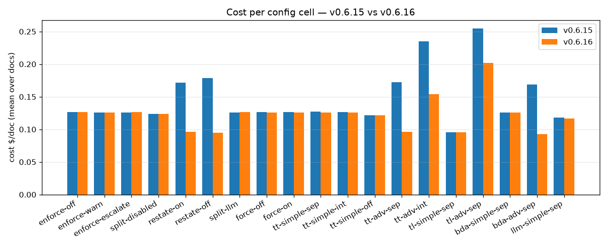
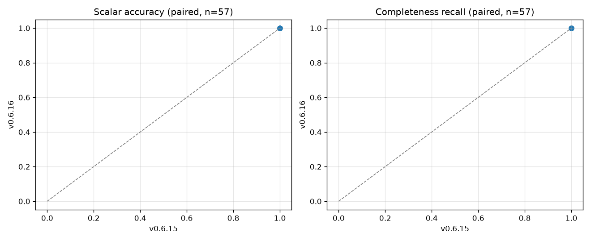

Copyright Amazon.com, Inc. or its affiliates. All Rights Reserved.
SPDX-License-Identifier: MIT-0

# v0.6.16 vs v0.6.15 (published) — release benchmark audit

> **Tier F ran in full for v0.6.16.** The release A/B below is one of **31 scored result
> sets**: 3,368 scored rows — 2,608 synthetic runs and 760 reference-corpus documents — for
> $1,571.67, all measured on one stack at one build on 2026-11-25 and 2026-11-26. The release
> A/B's v0.6.16 side is 171 of those rows; the guidance refresh is the other 3,197, for $1,550.72. Nine rows did
> not complete, every one a simple-mode request on the 3,200-row document, which is the expected
> outcome at that size (see *Failure census*). [The configuration
> guidance](../config-guidance.md) cites this refresh; which of its sections were rewritten from
> it is stated in that page's *Scope of this edition*.

**Verdict: no regression, and advanced mode is much cheaper.** The release A/B over 342 runs
reports **0 regressions and 0 improvements**, at grid level and at cell level. Mean completeness
recall and mean cell accuracy are **1.0000 on both sides, over 23,370 `cells_compared` on both
sides**, so the accuracy comparison is on an identical denominator. Neither side had a failed run:
**171 of 171 completed on each**. Grid cost moved **−16.2%** ($24.99 → $20.95) and grid wall
**−12.9%**.

**The whole cost movement is in advanced (agentic) extraction.** Every advanced-mode cell cost
21–47% less, and every simple-mode cell moved by 1% or less:

- On the two 100-row documents the advanced cells cost **45–52% less per run, with per-run ranges
  that do not overlap**. `core-tt-adv-sep` on `longdesc_100` cost $0.248–$0.288 a run on v0.6.15
  and $0.113–$0.153 on v0.6.16; on `small_narrow`, $0.174–$0.206 and $0.089–$0.121.
- The single-page `tiny_form` cost the same on both sides in every cell.
- The configurations are byte-identical on both sides, so the change is the code's. The CHANGELOG
  fix "Agentic table extraction no longer counts a table's header rows as data on some runs" also
  makes the table tool parse the section's own OCR text, so the agent no longer spends output
  tokens writing the table out for the tool. That is the likely cause. The per-call token split
  was not examined, so the attribution is inferred.

`aggregate.py --compare` labels six of these cells **inconclusive** rather than improved. It
judges a cell's cost change against the spread of that cell's nine runs, and the nine runs span
three documents whose row counts differ by 20×, so the cell's spread is mostly document size. A
paired per-document comparison, which the table above is, shows the change is consistent. The
seventh inconclusive row is the `bedrock_llm` OCR arm's scalar accuracy on `longdesc_100` (1.000 →
0.889, paired spread ±0.333), inside its own variation; its recall stayed 1.000.

## Provenance

| | v0.6.15 (PREV) | v0.6.16 (NEW) |
|---|---|---|
| template | published `idp-main_0.6.15.yaml` | published `idp-main_0.6.16.yaml` |
| stack | `IDPUpg0615to0616`, created from the published 0.6.15 template | the **same** stack after `update-stack` to 0.6.16 (the customer upgrade path) |
| suite | `corefast` (19 cells × 3 docs × 3 repeats) | same, identical config files (`--native-upload`) |
| runs / failures | **171 / 0** | **171 / 0** |
| runs launched (UTC) | 2026-11-25 21:27 → 22:21 | 2026-11-25 22:55 → 23:47 |
| extraction model | `sonnet46` on all 171 runs | `sonnet46` on all 171 runs |
| region / partition | `us-west-2`, commercial | same |
| scored at commit | `689e2b4df` (tag `v0.6.16`) | same |
| pricing | `config_library/pricing.yaml` at the tag, sha256 `7a617cea2aa5…` | same file, same hash |

The control model is `sonnet46` deliberately: it is the cross-version control, callable by every
release being compared. The **shipped default** is Sonnet 5, so no figure here is a statement
about the model a new deployment runs by default.

**Both sides were run with `--validate-against-release v0.6.15`**, so both received the same
generated configuration bytes.

⚠️ **Configs are built from the current repository's defaults, so a fix that ships as default
configuration is present on both sides and cancels out.** That is the right property for isolating
code, and it means this A/B says nothing about default-configuration changes in this release —
including that a **new** stack now has Review Routing on (`hitl.enabled`), which an upgraded stack,
like this one, does not.

`baseline.json` is **promoted** by this release: it now holds the v0.6.16 `corefast` grid
(`benchmarks/results/v0.6.16/corefast/summary.json`, stack `IDPUpg0615to0616`, scored
2026-11-26T00:02:18Z), replacing the v0.6.14 grid. v0.6.15 has no benchmark entry, so the
like-for-like reference here is the same-stack PREV grid committed under
`benchmarks/results/v0.6.15-rvprev/corefast/`.

## Grid totals

| | v0.6.15 | v0.6.16 | delta |
|---|---|---|---|
| runs | 171 | 171 | — |
| successful runs | **171** | **171** | 0 failures either side |
| grid cost | $24.99 | $20.95 | **−16.2%** |
| grid wall (sum of runs) | 8,414.8 s | 7,326.0 s | **−12.9%** |
| mean completeness recall | 1.0000 | 1.0000 | — |
| mean cell accuracy | 1.0000 | 1.0000 | — |
| `cells_compared` | 23,370 | 23,370 | — |
| processing issues | 16 | 14 | see below |

`cells_compared` is quoted beside the accuracy figures because a null column scores 1.000, so an
accuracy figure means nothing without the denominator it was computed over. Here the denominators
are identical, so the two 1.0000 figures are the same achievement. The wall figure is not a
performance claim: wall time on a shared account is load-sensitive, and the two sides ran an hour
apart.

## Per-cell comparison

Mean completeness recall and mean cell accuracy over 9 runs per cell (3 docs × 3 repeats); cost is
the cell's total across those 9 runs.

| cell | recall 0.6.15 | recall 0.6.16 | cell acc 0.6.15 | cell acc 0.6.16 | cost 0.6.15 | cost 0.6.16 | delta |
|---|---:|---:|---:|---:|---:|---:|---:|
| **core-bda-adv-sep** | 1.000 | 1.000 | 1.000 | 1.000 | $1.519 | $0.834 | **−45%** |
| core-bda-simple-sep | 1.000 | 1.000 | 1.000 | 1.000 | $1.133 | $1.134 | +0% |
| core-llm-simple-sep | 1.000 | 1.000 | 1.000 | 1.000 | $1.061 | $1.047 | −1% |
| **core-tl-adv-sep** | 1.000 | 1.000 | 1.000 | 1.000 | $2.294 | $1.814 | **−21%** |
| core-tl-simple-sep | 1.000 | 1.000 | 1.000 | 1.000 | $0.860 | $0.859 | −0% |
| **core-tt-adv-int** | 1.000 | 1.000 | 1.000 | 1.000 | $2.115 | $1.383 | **−35%** |
| **core-tt-adv-sep** | 1.000 | 1.000 | 1.000 | 1.000 | $1.551 | $0.865 | **−44%** |
| core-tt-simple-int | 1.000 | 1.000 | 1.000 | 1.000 | $1.136 | $1.133 | −0% |
| core-tt-simple-off | 1.000 | 1.000 | 1.000 | 1.000 | $1.095 | $1.095 | +0% |
| core-tt-simple-sep | 1.000 | 1.000 | 1.000 | 1.000 | $1.144 | $1.133 | −1% |
| enforce-escalate | 1.000 | 1.000 | 1.000 | 1.000 | $1.134 | $1.139 | +0% |
| enforce-off | 1.000 | 1.000 | 1.000 | 1.000 | $1.136 | $1.139 | +0% |
| enforce-warn | 1.000 | 1.000 | 1.000 | 1.000 | $1.134 | $1.134 | +0% |
| force-off | 1.000 | 1.000 | 1.000 | 1.000 | $1.137 | $1.134 | −0% |
| force-on | 1.000 | 1.000 | 1.000 | 1.000 | $1.138 | $1.135 | −0% |
| **restate-off** | 1.000 | 1.000 | 1.000 | 1.000 | $1.610 | $0.851 | **−47%** |
| **restate-on** | 1.000 | 1.000 | 1.000 | 1.000 | $1.546 | $0.867 | **−44%** |
| split-disabled | 1.000 | 1.000 | 1.000 | 1.000 | $1.113 | $1.114 | +0% |
| split-llm | 1.000 | 1.000 | 1.000 | 1.000 | $1.133 | $1.138 | +0% |

The six bold cells are the six advanced-mode cells. The Textract LAYOUT arm (`core-tl-adv-sep`)
moved least, −21%; why it moved less than the others was not examined.

## Processing issues

The count fell from 16 to 14, and none of the movement is a regression.

| issue code | v0.6.15 | v0.6.16 | where |
|---|---:|---:|---|
| `extraction_row_count_unverified` | 13 | 12 | the Textract LAYOUT cells (`core-tl-*`) on the two 100-row documents, every repeat, on both sides; LAYOUT emits no tables, so a long list has nothing to check its count against. One more on v0.6.15 on `core-llm-simple-sep` |
| `assessment_truncated` | 1 | 2 | single draws of a 100-row confidence pass, each split and retried; the runs are at recall and cell accuracy 1.000 |
| `extraction_sparse`, `extraction_validation_failed` | 1 each | 0 | one `core-llm-simple-sep` run on v0.6.15 |

## Figures





## Other tier F results

The A/B above answers "did this release regress?". The other 30 result sets re-measure what a
customer should configure. Each was compared with its v0.6.14 counterpart (the previous published
refresh; v0.6.15 had none), so each comparison spans two releases.

| result set | v0.6.14 → v0.6.16 recall | cell accuracy | cost | note |
|---|---|---|---|---|
| `core` synthetic grid | 1.0000 → 1.0000 | 0.9995 → 0.9998 | per document −12% | |
| `core` RealKIE (20 docs × 19 cells) | weighted accuracy 0.7871 → 0.7776 | | +1.5% | one document, below |
| `core` OmniAI OCR (20 docs × 19 cells) | weighted accuracy 0.9948 → 0.9945 | | −0.7% | |
| extraction sweep, Claude Opus 5.5 | 1.0000 → 0.9973 | 1.0000 → 1.0000 | $105.95 → $87.51 (−17%) | one `bedrock_llm` OCR run returned 64 of 100 rows |
| extraction sweep, Claude Opus 5 | 1.0000 → 1.0000 | 1.0000 → 1.0000 | $127.08 → $107.68 (−15%) | |
| extraction sweep, GPT-6 Astra | 0.9924 → 0.9999 | 0.9810 → 0.9737 | $191.85 → $141.45 (−26%) | lower bounds (long-context band) |
| extraction sweep, Claude Sonnet 5 *(default)* | 0.9463 → 0.9531 | 0.9998 → 0.9997 | $65.00 → $53.39 (−18%) | v0.6.14 figure re-priced to Sonnet 5's published rates |
| extraction sweep, Sonnet 5 `:1m` | 0.9524 → 0.9520 | 0.9995 → 0.9998 | $67.62 → $54.77 (−19%) | same re-pricing |
| extraction sweep, Claude Sonnet 5.5 | 0.8905 → 0.8980 | 1.0000 → 1.0000 | $62.21 → $55.51 (−11%) | still truncates 400-row lists in simple mode (#1494) |
| extraction sweep, Claude Haiku 5.5 | 0.9502 → 0.9665 | 0.9998 → 0.9997 | $25.76 → $27.05 (+5%) | lower bounds (tiered rate) |
| `simplegrid`, Nova Pro / Nova Lite | 0.50 → 0.50 / 0.50 → 0.51 | 0.92 → 0.95 / 0.73 → 0.75 | flat | simple mode only (#895) |
| `astravalue` (premium head-to-head) | 0.8905 → 0.8728 | 0.9998 → 0.9999 | $135.92 → $94.83 (−30%) | advanced-mode arms about half the cost |
| `cost` (5 × one 400-row document) | 1.0000 → 1.0000 | 1.0000 → 1.0000 | $30.33 → $22.34 (−26%) | |
| `scaling` (simple vs advanced, 25 → 3,200 rows) | unchanged | | | now 3 repeats; simple mode returns every row through 1,600 and fails at 3,200 |
| `intconf`, `advverify` hazards | 1.0000, 6 of 6 each | | | both standing list-loss hazards clean |
| feature A/B suites (`enforcement`, `enforcecost`, `forcing`, `boundary`, `boundaryab`) | unchanged | | flat | |

- **One RealKIE document moved entirely to its lower mode.** The RealKIE mean fell by 0.0095, and
  the drop is one document (`3aac2d4d…`). On v0.6.14 it scored 0.957 on 8 of 19 cells and about
  0.53 on most of the rest; on v0.6.16 it scored 0.532 on 11 of 19 and never 0.957. Every cell is
  one draw, so this cannot be separated from that document's own bimodality, and which fields
  moved was not examined. OmniAI OCR accuracy is flat.
- **On real documents simple mode is still as accurate as advanced and half the price.** On
  RealKIE, `core-tt-simple-sep` scored 0.787 at $0.1445 per document and `core-tt-adv-sep` 0.771
  at $0.3233; four cells running the same simple configuration span 0.778–0.787.
- **Simple-mode confidence coverage at 1,200 rows is about 90%** (0.88–0.92 over three runs), and
  at 1,600 rows it ranges 0.23–0.78, so the confidence pass still leaves part of a very large
  simple-mode list unscored on some runs. Every row was extracted on every run up to 1,600 rows.
- **The calibration comparisons `--compare` flags on the premium suites are degenerate**: the
  `astravalue` grid has 4 extraction errors in 67,508 scored cells on v0.6.16 (9 in 70,778 on
  v0.6.14), so an AUROC move such as Sonnet 5's 0.941 → 0.744 rests on a handful of observations
  and is not a calibration change.

**Failure census over the whole refresh.** 9 of the 3,368 scored rows did not complete (0.27%),
against 5 of 3,338 at v0.6.14. All nine are simple-mode requests on the 66-page `scale_3200.pdf`
refused as too long for one response, which is the expected outcome at that size: three each on the
scaling study's control cell and `astracap`'s Sonnet 5 and GPT-6 Astra simple cells. The count rose
because this refresh ran those two suites at three repeats where v0.6.14 ran one and two; the
refusal rate on those cells is 100% on both releases. No row failed for any other reason.

## Reproduce

```bash
python benchmarks/harness/gen_corpus.py
python benchmarks/harness/make_configs.py --suite corefast
# PREV side FIRST, on the 0.6.15 stack, before update-stack
python benchmarks/harness/run_matrix.py --stack <stack> --suite corefast \
    --repeats 3 --native-upload --validate-against-release v0.6.15 --max-inflight 4
python benchmarks/harness/aggregate.py --run <run dir> --out benchmarks/results/v0.6.15-rvprev/corefast
# ... update-stack to 0.6.16, then repeat on the same stack with the same flags ...
python benchmarks/harness/aggregate.py --run <run dir> --out benchmarks/results/v0.6.16/corefast
# NOTE the argument direction: --compare is the CURRENT side, --baseline the reference.
python benchmarks/harness/aggregate.py \
    --compare benchmarks/results/v0.6.16/corefast/summary.json \
    --baseline benchmarks/results/v0.6.15-rvprev/corefast/summary.json
python benchmarks/harness/aggregate.py --figures-compare \
    benchmarks/results/v0.6.16/corefast/summary.json \
    benchmarks/results/v0.6.15-rvprev/corefast/summary.json --labels v0.6.16 v0.6.15
```
