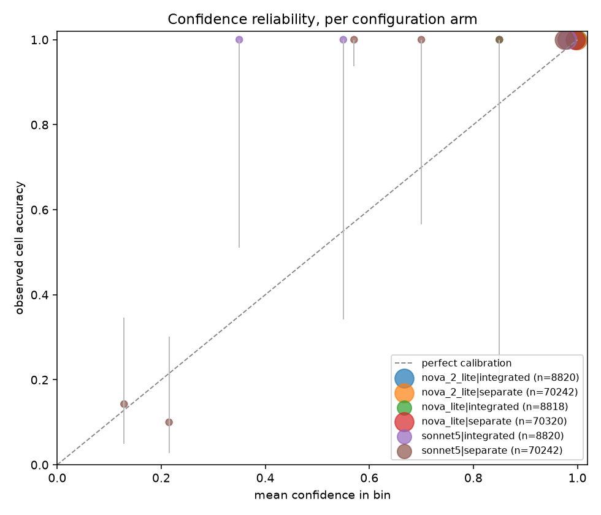

Copyright Amazon.com, Inc. or its affiliates. All Rights Reserved.
SPDX-License-Identifier: MIT-0

# Confidence Calibration — Can the Score Route Human Review?

> **What to do**
>
> - **Threshold alerts work on the default grader.** `separate` mode on Nova Lite is well calibrated, and on a population that is 99.9% correct an alert on "confidence below X" behaves as advertised.
> - **Worst-first review queues do not.** The default grader cannot rank errors. For that workload, set `confidence.model: us.anthropic.claude-sonnet-5`, or treat the queue as unordered and size review by the audit sample.
> - **Sonnet 5 costs more.** As the grader it costs at least ~88× and up to ~130× as much per document as Nova Lite ([cost](#choosing-a-grader)).
> - **The corpus is synthetic.** These are seven generated bank statements. Re-measure on your own documents before relying on either result.
> - No default changed.

The review-effort estimator turns per-field confidence scores into "review the worst *N*
documents and you reach 99% accuracy". That needs two properties. *Calibration* asks
whether 0.9 means 90%. *Discrimination* asks whether the wrong cells are the
low-scoring ones, and worst-first review depends only on discrimination. Measured
against exact per-cell ground truth, the shipped default is well calibrated but
undiscriminating: it puts essentially every cell in one confidence bin, so it is right
about the population and says nothing about which cells to check. Graded by Sonnet 5,
the same extraction spreads over 6 bins and reaches an unbinned AUROC of 0.859, against
0.417 for the default. The calibration gate cannot see the difference: every arm passes
it, including one with 1,413 wrong cells all in the top bin.

## Method

The scorer walks `explainability_info` with
`idp_common.evaluation.flatten_confidences` (the field-path rule the product keys its
stored confidence curves by) and joins each path to per-cell truth through the unique
`SEQnnnnn` row tag
([#935](https://github.com/aws-solutions-library-samples/accelerated-intelligent-document-processing-on-aws/issues/935)).
Existing runs were re-scored from S3, with no inference. Primary set: stack
`IDPUpg067to068`, `us-west-2`, code version `v0.6.8`, runs from 2026-09-12 → 09-15,
re-scored 2026-09-21. Replication: stack `IDP1`, code version `v0.6.9`, runs from
2026-09-19. The corpus is seven synthetic bank statements (`tiny_form`, `small_narrow`,
`med_narrow`, `large_narrow`, `longdesc_100`, `wide_400`, `manylists_400`) with exact
typed truth for the `Date` and `Amount` cell of every tagged row. Extraction, OCR and
geometry are fixed across grader arms; each table names the axis that moves.

Calibration error, binned AUROC and the verdict come from the shipped
`idp_common.evaluation.confidence_curve.ConfidenceCurve`, with
`ECE_UNRELIABLE_THRESHOLD = 0.15`, `AUROC_UNRELIABLE_THRESHOLD = 0.55`,
`MIN_OBSERVATIONS_FOR_MEASURED = 30`, `MIN_OBSERVATIONS_FOR_AUROC = 100` and
`MIN_BINS_FOR_SIGNAL = 3`. The unbinned AUROC and Brier score are computed in the
harness and tested against Stickler
([details](#how-the-local-auroc-and-brier-are-verified)). Every ECE in the tables is
the mean-confidence estimator ([§2](#2-why-a-low-calibration-error-ece-is-not-enough)).

---

## 1. Same extraction, two confidence graders

These two arms differ only in the confidence model: same extraction model (Sonnet 4.6),
classifier, OCR, seven documents and 70,242 scored cells.

| Confidence grader | Cells | Wrong cells | ECE (mean-conf) | Brier | AUROC (binned) | AUROC (unbinned) | Populated bins | Shipped verdict |
|---|---:|---:|---:|---:|---:|---:|---:|---|
| `nova_2_lite` | 70,242 | 64 | 0.0005 | 0.0009 | 0.500 | 0.465 | 1 | degenerate, undiscriminating |
| `sonnet5` | 70,242 | 66 | 0.0244 | 0.0014 | 0.772 | 0.859 | 6 | reliable |

Extraction quality is the same on both sides (accuracy 0.9991, 95% Wilson interval
[0.9988, 0.9993]), so the difference in the right-hand columns is the grader. The
shipped default, Nova Lite, behaves like `nova_2_lite`:

| Confidence grader | Mode | Cells | Wrong cells | ECE (mean-conf) | AUROC (unbinned) | Bins | Verdict |
|---|---|---:|---:|---:|---:|---:|---|
| `nova_lite` (shipped default) | `separate` | 70,320 | 55 | 0.0037 | 0.417 | 1 | degenerate, undiscriminating |
| `nova_2_lite` | `separate` | 70,242 | 64 | 0.0005 | 0.465 | 1 | degenerate, undiscriminating |
| `sonnet5` | `separate` | 70,242 | 66 | 0.0244 | 0.859 | 6 | reliable |
| `nova_lite` (shipped default) | `integrated` | 8,818 | 0 | 0.0031 | — | 2 | degenerate |
| `nova_2_lite` | `integrated` | 8,820 | 0 | 0.0007 | — | 1 | degenerate |
| `sonnet5` | `integrated` | 8,820 | 0 | 0.0197 | — | 3 | reliable |

One confound: the only v0.6.8 cell with `confidence_model: nova_lite` and Sonnet 4.6
extraction came from the suite that sets the classification model to Sonnet 5. On a
single-class corpus the classifier does not touch extracted values, and accuracy agrees
(0.9992 [0.9990, 0.9994] against 0.9991 [0.9988, 0.9993]). The unconfounded
`nova_2_lite`-versus-`sonnet5` pair is the headline.



Read the diagram by marker position, not count. Each Nova arm is one large marker at
(≈1.0, ≈1.0): all its mass is in the top bin, at mean confidence 0.995 and observed
accuracy 0.999. Sonnet 5 adds two small markers near the bottom-left of the diagonal, at
mean confidence 0.129 and 0.215 with observed accuracy 0.143 and 0.100. Those bins hold
41 cells, 36 of them wrong: over half the arm's 66 errors, where a worst-first queue
reaches them first.

---

## 2. Why a low calibration error (ECE) is not enough

Every arm passes calibration; the largest ECE above is 0.0244 against a gate at 0.15.
Two arms pass with a gross defect present:

| Arm | Cells | Wrong cells | Accuracy [95% Wilson] | Mean confidence | ECE (mean-conf) | AUROC (unbinned) |
|---|---:|---:|---|---:|---:|---:|
| `separate` / `nova_lite` / extraction `astra` | 54,484 | 1,413 | 0.9741 [0.9727, 0.9754] | 0.9952 | 0.0211 | 0.520 |
| `separate` / `nova_lite` / extraction `nova_lite` | 11,462 | 2,875 | 0.7492 [0.7412, 0.7570] | 0.9933 | 0.2441 | 0.541 |

In the first row, 1,413 cells are wrong, every cell is in the top bin, and the ECE of
0.0211 is inside the bar. A release validated on ECE alone would ship it. Its AUROC,
0.520, is chance. In the second row, with 25% of cells wrong and mean confidence still above 0.99, ECE reaches 0.2441 and the
shipped `overconfident` flag fires. So the ECE gate catches gross overconfidence, but not
a 2.6%-wrong extraction described at 99.5% confidence, which is the regime real
deployments operate in.

Note: the second row is a thin arm (58 of 112 runs, 6 documents); treat it as
directional ([Limits](#2-error-scarcity-and-unequal-power)).

**Two ECE estimators.** The shipped `CalibrationHealth.ece` compares each bin's accuracy
to the bin midpoint, because the curve stores counts rather than confidences. That sets
a floor: cells all scored 1.00 and all correct report 0.05, the distance to the top
bin's midpoint of 0.95. That does not trip the 0.15 gate, but it is not a calibration
error and should not be quoted as one. This page uses the mean-confidence estimator,
which Stickler's `ECEMetric` computes and the diagram plots. The harness records both,
as `calibration_ece` (the gate's) and `calibration_ece_mean_conf`.

---

## 3. How many confidence bins each grader uses

Bin coverage is the most reliable column because it is a count, not an estimate. A score
occupying fewer than `MIN_BINS_FOR_SIGNAL` (3) of the ten 0.1-wide bins cannot order a
queue, because almost every cell ties. Both Nova graders put all 70,000-odd cells in one
bin, which fires the `degenerate` flag before any AUROC question arises.

AUROC is estimated over wrong × correct pairs, so its sample size is the wrong-cell
count (55, 64 and 66 in the headline arms), not the cell count. No interval is reported
for it: the Wilson intervals here, from `idp_common.evaluation.wilson_interval`, apply to
binomial proportions, and AUROC's pairs are not independent, so a Wilson interval would
understate its uncertainty. The Nova point estimates (0.417, 0.465, 0.520, 0.541) are
indistinguishable from chance on 55–1,413 errors; "slightly worse than chance" is not
supported, and the verdict rests on the single-bin structure. Sonnet 5's 0.859 on 66
errors is clearly above 0.55, but its second decimal place is uncertain.

---

## 4. What `integrated` mode could be measured on

Six of the seven `integrated` arms returned zero wrong cells (8,814 to 8,820 cells each).
Discrimination is undefined without errors, so those rows show `—`. That is a missing
measurement, not a good result. With 0 errors in 8,820 cells the 95% Wilson interval on
accuracy is [0.999565, 1.0], so the error rate could be as high as 1 in 2,297. At that
rate the 7-document, 14-run grid would yield 3.84 errors, against
`MIN_OBSERVATIONS_FOR_AUROC` of 100; reaching 100 would take roughly 230,000 cells, about
26 times this grid.

The seventh arm also used Nova Lite for extraction: 998 cells over 5 documents and 6 of
14 runs, 318 wrong, mean-confidence ECE 0.310, with `overconfident` and
`undiscriminating` set. It measures a broken extraction more than the mode. Its unbinned
AUROC is 0.5594 (Brier 0.3112, binned AUROC 0.500). The Hanley–McNeil standard error on
318 wrong against 680 correct is 0.0197, an approximate 95% interval of
[0.521, 0.598]: three standard errors above chance but half a standard error above the
0.55 bar, and wider once non-independence is counted ([Limits](#limits)). All 998 cells
are in one bin, so the ordering is arbitrary.

No `integrated` arm shows that the mode ranks errors. Bin coverage splits as in
`separate`: 1 to 2 bins on the Nova graders, 3 on Sonnet 5. The `coresynth` grid runs
112 runs per `separate` arm and 14 per `integrated` arm, so no `separate`-versus-
`integrated` comparison here is controlled.

---

## 5. Replication

The v0.6.9 grid (stack `IDP1`) was re-scored the same way. It did not include the
`sonnet5` grader, so the positive result rests on one release. The negative result
reproduces closely:

| Arm | v0.6.8 cells / errors / AUROCu / bins | v0.6.9 cells / errors / AUROCu / bins |
|---|---|---|
| `separate` / `nova_lite` / `sonnet46` | 70,320 / 55 / 0.417 / 1 | 70,320 / 57 / 0.419 / 1 |
| `separate` / `nova_lite` / `sonnet5` | 65,864 / 43 / 0.382 / 1 | 64,342 / 58 / 0.428 / 1 |
| `separate` / `nova_2_lite` / `sonnet46` | 70,242 / 64 / 0.465 / 1 | 70,260 / 68 / 0.465 / 1 |
| `separate` / `nova_lite` / `astra` | 54,484 / 1,413 / 0.520 / 1 | 70,542 / 1,806 / 0.557 / 1 |
| `separate` / `sonnet5` / `sonnet46` | 70,242 / 66 / 0.859 / 6 | not run |

---

## Choosing a grader

On this corpus only `confidence.model: us.anthropic.claude-sonnet-5` supports worst-first
review. The default, `separate` mode on `us.amazon.nova-lite-v1:0`, is degenerate and
undiscriminating in two releases on two stacks, so a queue ordered by its scores is
ordered arbitrarily. The review-effort estimator already returns `recommendReviewAll`
for it, because `calibration_health()` sets both flags.

Two arms read just above `AUROC_UNRELIABLE_THRESHOLD` (0.55) and appear in the Reproduce
output. Neither is usable, because each puts all its cells in one bin:

| Arm | Unbinned AUROC | Bins | Errors |
|---|---:|---:|---:|
| `separate` / `nova_lite` / `astra`, v0.6.9 | 0.557 | 1 | 1,806 |
| `integrated` / `nova_lite` / `nova_lite`, v0.6.8 | 0.559 | 1 | 318 |

The `astra` arm reads 0.520 in v0.6.8 and 0.557 in v0.6.9, crossing the threshold by
0.007 on an imprecise estimate. The `integrated` arm is half a standard error above the
bar (§4).

**Cost.** The default is a cost decision and this study does not change it.
`base-confidence.yaml` records a live A/B at release 0.6.0 of ~$0.0011 per document on
Nova Lite against ~$0.145 on Sonnet 5, about 130×, priced from
`config_library/pricing.yaml` as it stood then. Both rates have since been corrected:
Sonnet 5 was 1.5× today's rate on every unit
([#1830](https://github.com/aws-solutions-library-samples/accelerated-intelligent-document-processing-on-aws/issues/1830)),
and Nova Lite charged cache writes at the full input rate where they are now free
([#1405](https://github.com/aws-solutions-library-samples/accelerated-intelligent-document-processing-on-aws/issues/1405)).
The token counts were not kept, so neither figure has been re-priced. Scaling Sonnet 5
by 1/1.5 gives about $0.097 per document. The Nova Lite figure is overstated by an
unknown amount, so the ratio is at least about 88×. Both are estimates, not
measurements.

The gap is large either way. What this study adds is the calibration half of the
trade-off, which the configuration comment justifying Nova Lite had assumed rather than
measured.

---

## Limits

### 1. The cells are not independent

`reconcile_assessment_to_data`'s `_expand_row_to_per_column` copies one per-row
confidence to every populated scalar column of the row, so a row's cells often carry the
same value by construction. In `separate`/`nova_lite` on `wide_400`, 396 to 400 of the
400 rows have every column at the same confidence. Counted from each row's
`calibration_curve.valueTally` over the joinable cells (`Date` and `Amount` of each
tagged row, 800 per 400-row document; the SEQ-tagged `Description` is not scored):

| Grader | Mode | Runs | Distinct confidence values per document-run | Median |
|---|---|---:|---|---:|
| `nova_lite` | `separate` | 832 | 1 – 5 | 2 |
| `nova_lite` | `integrated` | 100 | 1 – 5 | 2 |
| `nova_2_lite` | `separate` | 224 | 1 – 7 | 2 |
| `nova_2_lite` | `integrated` | 24 | 1 – 7 | 3 |
| `sonnet5` | `separate` | 112 | 1 – 8 | 4 |
| `sonnet5` | `integrated` | 14 | 1 – 7 | 3 |

The 70,320-cell arm is 112 runs of a two-to-five-valued score. Every interval here
treats cells as independent and so understates uncertainty. This is why the conclusion
rests on bin coverage: a grader with two distinct output values cannot order a queue at
any sample size.

### 2. Error scarcity and unequal power

The sample that limits discrimination is the wrong-cell count. Per arm, for v0.6.8:

| Arm | Runs | Documents | Cells | Wrong cells | Excluded runs |
|---|---:|---:|---:|---:|---:|
| `separate` / `nova_lite` / `sonnet46` | 112 | 7 | 70,320 | 55 | 0 |
| `separate` / `nova_2_lite` / `sonnet46` | 112 | 7 | 70,242 | 64 | 0 |
| `separate` / `sonnet5` / `sonnet46` | 112 | 7 | 70,242 | 66 | 0 |
| `separate` / `nova_lite` / `sonnet5` | 112 | 7 | 65,864 | 43 | 0 |
| `separate` / `nova_lite` / `opus5` | 112 | 7 | 69,804 | 0 | 0 |
| `separate` / `nova_lite` / `astra` | 102 | 7 | 54,484 | 1,413 | 10 |
| `separate` / `nova_lite` / `nova_lite` | 58 | 6 | 11,462 | 2,875 | 54 |
| `integrated`, six strong-extraction arms | 14 | 7 | 8,814–8,820 | 0 | 0 |
| `integrated` / `nova_lite` / `nova_lite` | 6 | 5 | 998 | 318 | 8 |

Exclusions by reason:

| Arm | Did not complete | No confidence at all | Confidence, no joinable cell |
|---|---:|---:|---:|
| `separate` / `nova_lite` / `nova_lite` | 26 | 6 | 22 |
| `separate` / `nova_lite` / `astra` | 0 | 0 | 10 |
| `integrated` / `nova_lite` / `nova_lite` | 6 | 0 | 2 |

Runs in the last column completed and produced confidence, but extraction returned no
SEQ-tagged row to join to. The surviving runs in these three arms are conditioned on
extraction success, and are plausibly the easier ones, so treat these arms as
directional. The `astra` and `nova_lite`-extraction arms are the only ones with a large
error sample (1,413 and 2,875), and both agree with the thin ones.

### 3. Synthetic documents

These are generated PDFs with clean text and regular tables. A real corpus with OCR
noise would produce a different error population, probably a larger one, and possibly
one the graders separate better.

---

## Reproduce

Every figure on this page reproduces with no AWS access. The `calibration_curve` payload
in each committed `summary.json` (ten bin counts plus `brierSse`, `confSum` and
`valueTally`) is an exact sufficient statistic for pooled ECE, mean-confidence ECE,
Brier, bin coverage and both AUROCs. `--calibration` reads it from the artifact and
falls back to S3 only for a row that has none. Run with no credentials, the commands
below reproduce all fourteen arms, every reliability bin and the committed figure
byte-for-byte.

**Prerequisites.** Run `pip install -e "lib/idp_common_pkg[core]"` from the repository
root, then set `PYTHONPATH=lib/idp_common_pkg` as below (`PYTHONPATH` alone does not
install the dependencies). The `[evaluation]` extra is not needed:
`idp_common.evaluation.confidence_curve` and `curve_store` are standard-library-only,
and the unbinned AUROC and Brier come from the stored statistic. `matplotlib` is needed
only for the diagram, which is skipped with a message if it is absent. `AWS_PROFILE` is
not needed: no boto3 client is constructed unless a row lacks its stored statistic.

```bash
# Only needed for a --calibration-from-s3 run, which joins against the truth files.
# Note: this writes PDFs into benchmarks/corpus/docs/ and rewrites the tracked
# benchmarks/corpus/manifest.yaml with absolute paths. Revert the manifest before
# committing.
python3 benchmarks/harness/gen_corpus.py

# The headline single-axis grader contrast + the reliability diagram.
PYTHONPATH=lib/idp_common_pkg python3 benchmarks/harness/aggregate.py \
  --calibration \
    benchmarks/results/v0.6.8/coresynth__classification-model-sonnet5/summary.json \
    benchmarks/results/v0.6.8/coresynth__confidence-model-nova-2-lite/summary.json \
    benchmarks/results/v0.6.8/coresynth__confidence-model-sonnet5/summary.json \
  --calibration-group confidence_model,assessment

# The full v0.6.8 matrix behind §2 and §5: 14 arms, 466,322 cells. Seven suites, not
# a glob over coresynth__* — the haiku-classifier and sonnet5-1m arms are excluded
# because they add arms this page does not report.
PYTHONPATH=lib/idp_common_pkg python3 benchmarks/harness/aggregate.py \
  --calibration \
    benchmarks/results/v0.6.8/coresynth__classification-model-sonnet5/summary.json \
    benchmarks/results/v0.6.8/coresynth__confidence-model-nova-2-lite/summary.json \
    benchmarks/results/v0.6.8/coresynth__confidence-model-sonnet5/summary.json \
    benchmarks/results/v0.6.8/coresynth__extraction-model-astra/summary.json \
    benchmarks/results/v0.6.8/coresynth__extraction-model-nova-lite/summary.json \
    benchmarks/results/v0.6.8/coresynth__extraction-model-opus5/summary.json \
    benchmarks/results/v0.6.8/coresynth__extraction-model-sonnet5/summary.json \
  --calibration-group assessment,confidence_model,extraction_model

# The v0.6.9 replication set in §5 (stack IDP1).
PYTHONPATH=lib/idp_common_pkg python3 benchmarks/harness/aggregate.py \
  --calibration \
    benchmarks/results/v0.6.9/coresynth__classification-model-sonnet5/summary.json \
    benchmarks/results/v0.6.9/coresynth__confidence-model-nova-2-lite/summary.json \
    benchmarks/results/v0.6.9/coresynth__extraction-model-astra/summary.json \
    benchmarks/results/v0.6.9/coresynth__extraction-model-sonnet5/summary.json \
  --calibration-group assessment,confidence_model,extraction_model
```

Reading the stored statistic takes seconds. `--calibration-from-s3` bypasses it and
re-reads every run from the bucket, which a freshly completed grid needs and which
verifies the stored statistic against its source; it takes several minutes and a few
thousand S3 GETs, with no inference and no DynamoDB access. Each arm reports its own
`runs`, `docs` and `excl` counts, and grid totals appear in the trailing `skipped:` line
([how to read it](#reading-the-skipped-line)).

### For harness maintainers

#### How the local AUROC and Brier are verified

The unbinned AUROC is `analyze.unbinned_auroc(tally)` over the stored value tally; the
Brier score is `sum((conf − correct)²) / n` from the stored `brierSse`.
`benchmarks/tests/test_confidence_calibration.py` asserts both equal Stickler's
`AUROCMetric` and `BrierScoreMetric`, the classes the evaluation service passes to
`compare_with`, at different tolerances:

- AUROC: `abs(mine − theirs) < 1e-12`, exact to numerical precision.
- Brier: `round(sse/n, 4) == round(theirs, 4)`, the 4 decimal places the harness stores
  and this page quotes. It detects a relative error of 1e-4 on the squared-error sum but
  not 1e-5.

Computing both locally keeps the `[evaluation]` extra off the default scoring path, so a
synthetic run does not fail part-way through a grid for a missing metric library. As a
result the three equality assertions are `importorskip`-guarded: without `stickler` they
skip and the suite still reports green. They are live in CI, which installs the `test`
extra.

#### Artifact lifetime and the backfill

An artifact is readable only while both its bucket and its KMS key exist, and neither is
under this repository's control. Three v0.6.x release stacks are gone. A fourth,
`IDPUpg068to069`, still has its bucket, but its KMS key is pending deletion, so every
`GetObject` returns `KMS.KMSInvalidStateException`. Its `corefast` grid has no
calibration statistic and cannot get one. The backfill reports the read error rather
than recording the grid as having had no confidence.

For that reason every grid still readable was backfilled: all nine `coresynth` grids on
`IDPUpg067to068` and all four on `IDP1`. Two of the nine,
`coresynth__classification-model-haiku45` and `coresynth__extraction-model-sonnet5-1m`,
add arms this page does not discuss and are left out of the commands above; their data
is available.

#### Generated files and a dirty working tree

- `gen_corpus.py` writes PDFs and rewrites the tracked `benchmarks/corpus/manifest.yaml`
  (see the comment in the commands above).
- The chart is written to `benchmarks/paper/figures/reliability-diagram.png`, which is
  scratch. This page cites a copy at
  `images/benchmark-v0.6.8-confidence-reliability.png`; copy a regenerated chart there
  to change the page.
- `benchmarks/.gitignore` un-ignores `paper/figures/*.png`, where three tracked PNGs
  live, so a new `reliability-diagram.png` shows as untracked. Delete it or leave it
  unstaged. Do not `rm -rf benchmarks/paper`, which removes the three tracked figures and
  the README.

#### Reading the `skipped:` line

Read the five buckets separately, not as a pooled count. On the full v0.6.8 matrix the
first four read `32 unsuccessful, 0 without exact per-cell truth, 55 with no confidence
at all, 34 with confidence but no joinable cell`.

- **No confidence at all**: no confidence leaf. One is expected per
  `confidence.mode: off` cell per document; 49 of the 55 are that. The other 6 are
  `separate`-mode runs on the Nova-Lite-extraction arm whose assessment returned an empty
  `explainability_info`, counted here because they produced no confidence. A surplus is
  expected in arms that also show `not_success` or `no_joinable_cell` exclusions. A
  surplus in a clean 112-run arm is worth investigating.
- **Confidence but no joinable cell**: the run produced confidence (6 to 148 leaves) but
  extraction returned no `SEQ`-tagged row. All 34 fall in the two weak-extraction arms.
  This measures extraction completeness. It is not a missing S3 prefix (no S3 read is
  attempted for a row with a stored statistic) or a failed assessment. Use the per-arm
  `excl` column to localize it.
- **`UNREAD`**: the row's section objects were listed but would not read, as with a KMS
  key pending deletion. This is not evidence of missing confidence. An arm with any
  `UNREAD` rows is pooled over the rows that did read, so treat its figures as
  provisional and re-run it against a readable stack before quoting them. The line prints
  the underlying error. It reads `0 UNREAD` on every grid in this study.

A summary whose stack no longer resolves to an output bucket prints a warning naming the
stack and how many rows lacked a stored statistic and so could not contribute.

#### The per-release gate

`analyze.score_synthetic` records per-document figures for every synthetic run, so new
grids need no backfill, and `aggregate.cell_stats` pools them per cell.
`aggregate.compare_cells` gates on:

- **Calibration error** worse by more than 0.01, on `ece_mean_conf`. The midpoint `ece`
  cannot see confidence moving within a bin: across the six grader arms above it spans
  0.0013 where `ece_mean_conf` spans 0.0239.
- **Ranking power** worse by more than 0.05, on the unbinned AUROC. Across the 216
  committed cells carrying a calibration block, the binned AUROC is undefined on 183 and
  exactly 0.5000 on 29 of the 33 where it is defined. Across these two releases it moved
  0.0000 on every configuration-matched arm while the unbinned value moved up to 0.0461.
- **Either crossing its shipped bar** (`ECE_UNRELIABLE_THRESHOLD` or
  `AUROC_UNRELIABLE_THRESHOLD`) at any step size, because past those the estimator stops
  recommending a review subset. These checks read the gate's own `ece` and binned
  `auroc`, the values the product applies the thresholds to. On a single-bin curve the
  AUROC crossing cannot fire (0.5 is below 0.55 on both sides), which is why the
  magnitude check reads the unbinned value.

**Headroom of the 0.01 threshold.** Across the eight configuration-matched arms of the
two releases (four `separate`, four `integrated`), the largest `ece_mean_conf` drift for
an unchanged configuration is 0.0019, on `integrated`/`nova_lite`/`sonnet5`
(0.0036 → 0.0017); among `separate` arms alone it is 0.0008. So 0.01 is 12.5× the
`separate`-only drift and 5.3× the full set. The gate fires per cell, though, and over
the 72 configuration-matched cell pairs the data supports, 0 of 72 would false-positive
at 0.01, median |Δ| is 0.00075, and the largest worsening is +0.0088, on a cell whose
pooled observations fell 4,410 → 410. Excluding the two sample-collapse cells it is
+0.0033. Real headroom is 1.14× where `n` collapses and about 3× where it does not.

Note: the gate has no stability-of-`n` guard. `MIN_OBSERVATIONS_FOR_MEASURED` is 30, so
n=410 clears the floor and is gated as if it were the 4,410-observation measurement it
replaced. The finding line prints `n 4410->410`, but the decision to fire ignores it.

`benchmarks/results/baseline.json` carries both metrics, so the gate is live. When
either side lacks a metric, `compare_cells` skips the comparison and prints a
`NOT COMPARED — one side lacks the metric` block naming the metric, the side and the
cells, so a skipped gate is distinguishable from a clean run. The current side is the
usual gap: 13 of the 96 committed summaries carry a calibration statistic and 83 do not.
The release procedure's named pair, `v0.6.9/corefast/summary.json` against
`baseline.json`, compares a grid with the statistic on 0 of its 171 rows against one
with it on 162. That grid is `IDPUpg068to069`, whose objects cannot be decrypted, so for
those cells the gate is permanently inert and says so.
