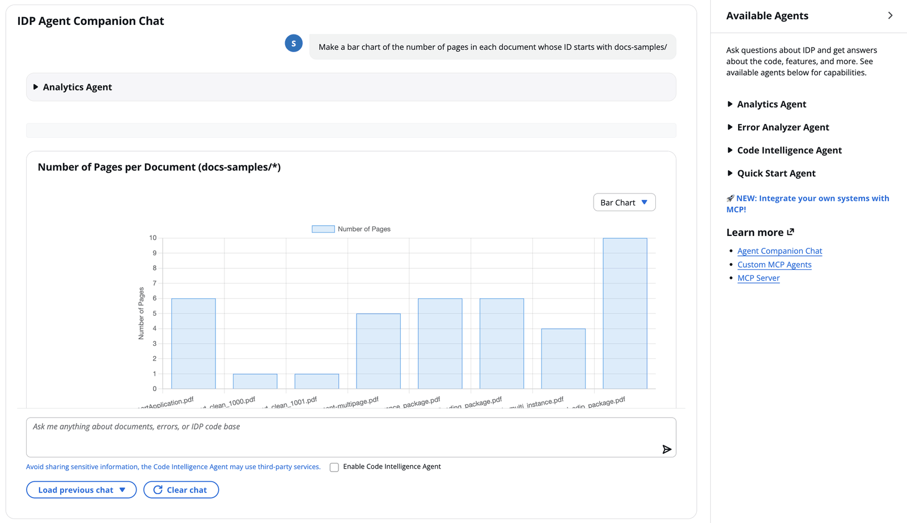

Copyright Amazon.com, Inc. or its affiliates. All Rights Reserved.
SPDX-License-Identifier: MIT-0

# Code Intelligence Agent

The GenAIIDP solution includes a Code Intelligence Agent that answers natural-language questions about **this accelerator's own source code** through the [Agent Companion Chat](./agent-companion-chat.md). It helps a developer or operator understand how the solution is built — its architecture, its modules, the way a document flows through it — without reading the repository themselves.

## Overview

The Code Intelligence Agent is one of several specialized sub-agents available within the Agent Companion Chat's multi-agent orchestration system. When enabled, the orchestrator can route code-related questions to this agent.

The agent answers by querying the [DeepWiki](https://docs.devin.ai/work-with-devin/deepwiki-mcp) MCP server about one fixed, public GitHub repository: `aws-solutions-library-samples/accelerated-intelligent-document-processing-on-aws`. Both the server URL and the repository name are hardcoded in
`lib/idp_common_pkg/idp_common/agents/code_intelligence/agent.py` and are not configurable.

What that means in practice:

- **The subject is the published accelerator, not your deployment.** The agent can explain how the extraction service is written; it cannot see your stack, your configuration, your documents, or any change you have made to your own copy of the code.
- **No code is uploaded.** The agent sends a *question* to DeepWiki and receives prose back. It does not read, package, or transmit any file from your account or from your checkout.
- **Queries leave your account.** DeepWiki is a third-party service. See the Security and Privacy section below.
- **Conversation memory, streaming, and the UI are shared** with every other companion chat agent, so follow-up questions work the same way.

## How It Fits Into Agent Companion Chat

The Code Intelligence Agent operates as an **optional sub-agent** within the Agent Companion Chat's orchestrator system:

```
User → Agent Companion Chat → Orchestrator Agent
                                  ├── Analytics Agent
                                  ├── Error Analyzer Agent
                                  ├── Code Intelligence Agent (Optional - toggle controlled)
                                  └── External MCP Agents (Optional)
```

- The **Orchestrator Agent** automatically routes code-related queries to the Code Intelligence Agent when it is enabled
- Users control whether the agent is active via the **"Enable Code Intelligence Agent"** checkbox in the chat interface
- When disabled, the orchestrator will not route any queries to this agent
- The agent shares the same conversation memory, streaming infrastructure, and UI as all other companion chat agents



For full details on the Agent Companion Chat architecture, session management, streaming, and multi-agent orchestration, see the [Agent Companion Chat documentation](./agent-companion-chat.md).

## ⚠️ Security and Privacy

**Enabling this agent sends the text of your questions to DeepWiki, a third-party MCP (Model Context Protocol) service that is not operated by AWS or by your organization.** Everything the agent returns comes from that service.

Where the data actually goes:

| | |
|---|---|
| **Leaves your account** | The question the agent sends to DeepWiki. The orchestrator reformulates the user's message, but the outbound text is still derived from what the user typed. |
| **Does not leave your account** | Your documents, extraction results, configuration, stack resources, logs, and your own copy of the source code. None of it is read or transmitted by this agent. |
| **What DeepWiki answers about** | The public GitHub repository `aws-solutions-library-samples/accelerated-intelligent-document-processing-on-aws`, indexed by DeepWiki from its public contents. Your deployment is not part of that index. |
| **Transport** | Unauthenticated Streamable HTTP to `https://mcp.deepwiki.com/mcp`. |

So the exposure is the **query text**, not your data — which is exactly why the guidance below is about what you type:

- **Keep Code Intelligence disabled by default** and enable it only while you need it.
- **Do not put sensitive values in a question** — credentials, account IDs, resource ARNs, document ids, customer names, log excerpts, file contents. A question like "why did document `ABC123` fail?" carries an identifier out of your account even though no document is sent.
- The agent's system prompt instructs it to refuse queries that look like they carry specific data or secrets, and to reformulate safe ones to be about code structure only. Treat that as a safety net, not a boundary: it is model-enforced, so it is best-effort.
- **Use a different agent for questions about your own system.** The Analytics Agent and the [Error Analyzer](./error-analyzer.md) answer from your deployment's data and make no third-party calls.
- Data sent to DeepWiki is subject to DeepWiki's own privacy policy and terms of service.

For the shared security guidance that applies to every companion chat agent, see the [Security and Privacy section](./agent-companion-chat.md#security-and-privacy) in the Agent Companion Chat documentation.

## Key Features

- **Natural Language Code Queries**: Ask questions about the accelerator's functionality, architecture, and implementation in plain English
- **Repository-Wide Answers**: Responses are drawn from DeepWiki's index of the whole repository rather than from a file you have to name
- **Structure Navigation**: The agent can read the repository's wiki structure to orient itself before answering
- **Conversation Continuity**: Follow-up questions keep their context through the Agent Companion Chat's shared DynamoDB-backed memory
- **Streaming Responses**: Answers arrive incrementally over the companion chat's streaming transport
- **Query Guardrails**: A system prompt that instructs the agent to refuse questions carrying sensitive data before any outbound call

## Architecture

The Code Intelligence Agent runs within the Agent Companion Chat's Lambda-based architecture. The shared `agent_chat_processor` Lambda function hosts the orchestrator and all sub-agents, including Code Intelligence. The agent itself holds no local copy of the repository: it is a Strands agent whose only tools are the ones the DeepWiki MCP server advertises, reached over an outbound HTTPS call from the Lambda.


### System Components

1. **Agent Companion Chat Orchestrator**: Routes code-related queries to the Code Intelligence Agent
2. **Code Intelligence Agent**: A Strands agent created by `create_code_intelligence_agent`, backed by a Bedrock model and the DeepWiki MCP tools
3. **DeepWiki MCP Server**: The external service that holds the repository index and answers the queries
4. **Conversation History Management**: Shared DynamoDB-backed memory via `ChatMemoryTable` (last 20 turns)
5. **Web UI Integration**: Accessed through the Agent Companion Chat interface with toggle control

### Agent Workflow

1. **User Sends Message**: User submits a question in the Agent Companion Chat interface
2. **Orchestrator Routing**: The orchestrator determines the query is code-related and routes to Code Intelligence Agent
3. **MCP Connection**: The agent opens a Streamable HTTP connection to DeepWiki and discovers the tools the server offers
4. **Guardrail Check**: The agent decides whether the query is safe to send — a question carrying identifiers, credentials, or data values is refused rather than forwarded
5. **Query**: The agent calls `ask_question` (or `read_wiki_structure`) with the repository name, and DeepWiki answers from its index
6. **Streaming Response**: Results stream back in real time over the Agent Companion Chat's streaming Lambda Function URL, which the browser reads directly (see [agent-companion-chat.md](./agent-companion-chat.md#real-time-streaming))
7. **Conversation Continuity**: The response is stored in shared conversation memory for follow-up questions

## Available Tools

The agent's tools are **not defined in this repository** — they are discovered from the DeepWiki MCP server at agent-creation time, so the authoritative list is whatever that server advertises. The system prompt permits two of them and forbids a third:

| Tool | Status | What it does |
|---|---|---|
| `ask_question` | **Preferred.** The tool nearly every answer comes from. | Asks DeepWiki a natural-language question about the repository and returns prose. |
| `read_wiki_structure` | Allowed, used occasionally. | Returns the repository's directory and file organization, so the agent can orient itself before asking. |
| `read_wiki_contents` | **Forbidden** by the system prompt. | Would load whole wiki pages. It returns enough data to exhaust the agent's context and time out the Lambda, so the prompt instructs the agent never to call it. |

Every call must carry a `repoName` parameter, which the system prompt pins to the accelerator's repository. The agent cannot be pointed at a different repository without a code change.

## Using Code Intelligence

### Accessing the Feature

1. Log in to the GenAI IDP Web UI
2. Navigate to **Agent Companion Chat** in the main navigation
3. Check the **"Enable Code Intelligence Agent"** checkbox at the bottom of the chat interface
4. Start asking code-related questions — the orchestrator will automatically route them to the Code Intelligence Agent

> **Note**: Code Intelligence is disabled by default for security reasons. Enable it only when you need code assistance and ensure your queries contain no sensitive information. A warning message reminds you: *"Avoid sharing sensitive information, the Code Intelligence Agent may use third-party services."*

### Types of Questions

The Code Intelligence Agent can answer various types of questions about your codebase:

**Architecture and Structure Questions:**
- "What is the main architecture of this codebase?"
- "How are the different modules organized?"
- "What are the key components and their relationships?"
- "Explain the overall system design and data flow"

**Functionality and Implementation Questions:**
- "How does the document processing pipeline work?"
- "What processing modes does this system support?"
- "Explain how the agent framework is implemented"
- "How does the authentication and authorization work?"

**Code Analysis Questions:**
- "What are the main classes and their purposes?"
- "Show me the key functions in the analytics module"
- "How is error handling implemented across the system?"
- "What design patterns are used in this codebase?"

**Configuration and Setup Questions:**
- "How do I configure the system for my environment?"
- "What environment variables are required?"
- "How do I set up the development environment?"
- "What are the deployment requirements?"

### Sample Queries

Here are some example questions you can ask about the IDP codebase:

```
"Explain the difference between BDA mode and pipeline mode, and what the use_bda flag controls"

"How does the agent framework work and what agents are available?"

"What are the main configuration options and how do I customize them?"

"Show me how document processing works from upload to final results"

"How is the web UI integrated with the backend services?"

"What security measures are implemented in this system?"

"How do I add a new document type for processing?"

"Explain the monitoring and logging capabilities"
```

### Understanding Results

The Code Intelligence Agent provides comprehensive responses including:

1. **Technical Explanations**: Detailed explanations of code functionality and architecture
2. **Code Examples**: Relevant code snippets with proper context and annotations
3. **Architectural Insights**: High-level system design and component relationships
4. **Implementation Details**: Specific implementation patterns and best practices
5. **Configuration Guidance**: Setup and configuration instructions with examples
6. **Troubleshooting Help**: Common issues and their solutions

Each response includes:
- Clear technical explanations with appropriate depth
- Direct references to relevant code sections and files
- Step-by-step guidance for complex procedures
- Best practices and recommendations

Responses stream in real-time through the Agent Companion Chat interface, so you can see results as they are generated.

## What the Agent Cannot Answer

Because the answers come from a third-party index of the published repository, several
plausible-sounding questions are out of scope. Knowing which ones saves a confusing
exchange:

- **Your deployment.** Stack names, parameter values, which features you enabled, how
  many documents you have processed. Ask the Analytics Agent.
- **Your local changes.** The index covers the public repository, so a modification you
  made in your own fork or checkout is invisible to it.
- **Anything newer than the index.** DeepWiki refreshes on its own schedule, so an answer
  may describe an earlier release than the one you deployed. Verify anything
  version-sensitive against the repository itself or against `CHANGELOG.md`.
- **Individual document or job failures.** Those live in your account. Use the
  [Error Analyzer](./error-analyzer.md).

## Configuration

### Model Selection

The Code Intelligence Agent uses the model configured for the Agent Companion Chat orchestrator. See the [Agent Companion Chat Configuration](./agent-companion-chat.md#configuration) for supported models and settings.

### Infrastructure Components

The Code Intelligence Agent shares infrastructure with the Agent Companion Chat:

- **DynamoDB Tables**: `ChatMessagesTable` (message storage) and `ChatMemoryTable` (conversation history)
- **Lambda Functions**: `agent_chat_resolver` (entry point) and `agent_chat_processor` (agent execution)
- **Shared transport**: the same REST API operations for sending messages, and the same streaming Lambda Function URL for receiving tokens
- **IAM Roles**: Minimal permissions for secure operation

### Code Intelligence-Specific Settings

**There are none.** `create_code_intelligence_agent` accepts a `config` argument and
ignores it: the MCP endpoint, the transport, and the repository name are all literals in
`lib/idp_common_pkg/idp_common/agents/code_intelligence/agent.py`, and the agent reads no
environment variables of its own. The only settings that affect it are the Agent Companion
Chat ones it inherits — the orchestrator's model, the conversation window, and the per-user
toggle. Changing where the agent points, or what it is allowed to call, is a code change.

## Best Practices

### Query Optimization

1. **Start with Overview**: Begin with general architecture questions before diving into specifics
2. **Be Specific**: Clearly state what aspect of the code you want to understand
3. **Use Context**: Reference previous responses to build deeper understanding
4. **Ask Follow-ups**: Build on previous answers to explore topics in depth — the Agent Companion Chat remembers the last 20 turns of conversation

### Effective Code Exploration

1. **Understand Structure First**: Ask about overall architecture before specific implementations
2. **Focus on Key Components**: Identify and explore the most important modules first
3. **Trace Data Flow**: Follow how data moves through the system
4. **Explore Patterns**: Understand common patterns and design principles used

### Security Best Practices

1. **Keep Disabled by Default**: Only enable Code Intelligence when you specifically need code assistance
2. **Review Your Questions**: Ensure queries contain no sensitive information before sending
3. **Use Other Agents for System Data**: Use Analytics or Error Analyzer agents for queries involving your actual system data
4. **Disable After Use**: Uncheck the Code Intelligence toggle when you're done with code-related questions

## Troubleshooting

### Common Issues

**Code Intelligence Toggle Not Available:**
- Verify Code Intelligence is configured in your deployment
- Contact your administrator if the feature should be available

**Agent Not Responding to Code Questions:**
- Ensure the **"Enable Code Intelligence Agent"** checkbox is checked in the chat interface
- Check CloudWatch logs for the `agent_chat_processor` Lambda function
- Verify Bedrock model access is enabled for your selected model

**Agent Creation Fails:**
Agent creation opens the MCP connection and lists the server's tools, so a network or
server problem surfaces as a failure to create the agent rather than as a bad answer. The
log line to look for is `Connecting to DeepWiki MCP at ...`, followed either by
`Discovered N tools from DeepWiki` or by `Failed to create Code Intelligence Agent`. Check:

- **Outbound HTTPS from the Lambda.** The call to `https://mcp.deepwiki.com/mcp` must be
  able to leave your account. If you placed the chat Lambda in a VPC, it needs a route to
  the internet (NAT gateway) and any egress filtering must permit that host. A deployment
  with no outbound internet access cannot run this agent at all.
- **DeepWiki availability.** The service is external and unauthenticated; an outage or rate
  limit there fails agent creation with nothing wrong on your side.

**The Agent Refuses to Answer:**
If the reply says it cannot send the query to an external service, the guardrail fired.
Rephrase the question to be about code structure rather than about a specific document,
identifier, account, or configuration value — or use the Analytics or Error Analyzer agent,
which answer from your own data.

**Answers Are Vague or Out of Date:**
- Responses come from DeepWiki's index of the public repository, so they describe the
  published accelerator, not your deployment or your local changes
- Narrow the question to one component rather than asking for a whole-system summary
- Verify anything version-sensitive against the repository itself

### Monitoring and Logging

- **CloudWatch Logs**: Check `/aws/lambda/agent_chat_processor` for agent execution logs
- **DynamoDB Console**: View conversation history in `ChatMessagesTable` and `ChatMemoryTable`
- **Agent Messages**: Real-time display of agent reasoning and tool usage in the chat interface

## Cost Considerations

The Code Intelligence Agent shares infrastructure costs with the Agent Companion Chat:

- **Amazon Bedrock**: Model inference costs for code analysis processing
- **AWS Lambda**: Shared function execution costs with other companion chat agents
- **Amazon DynamoDB**: Shared storage costs for conversation history and memory

### Cost Optimization Strategies

1. **Enable Only When Needed**: Keep Code Intelligence disabled when not actively using it
2. **Efficient Queries**: Ask focused questions to minimize processing time
3. **Session Management**: Start new chat sessions when switching topics to reduce context size

DeepWiki itself adds no AWS charge — it is an external service reached over HTTPS — so the
agent's cost is the Bedrock inference for the orchestrator and agent turns plus the shared
Lambda and DynamoDB usage.

For overall Agent Companion Chat cost details, see the [Cost Considerations section](./agent-companion-chat.md#cost-considerations) in the Agent Companion Chat documentation.

## Related Documentation

- [Agent Companion Chat](./agent-companion-chat.md) - Full documentation on the multi-agent chat interface
- [Custom MCP Agent](./custom-MCP-agent.md) - Integrating external tools via MCP
- [Error Analyzer](./error-analyzer.md) - Document-specific troubleshooting agent
- [Agent Analysis](./agent-analysis.md) - Analytics agent capabilities
- [Configuration](./configuration.md) - System configuration options
