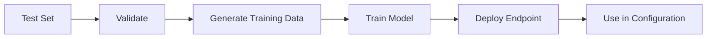

# Custom Model Fine-Tuning

This guide explains how to fine-tune Nova models for document classification using the IDP Accelerator.

## Overview

The Custom Model Fine-Tuning feature allows you to create specialized document classification models trained on your specific document types. This is particularly useful when:

- You have unique document types not well-recognized by base models
- You need higher accuracy for specific document classes
- You want to optimize classification for your domain-specific terminology

https://github.com/user-attachments/assets/e82c7be0-ee73-4ad7-8537-87ecf6a1a4c8

## How It Works



1. **Select a Test Set**: Choose an existing Test Set from Test Studio that contains labeled documents
2. **Validate**: The system checks if the Test Set has sufficient data for fine-tuning
3. **Generate Training Data**: Documents are converted to Bedrock's training format
4. **Train Model**: A Bedrock fine-tuning job trains a custom Nova model
5. **Deploy Endpoint**: The trained model is deployed as an on-demand Custom Model Deployment
6. **Use in Configuration**: Select the custom model when creating or editing configurations

## Roles & Permissions

Custom Model Fine-tuning is available to **Admin** and **Author** roles. The two mutations (`createFinetuningJob`, `deleteFinetuningJob`) are enforced server-side, in layers: the REST API's Cognito user-pool authorizer rejects an unauthenticated caller with a 401 before any code runs, the dispatcher rejects a malformed argument shape with a 400, and **authorization itself is enforced inside the resolver Lambda** (`nested/api-resolvers/src/lambda/finetuning_jobs_resolver/index.py`), which intersects the caller's `cognito:groups` claim with `{"Admin", "Author"}` and raises a `PermissionError` that the dispatcher returns as a 403. So Reviewer and Viewer roles cannot create or delete jobs even via direct API calls. The `@aws_cognito_user_pools(cognito_groups: [...])` directives in `nested/api-resolvers/src/api/schema.graphql` remain the declarative source of truth for the expected group policy — `make api-test-static` (`scripts/sdlc/scan_api_rbac.py`, checked against `scripts/api_rbac_expectations.yaml`) verifies each resolver's check against them — but nothing evaluates those directives at runtime. Two of the three query APIs — `listFinetuningJobs` and `getFinetuningJob` — are open to all authenticated users, and the UI only exposes the Custom Models page to Admin and Author. `listAvailableModels` and `validateTestSetForFinetuning` are **not reachable at all**: the resolver implements both, but the dispatcher's routing table does not name them and the manifest it authorizes against has no entry for them, so default-deny answers 403 to every caller including Admin. The UI calls neither. See [RBAC](./rbac.md) for the canonical description of where authorization is enforced.

> **Note on configuration-profile scoping**: Fine-tuning jobs are currently global — they are not filtered by `allowedConfigVersions`. A scoped Author can see all fine-tuning jobs and create jobs from any test set. However, when applying a custom model to a configuration profile (via "Create Config Profile"), the profile scope is enforced — the Author can only target profiles within their scope. See [RBAC](./rbac.md) for the full permission matrix.

## Prerequisites

- **Deployed in `us-east-1` region**: Custom Model Fine-Tuning is only available when the IDP Accelerator is deployed to the `us-east-1` AWS region. The Custom Models navigation link is automatically hidden in deployments to other regions.
- An existing Test Set with:
  - At least 10 documents
  - At least 2 document classes
  - Baseline classifications for all documents
- Appropriate IAM permissions for Bedrock model customization
- **Admin** or **Author** role in the IDP Accelerator

## Using the UI

### Creating a Fine-Tuning Job

1. Navigate to **Configuration** → **Custom Models** in the left navigation
2. Click **Create Fine-Tuning Job**
3. Fill in the form:
   - **Job Name**: A descriptive name for your fine-tuning job
   - **Test Set**: Select the Test Set to use for training
   - **Base Model**: Choose Nova 2 Lite or Nova 2 Pro as the base model (recommended)
4. Review the validation results showing:
   - Document count
   - Class distribution
   - Train/validation split
   - Any warnings or errors
5. Click **Start Fine-Tuning**

### Monitoring Progress

The job will progress through these stages:

| Status | Description |
|--------|-------------|
| VALIDATING | Checking Test Set data |
| GENERATING_DATA | Converting documents to training format |
| TRAINING | Bedrock is training the model (can take 1-4 hours) |
| DEPLOYING | Creating the on-demand endpoint |
| COMPLETED | Model is ready to use |
| FAILED | An error occurred (check error message) |

### Using a Custom Model

Once a fine-tuning job completes:

1. Go to **Configuration** › **View/Edit Configuration**
2. Create or open a profile in the Configuration Profiles table
3. In the model selector, you'll see your custom models under "Custom Models"
4. Select your fine-tuned model
5. Save the configuration

## Using the CLI or SDK

Neither the IDP CLI (`idp-cli`) nor the IDP SDK (`idp_sdk`) has fine-tuning
commands or methods. Create and monitor jobs in the UI (above), or call the API
operations listed under [API Reference](#api-reference).

## Best Practices

### Data Quality

- **Diverse Examples**: Include varied examples of each document class
- **Balanced Classes**: Try to have similar numbers of examples per class
- **Clean Baselines**: Ensure baseline classifications are accurate
- **Sufficient Data**: More examples generally lead to better results

### Model Selection

| Base Model | Best For |
|------------|----------|
| Nova 2 Lite | Faster training, lower cost, simpler documents (recommended) |
| Nova 2 Pro | Higher accuracy, complex documents, more classes (recommended) |
| Nova Lite (v1) | Legacy support |
| Nova Pro (v1) | Legacy support |

### Training Tips

1. **Start Small**: Begin with Nova 2 Lite to validate your approach
2. **Monitor Metrics**: Watch training/validation loss for overfitting
3. **Iterate**: If results aren't satisfactory, improve your training data
4. **Compare**: Run evaluations comparing base vs. custom models

## Troubleshooting

### Common Errors

| Error | Solution |
|-------|----------|
| "Insufficient documents" | Add more documents to your Test Set |
| "Insufficient classes" | Ensure at least 2 document classes |
| "Training failed" | Check Bedrock quotas and permissions |
| "Deployment failed" | Verify Custom Model Deployment permissions |

### Checking Logs

Fine-tuning job logs are available in CloudWatch:
- Log group: `/aws/lambda/idp-finetuning-*`
- Step Functions execution history in the AWS Console

### IAM Permissions

Ensure your deployment has these Bedrock permissions:
```
bedrock:CreateModelCustomizationJob
bedrock:GetModelCustomizationJob
bedrock:CreateCustomModelDeployment
bedrock:GetCustomModelDeployment
bedrock:ListCustomModelDeployments
bedrock:DeleteCustomModelDeployment
```

## Cost Considerations

Fine-tuning costs include:
1. **Training**: Charged per training hour (varies by base model)
2. **Deployment**: On-demand pricing when the model is invoked
3. **Storage**: S3 storage for training data and model artifacts

Custom Model Deployments use on-demand pricing, so you only pay when the model is invoked. This is more cost-effective than Provisioned Throughput for variable workloads.

## API Reference

These operations are reached through the solution's REST API, as
`POST /op/<operation>` on the API Gateway dispatcher with a JSON body of the form
`{"arguments": {...}}`. No GraphQL service runs and no GraphQL document is sent. They
are written below in the syntax of `nested/api-resolvers/src/api/schema.graphql`,
the typed contract the UI's types and the dispatcher's argument validation are
generated from, because that is where each operation's arguments and returned fields
are declared.

### Queries

The last two below, `validateTestSetForFinetuning` and `listAvailableModels`, are
documented as the schema declares them; they are **not routable today** (see the
authorization note above), so a call returns 403.

```graphql
# List fine-tuning jobs
query ListFinetuningJobs($limit: Int, $nextToken: String) {
  listFinetuningJobs(limit: $limit, nextToken: $nextToken) {
    items {
      id
      jobName
      status
      baseModel
      createdAt
    }
    nextToken
  }
}

# Get job details
query GetFinetuningJob($jobId: ID!) {
  getFinetuningJob(jobId: $jobId) {
    id
    jobName
    testSetId
    testSetName
    baseModel
    status
    createdAt
    trainingStartedAt
    trainingCompletedAt
    deploymentCompletedAt
    customModelArn
    customModelDeploymentArn
    trainingMetrics {
      trainingLoss
      validationLoss
    }
    errorMessage
  }
}

# Validate test set
query ValidateTestSet($testSetId: ID!) {
  validateTestSetForFinetuning(testSetId: $testSetId) {
    isValid
    documentCount
    classCount
    classDistribution
    trainCount
    validationCount
    warnings
    errors
  }
}

# List available models
query ListAvailableModels {
  listAvailableModels {
    baseModels {
      id
      name
      provider
    }
    customModels {
      id
      name
      baseModel
      status
    }
  }
}
```

### Mutations

```graphql
# Create fine-tuning job
mutation CreateFinetuningJob($input: CreateFinetuningJobInput!) {
  createFinetuningJob(input: $input) {
    id
    jobName
    status
  }
}

# Delete fine-tuning job
mutation DeleteFinetuningJob($jobId: ID!) {
  deleteFinetuningJob(jobId: $jobId)
}
```
