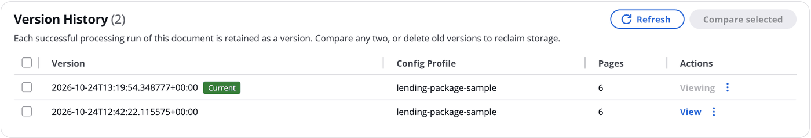
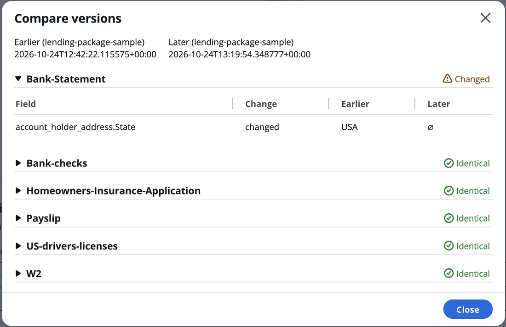

Copyright Amazon.com, Inc. or its affiliates. All Rights Reserved.
SPDX-License-Identifier: MIT-0

# Document Versions

GenAIIDP retains a **version** of a document each time it is processed. When you
upload a new copy of a document that was already processed — or reprocess an
existing one — the prior results are not lost: each successful processing run is
recorded as an immutable version you can view, compare, download, and (as an
admin) delete.

This directly supports enterprise use cases like reprocessing a mortgage or
lending package after a few days and keeping every prior extraction result
linked to the same logical document.

> **Terminology.** A document *version* is a snapshot of one processing run. A
> Configuration Profile *revision* is a snapshot of a configuration. Both are
> immutable and numbered, and they are deliberately different words — see the
> [terminology table](configuration-profiles.md#terminology-which-word-means-what).

## What is a "version"?

A version is one **successful processing run** of a document. The document's
identity is its S3 object key: re-uploading `loan-12345/package.pdf` (or
reprocessing it) creates version 2 of the same logical document, version 3, and
so on.

Each version records:

- **When** it completed, and which **Configuration Profile** and **revision** processed it
- Its section/page structure and its own metering (cost): the usage of that run
  only, so the version of a reprocess shows what the reprocess cost
- Per-section quality data — the low-confidence field alerts and any processing
  issues detected for that run — so a historical view shows the same
  **Low Confidence Fields** count and section **Status** the document showed
  when it completed
- A **manifest** that pins the exact S3 object version of every output file the
  run produced

## How it works

Output artifacts are written to deterministic keys under `<object-key>/` in the
Output bucket (for example `<object-key>/sections/1/result.json`), so a later
run overwrites them in place. All IDP buckets have **S3 versioning enabled**, so
the bytes of every prior run are retained as noncurrent object versions.

On its own, S3 versioning cannot tell you which object versions belonged to
which run — a run may produce a different set of sections than the last one. To
close that gap, when a workflow completes successfully the solution:

1. Snapshots the current `VersionId` of every output object into a per-run
   **manifest** at `<object-key>/runs/<run-id>/manifest.json`.
2. Writes an immutable **run record** to the tracking table
   (`PK = doc#<object-key>`, `SK = run#<run-id>`).

Because the output bucket is versioned, fetching an object by its pinned
`VersionId` returns that run's exact bytes **even after later runs overwrite the
object or a reprocess deletes it**. The reserved `runs/` prefix is preserved
across reprocessing so version history survives.

```
s3://<output-bucket>/loan-12345/package.pdf/
├── sections/1/result.json          ← current run's output (overwritten each run)
├── pages/1/rawText.json
└── runs/
    ├── 20250701T090000Z-exec-a/manifest.json   ← version 1 (pins prior VersionIds)
    └── 20250707T141530Z-exec-b/manifest.json   ← version 2 (current)
```

## Reprocessing

Reprocessing a document starts a new run, and the run becomes a new version when it
completes. A reprocess does not have to start over. In the web UI's **Reprocess**
dialog, with `idp-cli reprocess --step`, with the SDK and with the MCP `reprocess`
tool, you choose the step the run starts at:

| Start at | The run does | Kept from the earlier run |
|---|---|---|
| Beginning (OCR in Pipeline mode) | Every step | Nothing; the output is cleared, except the version history |
| Classification (Pipeline mode) | Classification and every later step | Page text and images |
| Extraction (Pipeline mode) | Extraction and every later step | Pages, classes and sections |
| Assessment (Pipeline mode) | Assessment and every later step | The extracted values |
| Policy Rule Validation | Policy rule validation, Review Routing, summarization, evaluation | Extraction and assessment results |
| Summarization | Review Routing, summarization, evaluation | The policy rule validation result as well |
| Evaluation | Review Routing, evaluation | The summary as well |

- **What a start step clears.** The outputs of the start step and of every later step
  are cleared before the run; what the earlier steps produced is reused. A document
  in a review queue has its review withdrawn.
- **Which steps are offered.** A step is available when the document has the output of
  the steps before it. In BDA mode a run starts at the beginning, at Policy Rule
  Validation or later; Classification, Extraction and Assessment are steps of Pipeline
  mode. A document that is being processed, or that the malware scan held or refused,
  cannot be reprocessed. The dialog shows why a step is not available.
- **Skipping steps.** With the CLI, the SDK and the MCP tool, a run can also leave out
  optional steps (assessment, policy rule validation, summarization, evaluation). A
  skipped step keeps the output it has.
- **A failed document** can be restarted with **Resume from the failed step**
  (`--step resume`): the run starts at the first step whose output is missing.
- **Another configuration.** A different profile, and a revision with a preprocessing
  hook or another processing mode, start at the beginning only (see
  [Reprocessing from a later step](./configuration-profiles.md#reprocessing-from-a-later-step)).
- **Several documents.** Each document gets its own result: queued, or not queued with
  the reason. One document that cannot be reprocessed does not stop the others.

A run that starts later is routed like any other when it reaches the Review Routing
step (see [Review Routing](./review-routing.md)), and fires the hooks of the steps it
does. The Processing Flow viewer shows the steps it left out as **Skipped**.

**Runs that follow a review.** A reprocess is the one run whose start step a person
chooses. The runs that follow a review start where the system decides. Like a
reprocess, such a run becomes a new version when it completes:

| Run | Starts at | The run does | Kept from the earlier run |
|---|---|---|---|
| Review completed | Apply Review Changes | Apply Review Changes (the reviewer's corrections are written onto the extracted values), policy rule validation, Review Routing, summarization, evaluation | Pages, classes, sections and the extracted values, with the corrections on them |
| Review completed after the page grouping was changed (Pipeline mode) | Extraction, for the sections that were added, whose pages changed or that have no extracted values | Extraction and assessment of those sections, Apply Review Changes (the corrections saved for them are set on the new values), then the steps above | Pages and classes; the values of the other sections |
| Review sent back | Classification in Pipeline mode; the beginning in BDA mode, and for a document whose page text or images are missing | That step and every later step. The review's corrections and any page regrouping are discarded | Page text and images, when the run starts at classification |
| Review removed or skipped | Policy rule validation | Policy rule validation, Review Routing (which does not hold the document again), summarization, evaluation | The machine's extracted values |
| Review rejected | — | Nothing: the document ends `REJECTED` | Everything |

The dialog that finishes a review lists the steps of the first three before the
reviewer confirms. See [How a review ends](./review-queues.md#how-a-review-ends).

## Retention

Document versions are retained for the stack's **`DataRetentionInDays`** period.
Noncurrent S3 object versions (the byte-store for version history) are expired on
the same schedule via bucket lifecycle rules, so version history does not grow
unbounded. Deleting a version (below) reclaims its storage immediately.

> **Always on, and there is no stack parameter to turn it off.** Versioning uses
> infrastructure the solution already had (S3 bucket versioning) plus one small
> tracking-table record per run, so it is on in every deployment. The
> `WorkflowTracker` Lambda reads a `DOCUMENT_VERSIONING_ENABLED` environment
> variable and skips run-record creation when it is not `true`, but the template
> sets that variable to the literal `"true"` with no `!Ref` behind it. Editing it
> in the Lambda console does suppress run records — until the next stack update,
> which restores the literal and silently re-enables versioning. Treat the feature
> as unconditional, and change the template if you genuinely need it off.

## Viewing and managing versions

### Web UI

The document detail page includes a **Version History** panel listing every
retained version newest-first, with the current version badged. From there you
can:

- **View a past version** — choose *View* in a row's **⋮** menu to render that run's
  snapshot on the page (read-only): its sections, page text/images, extraction
  results, and summary/evaluation reports are all fetched from the run's pinned
  S3 object versions (page images via version-pinned presigned URLs), so you see
  exactly what that run produced even after later runs overwrote the outputs. A
  banner indicates you're viewing a previous version; *Return to current
  version* switches back. While you view a past version, every change action on
  the page (the **More Actions** items, such as **Edit Page Grouping**, **Re-extract
  Sections**, **Use As Evaluation Baseline** and **Reprocess**) is
  disabled with the reason "Not available while you view a past version…", and so
  are **Refresh** and **Edit**. **Reports › Policy Rule Validation Summary** is unavailable,
  because policy rule validation results aren't kept for past versions.
- **Compare any two versions** — select two rows and choose *Compare selected*
  to see a section-by-section, field-level diff of their extraction results
  (values are read from each run's pinned S3 versions, so the comparison is
  exact).
- **Delete a version** (Admin only) — permanently removes that run's pinned
  output object versions and its record. The current version cannot be deleted.
  Deletion is reference-counted: any output object version also pinned by
  another retained version is kept, so deleting one version never corrupts
  another.





### CLI

```bash
# List versions for a document (newest first)
idp-cli list-versions --stack-name my-stack --document-id loan-12345/package.pdf

# Download the exact output bytes of a specific version
idp-cli download-results --stack-name my-stack \
    --document-id loan-12345/package.pdf \
    --run-id 20250707T141530Z-exec-b \
    --output-dir ./results/
```

### API

The GraphQL/REST API exposes:

| Field | Type | Access |
|-------|------|--------|
| `listDocumentVersions(objectKey)` | query | any **assigned group** (a caller in no group is refused) |
| `getDocumentVersion(objectKey, runId)` | query | any **assigned group** |
| `compareDocumentVersions(objectKey, runIdA, runIdB)` | query | any **assigned group** |
| `deleteDocumentVersion(objectKey, runId)` | mutation | **Admin only** |

All three reads take the same floor, because they return the same fields: the list
shapes every run through the same helper as `getDocumentVersion`, so it carries each
run's section output URIs, page image and text URIs, the confidence alerts naming
every extracted attribute, and the model-written page classification reasons — for
all runs rather than one. It returns no extracted *value*, but it is the step that
tells a caller where the values are and what they are about. Deleting a run is
narrower still, because it destroys history. See [RBAC](./rbac.md) for the full
policy, including why a group check is not a per-document check.

## Caveats

- **HITL edits after completion.** A version reflects the pipeline output at the
  moment the workflow completed. If a reviewer edits extraction results via
  Human-in-the-Loop review *after* completion, those edits modify the current
  output objects; the version snapshot captured at completion is unchanged.
- **Documents processed before this feature.** For documents last processed by a
  release without version history, the prior object *bytes* may still exist as
  noncurrent S3 versions, but there are no run manifests, so those old runs
  cannot be enumerated as versions. Version history begins accruing from the
  first run after upgrade.
- **Quality data on pre-existing versions.** The per-section low-confidence
  alerts and processing issues are written into the run record at completion.
  Versions recorded before the release that added them have no stored quality
  data, so they display a **Low Confidence Fields** count of 0 and an empty
  section **Status**. Versions recorded after upgrading show the real values.
- **Logical grouping is by object key.** Two different S3 keys are two different
  logical documents. To version a packet, upload it under the same key each
  time.

## Related

- [Post-Processing Lambda Hook](post-processing-lambda-hook.md) — for archiving
  results into a customer-owned system on every completion.
- [Configuration Profiles](configuration-profiles.md) — revisions of a
  *configuration profile*, distinct from versions of a *document*.
