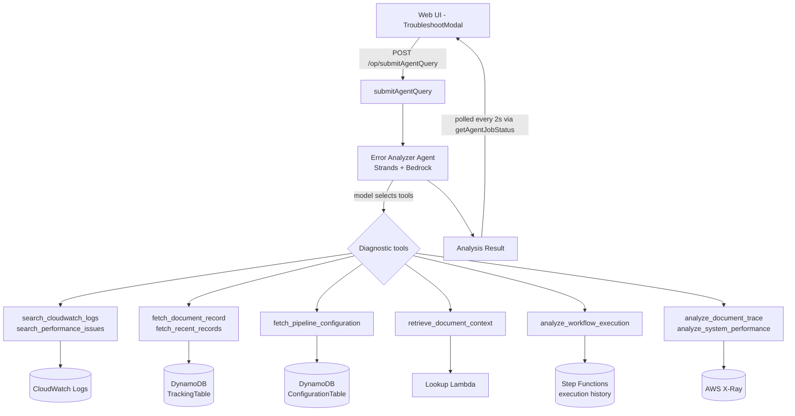
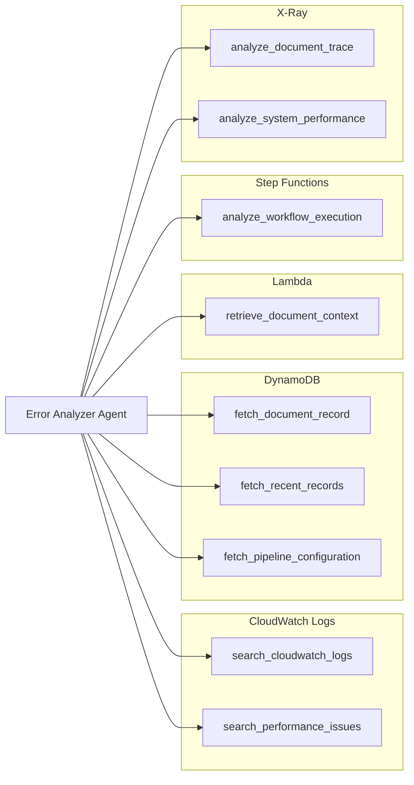
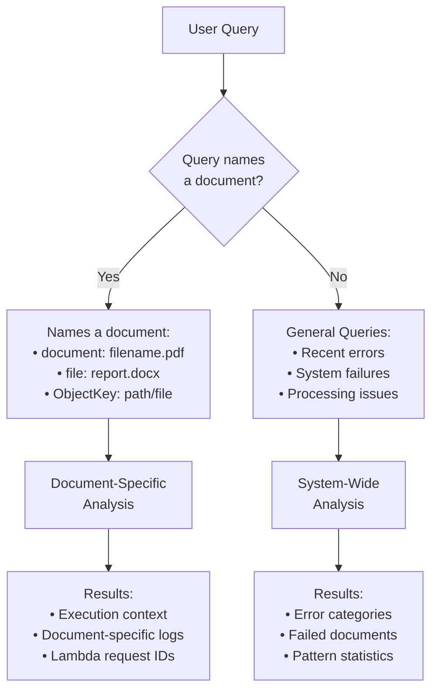
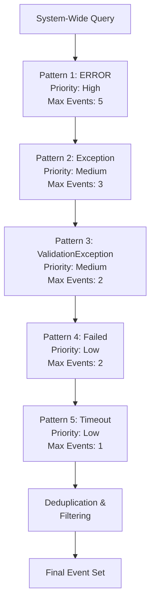
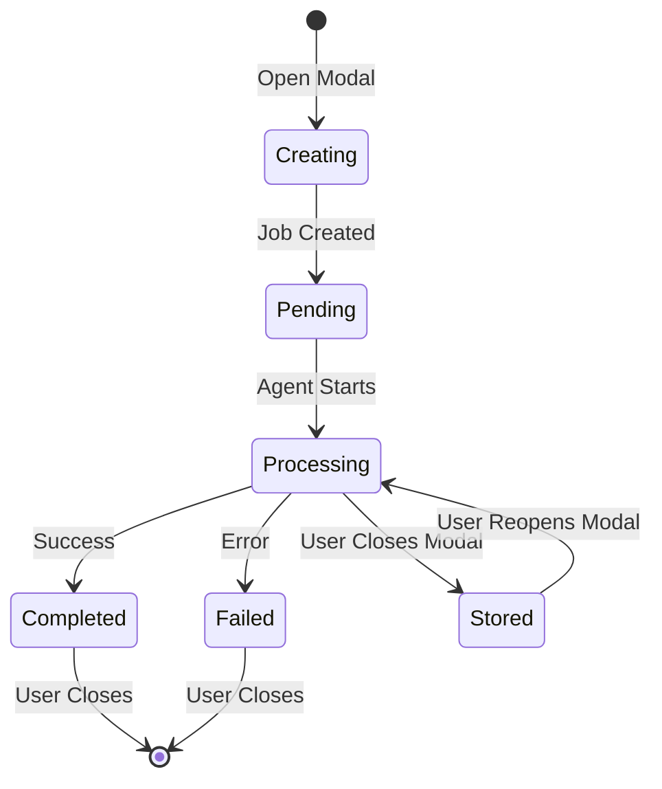

# Error Analyzer (Troubleshooting Tool) - PREVIEW

## Overview

The Error Analyzer is an intelligent AI-powered troubleshooting tool that helps diagnose and resolve document processing failures in the GenAI IDP Accelerator. It uses a configurable Amazon Bedrock model — Claude Sonnet 4.6 by default — with the Strands agent framework to automatically analyze CloudWatch logs, DynamoDB tracking data, Step Functions execution history and X-Ray traces to identify root causes and provide actionable recommendations.

This tool is not yet mature - we expect to refine and improve the capabilities in successive releases. Try it, and give us feedback via GitHub Issues.

https://github.com/user-attachments/assets/78764207-0fcf-4523-ad12-f428581a685f


### Key Capabilities

- **Automatic Failure Diagnosis**: AI agent automatically investigates document processing failures
- **Intelligent Tool Selection**: Distinguishes between document-specific and system-wide analysis and picks its own tools accordingly
- **Multi-Source Analysis**: Correlates data from CloudWatch Logs, DynamoDB, Step Functions and X-Ray
- **Contextual Recommendations**: Provides specific guidance for configuration, operational, or code issues
- **Real-Time Updates**: Live job status with progress tracking and resumption capability
- **Evidence-Based Analysis**: Shows detailed log evidence supporting diagnostic conclusions

### When to Use the Error Analyzer

- **Document Processing Failures**: Investigate why a specific document failed to process
- **Recurring Error Patterns**: Identify systemic issues affecting multiple documents
- **Performance Investigation**: Analyze timeout errors and processing bottlenecks
- **System Health Checks**: Review recent errors across the entire system
- **Troubleshooting Support**: Generate detailed error reports for support escalation

## Architecture

### System Design



### Tool Ecosystem

The Error Analyzer uses a set of specialized tools organized in a modular
architecture. These include CloudWatch log search, DynamoDB document-record
lookup, Step Functions execution analysis, X-Ray tracing, and
`fetch_pipeline_configuration` — which returns the Bedrock model ID configured
for each pipeline stage of a document's config version. The last is what lets
the agent name the exact model behind a retired/unavailable-model error (the
Bedrock error text itself does not name the model):



The agent is a Strands agent constructed in
`lib/idp_common_pkg/idp_common/agents/error_analyzer/agent.py`, which registers
these tools and lets the model choose among them directly. There is no
dispatching router tool between the model and the tools.

**Tool Descriptions:**

1. **search_cloudwatch_logs** (CloudWatch)
   - Searches log groups for errors and failures
   - Given a `document_id`, performs a targeted search using the document's
     processing timestamps and Lambda request IDs; without one, searches
     recent logs across the stack
   - Arguments: `document_id`, `filter_pattern`, `hours_back`,
     `max_log_events`, `max_log_groups`

2. **search_performance_issues** (CloudWatch)
   - Searches for throttling, timeout, capacity and concurrency problems
   - Arguments: `issue_type`, `hours_back`, `max_log_events`

3. **fetch_document_record** (DynamoDB)
   - Retrieves the complete tracking-table record for one document,
     including status, timestamps, `ConfigVersion` and execution information
   - Argument: `object_key`

4. **fetch_recent_records** (DynamoDB)
   - Fetches records for documents processed within a time window, using
     time-based partition scanning
   - Arguments: `date`, `hours_back`, `limit`

5. **fetch_pipeline_configuration** (Configuration)
   - Returns the Bedrock model ID configured for each pipeline stage of a
     configuration version, plus whether summarization is enabled
   - This is what lets the agent name the exact model behind a
     retired-or-unavailable-model error, since the Bedrock error text does
     not name the model
   - Argument: `config_version` (empty reads the active version)

6. **retrieve_document_context** (Lambda)
   - Invokes the lookup Lambda named by `LOOKUP_FUNCTION_NAME` to gather
     execution context, timing and Step Functions details
   - Extracts Lambda request IDs for correlating CloudWatch log searches
   - Argument: `document_id`

7. **analyze_workflow_execution** (Step Functions)
   - Retrieves execution history, analyzes state transitions and identifies
     the failure point in the workflow
   - Argument: `document_id`

8. **analyze_document_trace** (X-Ray)
   - Analyzes the X-Ray trace for one document for errors, bottlenecks and
     service timeline
   - Argument: `document_id`

9. **analyze_system_performance** (X-Ray)
   - Analyzes stack-specific traces first, then general infrastructure, to
     find system-wide performance degradation
   - Arguments: `stack_name`, `hours_back`

### Query Classification Logic



## Using the Error Analyzer

### Via Web UI

#### Accessing the Troubleshoot Modal

1. **Navigate to Dashboard**: Open the GenAI IDP Web UI
2. **Find Failed Document**: Locate a document with `FAILED` status
3. **Click Troubleshoot Button**: Opens the TroubleshootModal
4. **Automatic Analysis**: Agent immediately begins analyzing the failure

#### Understanding the Interface

The TroubleshootModal displays:

- **Document Information**: Shows the ObjectKey being analyzed
- **Status Indicator**: 
  - `PENDING`: Job submitted, waiting to start
  - `PROCESSING`: Agent actively analyzing with real-time messages
  - `COMPLETED`: Analysis finished, results available
  - `FAILED`: Analysis encountered an error
- **Agent Messages**: Live progress updates during processing
- **Results Display**: Formatted analysis with collapsible sections
- **Job Resumption**: If you close and reopen the modal, the existing job resumes

#### Reading Analysis Results

Results are structured in three sections:

**1. Root Cause**
```
The underlying technical reason for the failure. Focuses on the primary 
cause rather than symptoms.

Example: "Bedrock throttling exception due to exceeding token rate limits 
for the configured model."
```

**2. Recommendations**
```
Specific, actionable steps to resolve the issue. Limited to top three 
recommendations with clear guidance.

Example:
• Increase provisioned throughput for the Bedrock model
• Adjust retry configuration in classification settings
• Consider using batch processing to reduce concurrent requests
```

**3. Evidence** (Collapsible)
```html
<details>
<summary><strong>Evidence</strong></summary>

**Log Group:**  
/aws-stack-name/lambda/ClassificationFunction

**Log Stream:**  
2025/01/03/[$LATEST]abc123def456

[ERROR] 2025-01-03T14:23:45.123Z ThrottlingException: Rate exceeded
</details>
```

#### Reporting an Issue from the Modal

When the analysis job reaches a terminal state (`COMPLETED` or `FAILED`), the
Troubleshoot modal footer offers two additional actions:

- **Report this issue on GitHub** — opens a pre-filled GitHub bug-report form in a
  new tab, populated with the deployment environment (Region, Processing Mode,
  Version/Build/Stack), the document context (object key, status, config version,
  execution ARN, and any job error), and the agent's Markdown findings.
- **Copy full details** — copies the complete environment + findings text to your
  clipboard, for pasting content that the pre-filled URL can't carry (the issue link
  length-caps the findings; the full transcript is not embedded in the URL).

> **Privacy note:** GitHub issues on the public repository are visible to everyone,
> and the findings can quote OCR'd document content. Nothing is submitted
> automatically — review the pre-filled form and **redact any sensitive data**
> before submitting. See [Feedback & Issue Reporting](web-ui.md#feedback--issue-reporting).

The modal stays open until you press **Close** (an outside click or Esc no longer
dismisses it, so a running analysis — which can take ~30 seconds — is not
interrupted). Use **Minimize** to collapse it to a restore chip while the analysis
finishes in the background. When the Error Analyzer is run from the
[Agent Companion Chat](agent-companion-chat.md) instead, a **Create GitHub issue**
button appears under the answer with the same bug/feature options.

### Query Patterns

#### Document-Specific Queries

Use these patterns to analyze a specific document:

```
document: lending_package.pdf
file: bank_statement.docx  
ObjectKey: uploads/2024/contract.pdf
```

The query **must** include the keyword (`document:`, `file:`, or `ObjectKey:`) followed immediately by a colon and the filename.

#### System-Wide Queries

Use natural language for general analysis:

```
Find recent processing errors
What errors occurred in the last week?
Show me system failures
Summarize recent problems
```

#### Time Range Specifications

The agent interprets time ranges intelligently:

| Query Phrase | Time Range |
|--------------|------------|
| "recent" or "recently" | 1 hour |
| "last hour" | 1 hour |
| "last day" or "yesterday" | 24 hours |
| "last week" | 168 hours (7 days) |
| No time specified | 24 hours (default) |

## Configuration

### Agent Configuration in template.yaml

The Error Analyzer's editable settings are declared in the `ConfigSchema` of
`patterns/unified/template.yaml`, under the `agents` section. The schema is what
drives the UI Configuration panel, and it declares three properties:

```yaml
agents:
  error_analyzer:
    type: object
    sectionLabel: Error Analysis Agent
    description: Configuration for the error analysis agent
    properties:
      model_id:
        type: string
        description: Bedrock model ID for the error analysis agent (requires tool use support)
        enum:
          - "us.amazon.nova-pro-v1:0"
          - "us.anthropic.claude-sonnet-4-6"
          # ... see the template for the full list of selectable models
        default: "us.anthropic.claude-sonnet-4-6"
        order: 0
      lookback_hours:
        type: integer
        description: How far back the error analyzer searches logs, traces, and execution history (in hours)
        default: 24
        order: 1
      system_prompt:
        type: string
        format: textarea
        order: 2
```

The enum is long — it carries `us.`, `global.` and `eu.` inference-profile
variants of each supported model — so read it from the template rather than
from a list here. Two things about it are worth knowing before you pick a
value: Claude Haiku models are **not** in it, and a value outside the enum is
rejected, so the model must support tool use.

There is no `parameters` object in the schema. The `agents.error_analyzer.parameters`
block described [below](#advanced-parameters-config-file-only) is accepted by
the configuration model and can be set in a configuration YAML, but it is not
surfaced in the UI Configuration panel.

### Configuration Parameters

#### model_id

**Purpose**: Selects the Bedrock model for error analysis

**Recommended**: `us.anthropic.claude-sonnet-4-6`
- Superior reasoning for complex error diagnosis
- Better structured output formatting
- More accurate root cause identification

**Alternative Options**:
- `us.amazon.nova-pro-v1:0`: AWS-native option
- `us.anthropic.claude-sonnet-4-5-20250929-v1:0`: Good balance of cost and
  capability, but AWS has moved it to legacy (end of life 2027-04-08) and it
  takes no further Service Quota increases

Claude Haiku models are not selectable for this agent. The enum does not
include them, so a configuration naming one is rejected.

#### lookback_hours

**Purpose**: How far back the agent is meant to search logs, traces and
execution history.

**Default**: `24` hours

Each tool takes its own `hours_back` argument, and the model supplies that
argument per call — so in practice the window comes from the query ("errors in
the last hour", "what failed yesterday") and from each tool's own default,
which is also 24 hours. Setting `lookback_hours` records your intent in the
configuration, but no tool currently reads it, so changing it alone will not
widen or narrow a search. To search a different window, say so in the query.

#### system_prompt

**Purpose**: Defines agent behavior and response formatting

The shipped default is in
`lib/idp_common_pkg/idp_common/config/system_defaults/base-agents.yaml`, under
`agents.error_analyzer.system_prompt`. It is long, and it is the authoritative
copy — read it there rather than from an excerpt, which goes stale silently.
It covers:

- the pipeline stages and the AWS services behind each, so the agent can map a
  failing stage to the log group that holds its errors
- an investigation workflow and a "5 whys" instruction to keep the agent from
  stopping at the first error message it finds
- the distinction between a stage Lambda's generic wrapper message and the
  underlying exception, which is the single most common way an analysis goes
  shallow
- a tool-usage section that names each of the agent's tools by its registered
  name (listed under [Tool Ecosystem](#tool-ecosystem)), says when to
  use it and which arguments to pass, split by document-specific, system-wide,
  workflow, configuration and X-Ray questions
- a catalogue of recurring error patterns (throttling, timeout, configuration,
  permissions, input quality, BDA-specific, Bedrock model errors, and retired
  or unavailable models) with the likely cause and what to check for each
- the required output format: a `## Root Cause` section opening with a
  confidence rating, a `## Recommendations` section capped at three items, and
  a collapsible HTML `<details>` Evidence section
- recommendation guidelines that differ by issue class — for a code defect the
  agent is told not to propose code changes, because a user cannot change
  Lambda code, and to describe the error well enough to report it instead

If you replace the prompt, keep the three-section output format: the UI parses
it to render the result, and the Evidence panel depends on the `<details>`
block.

Name tools by the names the agent registers, which are the function names in
`idp_common/agents/error_analyzer/tools/`. The model is given only those tools,
so a prompt that directs it to any other name sends it after a tool it does not
have. `tests/unit/agents/error_analyzer/test_prompt_tool_names.py` in the
`idp_common` package checks every shipped copy of the prompt against the
registered set in both directions.

⚠️ **A configuration profile you created keeps the prompt it was saved with.**
Every profile is saved as a full, independent snapshot, and an upgrade re-seeds
only `default` and the stack-managed profiles. So a profile created before this
release carries the earlier prompt whether or not anyone edited it, and that
prompt directs the model to tools that never existed (`cloudwatch_document_logs`,
`dynamodb_status`, `cloudwatch_logs`, `dynamodb_query`, `stepfunction_details`,
`lambda_lookup`, `xray_trace`, `xray_performance_analysis`). To update one, open
the profile in the Configuration panel, use **Restore default** on the Error
Analysis Agent's `system_prompt` field and save. If the prompt was customised on
purpose, rewrite its tool-usage section against the registered tools instead, so
the customisation is kept.

#### Advanced parameters (config-file only)

`agents.error_analyzer.parameters` is accepted by the configuration model but
is absent from the template's `ConfigSchema`, so it can only be set in a
configuration YAML — it does not appear in the UI Configuration panel. The full
field list is `ErrorAnalyzerParameters` in
`lib/idp_common_pkg/idp_common/config/models.py`.

These take effect as written:

| Field | Default | Effect |
|---|---|---|
| `max_log_message_length` | `400` | Individual log messages longer than this are truncated |
| `settings_cache_ttl_seconds` | `300` | TTL for the SSM settings cache |
| `max_stepfunction_timeline_events` | `50` | Timeline events included from an execution history |
| `max_stepfunction_error_length` | `400` | Truncation length for a Step Functions error message |
| `max_stepfunction_history_pages` | `10` | Pages of execution history fetched |
| `xray_slow_segment_threshold_ms` | `5000` | Segment duration treated as slow |
| `xray_response_time_threshold_ms` | `10000` | Response time treated as slow |
| `xray_analysis_hours` | `3` | Window for X-Ray service-graph analysis (max 6) |
| `xray_error_rate_threshold` | `0.05` | Error rate treated as significant |

⚠️ **`max_log_events` and `max_log_groups` are read but cannot currently
override the tool defaults.** `search_cloudwatch_logs` declares
`max_log_events: int = 10` and `max_log_groups: int = 20` in its own signature
and then resolves the effective value as `max_log_events or params[...]`. When
the model omits the argument Python supplies the signature default, which is
truthy, so the `or` never falls through to the configured value. The configured
value wins only if a caller passes `0`. To change how many events come back,
ask for it in the query — the model passes the argument through — rather than
by setting the parameter.

`time_range_hours_default` is declared and validated by the configuration
model, so setting it is accepted, but nothing in the agent or its tools reads
it. Use the query to set a window, as described under `lookback_hours` above.

### Configuration Example (config.yaml)

```yaml
agents:
  error_analyzer:
    model_id: us.anthropic.claude-sonnet-4-6
    lookback_hours: 24
    # Omit system_prompt to inherit the shipped default from base-agents.yaml.
    # Override it only to change agent behaviour, and keep the three-section
    # output format the UI parses.
    parameters:
      max_log_message_length: 400
      max_stepfunction_history_pages: 10
```

## Understanding Results

### Root Cause Analysis

The Root Cause section identifies **the underlying technical reason** for the failure, not just symptoms.

**Good Root Cause Examples**:
```
✓ "Bedrock model returned ValidationException due to malformed JSON in the 
   extraction prompt, caused by unescaped special characters in attribute 
   descriptions"

✓ "Lambda function timeout after 900 seconds during assessment processing, 
   triggered by processing a document with 247 pages exceeding memory limits"

✓ "Access denied error when reading OCR results from S3, caused by missing 
   kms:Decrypt permission on the customer-managed encryption key"
```

**Poor Root Cause Examples** (too vague):
```
✗ "The document failed to process"
✗ "There was an error in the system"
✗ "Lambda function had a problem"
```

### Recommendations

Recommendations are **specific, actionable steps** tailored to the issue type.

#### Configuration-Related Recommendations

For configuration issues, the agent directs users to the UI:

```
Recommendations:
• Navigate to Configuration panel in the Web UI
• Update 'extraction.model' to use a higher-capacity model
• Lower 'extraction.confidence.list_batch_size' from 25 to 10 to reduce per-inference load
```

#### Operational Recommendations

For operational issues, provides immediate troubleshooting:

```
Recommendations:
• Retry the failed document - error appears transient
• Check AWS Service Health Dashboard for Bedrock service issues
• Monitor CloudWatch metrics for throttling patterns in next 30 minutes
```

#### Code/System Bug Recommendations

For code issues, focuses on reporting not fixing:

```
Recommendations:
• Report to development team with error details and timestamp
• Include Lambda request ID: abc-123-def-456 for debugging
• Avoid reprocessing this document type until patch is deployed
```

### Evidence Section

The Evidence section provides **verifiable log data** supporting the analysis.

**Structure**:
```html
<details>
<summary><strong>Evidence</strong></summary>

**Log Group:**  
/aws-stack-name/lambda/ExtractionFunction

**Log Stream:**  
2025/01/03/[$LATEST]abc123def456

**Events:**
```
[ERROR] 2025-01-03T15:42:13.456Z RequestId: xyz-789 
ValidationException: JSON parsing error at line 42
```

</details>
```

**Reading Evidence**:
1. **Log Group**: Identifies which Lambda function encountered the error
2. **Log Stream**: Provides exact execution instance for deep-dive investigation
3. **Events**: Shows actual error messages with timestamps
4. **Truncation**: Long messages truncated to "... [truncated]" for readability

## Advanced Features

### Intelligent Query Classification

Nothing parses the query before the model sees it. The model reads it and
decides which tools to call and what to pass them, so the split between
document-specific and system-wide analysis is a consequence of whether it
supplies a `document_id`:

```
document: filename.pdf   → model passes document_id="filename.pdf"
file: report.docx        → model passes document_id="report.docx"
ObjectKey: path/file     → model passes document_id="path/file"

recent errors            → model omits document_id
find failures            → model omits document_id
what happened            → model omits document_id
```

`search_cloudwatch_logs` then branches on that argument: with a `document_id`
it looks up the document's processing window and Lambda request IDs and
searches only the relevant log groups; without one it searches recent logs
across the stack. Writing `document:` in front of a filename is a convention
that helps the model pick the filename out of the sentence — it is not a
required syntax, and a query that names a file plainly works too.

### Multi-Pattern Error Detection

System-wide analysis uses prioritized pattern matching:



**Prioritization Strategy**:
1. **ERROR**: Highest priority, captures 5 events
2. **Exception**: Important errors, captures 3 events
3. **ValidationException**: Specific validation issues, 2 events
4. **Failed**: General failures, 2 events
5. **Timeout**: Performance issues, 1 event

**Context Management**:
- Respects `max_log_events` parameter as total limit
- Uses adaptive sampling across patterns
- Deduplicates similar error messages
- Truncates long messages at 200 characters

### Error Categorization

System-wide analysis categorizes errors for pattern identification:

**Category Definitions**:

1. **validation_errors**
   - Keywords: "validation", "invalid"
   - Indicates data quality or format issues
   - Often fixable through configuration

2. **processing_errors**
   - Keywords: "exception", "error"
   - Core processing failures
   - May require code fixes

3. **timeout_errors**
   - Keywords: "timeout"
   - Performance/resource issues
   - Adjustable through memory/timeout settings

4. **access_errors**
   - Keywords: "access", "denied"
   - Permission problems
   - Requires IAM policy updates

5. **system_errors**
   - Catch-all for other errors
   - Infrastructure or service issues

**Category Summary Example**:
```json
{
  "error_categories": {
    "validation_errors": {
      "count": 12,
      "sample": "ValidationException: Invalid attribute schema..."
    },
    "timeout_errors": {
      "count": 5,
      "sample": "Task timed out after 900.00 seconds"
    }
  }
}
```

### Job Resumption

The Web UI maintains job state for seamless resumption:



**How It Works**:
1. **Job Creation**: Modal creates job with unique `jobId`
2. **Parent Tracking**: Component stores job state in parent
3. **Modal Close**: Job continues running in background
4. **Modal Reopen**: Automatically resumes displaying existing job
5. **Status Updates**: `TroubleshootModal.tsx` polls `getAgentJobStatus` every 2
   seconds until the job reaches a terminal state; GraphQL subscriptions are not
   used (`subscribeToJobCompletion` is a retained no-op that returns `null`)

**User Experience**:
- Users can close modal without losing analysis
- Reopening shows current progress or final results
- No need to re-submit for in-progress or completed jobs
- New jobs only created when previous job is COMPLETED/FAILED

## Best Practices

### When to Use the Error Analyzer

#### ✓ Ideal Use Cases

1. **Document Processing Failures**
   ```
   Scenario: Specific document failed with FAILED status
   Query: "document: customer_form_2024.pdf"
   Benefit: Pinpoints exact Lambda function and error cause
   ```

2. **Recurring Error Patterns**
   ```
   Scenario: Multiple documents failing with similar errors
   Query: "What errors occurred in the last 6 hours?"
   Benefit: Identifies systemic issues affecting multiple documents
   ```

3. **Performance Investigation**
   ```
   Scenario: Documents timing out during processing
   Query: "Show me timeout errors in the last day"
   Benefit: Reveals resource constraints and bottlenecks
   ```

4. **Post-Deployment Validation**
   ```
   Scenario: New configuration deployed, checking for issues
   Query: "Recent processing errors"
   Benefit: Quick health check after changes
   ```

5. **Support Ticket Creation**
   ```
   Scenario: Need detailed error report for escalation
   Query: "document: problem_file.pdf"
   Benefit: Generates formatted report with evidence
   ```

#### ✗ Not Suitable For

- **Pre-deployment Testing**: Use evaluation tools and test sets instead
- **Performance Optimization**: Use CloudWatch metrics and dashboards
- **Capacity Planning**: Use monitoring and reporting features
- **Cost Analysis**: Use the cost calculator and pricing reports

### Query Formulation Best Practices

#### Be Specific with Document IDs

```
Good ✓
document: lending_package_2024_Q1.pdf
file: bank_statement_january.docx
ObjectKey: uploads/healthcare/prior_auth_12345.pdf

Poor ✗
document lending package        # Missing colon
find document                   # Too vague
check that failed file         # No specific ID
```

#### Use Appropriate Time Ranges

```
Good ✓
Show errors in the last hour    # Recent issues
What happened yesterday?        # Specific timeframe
Recent system failures          # Uses default 24h

Poor ✗
Show all errors ever           # Too broad, slow query
Find problems                  # No time context
Check everything               # Vague and expensive
```

#### Let the Agent Classify Intent

```
Good ✓
document: contract.pdf         # Clear document-specific
Recent validation errors       # Clear system-wide
What went wrong today?         # Natural language OK
Analyze document contract.pdf  # Also fine - no required syntax

Poor ✗
Find errors for file: x.pdf and system  # Mixed intents in one query
```

Ask one question at a time. A query that mixes a single document with a
system-wide sweep gives the model two goals at once, and it will usually
pursue only one of them.

### Interpreting Results Effectively

#### 1. Focus on Root Cause, Not Symptoms

**Example Analysis**:
```
Root Cause: Lambda function exhausted 4096 MB memory limit while processing 
a 150-page document with high-resolution images during OCR conversion

Symptoms (don't focus on these):
- Lambda timeout after 15 minutes
- No results written to S3
- Document stuck in PROCESSING status
```

**Action**: Address the root cause (memory limit) rather than symptoms (timeout).

#### 2. Prioritize Top Recommendations

The agent limits recommendations to **top three most impactful actions**:

```
Recommendation Priority:
1. Immediate Fix: Increase OCR Lambda memory to 8192 MB
2. Short-term: Implement image preprocessing to reduce resolution
3. Long-term: Add document size validation before processing
```

**Don't try to implement all suggestions at once** - start with #1.

#### 3. Use Evidence for Verification

Cross-reference recommendations with evidence:

```
Recommendation: "Increase Lambda memory allocation"

Evidence Validation:
✓ Log shows: "@maxMemoryUsed: 4089 MB" (near 4096 MB limit)
✓ Event type: "Task timed out after 900.00 seconds"
✓ Pattern: Occurs on documents with >100 pages
```

If evidence doesn't support recommendation, request clarification.

#### 4. Consider Error Categories

System-wide analysis categorizes errors:

```
Categories Found:
- validation_errors: 15 (most common)
- timeout_errors: 3
- access_errors: 1

Action: Focus on validation_errors first as they affect most documents
```

### Configuration Best Practices

#### Model Selection

Choose model based on error complexity:

```yaml
# Complex multi-component failures, critical analysis
model_id: us.anthropic.claude-sonnet-4-6  # Recommended and the default

# Lower-cost option for routine analysis
model_id: us.amazon.nova-pro-v1:0

# Still selectable, but AWS has moved it to legacy (end of life 2027-04-08)
model_id: us.anthropic.claude-sonnet-4-5-20250929-v1:0
```

The agent calls tools on every investigation, so any model you pick has to
support tool use. Claude Haiku models are not in the enum and cannot be
selected here.

#### Scoping how much evidence is gathered

Ask for it in the query rather than reaching for a configuration setting. The
model passes `hours_back`, `max_log_events` and `max_log_groups` to the tools
per call, so "check the last 6 hours" or "show me more log events" changes the
search directly. The matching `parameters` fields cannot override the tool
defaults — see
[Advanced parameters](#advanced-parameters-config-file-only) for why.

What you *can* set usefully in `parameters` is how much of each result is
retained:

```yaml
parameters:
  # Keep more of each log message before truncation
  max_log_message_length: 800

  # Walk further back through a long execution history
  max_stepfunction_history_pages: 20
```

## Troubleshooting Common Issues

### Agent Not Available

**Symptom**: Error message "Error-Analyzer-Agent-v1 agent is not available"

**Causes**:
1. Agent configuration not deployed
2. Stack configuration outdated
3. Agent ID mismatch

**Resolution**:
```
1. Check template.yaml includes agents.error_analyzer section
2. Verify configuration deployed: 
   aws cloudformation describe-stacks --stack-name <stack-name>
3. Check available agents in Web UI Configuration panel
4. Redeploy stack if configuration missing
```

### Job Timeout or Failure

**Symptom**: Job status shows FAILED or times out

**Causes**:
1. Lambda function timeout (15 min limit)
2. Insufficient memory
3. Invalid permissions
4. Bedrock throttling

**Resolution**:
```
1. Check CloudWatch Logs for agent Lambda function:
   /aws/<stack-name>/lambda/AgentFunction
   
2. Look for specific error messages:
   - "Task timed out" → Increase memory or reduce query scope
   - "AccessDeniedException" → Check IAM permissions
   - "ThrottlingException" → Wait and retry
   
3. For document-specific queries, ensure document exists:
   - Verify ObjectKey is correct
   - Check document in DynamoDB TrackingTable
```

### Incomplete Analysis Results

**Symptom**: Analysis missing Root Cause or Recommendations sections

**Causes**:
1. Model output formatting issue
2. System prompt not enforced
3. Token limit exceeded

**Resolution**:
```
1. Verify system_prompt includes formatting requirements:
   "ALWAYS format your response with exactly these three sections"
   
2. Check model_id is using recommended Claude Sonnet 4:
   us.anthropic.claude-sonnet-4-6
   
3. If token limit reached, reduce max_log_events or time range
```

### Permission-Related Issues

**Symptom**: "Access denied" or "Permission denied" errors

**Causes**:
1. Missing CloudWatch Logs permissions
2. DynamoDB access denied
3. KMS key permissions

**Resolution**:
```
IAM Permissions Required:
- CloudWatch Logs:
  * logs:FilterLogEvents
  * logs:DescribeLogGroups
  * logs:DescribeLogStreams
  
- DynamoDB:
  * dynamodb:GetItem
  * dynamodb:Query
  * dynamodb:Scan
  
- KMS (if using customer-managed keys):
  * kms:Decrypt
  * kms:DescribeKey
  
Check Lambda execution role has these permissions.
```

### Evidence Section Not Showing

**Symptom**: Evidence section is empty or missing

**Causes**:
1. No matching log events in time range
2. CloudWatch log retention expired
3. Incorrect log group names

**Resolution**:
```
1. Increase time range: "Show errors in the last week"
2. Check log retention in CloudWatch console
3. Verify log group naming convention:
   /{StackName}/lambda/{FunctionName}
4. Use system-wide query to check if any logs available
```

## Technical Details

### Integration Points

#### Web UI API operations

These are the GraphQL-shaped operations the UI sends to `POST /op/{field}`; the
names and argument shapes come from the retained schema contract in
`nested/api-resolvers/src/api/schema.graphql`.

**Mutations**:
```graphql
mutation SubmitAgentQuery {
  submitAgentQuery(
    query: "document: lending_package.pdf"
    agentIds: ["Error-Analyzer-Agent-v1"]
  ) {
    jobId
    status
  }
}
```

**Queries**:
```graphql
query GetAgentJobStatus($jobId: ID!) {
  getAgentJobStatus(jobId: $jobId) {
    jobId
    status
    result
    agent_messages
    error
  }
}
```

There is no subscription operation in this list. Job completion is detected by
polling `getAgentJobStatus`, as described under
[Job Resumption](#job-resumption).

#### CloudWatch Logs Integration

**Log Group Discovery**:
```python
# Pattern for stack log groups
log_group_pattern = f"/{stack_name}/lambda/"

# Searches across:
- /stack-name/lambda/OCRFunction
- /stack-name/lambda/ClassificationFunction
- /stack-name/lambda/ExtractionFunction
- /stack-name/lambda/AssessmentFunction
- /stack-name/lambda/SummarizationFunction
```

**Log Filtering**:
```python
# Document-specific filter
filter_pattern = f'"ObjectKey" = "{document_id}" "ERROR"'

# System-wide patterns (prioritized)
patterns = ["ERROR", "Exception", "ValidationException", "Failed", "Timeout"]
```

#### DynamoDB Tracking Integration

**Table Schema** (relevant fields):
```python
{
  "ObjectKey": "uploads/document.pdf",    # Partition key
  "ObjectStatus": "FAILED",               # Document status
  "ExecutionArn": "arn:aws:states:...",  # Step Functions ARN
  "CompletionTime": "2025-01-03T15:30:00Z",
  "ErrorMessage": "Processing failed...", # Optional error
  "LastModified": "2025-01-03T15:30:00Z"
}
```

**Query Patterns**:
```python
# Find document by ObjectKey
response = table.get_item(Key={"ObjectKey": document_id})

# Scan for recent failures
response = table.scan(
    FilterExpression="ObjectStatus = :status AND CompletionTime > :time",
    ExpressionAttributeValues={
        ":status": "FAILED",
        ":time": threshold_timestamp
    }
)
```

#### Step Functions Integration

**Execution Context**:
```python
# Extract execution ID from DynamoDB
execution_arn = "arn:aws:states:us-east-1:123456789012:execution:StateMachine:abc-123"
execution_id = execution_arn.split(":")[-1]  # "abc-123"

# Used for log filtering
filter_pattern = f'"execution_id" = "{execution_id}"'
```

### Tool Implementation Reference

Every tool lives under
`lib/idp_common_pkg/idp_common/agents/error_analyzer/tools/`, is exported from
that package's `__init__.py`, and is registered on the agent in
`../agent.py`. Each is decorated with `@tool` and returns a `Dict[str, Any]`.

| Tool | Module | Signature |
|---|---|---|
| `search_cloudwatch_logs` | `cloudwatch_tool.py` | `(document_id="", filter_pattern="ERROR", hours_back=24, max_log_events=10, max_log_groups=20)` |
| `search_performance_issues` | `cloudwatch_tool.py` | `(issue_type="performance", hours_back=24, max_log_events=10)` |
| `fetch_document_record` | `dynamodb_tool.py` | `(object_key)` |
| `fetch_recent_records` | `dynamodb_tool.py` | `(date="", hours_back=24, limit=100)` |
| `fetch_pipeline_configuration` | `config_tool.py` | `(config_version="")` |
| `retrieve_document_context` | `lambda_tool.py` | `(document_id)` |
| `analyze_workflow_execution` | `stepfunction_tool.py` | `(document_id="")` |
| `analyze_document_trace` | `xray_tool.py` | `(document_id)` |
| `analyze_system_performance` | `xray_tool.py` | `(stack_name="", hours_back=1)` |

#### search_cloudwatch_logs

The one tool with two distinct modes, selected by whether `document_id` is
supplied:

- **With a `document_id`** it calls `_search_document_logs`, which first
  resolves the document's processing window and Lambda request IDs (via
  `_get_document_context`, which reuses `fetch_document_record`) and then
  filters only the log groups that window implicates. This is the targeted
  path, and it is much cheaper than a stack-wide sweep.
- **Without one** it calls `_search_stack_logs`, which searches recent logs
  across the stack's log groups for the given `filter_pattern`.

Both paths truncate individual messages at `max_log_message_length` and cap
the number of log groups searched.

#### retrieve_document_context

Invokes a separate lookup Lambda rather than reading AWS APIs directly. The
function name comes from the `LOOKUP_FUNCTION_NAME` environment variable, and
the tool raises if it is unset — which is the first thing to check if this tool
alone is failing.

#### fetch_pipeline_configuration

Loads a configuration version through `idp_common.config.get_config` and walks
it for every stage that references a Bedrock model, returning
`stage_models` as a list of `{"stage": <dotted path>, "model": <model_id>}`
plus whether summarization is enabled.

This is the tool that resolves retired-model failures. A Bedrock
`ResourceNotFoundException` does not name the model that was rejected, so the
chain is: `fetch_document_record` for the document's `ConfigVersion`, then
`fetch_pipeline_configuration` with that version, then match the failing stage
to its configured model ID.

### Performance Considerations

**CloudWatch Logs Queries**:
- Each query scans specified time range across log groups
- Longer time ranges increase query latency
- Max 10,000 events per FilterLogEvents call

**Cost Optimization**:
```python
# Efficient queries
max_log_events = 5           # Minimal context window usage
time_range_hours = 1         # Recent errors only

# Expensive queries (use sparingly)
max_log_events = 50          # Large context window
time_range_hours = 168       # Full week scan
```

**Token Usage**:
- System prompt: ~800 tokens
- Log events: ~100-200 tokens each
- Analysis response: ~500-1000 tokens
- Total per query: ~2000-4000 tokens average

## Related Documentation

- **[Troubleshooting Guide](troubleshooting.md)**: General troubleshooting for common issues (manual steps)
  - Use the Error Analyzer for automated diagnosis
  - Refer to Troubleshooting Guide for manual resolution steps, performance tuning, and infrastructure issues
- **[Monitoring](monitoring.md)**: CloudWatch dashboards and metrics
- **[Web UI](web-ui.md)**: User interface features and navigation
- **[Architecture](architecture.md)**: Overall system architecture
- **[Configuration](configuration.md)**: Configuration management

## Error Analyzer vs Manual Troubleshooting

**Use Error Analyzer for:**
- Document processing failures (root cause analysis)
- Recent error patterns across the system
- Automated log correlation and diagnosis
- Quick troubleshooting with AI-powered recommendations

**Use Manual Troubleshooting Guide for:**
- Infrastructure and deployment issues
- Performance optimization and tuning
- Security and authentication problems
- Build and configuration management
- DLQ processing and queue management

## FAQ

### How does the Error Analyzer differ from CloudWatch Insights?

**Error Analyzer**:
- AI-powered root cause identification
- Automated correlation across services
- Natural language query interface
- Actionable recommendations
- Integrated with IDP workflow

**CloudWatch Insights**:
- Manual query writing required
- Single log group analysis
- Technical query language
- Raw log data output
- Generic AWS service

### Can I customize the system prompt?

Yes, the system prompt is fully customizable in the configuration:

1. Navigate to Configuration panel in Web UI
2. Expand "Agent Configuration" section
3. Edit "Error Analysis Agent" → "system_prompt"
4. Save configuration

**Caution**: Modifying the system prompt may affect output formatting and quality.

### How many concurrent analysis jobs can run?

The Error Analyzer supports:
- **Multiple users**: Each can have active jobs
- **Job per document**: One active job per user per document
- **System-wide queries**: Unlimited concurrent queries
- **Resource limits**: Subject to Lambda concurrency and Bedrock quotas

### What happens if analysis times out?

**Timeout Handling**:
1. Lambda has 15-minute timeout
2. Job status set to FAILED
3. Partial results (if any) are saved
4. User can retry with narrower scope:
   - Reduce `time_range_hours`
   - Reduce `max_log_events`
   - Use document-specific query

### Can I export analysis results?

**Export Options**:
1. **Copy full details**: The Troubleshoot modal footer has a **Copy full details** button that copies the environment + findings as formatted text
2. **Report this issue on GitHub**: Opens a pre-filled bug-report form with the findings and document context (see [Reporting an Issue from the Modal](#reporting-an-issue-from-the-modal))
3. **Copy from UI**: Select and copy formatted text
4. **API Access**: Use `getAgentJobStatus` query
5. **CloudWatch Logs**: Agent logs contain full results

### How long are analysis results retained?

**Retention Policy**:
- **In-memory**: Active jobs only
- **DynamoDB**: Not persisted (stateless)
- **CloudWatch Logs**: Per log group retention (default: 7-90 days)
- **Recommendation**: Screenshot or copy important analyses

### Does the analyzer work with custom Lambda functions?

Yes, if custom Lambda functions:
1. Write to CloudWatch Logs with stack-based log group names
2. Include ObjectKey in log messages
3. Follow standard error logging patterns

The analyzer will automatically discover and search these logs.

## Limitations

### Current Limitations

1. **Single Agent**: Only Error-Analyzer-Agent-v1 supported
2. **English Only**: Optimized for English log messages
3. **AWS Services**: CloudWatch and DynamoDB only (no external logs)
4. **Pattern Matching**: Regex-based classification may miss edge cases
5. **Context Window**: Limited by Bedrock model token limits

### Known Issues

1. **Long Document IDs**: ObjectKeys >200 characters may be truncated
2. **Special Characters**: Some Unicode in logs may cause parsing issues
3. **High Volume**: Systems with >1000 errors/hour may hit throttling
4. **Multi-Region**: Analyzer only searches current region

### Future Enhancements

- **Multi-language Support**: Non-English log analysis
- **Custom Patterns**: User-defined error patterns
- **Trend Analysis**: Historical error pattern tracking
- **Predictive Alerts**: Proactive failure prediction
- **Export Features**: PDF/JSON report generation
- **Integration**: Slack/Teams notifications

## Summary

The Error Analyzer is a powerful AI-driven troubleshooting tool that:

✓ **Automates** failure diagnosis with AI-powered analysis  
✓ **Accelerates** root cause identification from hours to minutes  
✓ **Correlates** data across CloudWatch, DynamoDB, and Step Functions  
✓ **Provides** actionable, context-specific recommendations  
✓ **Integrates** seamlessly with the Web UI workflow  
✓ **Supports** both document-specific and system-wide analysis

For optimal results:
- Use Claude Sonnet 4 model for complex errors
- Be specific with document IDs in queries
- Focus on root causes, not symptoms
- Verify recommendations with evidence
- Adjust configuration based on deployment patterns

The Error Analyzer significantly reduces troubleshooting time and improves operational efficiency for GenAI IDP deployments.
