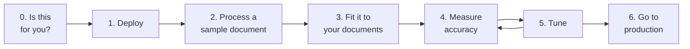

Copyright Amazon.com, Inc. or its affiliates. All Rights Reserved.
SPDX-License-Identifier: MIT-0

# Get Started

This page takes you from an empty AWS account to processing your own documents in
production, one step at a time. Each step says what you will do, how long it takes,
and how to tell that it worked, then links to the detailed page if you need more.

Steps 4 and 5 form a loop: measure, change one setting, measure again. Most of the
accuracy you will get comes from going round it a few times.

## Step 0: Decide whether this is the right tool

The accelerator turns documents (PDFs, images, office files) into structured data. It
reads each page with OCR or a vision model, works out which document types are present
and where each one starts and ends, extracts the fields you define, scores how
confident it is in each value, and routes uncertain results to a person for review.

It fits well when you have a recurring stream of documents of known types, you can
describe the fields you need, and you want the results in your own AWS account. It is
not an OCR-only service, a document management system, or a search engine over
documents.

Before you deploy, skim [How Document Processing Works](idp-fundamentals/index.md). It
describes the five problem sets every IDP system solves (digitization, splitting and
classification, extraction, confidence assessment and rule validation) and shows which of
them your kind of documents makes hardest. That tells you where to focus in steps 4 and 5.

The accelerator processes documents in one of two modes. You choose per configuration,
and you can change your mind later.

| | Pipeline mode (default) | BDA mode |
|---|---|---|
| What runs | OCR, then classification and extraction with Bedrock models you choose | Amazon Bedrock Data Automation handles the whole document |
| Control | Every prompt, model and threshold is configurable | Fewer settings; the managed service decides |
| Best for | Getting the most accuracy from a specific document type | A quick start with standard document types |
| Reference | [Pipeline mode](pattern-2.md) | [BDA mode](pattern-1.md) |

**You will need:** an AWS account where you can deploy with administrator access (or a
delegated deployment role), access to the Amazon Bedrock models you plan to use in your
region, and an email address for the first administrator.

## Step 1: Deploy

**About 15 minutes, most of it waiting.**

1. Open [Deployment](deployment.md) and choose **Launch Stack** for your region.
2. Set **AdminEmail** to an address you can read now. Leave the other parameters at
   their defaults for a first deployment. The default **ConfigurationPreset** is
   `lending-package-sample`, which matches the sample document in step 2.
3. Acknowledge the IAM capabilities and choose **Create stack**.

Two emails arrive while the stack deploys, and you need both:

- **Your temporary password** for the Web UI.
- **"AWS Notification - Subscription Confirmation"** for the alerts topic. Until you
  click its link, alarms fire but reach nobody. See
  [Who receives the alerts](monitoring.md#who-receives-the-alerts).

**Done when** the stack shows `CREATE_COMPLETE` and you can sign in to the Web UI from
the URL in the stack's **Outputs** tab.

Other ways to deploy, once you know you need them: [from source with the IDP CLI](deployment.md),
[without a Web UI](headless-deployment.md), [in a private network](deployment-private-network.md),
[VPC-secured](vpc-secured-mode.md), [in GovCloud](govcloud-deployment.md), or
[with Terraform](terraform.md).

## Step 2: Process a sample document

**About 5 minutes.**

1. In the Web UI, choose **Upload Documents**, then **Sample documents**.
2. Select the lending package and upload it.
3. Open **Document List**. The document moves through its stages and reaches
   `COMPLETED` in a few minutes.
4. Open the document. Look at three things:
   - **Sections**: the lending package holds several documents. Each one has been
     identified, given a class, and assigned its pages.
   - **Extracted data**: the fields for each section, with a confidence score per field.
   - **Pages**: the page images with the OCR text, so you can check a value against
     the source.

**Done when** you can find a field value on the page image and see the same value in the
extracted data. The [Web UI guide](web-ui.md#document-details) explains every panel.

## Step 3: Fit it to your documents

**An hour to a day, depending on how many document types you have.**

A configuration tells the accelerator which **document classes** to expect and which
**fields** to extract from each. You have three ways to build one, and you can combine
them:

| Start from | When | Guide |
|---|---|---|
| A conversation | You can describe your documents in words. An assistant drafts the classes and fields and activates them. | [Quick Start](quick-start.md) |
| Your own sample documents | You have examples but no schema. Discovery reads them and proposes classes and fields. | [Discovery](discovery.md) |
| A shipped preset | One of the presets in `config_library/unified/` is close to your documents. | [Configuration](configuration.md) |

Whichever you choose, review the result before relying on it: the field names, their
types, and the descriptions. The field descriptions are the instructions the model reads,
so a precise description is the cheapest accuracy improvement there is. Keep each version
you try as a separate [configuration profile](configuration-profiles.md) so you can
compare them in step 4.

**Done when** a few of your own documents process to `COMPLETED` with the classes and
fields you expect.

## Step 4: Measure accuracy

**A few hours, most of it preparing ground truth.**

You cannot tune what you have not measured. Build a test set:

1. Pick 20–50 documents that represent your real traffic, including the awkward ones:
   poor scans, long documents, unusual layouts.
2. Process them, then correct every extracted value by hand. The corrected result is the
   **ground truth** (the "baseline") for that document. See
   [Creating Custom Test Sets](creating-custom-test-sets.md).
3. Decide how each field should be compared: exact for an ID, a tolerance for an amount,
   fuzzy matching for a name. Evaluation uses [Stickler](https://github.com/awslabs/stickler),
   so the comparison method, strictness and weight of every field are yours to set. See
   [How to measure](idp-fundamentals/index.md#measure-it-on-your-documents).
4. In **Test Studio**, create a test set from those documents and run it against your
   configuration profile. The run scores every section and field against ground truth. See
   [Test Studio](test-studio.md).

Read the result field by field, not just the overall score. A field at 60% usually has
one cause you can fix, such as a vague description, a date format, or a value that sits
in a table. [Evaluation](evaluation.md) explains each metric and comparison method.

**Done when** you have a baseline score per field for your current configuration.

If you want a reference point before you have your own ground truth, Test Studio comes
with public benchmark test sets already loaded.
[Benchmark Datasets](idp-fundamentals/benchmark-datasets.md) says which problem set each one
measures, and each problem-set page says what we measured on it.

## Step 5: Tune

**Repeat until the numbers stop improving.**

Change one setting, run the same test set again, and compare. Work in pipeline order,
because errors flow downstream:

1. **Splitting and classification.** If your files hold several documents or many types,
   check section accuracy before field accuracy: a section with the wrong pages or class
   cannot be extracted correctly. See
   [Splitting and Section Classification](idp-fundamentals/splitting-and-classification.md).
2. **Digitization.** If values are wrong across the board, compare OCR readers before
   tuning extraction. See [Digitization (OCR)](idp-fundamentals/digitization.md).
3. **Extraction.** Improve field descriptions first, then try another model. For long lists,
   check that every row comes back before checking values. See
   [Key Information Extraction](idp-fundamentals/extraction.md).
4. **Confidence assessment.** If you will route review by confidence, check that the scores
   separate right from wrong per field. See
   [Confidence Assessment](idp-fundamentals/confidence-assessment.md).
5. **Rule validation.** Check the facts a rule needs before the verdict. See
   [Rule Validation](idp-fundamentals/rule-validation.md).

[Configuration guidance](benchmarking/config-guidance.md) has the measured trade-offs for
each option, and [Configuration Best Practices](idp-configuration-best-practices.md)
covers prompt and schema design.

**Done when** another change no longer moves the score, or the score meets the bar your
business needs.

## Step 6: Go to production

Work through these before you send real traffic:

- **Human review.** Decide which results a person checks and how they are routed:
  [Human Review](human-review.md) and [Review Queues](review-queues.md). Measure how often
  your confidence scores flag a wrong value before you rely on them to route work.
- **Monitoring.** Confirm the alerts subscription, and learn the dashboard:
  [Monitoring](monitoring.md).
- **Capacity and cost.** Size concurrency and Bedrock quotas for your volume, and estimate
  monthly cost from the cost per page you measured in step 4:
  [Capacity Planning](capacity-planning.md) and [Cost Calculator](cost-calculator.md).
- **Access and security.** Give each user the narrowest role they need, and review the
  threat model: [RBAC](rbac.md), [Threat Model](threat-model.md) and
  [AWS Services and IAM Roles](aws-services-and-roles.md).
- **Integration.** Send documents and collect results from your own systems with the
  [IDP CLI](idp-cli.md), the [IDP SDK](idp-sdk.md), a
  [post-processing Lambda hook](post-processing-lambda-hook.md), or the
  [MCP server](mcp-server.md).

Keep the test set from step 4. Re-run it whenever you change the configuration or upgrade
the stack, so a regression shows up in your numbers before it shows up in your data.

If something goes wrong, start with [Troubleshooting](troubleshooting.md).
