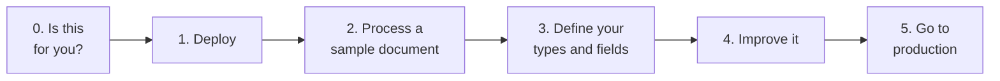

Copyright Amazon.com, Inc. or its affiliates. All Rights Reserved.
SPDX-License-Identifier: MIT-0

# Get Started

This page takes you from an empty AWS account to processing your own documents in
production, one step at a time. Each step says what you will do, how long it takes,
and how to tell that it worked, then links to the detailed page if you need more.

After step 3 you have a working pipeline. Step 4 is optional and ongoing: improve the
results at your own pace, by hand or with an agent.

## Step 0: Decide whether this is the right tool

The accelerator turns documents (PDFs, images, office files) into structured data. It
reads each page with OCR or a vision model, works out which document types are present
and where each one starts and ends, extracts the fields you define, scores how
confident it is in each value, and routes uncertain results to a person for review.

It fits well when you have a recurring stream of documents of known types, you can
describe the fields you need, and you want the results in your own AWS account. It is
not an OCR-only service, a document management system, or a search engine over
documents.

Before you deploy, skim [How Document Processing Works](idp-fundamentals/index.md). It
describes the five problem sets every IDP system solves (digitization, splitting and
classification, extraction, confidence assessment and rule validation) and shows which of
them your kind of documents makes hardest. That tells you where to focus in step 4.

The accelerator processes documents in one of two modes. You choose per configuration,
and you can change your mind later.

| | Pipeline mode (default) | BDA mode |
|---|---|---|
| What runs | OCR, then classification and extraction with Bedrock models you choose | Amazon Bedrock Data Automation handles the whole document |
| Control | Every prompt, model and threshold is configurable | Fewer settings; the managed service decides |
| Best for | Getting the most accuracy from a specific document type | A quick start with standard document types |
| Reference | [Pipeline mode](pattern-2.md) | [BDA mode](pattern-1.md) |

**You will need:** an AWS account where you can deploy with administrator access (or a
delegated deployment role), access to the Amazon Bedrock models you plan to use in your
region, and an email address for the first administrator.

## Step 1: Deploy

**About 15 minutes, most of it waiting.**

1. Open [Deployment](deployment.md) and choose **Launch Stack** for your region.
2. Set **AdminEmail** to an address you can read now. Leave the other parameters at
   their defaults for a first deployment. The default **ConfigurationPreset** is
   `lending-package-sample`, which matches the sample document in step 2.
3. Acknowledge the IAM capabilities and choose **Create stack**.

Two emails arrive while the stack deploys, and you need both:

- **Your temporary password** for the Web UI.
- **"AWS Notification - Subscription Confirmation"** for the alerts topic. Until you
  click its link, alarms fire but reach nobody. See
  [Who receives the alerts](monitoring.md#who-receives-the-alerts).

**Done when** the stack shows `CREATE_COMPLETE` and you can sign in to the Web UI from
the URL in the stack's **Outputs** tab.

Other ways to deploy, once you know you need them: [from source with the IDP CLI](deployment.md),
[without a Web UI](headless-deployment.md), [in a private network](deployment-private-network.md),
[VPC-secured](vpc-secured-mode.md), [in GovCloud](govcloud-deployment.md), or
[with Terraform](terraform.md).

## Step 2: Process a sample document

**About 5 minutes.**

1. In the Web UI, choose **Upload Documents**, then **Sample documents**.
2. Select the lending package and upload it.
3. Open **Document List**. The document moves through its stages and reaches
   `COMPLETED` in a few minutes.
4. Open the document. Look at three things:
   - **Sections**: the lending package holds several documents. Each one has been
     identified, given a class, and assigned its pages.
   - **Extracted data**: the fields for each section, with a confidence score per field.
   - **Pages**: the page images with the OCR text, so you can check a value against
     the source.

**Done when** you can find a field value on the page image and see the same value in the
extracted data. The [Web UI guide](web-ui.md#document-details) explains every panel.

## Step 3: Define your document types and fields

**An hour to a day, depending on how many document types you have.**

Tell the pipeline what you receive and what you need from it: your **document types**, and
the **fields** to extract from each. You have three ways to start, and you can combine them:

| Start from | When | Guide |
|---|---|---|
| A conversation | You can describe your documents in words. An assistant drafts the types and fields and activates them. | [Quick Start](quick-start.md) |
| Your own sample documents | You have examples but no schema. Discovery reads them and drafts types and fields. | [Discovery](discovery.md) |
| A shipped preset | One of the presets in `config_library/unified/` is close to your documents. | [Configuration](configuration.md) |

Review the draft before you rely on it, especially the field descriptions. A description is
the instruction the model follows, so a precise one ("statement period: the date range the
statement covers, YYYY-MM-DD to YYYY-MM-DD") is the quickest accuracy gain there is.

**Done when** your own documents come out as records with the types and fields you defined.
You now have a working pipeline.

## Step 4: Improve it

**Ongoing, at your own pace.**

Process real documents and look at the results. Each record shows the extracted values next
to the page they came from, and the accelerator flags results with low confidence or a
failed rule for review. When a field keeps coming back wrong, make its description more precise, or try
another model, and run the documents again.

You don't have to do the experimenting yourself. The
[Auto Optimizer](extensions/auto-optimizer.md) is an agent that tries changes to prompts,
models and settings within a cost budget you set, and keeps the ones that score better.

**Ground truth makes improvement measurable.** It is optional, and the accelerator builds
most of it for you. Upload a few dozen of your documents to Test Studio, and the accelerator
drafts the correct answers, ranks them worst-first, tells you how many to check, and saves
the checked answers as a test set. From then on it scores every change field by field, and
you decide what counts as a match for each field. See
[Measure with ground truth](idp-fundamentals/index.md#4-measure-with-ground-truth).

Where to look first depends on your documents:

- **Several documents per file, or many types:** check that each document is found and
  typed correctly. See
  [Splitting and Section Classification](idp-fundamentals/splitting-and-classification.md).
- **Values wrong across the board:** check the text the pipeline read. See
  [Digitization (OCR)](idp-fundamentals/digitization.md).
- **Specific fields wrong, or rows missing from long lists:** see
  [Key Information Extraction](idp-fundamentals/extraction.md).
- **Too much, or too little, sent to review:** see
  [Confidence Assessment](idp-fundamentals/confidence-assessment.md).
- **Business rules:** see [Rule Validation](idp-fundamentals/rule-validation.md).

[Configuration guidance](benchmarking/config-guidance.md) has the measured trade-offs for
each option, and [Configuration Best Practices](idp-configuration-best-practices.md) covers
prompt and schema design.

## Step 5: Go to production

Work through these before you send real traffic:

- **Human review.** Decide which results a person checks, and the accelerator routes them:
  [Human Review](human-review.md) and [Review Queues](review-queues.md). Measure how often
  your confidence scores flag a wrong value before you rely on them to route work.
- **Monitoring.** Confirm the alerts subscription, and learn the dashboard:
  [Monitoring](monitoring.md).
- **Capacity and cost.** Size concurrency and Bedrock quotas for your volume, and estimate
  monthly cost from the cost per page of your own documents:
  [Capacity Planning](capacity-planning.md) and [Cost Calculator](cost-calculator.md).
- **Access and security.** Give each user the narrowest role they need, and review the
  threat model: [RBAC](rbac.md), [Threat Model](threat-model.md) and
  [AWS Services and IAM Roles](aws-services-and-roles.md).
- **Integration.** Send documents and collect results from your own systems with the
  [IDP CLI](idp-cli.md), the [IDP SDK](idp-sdk.md), a
  [post-processing Lambda hook](post-processing-lambda-hook.md), or the
  [MCP server](mcp-server.md).

If you built a test set in step 4, keep it. Re-run it whenever you change the configuration
or upgrade the stack, so a regression shows up in your numbers before it shows up in your
data.

If something goes wrong, start with [Troubleshooting](troubleshooting.md).
