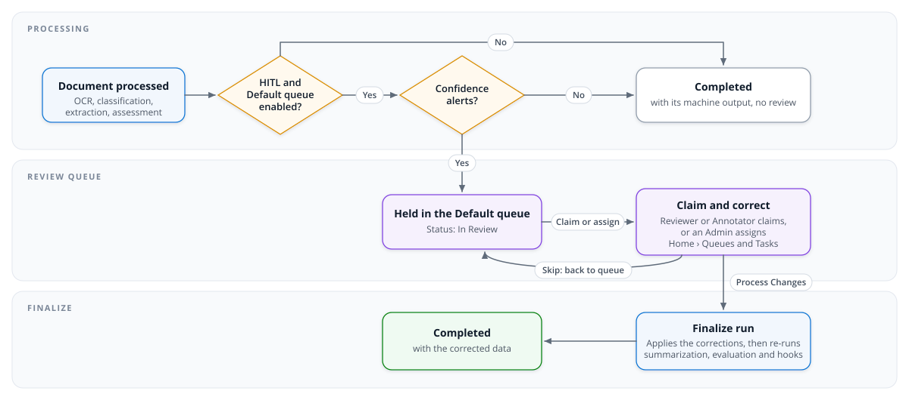

# Human-in-the-Loop (HITL) Review

Copyright Amazon.com, Inc. or its affiliates. All Rights Reserved.
SPDX-License-Identifier: MIT-0

## Table of Contents

- [Overview](#overview)
- [Architecture](#architecture)
- [Who reviews](#who-reviews)
  - [User Personas](#user-personas)
  - [Managing Users](#managing-users)
- [Workflow](#workflow)
  - [Review Status Values](#review-status-values)
- [Configuration](#configuration)
- [Document Editor](#document-editor)
- [Best Practices](#best-practices)
- [Troubleshooting](#troubleshooting)
- [When the Default queue is off](#when-the-default-queue-is-off)

## Overview

Human-in-the-loop (HITL) review sends a processed document to a person before it
finishes, when its extracted values aren't confident enough to be trusted on their
own. The person checks and corrects the values, and the document then finishes with
the corrected data.

Review is **queue based**. A document that needs review is held in a **review queue**,
and the people who review work it from **Home › Queues** and **Home › Tasks** in the
Web UI: they claim an item, correct it in the edit page, and finish it with **Process
Changes**. Admins oversee the queues in **Review Studio › Review Management**. Every
page and setting of the queues is described in [Review queues](review-queues.md); this
page is the overview of the review process.

https://github.com/user-attachments/assets/0bf14b62-99dc-4538-a015-d8b89fa2f1f0

**Supported processing modes:** both.
- BDA mode: Amazon Bedrock Data Automation processing with HITL review
- Pipeline mode: Textract or LLM-based OCR + Bedrock processing with HITL review

**Key Features:**
- Production review queues, managed by Admins, plus one Test Studio queue per test set
- Reviewers and Annotators work their queues from **Home › Queues** and **Home › Tasks**,
  and get an Inbox message when work is assigned to them
- Every item is held to the caller's configuration-profile scope
- One edit page for every item, with the page images beside the fields, each review
  reason, and a draft saved as you type
- Corrections are applied by a second (finalize) run that reuses the document's OCR,
  classification and extraction

## Architecture



_How a document moves through review: processing decides whether it is queued, a Reviewer or Annotator claims and corrects it (or skips it back to the queue), and the finalize run completes it with the corrected data._

- **Routing.** At the end of the first run, a document is held in the **Default** queue
  when HITL is enabled in its configuration (`hitl.enabled`), the Default queue is
  enabled, and the document raised a confidence alert. Its status becomes
  `HITL_IN_PROGRESS`, shown as **In Review**, and the machine output is kept. The exact
  rules, including BDA blueprint confidence, are in
  [How a document reaches a queue](review-queues.md#how-a-document-reaches-a-queue).
- **Queues are system-wide**, not part of any Configuration Profile, so one queue holds
  items of several profiles. Each item keeps its own profile, and that profile decides
  who may see and work it.
- **The finalize run** starts when the item is finished. It reuses the first run's OCR,
  classification and extraction, applies the corrections, and runs summarization,
  evaluation, rule validation and the post-processing hooks. Those steps run only after
  review, so they always see the corrected data.
- **Review state** is kept in DynamoDB (the stack's `HITLTable`), and each routed
  document has a status object at
  `s3://<OutputBucket>/<documentKey>/review/status.json` that downstream consumers can
  trigger on (see [Review status for downstream consumers](review-queues.md#review-status-for-downstream-consumers)).

## Who reviews

### User Personas

| Persona | What they do in review |
|---|---|
| **Admin** | Manages the queues in **Review Studio › Review Management**: their settings, their **Eligible Annotators**, and their items (**Assign to…**, **Unassign**, **Move…**, **Remove from queue…**). Can open any item, work an unassigned one, and **Take over** one assigned to someone else. |
| **Reviewer** | Works **every** Production queue, with no Admin assignment: claims items, corrects them, and finishes or skips them. Also works every Test Studio queue whose test set's profile is in their scope. A Reviewer is never assigned work; they claim their own. |
| **Annotator** | Works the queues that list them in **Eligible Annotators**: claims their items, or is assigned them by an Admin, and finishes or skips them. Also works the test sets in their `allowedTestSets`. |
| **Author**, **Viewer** | Don't work review queues. A document in review opens read-only for them, saying it is edited in its queue. |

**Configuration scope applies to every item.** A user's `allowedConfigVersions` limits
which profiles' items they can work. An item whose profile is outside it isn't listed
in any queue or in Tasks, is skipped by **Next item**, and can't be opened, claimed,
saved, skipped or finished. That holds even for an item the user already holds, if
their scope has been narrowed since. A user with no restriction works every profile's
items. See [rbac.md](rbac.md).

**What reviewers see.** A Reviewer or Annotator whose only work is review (no Admin,
Author or Viewer role) sees **Home** (**Inbox**, **Tasks** and **Queues**) and
**Deployment Info**, and lands on **Home › Tasks** after signing in. A Reviewer or
Annotator who also holds another role keeps that role's navigation, with **Tasks** and
**Queues** added under **Home**.

### Managing Users

User management is available to Admins in **User Management**.

#### Creating a New User

1. Choose **Create User**.
2. Enter the user's email address.
3. Choose the persona: **Admin**, **Author**, **Reviewer**, **Annotator** or **Viewer**.
   For someone who reviews, choose **Reviewer** to have them work every Production
   queue, or **Annotator** to have them work only the queues an Admin lists them on.
4. Optionally restrict the user to some Configuration Profiles
   (`allowedConfigVersions`); review items of other profiles are then out of their reach.
5. Choose **Create**.

The system creates the user record in DynamoDB and the user in Cognito, adds them to
the persona's Cognito group, and sends them a temporary password by email.

An Annotator works a Production queue once an Admin lists them in that queue's
**Eligible Annotators** (Review Management › the queue's **Settings**). A Reviewer
needs nothing more: they work every Production queue as soon as they sign in.

#### Deleting a User

Choose **Delete** in the user's row and confirm. The user is removed from both
DynamoDB and Cognito.

#### User Synchronization

Users created in Cognito directly are synchronized to DynamoDB when the user list is
loaded. The persona comes from the user's Cognito groups, highest first: Admin,
Author, Reviewer, Annotator, Viewer. A user in none of them is shown as Viewer.

## Workflow

### Review Status Values

A document in review has the status **In Review** (`HITL_IN_PROGRESS`). Its queue item
is in one of these states, shown on the queue's page:

| State | Meaning |
|---|---|
| **Pending** | Waiting in its queue, assigned to nobody. Any Reviewer, and any Annotator the queue lists, can claim it. |
| **Assigned** | Claimed by, or assigned to, one person. Only they (or an Admin taking it over) can work it. |
| **In Progress** | Assigned, and the assignee has saved work. |

When the review ends, the document finishes:

| Outcome | Document status |
|---|---|
| **Process Changes** | `COMPLETED`, with the corrected data, after the finalize run |
| An Admin's **Remove from queue…** | `COMPLETED`, with the machine output unchanged |
| The API's `rejectReviewItem` | `REJECTED`, with the machine output unchanged (the Web UI doesn't offer it) |

The document records **Review Owner** (the item's assignee) and **Review Completed By**
(whoever finished it).

### 1. Automatic Triggering

A document is held for review when all of these are true:
- HITL is enabled in the document's configuration (`hitl.enabled: true`)
- The Default queue is enabled (it is on a new stack)
- The document raised a confidence alert: a field's confidence is under its own
  threshold (`x-aws-idp-confidence-threshold` in the class schema), or under
  `hitl.confidence_threshold` when it has none; or, in BDA mode, the matched
  blueprint's confidence is under `hitl.confidence_threshold` or unusable

Each alert becomes a **review reason** on the item. A document with no alerts isn't
queued, and documents processed by a Test Studio run are never held in a Production
queue.

### 2. Review Process

**For Reviewers and Annotators:**

1. **Find work.** Open **Home › Queues** to see the queues you work: every Production
   queue for a Reviewer, the queues that list you for an Annotator. Open a queue to see
   its items. **Home › Tasks** lists everything assigned to you; its badge counts it.
   An Admin's assignment also sends you an Inbox message.
2. **Claim an item.** On a queue's page, choose **Claim** on an item nobody holds, or
   **Next item** to claim the next one waiting. The item is assigned to you and appears
   in your Tasks. You can open any item read-only first; an item someone else holds
   stays view-only.
3. **Review and correct.** Open the item from Tasks. It opens in the
   [edit page](#document-editor). **Review Reason** lists why it is in review, worst
   first, and the editor opens on the fields with confidence alerts. Correct the
   values. Your edits are saved as a draft as you type, or at once with **Save**;
   saving doesn't finish the review, so you can come back to it. **Edit Page
   Grouping**, on the Document Editor panel, corrects how the document is split into
   sections.
4. **Finish.** Choose **Process Changes**. It saves your latest edits, asks you to
   confirm, and applies your corrections in the finalize run. The item leaves your
   Tasks, the queue counts it as completed, and the document ends `COMPLETED`.
5. **Or give it back.** If you can't finish it, choose **Skip** and pick a reason from
   the queue's skip list, with an optional note. The item goes back to its queue,
   unassigned and unfinished, and its draft is kept for whoever claims it next.

**For Admins:**

- **Assign work.** In **Review Studio › Review Management**, open a queue, select items
  and choose **Assign to…** to give them to one of the queue's Annotators. **Unassign**
  returns an item to its queue, keeping its draft. Reviewers aren't assigned work.
- **Work an item.** Open an item from its queue's page. Editing an unassigned item, or
  choosing **Process Changes** on it, assigns it to you. An item assigned to someone
  else is view-only, with **Take over**, which assigns it to you, keeps its draft and
  tells the former assignee.
- **Take an item out of review.** **Remove from queue…** ends the document `COMPLETED`
  with its machine output, applying no draft; an assignee is told.
- **Reminders.** An assignment doesn't expire. When a queue's time limit passes on an
  open item, its assignee gets one **still to complete** reminder in the Inbox.

The full Admin guide is in
[Admin guide: Review Management](review-queues.md#admin-guide-review-management).

### 3. Result Integration

When an item is finished with **Process Changes**:
- The finalize run applies the corrections and writes the document's final outputs to S3
- Summarization, evaluation, rule validation and the optional post-processing hook
  (`PostProcessingLambdaHookFunctionArn`) run on the corrected data
- The document ends `COMPLETED`, and **Review Completed By** records who finished it
- The review status object becomes `complete`, and the item's history (claims,
  assignments, skips with their reasons, completion) is kept

While a document is in review it is corrected only from its queue item: its other
change actions (**Edit Page Grouping**, **Re-extract Sections**, **Edit Page Text**,
**Reset Page Class**, **Use As Evaluation Baseline**) are disabled, and the server
refuses them. Reprocessing, aborting or deleting a document in review withdraws its
review.

## Configuration

### Enabling HITL

HITL is a **configuration setting**, not a stack parameter. Review queues then need
someone to work them and the Default queue enabled:

1. **Turn on HITL** in each Configuration Profile whose documents should be reviewed,
   either in the Web UI (**Configuration** › **Human-in-the-Loop (HITL) Review
   (Optional)** › **Enabled**, then **Save**) or in the configuration YAML:

   ```yaml
   hitl:
     enabled: true
     confidence_threshold: 0.8
   ```

   Set it in the configuration passed as `CustomConfigPath` (or
   `idp-cli deploy --custom-config`) for a new stack to come up with HITL on.
2. **Give people a review role** in **User Management**: **Reviewer** (works every
   Production queue) or **Annotator** (works the queues that list them). With an
   external identity provider, map a group instead (see [external-idp.md](external-idp.md)).
3. **Check the Default queue.** In **Review Studio › Review Management**, open the
   Default queue's **Settings**, make sure **Enabled** is on, and list any Annotators
   under **Eligible Annotators**. A change applies to documents processed after it.

> The `EnableHITL` CloudFormation parameter was removed in v0.4.11. If you are
> upgrading from before that release and had `EnableHITL=true`, re-enable HITL in the
> configuration as above; the parameter no longer exists and passing it is rejected.

### Confidence Threshold Configuration

Queues have no threshold of their own. The confidence alerts decide routing: each
field's own threshold in the class schema (`x-aws-idp-confidence-threshold`),
otherwise `hitl.confidence_threshold`, the same thresholds that drive the alerts and
field highlights (see [extraction-and-confidence.md](extraction-and-confidence.md)).

1. Open **Configuration** in the Web UI.
2. Find the **Human-in-the-Loop (HITL) Review (Optional)** section.
3. Set **Confidence threshold** (0.0–1.0, the `hitl.confidence_threshold` key):
   - `0.8` = 80% confidence threshold (recommended starting point)
   - A confidence that is NaN or infinite is not a usable score and is read as 0.0, so
     it triggers review too
4. Choose **Save**.

Without confidence scoring, only BDA's blueprint confidence can queue a document.

## Document Editor

Every review item opens in the **edit page**: a Production item at its document's edit
page, `#/documents/<document>/edit`, and a Test Studio item at
`#/review-queues/test-sets/<id>/items/<document>`. `?section=<id>` opens one section,
`?field=<path>` one field, and `?view=source` the original file. The breadcrumbs read
**Home**, then the item's queue or test set, then the document.

The title is the document's name with the item's status in parentheses, with the full
object key under it. The actions are in one bar at the top:

| Where | Action | What it does |
|---|---|---|
| Bar | **Edit \| View** | **View** shows the original file in the editor's place; unsaved edits are kept |
| Reports | **History** | **Field Edits** (every field a save changed: **When**, **By**, **Field**, **From**, **To**) and **Review Activity** (who claimed, was assigned, skipped or completed the item) |
| Reports | **Summary** | The document's summary, once its review is complete |
| Reports | **Processing Report** | How the open section was extracted |
| More Actions | **Use As Evaluation Baseline** | Copies the finished document's results into the evaluation baseline (Admin, Author) |
| Document Editor panel | **Edit Page Grouping** | Opens the page-grouping board, where each section's pages are changed (the item's holder) |
| Button | **Skip** | Gives the item back to its queue, with a reason |
| Button | **Cancel** | Leaves the item without finishing it; asks before discarding unsaved edits, and keeps the saved draft |
| Button | **Save** | Saves the draft now (it is also saved as you type) |
| Button | **Process Changes** | Saves your latest edits, confirms, and applies the corrections |

For a Reviewer or Annotator viewing an item nobody holds, the bar offers **Claim**
instead of the editing buttons. A button that doesn't apply is left out; a menu item
that doesn't apply yet stays in its menu, disabled, with the reason on hover. The info
icon opens a panel describing the screen. **Review Reason**, above the editor, lists
the item's alerts, worst first: the five lowest-confidence are shown, **+N more
alerts** lists the rest, and hovering a reason shows the field, the score and the
threshold.

The **Document Editor** panel holds the editor: the page images beside the fields,
with a **Section** dropdown at its top left listing each section with its class, and
**Show Fields** set to **Confidence alerts only** when the item has review reasons.
Changing a section's class isn't available for a Production document in review;
regrouping pages is, with **Edit Page Grouping**.

#### Navigation Controls
- **Mouse Wheel Zoom**: Zoom in/out using the mouse wheel without requiring modifier keys
- **Click-and-Drag Panning**: Pan around zoomed images by clicking and dragging (cursor shows grab/grabbing state)
- **Rotate**: Turn a sideways or upside-down page in 90° steps, either direction. The rotated page is re-fitted to the panel rather than cropped, bounding-box overlays rotate with it, the rotation stays applied as you move between pages, and **Reset View** clears it along with zoom and pan
- **Section Navigation**: Choose a section from the **Section** dropdown at the top left of the Document Editor panel; unsaved edits ask before switching

#### Tabbed Interface

**Visual Editor Tab**
- Split-pane layout with document image (left) and form-based field editing (right)
- Bounding box overlay highlighting field locations on the document
- Color-coded confidence indicators (green=meets threshold, red=below threshold, black=no threshold)
- Inline editing with visual change tracking (✏️ Edited badges)

**JSON Editor Tab**
- Raw JSON editing for advanced users
- Section filtering with multiselect dropdown to focus on specific sections
- Full JSON validation before saving

#### Editing Features

- Edit extracted field values directly in the visual editor, with a blue left border
  on each modified field
- When evaluation is enabled, edit baseline (expected) values alongside the
  predictions, tracked separately (orange left border); a Reviewer doesn't save
  baseline edits
- **Process Changes** applies the edits; **Cancel** discards unsaved ones after asking

#### Smart Filtering

- **Low Confidence Filter**: Show only fields with confidence scores below threshold
- **Evaluation Mismatches Filter**: Show only fields that don't match baseline (when evaluation enabled)
- **Collapsible Tree Navigation**: Expand/Collapse All buttons for nested data structures
- **Individual Node Toggle**: Click ▶/▼ to expand or collapse specific objects/arrays

#### Evaluation Comparison Mode

When evaluation data is available, turn on **Show Evaluation**:
- Side-by-side display of prediction and baseline values for each field
- Match indicators showing ✓ Match or ⚠ Mismatch status
- Evaluation scores and LLM-generated comparison reasons
- Aggregate scores for nested groups and arrays

## Best Practices

### Review Management

- **Claim before editing**: claim an item (or use **Next item**) so nobody else works it
  at the same time
- **Skip rather than abandon**: if you can't finish an item, **Skip** it with a reason so
  it goes back to the queue for someone else
- **Keep the Default queue staffed**: list Annotators on it, or give reviewers the
  Reviewer role, so queued documents don't wait
- **Consistent standards**: agree correction guidelines across reviewers, and use the
  queue's skip reasons to record why work was handed back
- **Quality checks**: spot-check finished items through **Reports › History**

### Threshold Optimization

- **Start conservative**: begin with higher thresholds (0.8–0.9) and adjust based on accuracy needs
- **Use per-field thresholds**: set `x-aws-idp-confidence-threshold` on the fields that
  matter most, rather than lowering the profile-wide threshold
- **Iterative refinement**: use review corrections to improve extraction prompts

### User Management

- **Least privilege**: give review-only users the Reviewer or Annotator role, and
  restrict them to the Configuration Profiles they review
- **Reviewer or Annotator**: choose Reviewer for people who should take any Production
  work; choose Annotator when an Admin decides who works which queue
- **Regular audits**: periodically review the user list and remove inactive users

## Troubleshooting

### Common Issues

**Documents not reaching a queue:**
- Verify HITL is enabled in the document's Configuration Profile
- Verify the Default queue is enabled in **Review Studio › Review Management**
- Check the confidence thresholds, and that extraction confidence scores are being calculated
- Documents processed by a Test Studio run are reviewed in their test set's queue, not a Production queue

**A reviewer can't see a queue or an item:**
- An Annotator sees only the queues that list them in **Eligible Annotators**
- An item whose profile is outside the user's `allowedConfigVersions` is never shown to them
- Verify the user's persona and scope in **User Management**, then have them sign out and in again

**Cannot claim an item:**
- Someone else may hold it: an item someone holds stays view-only
- The item may have finished or been removed from its queue; refresh the queue's page

**Cannot finish an item:**
- Only the item's assignee, or an Admin, can finish it
- An item whose profile has gone out of the user's scope is refused, even one they hold

### Monitoring

- **Review Studio › Review Management** shows each queue's items, pending, assigned and
  Annotators, and each queue's page its progress and who holds what
- The review status object (`review/status.json`) lets downstream systems react when a
  review finishes
- **CloudWatch Metrics**: track review completion rates

### Review History

Each item's history records who claimed it, was assigned it, skipped it (with the
reason and note) and completed it, with timestamps. It is shown in the edit page's
**Reports › History › Review Activity**, and the document records **Review Owner** and
**Review Completed By**.

## When the Default queue is off

The Default queue is enabled on a new stack. If an Admin turns it off while HITL stays
enabled in a profile, documents that raise confidence alerts are not queued: they wait
as **Review Pending** and are reviewed on their document page instead, with **Start
Review** and **Process Changes** (or **More Actions › Skip All Reviews**). That page is
reached only by an Admin, or a Reviewer who also holds Author or Viewer; a Reviewer or
Annotator whose only work is review has no navigation to it. Keep the Default queue
enabled whenever review-only users do the reviewing. Turning it off stops new documents
from being queued; items already in review stay there and can be finished.
