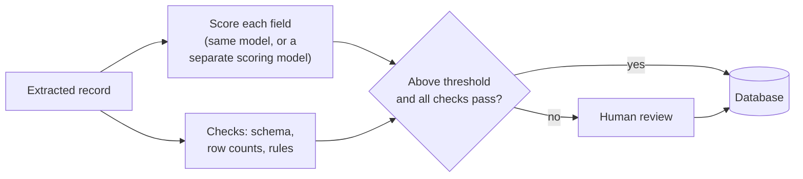

Copyright Amazon.com, Inc. or its affiliates. All Rights Reserved.
SPDX-License-Identifier: MIT-0

# Confidence Assessment

## What it does

Confidence assessment gives every result a score for how likely it is to be right: each
extracted field, and each document's type. The score lets you automate the results you can
trust and send only the rest to a person. When it works, your reviewers spend their time on
the few fields that need them, and everything else flows straight into your database.

## Getting it right

**Know what you want the score for.** A score can do two jobs:

- **Reporting:** "how accurate is this batch overall?" This needs the scores to be
  *calibrated*: across many fields, a score of 0.9 should mean about 90% are right.
- **Routing review:** "which fields should a person check?" This needs the scores to
  *discriminate*: wrong fields should score lower than right ones.

A score can do the first job well and the second poorly. Decide which job matters to you,
and choose a scoring model that does it.

**Set thresholds per field.** An account number and a free-text note need different bars.
Set a high threshold on the fields your business depends on and a lower one elsewhere. See
[Confidence thresholds](../extraction-and-confidence.md#6-confidence-thresholds).

**Combine the score with checks that cannot be wrong.** A failed format check, a short list
or a failed business rule is a certain reason to look again. The accelerator reports all
three alongside the confidence score.

**Remember that a missing row has no score.** Confidence rates the values that came back. For
long lists, rely on the accelerator's row-count check to catch rows that never came back.

## Your documents

- **Long tables:** use the row-count check for completeness, and confidence for the values.
- **Poor scans and handwriting:** choose a scoring model that discriminates, because the
  errors that matter look plausible.
- **Identity documents:** a cross-check of the printed fields against the machine-readable
  zone is the strongest review signal there is.
- **Several documents per file:** read the confidence of each document's type as well as its
  fields.

## How confidence works



| Scoring | How it works | Best for |
|---|---|---|
| **Separate pass** (default) | A second model reads the extracted record and the page, and scores every field | Choosing the scoring model independently of extraction |
| **Integrated** | The extraction model scores its own answers in the same call | Short documents, where it adds little cost |
| **Off** | No scores | Pipelines that review everything, or none |

See [the three confidence modes](../extraction-and-confidence.md#the-three-confidence-modes).

## How to measure it

Measure confidence on the same ground truth you use for extraction. For each scored field you
know two things: its score, and whether it was right. Test Studio turns those into three
numbers per field:

| Number | Question it answers | What good looks like |
|---|---|---|
| **AUROC** | Do wrong fields score lower than right ones? | 0.5 is chance; 0.8 or more is useful for routing |
| **Calibration error** | Do the scores match the observed accuracy? | Close to 0 |
| **Review effort** | How many documents must a person check to reach a target accuracy? | As few as possible |

See [field-level metrics](../test-studio.md#field-level-metrics) and
[How much review is enough?](../test-studio.md#how-much-review-is-enough).

## What we measured

### Field confidence

**Dataset:** [synthetic bank statements](benchmark-datasets.md#synthetic-bank-statements),
about 70,000 fields with exact ground truth, of which about 60 were wrong. Extraction stayed
the same, and only the scoring model changed. **Run:** releases 0.6.8 and 0.6.9,
September 2026.

| Scoring model | AUROC (routing) | Calibration error (reporting) | Distinct score levels |
|---|---|---|---|
| Amazon Nova Lite (**default**) | 0.42 | 0.004 | 1 |
| Amazon Nova 2 Lite | 0.47 | 0.001 | 1 |
| Claude Sonnet 5 | **0.86** | 0.024 | 6 |

Source: [Confidence Calibration study](../benchmarking/studies/confidence-calibration.md).

On release 0.6.14 (November 2026), across about 120,000 fields on the same statements:

| Scoring model | Fields scored below 0.9 | Scoring cost per page |
|---|---|---|
| Amazon Nova Lite (default) | 0 | $0.013 |
| Claude Sonnet 5 | about 640 | $0.085¹ |

¹ Corrected for a known pricing error that overstates Claude Sonnet 5 by 1.5×
([#1830](https://github.com/aws-solutions-library-samples/accelerated-intelligent-document-processing-on-aws/issues/1830)).
Source: `benchmarks/results/v0.6.14/coresynth__confidence-model-*/`.

What this shows:

- **The default scoring model is a low-cost reporting tool.** It is well calibrated, so it
  tells you how accurate a batch is overall, and it rarely sends anything to review.
- **To route review by confidence, choose Claude Sonnet 5 as the scoring model.** It ranked
  the wrong fields low (AUROC 0.86) without changing extraction accuracy, at a higher scoring
  cost per page.

### Document-type confidence

**Dataset:** [DocSplit-Poly-Seq](benchmark-datasets.md#docsplit-poly-seq), 20 packets
(298 pages, 13 document types). **Run:** release 0.6.7, September 2026, one run per model.

| Classifier | Page accuracy | AUROC | Classification cost per page |
|---|---|---|---|
| Amazon Nova 2 Lite (default) | 0.846 | 0.70 | $0.0009 |
| Claude Haiku 4.5 | 0.852 | **0.93** | $0.0057 |

Source: [Classification Confidence study](../benchmarking/studies/classification-confidence.md).

**Claude Haiku 4.5's type scores separated right from wrong far better,** at the same
accuracy and about 6 times the classification cost, which is still well under a cent per
page. Choose it when you route review by document type.

**How far this carries:** the field results rest on about 60 wrong fields in synthetic
documents, and the type results on 20 packets, both from earlier releases. Measure on your
own test set before you set thresholds.

## Reproduce it

**On your own documents.** Run your test set in [Test Studio](../test-studio.md) with
confidence on, and read AUROC and calibration error for each field. Then switch the scoring
model and run it again.

**The benchmark.**

```bash
M=benchmarks/harness/make_configs.py
for m in nova_lite nova_2_lite sonnet5; do
  python3 $M --suite coresynth --class bank_statement --set confidence_model=$m
  python3 benchmarks/harness/run_matrix.py --stack <STACK> --suite coresynth --set confidence_model=$m
done
# Pooled calibration and AUROC from the committed results, offline:
python3 benchmarks/harness/aggregate.py --calibration \
  benchmarks/results/v0.6.14/coresynth__confidence-model-*/summary.json
```

The study pages give the full steps, including re-scoring existing runs without new
inference.

## In the accelerator

- **Choose a confidence mode and scoring model:**
  [Confidence Assessment](../extraction-and-confidence.md#3-confidence-assessment) and
  [Confidence configuration](../configuration.md#confidence-assessment-configuration).
- **Score document types:**
  [classification confidence](../configuration.md#classification-confidence-classificationcombinedllmconfidence).
- **Set thresholds:**
  [Confidence thresholds](../extraction-and-confidence.md#6-confidence-thresholds) and
  [Confidence Threshold Configuration](../human-review.md#confidence-threshold-configuration).
- **Route results to people:** [Human Review](../human-review.md), and
  [Review Queues](../review-queues.md#how-a-document-reaches-a-queue) for routing to the right
  team.
- **See where each value came from:**
  [bounding boxes](../extraction-and-confidence.md#4-geometry--bounding-boxes) in the review
  editor.
