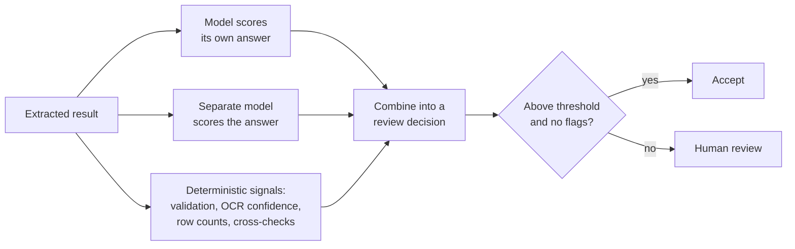

Copyright Amazon.com, Inc. or its affiliates. All Rights Reserved.
SPDX-License-Identifier: MIT-0

# Confidence Assessment

## The problem

Attaching to each result a score that says how likely it is to be right: each extracted
field, each section's class, each split point. The score exists to answer one practical
question: **which results does a person need to check?** A system that is 95% accurate and
points to its 5% of errors needs a fraction of the review effort of one that is 97%
accurate and points to nothing.

## What makes it hard

- **Two different properties, often confused.**
  - **Calibration** asks whether a score of 0.9 means right 90% of the time, across many
    results.
  - **Discrimination** asks whether the wrong results get lower scores than the right ones.

  Routing review by confidence depends on discrimination. A score can be perfectly
  calibrated and still useless for routing: if every field gets 0.99 and 99% of fields are
  right, the score is calibrated and tells you nothing about which field is wrong.
- **Models are overconfident about their own mistakes.** A model asked to rate its own
  answer tends to rate it highly, especially when the answer is fluent and plausible.
- **Errors are rare,** so measuring discrimination needs many results and enough errors
  among them. A test set with no errors cannot tell you whether the score would have caught
  one.
- **Missing results have no score.** A row that was never extracted has no confidence to
  be low. Confidence cannot replace a completeness check.
- **It costs money.** A separate scoring pass can cost as much as the extraction it scores.

### How document characteristics affect it

- **Long tables:** completeness failures (missing rows) are invisible to field confidence.
  Use row-count checks.
- **Poor scans and handwriting:** the errors that matter most are the plausible ones, which
  are also the ones a model is most confident about.
- **Identity documents:** a cross-check, such as the printed fields against the
  machine-readable zone, is usually a better review signal than any model score.
- **Multi-document files:** a section's class confidence and its boundary confidence are
  separate signals, and both matter.

## Approaches



| Signal | Strength | Weakness |
|---|---|---|
| **Same model, in the same call** | Cheapest | Least independent; tends to agree with itself |
| **Separate scoring pass** | Independent; the scoring model can be chosen for discrimination | Extra cost and latency |
| **Deterministic signals** | Exact and explainable: a failed format check or a row shortfall is certain | Only covers what can be checked by rule |
| **Agreement** between two models or two runs | Disagreement is a strong error signal | Doubles the cost |

In practice the best review decisions combine a model score with deterministic flags, and
set thresholds per field rather than one for the whole document.

## How to measure it

Measure confidence against the same ground truth you use for extraction and
classification. For every scored result you need two things: its confidence, and whether it
was right. From those:

| Metric | Question | Good |
|---|---|---|
| **AUROC** (discrimination) | How often does a wrong result score lower than a right one? | 0.5 is chance; above about 0.8 is useful for routing |
| **Calibration error (ECE)** | How far are the scores from the observed accuracy? | Close to 0 |
| **Distinct score values** | Does the score spread out, or does everything get the same value? | Several distinct levels |
| **Alert rate and errors caught** at a threshold | If I review everything below the threshold, how much do I review and what share of the errors do I find? | Few alerts, most errors caught |

Stickler reports confidence alongside each field's comparison result, so calibration and
discrimination come from the same evaluation run as accuracy, per field. Read them per
field: one field can be well scored while another is not. Include enough documents to
contain real errors, otherwise discrimination cannot be measured.

## What we measured

### Field confidence: calibrated, but not always discriminating

**Dataset:** [synthetic bank statements](benchmark-datasets.md#synthetic-bank-statements),
about 70,000 scored cells with exact ground truth, of which about 60 were wrong. Extraction
was held fixed and only the scoring model changed. **Run:** releases 0.6.8 and 0.6.9,
September 2026.

| Scoring model | Wrong cells | Calibration error | AUROC | Distinct score bins |
|---|---|---|---|---|
| Amazon Nova Lite (**default**) | 55 of 70,320 | 0.004 | **0.42** | 1 |
| Amazon Nova 2 Lite | 64 of 70,242 | 0.001 | 0.47 | 1 |
| Claude Sonnet 5 | 66 of 70,242 | 0.024 | **0.86** | 6 |

Source: [Confidence Calibration study](../benchmarking/studies/confidence-calibration.md).

What this shows:

- **The default scoring model is well calibrated and does not discriminate.** It gives
  almost every field the same score, so it is right about the population and carries no
  information about which field to check.
- **A larger scoring model can discriminate.** Claude Sonnet 5 ranked the wrong cells low
  (AUROC 0.86) with no change in extraction accuracy.

The trade-off is cost and review volume. On release 0.6.14 (November 2026), across the
same seven statements with no extraction errors:

| Scoring model | Fields below 0.9, of about 120,000 | Scoring cost per page |
|---|---|---|
| Amazon Nova Lite (default) | 0 | $0.013 |
| Claude Sonnet 5 | about 640 | $0.085¹ |

¹ Corrected for a known pricing error that overstates Claude Sonnet 5 by 1.5×
([#1830](https://github.com/aws-solutions-library-samples/accelerated-intelligent-document-processing-on-aws/issues/1830)).
Source: `benchmarks/results/v0.6.14/coresynth__confidence-model-*/`.

So the default is the inexpensive choice when confidence is for reporting, and it will
rarely send anything to review. If you plan to route review by field confidence, choose a
scoring model that discriminates, and expect to pay for it and to review more.

### Classification confidence

**Dataset:** [DocSplit-Poly-Seq](benchmark-datasets.md#docsplit-poly-seq), 20 packets
(298 pages). **Run:** release 0.6.7, September 2026, one run per model.

| Classifier | Page accuracy | AUROC | Classification cost per page |
|---|---|---|---|
| Amazon Nova 2 Lite (default) | 0.846 | **0.70** | $0.0009 |
| Claude Haiku 4.5 | 0.852 | **0.93** | $0.0057 |

Source: [Classification Confidence study](../benchmarking/studies/classification-confidence.md)
and `benchmarks/results/v0.6.7/clsconf/`.

Both classifiers were equally accurate. Haiku 4.5's scores separated its errors far better,
at about 6 times the classification cost. The default used only a few distinct score
values, and half of its wrong pages scored 0.95.

### What this does not tell you

- The field-confidence corpus is synthetic and almost error-free. Discrimination rests on
  about 60 wrong cells, so the AUROC values are themselves uncertain.
- The field and classification results come from older releases, and the classification
  comparison used Claude Haiku 4.5, which has since been superseded.
- On real invoices ([RealKIE-FCC-Verified](benchmark-datasets.md#realkie-fcc-verified)),
  separation could be measured on only 11 of 20 documents (release 0.6.12), because a
  document needs both right and wrong fields. Where it could, right fields averaged 0.15
  higher confidence than wrong ones. That is too few documents to compute a reliable AUROC.

## Reproduce it

**On your own documents.** Run your test set in [Test Studio](../test-studio.md) with
confidence scoring on. The per-field results include AUROC and calibration error next to
accuracy. Then try a second scoring model on the same test set and compare.
[How much review is enough?](../test-studio.md#how-much-review-is-enough) explains how the
review-effort estimate uses these scores.

**The benchmark.**

```bash
M=benchmarks/harness/make_configs.py
for m in nova_lite nova_2_lite sonnet5; do
  python3 $M --suite coresynth --class bank_statement --set confidence_model=$m
  python3 benchmarks/harness/run_matrix.py --stack <STACK> --suite coresynth --set confidence_model=$m
done
# Pooled calibration and AUROC from the committed results, offline:
python3 benchmarks/harness/aggregate.py --calibration \
  benchmarks/results/v0.6.14/coresynth__confidence-model-*/summary.json
```

The study pages give the full reproduction steps, including re-scoring existing runs
without new inference.

## In the accelerator

- Confidence modes, scoring models and thresholds:
  [Extraction and Confidence](../extraction-and-confidence.md).
- Routing results to people: [Human Review](../human-review.md) and
  [Review Queues](../review-queues.md).
- Deterministic signals: schema validation and completeness checks in
  [Extraction and Confidence](../extraction-and-confidence.md), and
  [Rule Validation](../rule-validation.md).
- Measured trade-offs: [Configuration guidance](../benchmarking/config-guidance.md).
