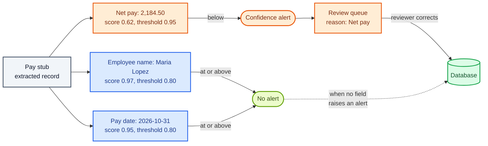
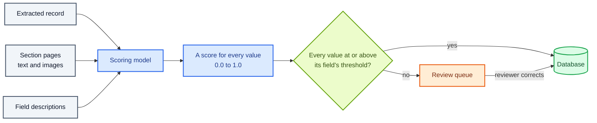

Copyright Amazon.com, Inc. or its affiliates. All Rights Reserved.
SPDX-License-Identifier: MIT-0

# Confidence Assessment

## What confidence assessment does for your database

Extraction turns each section of a file into a record: one value for each field of its
document class. Most of those values are right. Confidence assessment tells you which ones
to check before they reach your database.

Confidence assessment gives every extracted value a **confidence score** between 0 and 1:
how likely the value is to be right. You set a **threshold** for each field. A value that
scores below its field's threshold raises a **confidence alert**. With human review turned
on, the accelerator holds the document in a **review queue**, with each alert as a reason,
and a person checks those values before the document finishes. Every other document goes
straight to your database.

In the example below, the extraction model has read a pay stub. Two values score above
their thresholds. The net pay scores 0.62 against a threshold of 0.95, which you set high
because payroll depends on it. The accelerator holds the pay stub for review, and the
reviewer sees "Net pay" as the reason.



The accelerator also scores the **document class** of each section, so you can see which
sections the classification model was unsure of. Alongside the scores, it reports checks
that need no score at all: a value that breaks the format your schema requires, a list
that came back shorter than the page shows, and a business rule that failed.

## How the accelerator assigns confidence to each field

A language model assigns the scores. This page calls it the **scoring model**. You make
two choices: where the scores come from, and which scoring model reads the record. The
accelerator then compares each score with its field's threshold.



### Choice 1: score in a separate pass, inside the extraction call, or not at all

In the configuration editor this choice is **Confidence scoring mode**
(`extraction.confidence.mode`).

**Separate pass (default).** After extraction, a second model call reads the finished
record and scores every value. Because the call is separate, the scoring model can be a
different model from the extraction model. With Simple extraction the separate pass is
its own step in the workflow. With Advanced (agentic) extraction, which splits a long
section into shards, the accelerator scores each shard's values right after extracting
them. The editor shows this mode as *Separate — its own pass (default)*.

**Integrated.** The extraction model scores its own values in the same call that
extracts them, so no second call runs. With Simple extraction, the model returns its top
few guesses for each field with a probability for each, and the accelerator keeps the
top guess as the value and its probability as the score. The editor shows this mode as
*Integrated — same call as extraction*. For a document class that has a list field, the
accelerator scores Simple-mode sections in a separate pass anyway, because one response
cannot reliably hold a long list and a score for every cell of it.

**Off.** No scores. The editor shows this mode as *Off — no confidence*. Without scores,
no field raises a confidence alert.

### Choice 2: which scoring model reads the record

In the separate pass, the **Confidence model** setting (`extraction.confidence.model`)
names the scoring model. The default is Amazon Nova Lite (`us.amazon.nova-lite-v1:0`). In
integrated mode, the extraction model scores its own values and this setting is unused.

Scoring models differ less in how accurate their scores are on average than in how well
they **separate** right values from wrong ones. That difference decides which model to
choose, and [the configuration to start with](#the-configuration-to-start-with) explains
it.

### What the scoring model reads

The default confidence prompt gives the scoring model four things for each section:

- **The extracted record:** every value the extraction model returned.
- **The field descriptions** from your document class, so the model knows what each value
  should be.
- **The page text,** line by line, with the OCR confidence of each line. A value that sits
  on a faint or garbled line is a reason for a lower score.
- **The page images,** so the model can check values whose evidence is visual, such as a
  checkbox, a signature or a handwritten amount.

These are the `{EXTRACTION_RESULTS}`, `{ATTRIBUTE_NAMES_AND_DESCRIPTIONS}`,
`{OCR_TEXT_CONFIDENCE}` and `{DOCUMENT_IMAGE}` placeholders in the confidence prompt. To
score from text only, remove `{DOCUMENT_IMAGE}` from the prompt. See
[Prompt placeholders](../extraction-and-confidence.md#prompt-placeholders).

### A score for every field, including every row of a list

The scoring model returns one score per value: each field, each field inside a group, and
each cell of each row of a list. For any score below 0.9, the model also writes a short
reason, which the accelerator stores with the score in the section's result.

The accelerator scores a long list in batches of rows. Each batch reads the same pages and the same
fields outside the list, and the accelerator joins the batches so every cell gets its own
score. The **List batch size** setting (`extraction.confidence.list_batch_size`, default
25) sets the most rows in one batch. The accelerator uses a smaller batch when the scoring
model's output limit requires it, and Amazon Nova Lite scores at most 12 rows per batch.
See [Large-list batching](../extraction-and-confidence.md#large-list-batching-list_batch_size).

### Thresholds decide which fields need a person

The accelerator compares each value with its field's threshold. A value that scores **below** the
threshold raises a confidence alert; a value at or above it does not.

- **One threshold for every field:** **Confidence threshold** in the
  **Human-in-the-Loop (HITL) Review (Optional)** section (`hitl.confidence_threshold`,
  default 0.8).
- **A threshold for one field:** **Confidence Threshold** on the field in the schema
  editor (`x-aws-idp-confidence-threshold`). A field's own threshold wins over the global
  one. In a list, each column can have its own threshold.

A field with no extracted value has no value to score, so it raises no confidence alert.
The accelerator lists every field your schema marks **required** that came back empty, as
**Missing Required Fields**. See
[Confidence thresholds](../extraction-and-confidence.md#6-confidence-thresholds) and
[Absent values and missing required fields](../extraction-and-confidence.md#absent-values-and-missing-required-fields).

The Web UI colors each value against its threshold: green at or above, red below. The
document list counts each document's **Confidence Alerts**, and the Sections panel shows
the **Low Confidence Fields** of each section.

### How a document reaches review and a review queue

Turn on review with **Enabled** in the **Human-in-the-Loop (HITL) Review (Optional)**
section (`hitl.enabled`). The accelerator then holds a document in the **Default** review
queue when any of its sections has:

- a value below its field's threshold; or
- a required field with no value, while **Review missing required fields**
  (`hitl.route_missing_required_fields`) is on, as it is by default.

Each alert becomes a **review reason** on the queue item, sorted worst first. A reviewer
claims the item, corrects the values, and chooses **Process Changes**. The accelerator
then finishes the document with the corrected values. A document with no alerts is never
queued. Queues have no threshold of their own: the field thresholds decide. Admins manage
the queues in **Review Studio › Review Management**. See
[How a document reaches a queue](../review-queues.md#how-a-document-reaches-a-queue) and
[Human Review](../human-review.md#1-automatic-triggering).

### Checks that need no score: schema validation, row counts and rules

The accelerator runs three kinds of deterministic check next to confidence, and reports
each failure on the document as a **processing issue**:

- **Schema validation** checks each value against your schema, such as a date format or a
  pattern. See [Schema validation](../extraction-and-confidence.md#schema-validation-extractionvalidation).
- **Row-count checks** compare the rows extraction returned with the rows in the page's
  tables, and report a list that came back short. A row that never came back has no score,
  so this check is what catches it. See
  [Detecting a truncated list](../extraction-and-confidence.md#detecting-a-truncated-list).
- **Rule validation** checks each document against your business rules and records a
  verdict for each rule. See [Rule Validation](rule-validation.md).

Processing issues appear in the document list's **Processing Issues** column and in the
document's Processing Report. Processing issues do not by themselves send a document to a review
queue: confidence alerts and missing required fields do that.

### Confidence in the document class of each section

The classification model also scores the document class it assigns. No second model call
runs: the classification model returns the score in the same response as the document
class. In the editor this is **Class confidence mode**
(`classification.combined.llm.confidence.mode`):

- *Top-K — ranked candidate classes (default):* the model ranks its likeliest document
  classes with a probability for each, such as "80% W-2, 15% 1099". **Candidates to
  request** (`top_k_candidates`, default 3) sets the length of the list, including the
  chosen class. The page's score is the probability of the document class it received.
- *Verbalized — one 0–1 score:* the model states one number for its choice.
- *Off — no score.*

A section's score is the **lowest** score of its pages. The **Class Confidence** column of
the Document Pages table shows each page's score, and selecting the score shows the
model's reasoning and the other document classes it considered. In Pipeline mode the
class score has no threshold and does not send a document to review. In BDA mode, a
matched blueprint whose confidence is below `hitl.confidence_threshold` does. See
[Classification Confidence](../classification.md#classification-confidence).

## The configuration to start with

**Start with the defaults: a separate pass, scored by Amazon Nova Lite.** The default
scoring model reports how accurate your results are overall. Its scores are well calibrated: across our benchmark, its average score matched the
share of values that were right to within 0.01. Use it to answer "how accurate is this
batch?"

**To send only uncertain values to people, choose Claude Sonnet 5 as the scoring model**
(`us.anthropic.claude-sonnet-5`), keep the separate pass, and turn on human review. The
default scoring model gives nearly every value the same high score, so it rarely raises an
alert, and its scores do not separate wrong values from right ones. Claude
Sonnet 5 gave most wrong values low scores in our benchmark, so a threshold on its scores
sends a small share of values to review and finds most of the errors (see
[the benchmark results](#benchmark-results-how-well-each-scoring-model-separates-right-from-wrong)).
Changing the scoring model does not change the extracted values.

**Set thresholds per field.** Start with the default of 0.8, and raise the threshold on
the fields your business depends on, such as amounts, account numbers and dates. Mark
those fields **required** as well, so an empty value goes to review too.

**Keep Top-K class confidence on.** Top-K is the default and adds few tokens per page. The
default classification model, Amazon Nova 2 Lite, gives most pages the same score, so its
class scores flag only some wrong document classes. If you rely on class scores to decide
which sections a person checks, test Claude Haiku 4.5 as the classification model.

## How many tokens confidence assessment uses, and what drives the count

The separate pass is one more model call per section, and for a long list, one call per
batch of rows. Five things decide how many tokens the pass uses:

- **The pages each call reads.** Each call reads the section's page text and page images
  again. With Simple extraction, every batch of a long list reads the whole section. With
  Advanced extraction, each batch reads only its shard's pages.
- **The number of rows in your lists.** More rows mean more batches. Amazon Nova Lite
  scores at most 12 rows per call, so a long list takes about twice as many calls as with
  the other scoring models.
- **The number of values.** The output holds one score per value and per list cell, plus a
  short reason for each score below 0.9.
- **Page images.** Each image adds input tokens, and models count image tokens
  differently. To score from text only, remove `{DOCUMENT_IMAGE}` from the confidence
  prompt.
- **The scoring model.** Models count tokens differently, and larger models charge more
  for each token.

Integrated mode adds the scores to the extraction call's output instead of making a second
call. Off uses no tokens for confidence.

Measured confidence tokens per page, on seven synthetic bank statements (52 pages, 5 to 800
rows each), extraction by Claude Sonnet 4.6, OCR by Amazon Textract (release 0.6.14,
November 2026):

| Scoring model | Simple extraction: input tokens per page | Simple: output tokens per page | Advanced extraction: input tokens per page | Advanced: output tokens per page |
|---|---|---|---|---|
| Amazon Nova Lite (default) | 367,180 | 2,876 | 36,022 | 2,853 |
| Amazon Nova 2 Lite | 66,487 | 3,927 | 6,045 | 3,490 |
| Claude Sonnet 5 | 161,811 | 4,574 | 43,325 | 3,735 |

Input tokens include the page text and images the accelerator serves from the prompt
cache, which Amazon Bedrock bills at a reduced rate. Source:
`benchmarks/results/v0.6.14/coresynth__confidence-model-*/summary.json`, configurations
`core-tt-simple-sep` and `core-tt-adv-sep`, phase `Assessment`.

What this shows:

- **Long lists drive the count.** On the one-page statement with 5 rows, the default
  scoring model read 3,243 input tokens in total. On the 17-page statement with 800 rows in
  Simple mode, every batch reread all 17 pages.
- **Advanced extraction scored the same values with about a tenth of the input tokens** of
  Simple extraction with the default scoring model, because each batch reads one shard
  instead of the whole section.
- **Claude Sonnet 5 wrote more output tokens per page** than Amazon Nova Lite, 4,574
  against 2,876 in Simple mode, and its tokens cost more each.

For comparison, the Simple-mode extraction calls in the same runs read 3,336 input tokens
per page. On documents with long lists, confidence assessment can be the largest token
consumer in the pipeline. On the one-page statement, the scoring call and the extraction
call read about the same number of input tokens. See
[Extraction & Confidence](../extraction-and-confidence.md#0-choosing-a-configuration-start-here)
for the trade-off between the modes.

**Class confidence** adds tokens to every classification call. Measured on 20 public
packets (298 pages) with page-by-page classification (release 0.6.7, September 2026):

| Classification model | Class confidence | Input tokens per page | Output tokens per page |
|---|---|---|---|
| Amazon Nova 2 Lite (default) | *Off* | 1,738 | 154 |
| Amazon Nova 2 Lite (default) | *Top-K* (default) | 1,966 | 199 |
| Claude Haiku 4.5 | *Off* | 3,169 | 268 |
| Claude Haiku 4.5 | *Top-K* | 3,416 | 353 |

Source: `benchmarks/results/v0.6.7/clsconf/summary.json` and `summary_off_control.json`.

## How to measure confidence on your own documents

Measure confidence on the same ground truth you use for extraction. For each scored value
you then know two things: its score, and whether it was right. A score can do two jobs,
and each job has its own measure.

**Reporting** asks "how accurate is this batch?" The scores do this job when they are
**calibrated**: across many values, a score of 0.9 means about 90% of them are right.

**Routing review** asks "which values should a person check?" The scores do this job when
they **discriminate**: wrong values score lower than right ones. A threshold then catches
the wrong values and lets the right ones through.

A score can do the first job well and the second poorly. A scoring model that gives every
value 0.99 is perfectly calibrated on a batch that is 99% right, and tells you nothing
about which 1% is wrong.

Test Studio reports these numbers for each field after a run against your test set:

| Number | Definition | What good looks like |
|---|---|---|
| **AUROC** (discrimination) | Pick one right value and one wrong value at random. AUROC is the chance that the right value has the higher score, counting a tie as half. | 0.5 is no better than chance. 1.0 means every wrong value scores below every right value |
| **ECE** (calibration error) | Group the values into ten score bands (0–0.1, 0.1–0.2, …). In each band, take the gap between the average score and the share of values that are right. ECE is the average gap, weighted by the number of values in each band. | 0 is perfect. Below 0.05 is close |
| **ECARB@30** | Sort the values by score, lowest first. ECARB@30 is the share of the wrong values found in the lowest 30%, with the gain over checking a random 30%. | As close to 100% as possible |
| **Alert rate** | The share of values that score below their field's threshold. The alert rate measures how much work the threshold creates for reviewers. | Small, and made up mostly of wrong values |

AUROC rests on the wrong values, so read it next to the number of errors: a field with
three wrong values gives a rough AUROC at best. See
[Field-Level Metrics](../test-studio.md#field-level-metrics) and
[Confidence Calibration Metrics](../test-studio.md#confidence-calibration-metrics).

**The review-effort estimate** turns the scores into a plan: how many documents a person
must check, lowest scores first, to reach the accuracy you want, plus a random audit sample
of the high-scoring ones. When the scores do not discriminate, the estimate reports
**Unreliable** and recommends checking everything. See
[How much review is enough?](../test-studio.md#how-much-review-is-enough).

To build the ground truth, see [Measure with ground truth](index.md#4-measure-with-ground-truth).

## When confidence misleads: which scoring model makes which mistake

Once you measure AUROC and the alert rate, the mistakes fall into a few patterns, each with
a change that fixes it:

| What you see | Cause | What to change |
|---|---|---|
| Almost no alerts, low AUROC, and the review-effort estimate reads **Unreliable** | The scoring model gives nearly every value the same high score. The default scoring model does this on most documents | Choose Claude Sonnet 5 as the scoring model |
| More alerts than your reviewers can handle | A threshold is high for a scoring model that spreads its scores out | Lower the threshold on fields with many alerts and few errors, and keep it high on critical fields |
| Wrong values with high scores | The scoring model is sure of a misread value, often on a poor scan where the page text agrees with the wrong value | Review the random audit sample of high-scoring documents, and add a schema pattern or a rule for the field |
| A value missing from the record, with no alert | An empty field has no value to score | Mark the field **required**, so an empty value goes to review |
| Rows missing from a list, with no alert | A row that never came back has no score | Watch the row-count processing issues, or set `extraction.row_shortfall_action: fail`. Advanced extraction returns long lists more completely |
| No field is ever flagged | `hitl.confidence_threshold` is 0, and the fields have no threshold of their own | Set a global threshold, such as 0.8 |
| Most pages show the same class score, wrong pages included | The default classification model gives most pages one score | Test Claude Haiku 4.5 as the classification model |

## Benchmark results: how well each scoring model separates right from wrong

### Field confidence when extraction makes mistakes

**Dataset:** [synthetic bank statements](benchmark-datasets.md#synthetic-bank-statements),
seven files (52 pages), with the exact value of every date and amount. **Run:** release
0.6.14, November 2026, extraction by Claude Sonnet 4.6, Simple extraction with a separate
confidence pass. Extraction made errors in one configuration only, the one with OCR by a
Bedrock language model instead of Amazon Textract. That configuration scored 4,410 dates and
amounts per scoring model. Each scoring model ran with its own extraction run, so the number
of wrong values differs slightly.

| Scoring model | Wrong values | AUROC | ECE | Score bands used | Values below 0.8 | Wrong values below 0.8 |
|---|---|---|---|---|---|---|
| Amazon Nova Lite (default) | 37 | 0.50 | 0.008 | 1 of 10 | 0 | 0 of 37 |
| Amazon Nova 2 Lite | 41 | 0.50 | 0.009 | 1 of 10 | 0 | 0 of 41 |
| **Claude Sonnet 5** | 39 | **0.96** | 0.039 | 6 of 10 | 60 | **35 of 39** |

Source: `benchmarks/results/v0.6.14/coresynth__confidence-model-*/summary.json`,
configuration `core-llm-simple-sep`.

What this shows:

- **With Claude Sonnet 5 as the scoring model, a threshold of 0.8 sent 60 of 4,410 values
  to review, and those 60 held 35 of the 39 errors.** Claude Sonnet 5 scored those 35 wrong
  values 0.3 or lower.
- **Amazon Nova Lite and Amazon Nova 2 Lite gave every value a score of 0.9 or higher,** and
  Amazon Nova Lite scored all 37 wrong values 1.0. A threshold on their scores cannot find
  the errors.
- **All three scoring models were well calibrated.** Calibration error was below 0.04 for
  each, so each one's average score is a fair report of overall accuracy.

### Field confidence on a larger sample of values

**Dataset:** the same seven synthetic bank statements, under 16 configurations that use
a separate confidence pass, one run per file: 112 runs per scoring model. **Run:** release 0.6.8, September 2026, extraction by
Claude Sonnet 4.6; only the scoring model changed.

| Scoring model | Values scored | Wrong values | AUROC | ECE | Score bands used |
|---|---|---|---|---|---|
| Amazon Nova Lite (default) | 70,320 | 55 | 0.42 | 0.004 | 1 of 10 |
| Amazon Nova 2 Lite | 70,242 | 64 | 0.47 | 0.001 | 1 of 10 |
| **Claude Sonnet 5** | 70,242 | 66 | **0.86** | 0.024 | 6 of 10 |

Sources: `benchmarks/results/v0.6.8/coresynth__confidence-model-nova-2-lite/summary.json`,
`benchmarks/results/v0.6.8/coresynth__confidence-model-sonnet5/summary.json` and, for
Amazon Nova Lite, `benchmarks/results/v0.6.8/coresynth__classification-model-sonnet5/summary.json`.
See the [Confidence Calibration study](../benchmarking/studies/confidence-calibration.md)
for the method.

The 0.6.8 results agree with the 0.6.14 results: only Claude Sonnet 5 ranked the wrong
values low.

### How often each scoring model raises an alert

**Dataset and run:** as in the first table, across all 16 configurations that use a
separate confidence pass, 112 runs and about 106,600 scores per scoring model (release
0.6.14, November 2026).

| Scoring model | Scores below 0.9 | Share of scores |
|---|---|---|
| Amazon Nova Lite (default) | 0 | 0.0% |
| Amazon Nova 2 Lite | 2 | 0.0% |
| Claude Sonnet 5 | 562 | 0.5% |

Source: `benchmarks/results/v0.6.14/coresynth__confidence-model-*/summary.json`, fields
`n_conf_leaves` and `pct_conf_below_0.9`.

Claude Sonnet 5 raised alerts on about one value in 200, which is review a team can keep
up with. The default scoring model raised none.

### Document-class confidence on multi-document packets

**Dataset:** [DocSplit-Poly-Seq](benchmark-datasets.md#docsplit-poly-seq), 20 public files
(298 pages, 13 document classes). **Run:** release 0.6.7, September 2026, page-by-page
classification, *Top-K* class confidence with 3 candidates, one run per classification
model.

| Classification model | Page accuracy | Average score, right pages | Average score, wrong pages | AUROC | Pages flagged | Wrong pages flagged |
|---|---|---|---|---|---|---|
| Amazon Nova 2 Lite (default) | 0.846 | 0.947 | 0.903 | 0.70 | 25 of 298, below 0.90 | 20 of 46 |
| **Claude Haiku 4.5** | 0.852 | 0.948 | 0.741 | **0.93** | 34 of 298, below 0.85 | **32 of 44** |

Sources: `benchmarks/results/v0.6.7/clsconf/summary.json` and `escalation.json` (AUROC
computed from the score histograms in `escalation.json`). See the
[Classification Confidence study](../benchmarking/studies/classification-confidence.md).

What this shows:

- **Both models assigned the right document class equally often.** The difference is in
  the scores.
- **Claude Haiku 4.5 found 73% of its wrong pages by flagging 11% of pages,** and 94% of
  the pages it flagged were wrong.
- **Amazon Nova 2 Lite gave 269 of 298 pages a score of 0.95,** including 23 of its 46
  wrong pages, so no threshold separates those wrong pages from the right ones.

Release 0.6.14 (November 2026) repeated the Amazon Nova 2 Lite run on the same files
(286 pages scored): page accuracy 0.818, average score 0.947 on right pages and 0.914 on
wrong pages. Source: `benchmarks/results/v0.6.14/clsvariants/summary.json`, key
`nova2lite-page-both`.

**How far this carries:** the field results come from synthetic statements with clean
tables, where extraction made few errors: 37 to 66 wrong values per scoring model, so the
AUROC figures are estimates on small samples. The class results come from one run of 20
files. Real documents with poor scans produce more errors, and the ranking can differ.
Measure on your own test set before you set thresholds.

## Improving confidence once your pipeline is running

When your measurements show alerts in the wrong places, these changes help most, roughly in
this order.

**Choose Claude Sonnet 5 as the scoring model when people review by confidence.** The
change affects only the scores. The extracted values stay the same, so you can compare the
two scoring models on the same test set.

**Set thresholds field by field from your own numbers.** Look at each field's AUROC and
alert rate in Test Studio. Raise the threshold where wrong values still get through, and
lower it where reviewers mostly confirm right values.

**Write field descriptions that say what a right value looks like.** The scoring model
reads each field's description when it judges the value. "Net pay: the amount paid after
all deductions, in the pay stub's currency, usually labeled Net Pay" gives the model
something to check the value against.

**Keep page images in the confidence prompt for visual fields.** Checkboxes, signatures,
stamps and handwritten amounts show only in the image, so the scoring model needs it to
check them. The default prompt
sends the images.

**Mark the fields you cannot do without as required.** An empty required field goes to
review even though it has no score. See
[Absent values and missing required fields](../extraction-and-confidence.md#absent-values-and-missing-required-fields).

**Back confidence with deterministic checks.** Add a schema pattern for fields with a fixed
format, such as an account number. For long lists, set
`extraction.row_shortfall_action: fail` to fail a section that lost most of its rows, or
use Advanced extraction. Add rules for relations between fields, such as a total that must
equal the sum of its lines. See [Rule Validation](rule-validation.md).

**Let your reviewers' corrections refine the estimate.** Each reviewed document records
which values a person changed and which they kept, and Test Studio uses those verdicts to
refine its review-effort estimate. See
[How the curve is measured and refined](../test-studio.md#how-the-curve-is-measured-and-refined).

**Let an agent tune the configuration.** The [Auto Optimizer](../extensions/auto-optimizer.md)
tries changes to prompts, models and settings against your test set and keeps the ones that
score better.

## Run the confidence benchmarks yourself

**On your own documents.** Run your test set in [Test Studio](../test-studio.md) with
confidence on, and read AUROC, ECE and ECARB@30 for each field. Then change the
**Confidence model** and run the same test set again. The extracted values stay the same,
so any change in the numbers comes from the scoring model.

**The benchmark suite.**

```bash
# Field confidence: the same synthetic statements, once per scoring model
M=benchmarks/harness/make_configs.py
for m in nova_lite nova_2_lite sonnet5; do
  python3 $M --suite coresynth --class bank_statement --set confidence_model=$m
  python3 benchmarks/harness/run_matrix.py --stack <STACK> --suite coresynth --set confidence_model=$m
done

# Class confidence on DocSplit (the test set comes with the stack)
python3 benchmarks/harness/run_classification_bench.py --stack <STACK> --testset docsplit \
  --n 20 --models nova2lite,haiku45 --mode topk
```

Recompute a row from the committed results:

```bash
jq '.cell_stats."core-llm-simple-sep".calibration | {observations, correct, auroc_unbinned, ece_mean_conf, bin_coverage}' \
  benchmarks/results/v0.6.14/coresynth__confidence-model-sonnet5/summary.json
```

The [Confidence Calibration study](../benchmarking/studies/confidence-calibration.md)
shows how to recompute calibration and AUROC for a whole grid offline. See the
[benchmark suite](../benchmarking/index.md) for setup and scoring.

## Where to configure confidence in the accelerator

- **Confidence scoring mode, confidence model and list batch size:**
  [Confidence Assessment](../extraction-and-confidence.md#3-confidence-assessment),
  including [the three confidence modes](../extraction-and-confidence.md#the-three-confidence-modes),
  and [Confidence configuration](../configuration.md#confidence-assessment-configuration).
- **Thresholds, globally and per field:**
  [Confidence thresholds](../extraction-and-confidence.md#6-confidence-thresholds),
  [thresholds inside lists](../extraction-and-confidence.md#thresholds-inside-lists-arrays)
  and [Confidence Threshold Configuration](../human-review.md#confidence-threshold-configuration).
- **Turn on human review:** [Enabling HITL](../human-review.md#enabling-hitl).
- **Route documents to people and work the queue:**
  [Review Queues](../review-queues.md#how-a-document-reaches-a-queue) and
  [Human Review](../human-review.md).
- **Score document classes:**
  [Classification confidence](../configuration.md#classification-confidence-classificationcombinedllmconfidence)
  and [Classification Confidence](../classification.md#classification-confidence).
- **Deterministic checks:**
  [Schema validation](../extraction-and-confidence.md#schema-validation-extractionvalidation),
  [Detecting a truncated list](../extraction-and-confidence.md#detecting-a-truncated-list)
  and [Rule Validation](../rule-validation.md).
- **Measure the scores on your test set:**
  [Field-Level Metrics](../test-studio.md#field-level-metrics) and
  [How much review is enough?](../test-studio.md#how-much-review-is-enough).
- **Alarm when a section gets no confidence at all:**
  [Monitoring](../monitoring.md#confidence-assessment-degraded).
