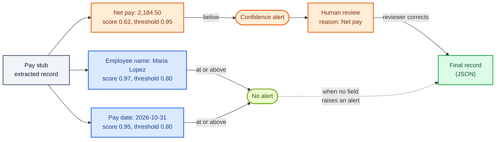
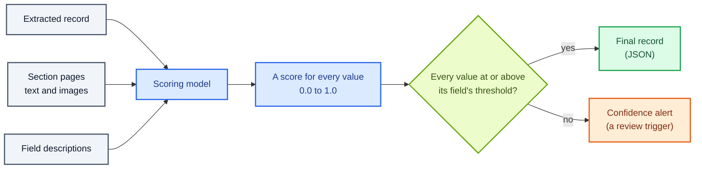

Copyright Amazon.com, Inc. or its affiliates. All Rights Reserved.
SPDX-License-Identifier: MIT-0

# Confidence Assessment

## Overview

Extraction produces a record for each section: one value for each field of its document
class. Most values are right, and checking every one by hand undoes the point of
automation. Confidence-guided review sends people only the values most likely to be wrong,
so it removes the most errors for the least review effort.

Confidence assessment gives every extracted value a **confidence score** between 0 and 1,
an estimate of how likely the value is to be right. Each field has a **threshold**. A value
that scores below its field's threshold raises a **confidence alert**, and a document with an
alert can be sent to human review, where a person checks the flagged values. A confidence
alert is one reason to send a document to review; a document with no reason for review
completes without one.

In the example below, a pay stub has three extracted values. Two score above their
thresholds. Net pay scores 0.62 against a threshold of 0.95, set high because payroll
depends on it, so it raises an alert, and the pay stub goes to review with "Net pay" as the
reason.

The accelerator also scores the **document class** of each section, which shows where
classification was uncertain. Some problems need no score: a value that breaks the format
the schema requires, a list shorter than the OCR tables show, or a failed business rule. The
accelerator reports these as checks alongside the scores.

## Scoring

The accelerator invokes a **scoring model** to score each extracted value; today the scoring
model is a language model. It runs either inside the extraction call or as its own step after
extraction. The accelerator compares each score with its field's threshold, and a value below
its threshold raises a confidence alert. A configuration profile can use confidence alerts as
one of the triggers that send a document to human review.

### Choice 1: scoring mode

In the configuration editor this choice is **Confidence scoring mode**
(`extraction.confidence.mode`).

**Separate pass (default).** After extraction, a second model call reads the finished
record and scores every value. Because the call is separate, the scoring model can be a
different model from the extraction model. With Simple extraction the separate pass is
its own step in the workflow. With Advanced (agentic) extraction, which splits a long
section into shards, the accelerator scores each shard's values right after extracting
them. The editor shows this mode as *Separate — its own pass (default)*.

**Integrated.** The extraction model scores its own values in the same call that
extracts them, so no second call runs. With Simple extraction, the model returns its top
few guesses for each field with a probability for each, and the accelerator keeps the
top guess as the value and its probability as the score. The editor shows this mode as
*Integrated — same call as extraction*. For a document class that has a list field, the
accelerator scores Simple-mode sections in a separate pass anyway, because one response
does not have to hold both a long list and a score for every cell of it.

**Off.** No scores. The editor shows this mode as *Off — no confidence*. Without scores,
no field raises a confidence alert.

### Choice 2: scoring model

In the separate pass, the **Confidence model** setting (`extraction.confidence.model`)
names the scoring model. In integrated mode, the extraction model scores its own values and
this setting is unused.

To route review, what matters is how well a scoring model **separates** right values from
wrong ones, more than how accurate its scores are on average. See
[Which scoring model should I use?](../benchmark-guidance/confidence-assessment.md#which-scoring-model-should-i-use)

**Escalation** (`extraction.confidence.escalation_enabled`, on by default) re-scores any rows
the scoring model could not score, with a stronger model (`escalation_model`). See
[Large-list batching](../extraction-and-confidence.md#large-list-batching-list_batch_size).

### Model inputs

The default confidence prompt gives the scoring model four things for each section:

- **The extracted record:** every value the extraction model returned.
- **The field descriptions** from your document class, so the model knows what each value
  should be.
- **The page text,** line by line, with the OCR confidence of each line. A value that sits
  on a faint or garbled line is a reason for a lower score.
- **The page images,** so the model can check values whose evidence is visual, such as a
  checkbox, a signature or a handwritten amount.

These are the `{EXTRACTION_RESULTS}`, `{ATTRIBUTE_NAMES_AND_DESCRIPTIONS}`,
`{OCR_TEXT_CONFIDENCE}` and `{DOCUMENT_IMAGE}` placeholders in the confidence prompt. To
score from text only, remove `{DOCUMENT_IMAGE}` from the prompt. See
[Prompt placeholders](../extraction-and-confidence.md#prompt-placeholders).

### Field and row scores

The scoring model returns one score per value: each field, each field inside a group, and
each cell of each row of a list. For any score below 0.9, the model also writes a short
reason, which the accelerator stores with the score in the section's result.

The accelerator scores a long list in batches of rows. Each batch reads the same pages and the same
fields outside the list, and the accelerator joins the batches so every cell gets its own
score. The **List batch size** setting (`extraction.confidence.list_batch_size`, default
25) sets the most rows in one batch. The accelerator uses a smaller batch when the scoring
model's output limit requires it.
See [Large-list batching](../extraction-and-confidence.md#large-list-batching-list_batch_size).

### Thresholds

The accelerator compares each value with its field's threshold. A value that scores **below** the
threshold raises a confidence alert; a value at or above it does not.

- **One threshold for every field:** **Confidence threshold** in the
  **Human-in-the-Loop (HITL) Review (Optional)** section (`hitl.confidence_threshold`,
  default 0.8).
- **A threshold for one field:** **Confidence Threshold** on the field in the schema
  editor (`x-aws-idp-confidence-threshold`). A field's own threshold wins over the global
  one. In a list, each column can have its own threshold.

A field with no extracted value has no value to score, so it raises no confidence alert.
The accelerator lists every field your schema marks **required** that came back empty, as
**Missing Required Fields**. See
[Confidence thresholds](../extraction-and-confidence.md#6-confidence-thresholds) and
[Absent values and missing required fields](../extraction-and-confidence.md#absent-values-and-missing-required-fields).

The Web UI colors each value against its threshold: green at or above, red below. The
document list counts each document's **Confidence Alerts**, and the Sections panel shows
the **Low Confidence Fields** of each section.

### Review routing

Confidence alerts are one trigger for human review. With review turned on in the profile
(**Enabled** in **Human-in-the-Loop (HITL) Review (Optional)**, `hitl.enabled`), a document
goes to review when a section has a value below its field's threshold, or a required field
with no value while **Review missing required fields** (`hitl.route_missing_required_fields`)
is on. Each alert becomes a **review reason**. A reviewer corrects the values, and the
accelerator finishes the document with the corrected values. Other triggers can also send a
document to review; see
[How a document reaches a queue](../review-queues.md#how-a-document-reaches-a-queue) and
[Human Review](../human-review.md#1-automatic-triggering).

### Checks without scores

The accelerator runs three kinds of deterministic check next to confidence, and reports
each failure on the document as a **processing issue**:

- **Schema validation** checks each value against your schema, such as a date format or a
  pattern. See [Schema validation](../extraction-and-confidence.md#schema-validation-extractionvalidation).
- **Row-count checks** compare the rows extraction returned with the rows in the page's
  tables, and report a list that came back short. A row that never came back has no score,
  so this check is what catches it. See
  [Detecting a truncated list](../extraction-and-confidence.md#detecting-a-truncated-list).
- **Rule validation** checks each document against your business rules and records a
  verdict for each rule. See [Rule Validation](rule-validation.md).

Processing issues appear in the document list's **Processing Issues** column and in the
document's Processing Report. Processing issues do not by themselves send a document to a review
queue: confidence alerts and missing required fields do that.

### Class confidence

The classification model also scores the document class it assigns. No second model call
runs: the classification model returns the score in the same response as the document
class. In the editor this is **Class confidence mode**
(`classification.combined.llm.confidence.mode`):

- *Top-K — ranked candidate classes (default):* the model ranks its likeliest document
  classes with a probability for each, such as "80% W-2, 15% 1099". **Candidates to
  request** (`top_k_candidates`, default 3) sets the length of the list, including the
  chosen class. The page's score is the probability of the document class it received.
- *Verbalized — one 0–1 score:* the model states one number for its choice.
- *Off — no score.*

A section's score is the **lowest** score of its pages. The **Class Confidence** column of
the Document Pages table shows each page's score, and selecting the score shows the
model's reasoning and the other document classes it considered. In Pipeline mode the
class score has no threshold and does not send a document to review. In BDA mode, a
matched blueprint whose confidence is below `hitl.confidence_threshold` does. See
[Classification Confidence](../classification.md#classification-confidence).

For the configuration we recommend, and the measurements behind it, see
[Confidence assessment benchmarks](../benchmark-guidance/confidence-assessment.md).

## Token use

The separate pass is one more model call per section, and for a long list, one call per
batch of rows. Five things decide how many tokens the pass uses:

- **The pages each call reads.** Each call reads the section's page text and page images
  again. With Simple extraction, every batch of a long list reads the whole section. With
  Advanced extraction, each batch reads only its shard's pages.
- **The number of rows in your lists.** More rows mean more batches. A scoring model with a
  small output limit scores fewer rows per call, so a long list takes more calls.
- **The number of values.** The output holds one score per value and per list cell, plus a
  short reason for each score below 0.9.
- **Page images.** Each image adds input tokens, and models count image tokens
  differently. To score from text only, remove `{DOCUMENT_IMAGE}` from the confidence
  prompt.
- **The scoring model.** Models count tokens differently, and larger models charge more
  for each token.

Integrated mode adds the scores to the extraction call's output instead of making a second
call. Off uses no tokens for confidence.

On long lists with Simple extraction, the scoring pass can read more tokens than extraction
itself. See
[Extraction & Confidence](../extraction-and-confidence.md#0-choosing-a-configuration-start-here)
for the trade-off between the modes, and
[Separate scoring pass or integrated into extraction?](../benchmark-guidance/confidence-assessment.md#separate-scoring-pass-or-integrated-into-extraction)
for what confidence costs.

**Class confidence** adds tokens to every classification call: *Top-K* adds the ranked
candidates to each answer.

## Measuring accuracy

Measure confidence on the same ground truth you use for extraction. For each scored value
you then know two things: its score, and whether it was right. A score can do two jobs,
and each job has its own measure.

**Reporting** asks "how accurate is this batch?" The scores do this job when they are
**calibrated**: across many values, a score of 0.9 means about 90% of them are right.

**Routing review** asks "which values should a person check?" The scores do this job when
they **discriminate**: wrong values score lower than right ones. A threshold then catches
the wrong values and lets the right ones through.

A score can do the first job well and the second poorly. A scoring model that gives every
value 0.99 is perfectly calibrated on a batch that is 99% right, and tells you nothing
about which 1% is wrong.

Test Studio reports these numbers for each field after a run against your test set:

| Number | Definition | What good looks like |
|---|---|---|
| **AUROC** (discrimination) | Pick one right value and one wrong value at random. AUROC is the chance that the right value has the higher score, counting a tie as half. | 0.5 is no better than chance. 1.0 means every wrong value scores below every right value |
| **ECE** (calibration error) | Group the values into ten score bands (0–0.1, 0.1–0.2, …). In each band, take the gap between the average score and the share of values that are right. ECE is the average gap, weighted by the number of values in each band. | 0 is perfect. Below 0.05 is close |
| **ECARB@30** | Sort the values by score, lowest first. ECARB@30 is the share of the wrong values found in the lowest 30%, with the gain over checking a random 30%. | As close to 100% as possible |
| **Alert rate** | The share of values that score below their field's threshold. The alert rate measures how much work the threshold creates for reviewers. | Small, and made up mostly of wrong values |

AUROC rests on the wrong values, so read it next to the number of errors: a field with
three wrong values gives a rough AUROC at best. See
[Field-Level Metrics](../test-studio.md#field-level-metrics) and
[Confidence Calibration Metrics](../test-studio.md#confidence-calibration-metrics).

**The review-effort estimate** turns the scores into a plan: how many documents a person
must check, lowest scores first, to reach the accuracy you want, plus a random audit sample
of the high-scoring ones. When the scores do not discriminate, the estimate reports
**Unreliable** and recommends checking everything. See
[How much review is enough?](../test-studio.md#how-much-review-is-enough).

To build the ground truth, see [Measure with ground truth](index.md#4-measure-with-ground-truth).

Run your test set in [Test Studio](../test-studio.md) with
confidence on, and read AUROC, ECE and ECARB@30 for each field. Then change the
**Confidence model** and run the same test set again. The extracted values stay the same,
so any change in the numbers comes from the scoring model.

## Common mistakes

Once you measure AUROC and the alert rate, the mistakes fall into a few patterns, each with
a change that fixes it:

| What you see | Cause | What to change |
|---|---|---|
| Almost no alerts, low AUROC, and the review-effort estimate reads **Unreliable** | The scoring model gives nearly every value the same high score | Choose Claude Haiku 5.5 as the scoring model |
| More alerts than your reviewers can handle | A threshold is high for a scoring model that spreads its scores out | Lower the threshold on fields with many alerts and few errors, and keep it high on critical fields |
| Wrong values with high scores | The scoring model is sure of a misread value, as on a poor scan where the page text agrees with the wrong value | Review the random audit sample of high-scoring documents, and add a schema pattern or a rule for the field |
| A value missing from the record, with no alert | An empty field has no value to score | Mark the field **required**, so an empty value goes to review |
| Rows missing from a list, with no alert | A row that never came back has no score | Watch the row-count processing issues, or set `extraction.row_shortfall_action: fail`. Advanced extraction returns long lists more completely |
| No field is ever flagged | `hitl.confidence_threshold` is 0, and the fields have no threshold of their own | Set a global threshold, such as 0.8 |
| Most pages show the same class score, wrong pages included | The classification model gives most pages one score | Test another classification model on your test set |

## Improving accuracy

When your measurements show alerts in the wrong places, try these changes, and score each one against your test set.

**Compare scoring models on your test set.** Changing the scoring model changes only the
scores. The extracted values stay the same, so the comparison isolates the scoring model. See
[Which scoring model should I use?](../benchmark-guidance/confidence-assessment.md#which-scoring-model-should-i-use)

**Set thresholds field by field from your own numbers.** Look at each field's AUROC and
alert rate in Test Studio. Raise the threshold where wrong values still get through, and
lower it where reviewers mostly confirm right values.

**Write field descriptions that say what a right value looks like.** The scoring model
reads each field's description when it judges the value. "Net pay: the amount paid after
all deductions, in the pay stub's currency, usually labeled Net Pay" gives the model
something to check the value against.

**Keep page images in the confidence prompt for visual fields.** Checkboxes, signatures,
stamps and handwritten amounts show only in the image, so the scoring model needs it to
check them. The default prompt sends the images.

**Mark the fields you cannot do without as required.** An empty required field goes to
review even though it has no score. See
[Absent values and missing required fields](../extraction-and-confidence.md#absent-values-and-missing-required-fields).

**Back confidence with deterministic checks.** Add a schema pattern for fields with a fixed
format, such as an account number. For long lists, set
`extraction.row_shortfall_action: fail` to fail a section that lost most of its rows, or
use Advanced extraction. Add rules for relations between fields, such as a total that must
equal the sum of its lines. See [Rule Validation](rule-validation.md).

**Let your reviewers' corrections refine the estimate.** Each reviewed document records
which values a person changed and which they kept, and Test Studio uses those verdicts to
refine its review-effort estimate. See
[How the curve is measured and refined](../test-studio.md#how-the-curve-is-measured-and-refined).

**Let an agent tune the configuration.** The [Auto Optimizer](../extensions/auto-optimizer.md)
tries changes to prompts, models and settings against your test set and keeps the ones that
score better.

## Configuration reference

- **Confidence scoring mode, confidence model and list batch size:**
  [Confidence Assessment](../extraction-and-confidence.md#3-confidence-assessment),
  including [the three confidence modes](../extraction-and-confidence.md#the-three-confidence-modes),
  and [Confidence configuration](../configuration.md#confidence-assessment-configuration).
- **Thresholds, globally and per field:**
  [Confidence thresholds](../extraction-and-confidence.md#6-confidence-thresholds),
  [thresholds inside lists](../extraction-and-confidence.md#thresholds-inside-lists-arrays)
  and [Confidence Threshold Configuration](../human-review.md#confidence-threshold-configuration).
- **Turn on human review:** [Enabling HITL](../human-review.md#enabling-hitl).
- **Route documents to people and work the queue:**
  [Review Queues](../review-queues.md#how-a-document-reaches-a-queue) and
  [Human Review](../human-review.md).
- **Score document classes:**
  [Classification confidence](../configuration.md#classification-confidence-classificationcombinedllmconfidence)
  and [Classification Confidence](../classification.md#classification-confidence).
- **Deterministic checks:**
  [Schema validation](../extraction-and-confidence.md#schema-validation-extractionvalidation),
  [Detecting a truncated list](../extraction-and-confidence.md#detecting-a-truncated-list)
  and [Rule Validation](../rule-validation.md).
- **Measure the scores on your test set:**
  [Field-Level Metrics](../test-studio.md#field-level-metrics) and
  [How much review is enough?](../test-studio.md#how-much-review-is-enough).
- **Alarm when a section gets no confidence at all:**
  [Monitoring](../monitoring.md#confidence-assessment-degraded).
