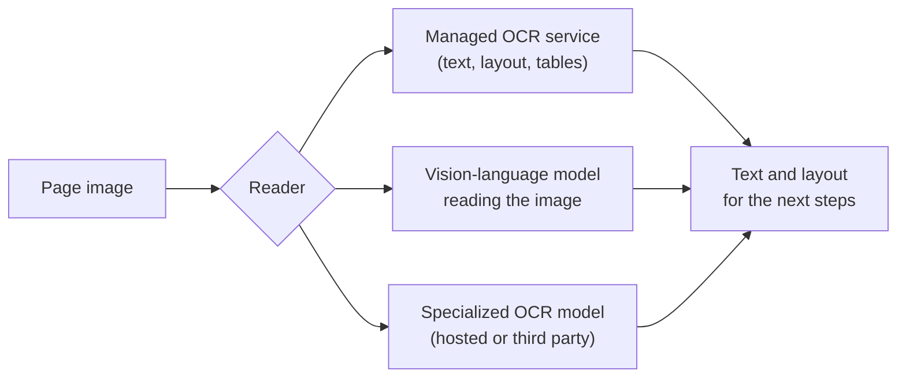

Copyright Amazon.com, Inc. or its affiliates. All Rights Reserved.
SPDX-License-Identifier: MIT-0

# Digitization (OCR)

## What it does

Digitization reads each page image and turns it into text and layout: the words, where they
sit on the page, which cells form a table, and which boxes are ticked. It is the first step
from a stack of documents to a database, and every later step works from its output. Clean
text here makes splitting, extraction and review easier.

## Getting it right

**Keep table structure.** If your documents have tables, use a reader that returns them as
tables, so each value stays in its row and column.

**Keep enough resolution.** 300 DPI keeps small print and handwriting legible, and it is the
accelerator's default. See [OCR Image Sizing](../ocr-image-sizing-guide.md#when-to-change-the-defaults).

**Send the page image along with the text.** The accelerator passes page images to later
steps, so the extraction model can read checkboxes and signatures and check the text against
the page.

**Choose the reader for your hardest pages.** Clean, born-digital PDFs read well with any
reader. Phone photos, faxes, handwriting and unusual scripts are where the choice pays off.

## Your documents

- **Tables and statements:** use a reader that returns table structure.
- **Photos, faxes and uneven scans:** turn on image preprocessing. See
  [OCR image processing](../pattern-2.md#ocr-image-processing-features).
- **Handwriting:** compare a managed OCR service with a vision-language model on your own
  pages; they handle handwriting differently.
- **Languages other than English:** check which readers support your language. See
  [OCR backend language support](../languages.md#ocr-backend-considerations-for-language-support).

## Choosing a reader

There are three kinds of reader. The accelerator supports all three, so you can switch
between them with one setting and compare them on your own documents.

| Reader | In the accelerator | Best at |
|---|---|---|
| **Managed OCR service** | Amazon Textract, or Amazon Bedrock Data Automation | Word positions and confidence, table and form structure, predictable cost |
| **Vision-language model** | Any supported Bedrock model, prompted to transcribe the page | Unusual layouts; returns tables as Markdown |
| **Specialized OCR model** | Your own model or a third-party service, through a Lambda hook | A script, layout or kind of document it was built for |

## How to measure it

You can measure a reader in two ways:

1. **Shortlist readers with public OCR benchmarks,** such as the
   [OmniAI OCR benchmark](https://github.com/getomni-ai/benchmark),
   [OmniDocBench](https://github.com/opendatalab/OmniDocBench) and
   [olmOCR-Bench](https://huggingface.co/datasets/allenai/olmOCR-bench). They score OCR on its
   own, against transcriptions of each page. Pick the benchmarks whose documents look most
   like yours.
2. **Compare the shortlist by what reaches your database.** Run your test set once with each
   reader, keep everything else the same, and compare extraction and classification
   accuracy. This needs no page transcriptions, only the ground truth you already use for
   extraction.

## What we measured

We measure readers the second way, by their effect on extraction. **Run:** release 0.6.14,
November 2026, us-west-2. Only the reader changed; extraction used Claude Sonnet 4.6 (the
benchmark's control model) throughout.

| Reader | Real invoices: accuracy | Real invoices: cost | Bank checks: accuracy | Bank checks: cost |
|---|---|---|---|---|
| Textract, tables (**baseline**) | 0.798 | $0.143 per document | 0.995 | $0.034 per document |
| Textract, layout only | −1.7 points (SE 1.3) | **35% lower** | +0.3 points | 34% lower |
| Bedrock vision model | −1.6 points (SE 2.2) | 23% lower | −2.0 points (SE 0.9) | 43% lower |

Datasets: [RealKIE-FCC-Verified](benchmark-datasets.md#realkie-fcc-verified) (20 invoices)
and the [OmniAI-OCR-Benchmark](benchmark-datasets.md#omniai-ocr-benchmark) slice (20 bank
checks), scored by Stickler as weighted accuracy and compared document by document. Source:
`benchmarks/results/v0.6.14/core/summary.json`.

What this shows:

- **Textract is a strong default for printed business documents.** It was as accurate as any
  reader we tried, and its layout-only mode cut cost by a third for at most a small change in
  accuracy.
- **The vision-model reader was the cheapest,** and close on invoices. On a 400-row synthetic
  statement it misread up to about 2% of cells, the only reader that did (release 0.6.12), so
  compare it on your table-heavy documents before switching.

**How far this carries:** both datasets are printed and fairly clean. For handwriting,
photos and faxes, run the same comparison on your own pages.

## In the accelerator

- **Choose and configure a reader:** [OCR configuration](../pattern-2.md#ocr-configuration)
  and [Bedrock OCR](../pattern-2.md#bedrock-ocr-feature).
- **Bring your own OCR model:** [Lambda Hook Inference](../lambda-hook-inference.md), with
  ready-made samples for [Chandra](../lambda-hook-inference.md#chandra-ocr-integration),
  [Mistral OCR](../lambda-hook-inference.md#mistral-ocr-integration) and
  [Cohere Parse](../lambda-hook-inference.md#cohere-parse-integration).
- **Tune resolution and image size:** [OCR Image Sizing](../ocr-image-sizing-guide.md).
- **Pick a reader by language:** [Languages](../languages.md).
- **See the text the reader produced:** [View Page Text](../web-ui.md#view-page-text) on any
  processed document.
