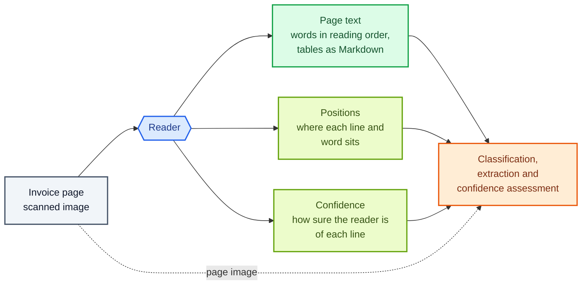
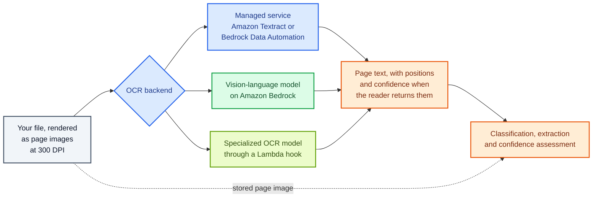

Copyright Amazon.com, Inc. or its affiliates. All Rights Reserved.
SPDX-License-Identifier: MIT-0

# Digitization (OCR)

## What digitization does for your database

Before any model can find a field on a page, something has to read the page. Digitization
turns each page of each file into **page text**: the words on the page, in reading order,
with tables kept as rows and columns. Optical character recognition (OCR) is the usual name
for the job. These pages call the service or model that does the job the **reader**.

Some readers also return where each line and word sits on the page, and how sure the reader
is of each one. The accelerator keeps that position and confidence data next to the page
text, and later steps use it to draw boxes around extracted values and to judge how far to
trust them.

Here is a scanned invoice page for broadcast advertising, and the page text a reader returns
for it:

```markdown
# INVOICE
Invoice No: 10482        Invoice Date: 03/14/2026
Advertiser: Harbor Credit Union

| Description              | Spots | Amount   |
|--------------------------|-------|----------|
| Morning News, 30 seconds | 4     | 1,200.00 |
| Evening News, 30 seconds | 2     | 900.00   |

Total Due: 2,100.00
```

Extraction then reads `Invoice No: 10482` from the page text and fills the `invoice_number`
column of your invoice table. The two rows of the table become two line items. Every later
step works from this output, so a value the reader misses cannot reach your database.



**The accelerator adds no OCR of its own.** It renders your pages, hands them to the reader
you choose, and passes the result and the page image to every later step. Your choice is
which reader to use and how to prepare the pages for it.

## How the accelerator reads each page

Digitization runs in three steps for every file: the accelerator renders each page as an
image, a reader turns the image into page text, and the accelerator stores both for the
steps that follow.



### Step 1: the accelerator renders every page as an image

The accelerator renders each page of a PDF at **300 DPI** by default, which keeps small print,
box numbers and hand-filled values legible. A US Letter page becomes a 2550 × 3300 pixel
image. An out-of-memory ceiling of 2600 × 3600 pixels shrinks only pages larger than Letter
or A4, such as Legal, and the accelerator never enlarges an image. An image file, such as a
phone photo or a scanned PNG, keeps its own resolution.

Word, Excel, CSV and plain-text files already hold their text, so the accelerator reads that
text directly and renders page images from it for the later steps.

Two settings change how the accelerator prepares each page:

- **Resolution.** In the configuration editor, the *Dpi* field under *OCR* > *Image
  Processing Settings* (`ocr.image.dpi`). *Target Width* and *Target Height*
  (`ocr.image.target_width`, `ocr.image.target_height`) set the ceiling. See
  [OCR Image Sizing](../ocr-image-sizing-guide.md#defaults).
- **Preprocessing.** *Preprocessing* (`ocr.image.preprocessing`) applies adaptive
  binarization: the accelerator turns the page into clean black text on a white background
  before the reader sees it, which helps with shadows, uneven lighting and faint scans. The
  stored page image stays as it was. See
  [Image Preprocessing Configuration](../pattern-2.md#image-preprocessing-configuration).

### Step 2: a reader turns each page image into page text

The accelerator sends each page to the reader you choose, one call per page, with up to 20
pages in flight at once (`ocr.max_workers`). In the editor the choice is **OCR backend**
(`ocr.backend`). Three kinds of reader are available.

**A managed OCR service.**

- **Amazon Textract** (*Amazon Textract (default)*, `textract`) returns every line and word
  with its position and a confidence score, and marks handwriting. You choose its analysis
  features in **Textract features** (`ocr.features`):
  - `LAYOUT` puts the text in reading order, with headings and paragraphs.
  - `TABLES` returns each table cell by cell, which the accelerator writes as a Markdown
    table.
  - `FORMS` returns key-value pairs, such as a label and the value printed beside it.
  - `SIGNATURES` reports each region that holds a signature, with its position and a
    detection confidence.

  With no features selected, Textract returns plain lines of text.
- **Amazon Bedrock Data Automation** (*Bedrock Data Automation*, `bda`) returns Markdown with
  tables and layout, plus every line and word with its position and confidence, from one
  call per page. The stack creates the project the backend needs in most commercial AWS
  Regions; the backend is not available in AWS GovCloud (US) or China. See [When to choose BDA vs Textract for OCR](../configuration.md#when-to-choose-bda-vs-textract-for-ocr).

**A vision-language model on Amazon Bedrock** (*Bedrock LLM*, `bedrock`). A model that reads
images, such as Amazon Nova 2 Lite (the default in **Model**, `ocr.model_id`), receives the
page image with an instruction to transcribe it, and writes the page text as Markdown. You
can edit the instruction in **Task prompt** (`ocr.task_prompt`) and **System prompt**
(`ocr.system_prompt`), for example to ask for tables as Markdown pipe tables. A
vision-language model returns no positions and no confidence. See
[Bedrock OCR](../pattern-2.md#bedrock-ocr-feature).

**A specialized OCR model through a Lambda hook.** Set **OCR backend** to *Bedrock LLM*,
choose *LambdaHook* in **Model**, and enter your function in **Model Lambda hook ARN**
(`ocr.model_lambda_hook_arn`). The accelerator then sends each page image to your AWS Lambda
function, which can call any OCR model, hosted by you or by a third party. Ready-made samples
call [Chandra](../lambda-hook-inference.md#chandra-ocr-integration),
[Mistral OCR](../lambda-hook-inference.md#mistral-ocr-integration) and
[Cohere Parse](../lambda-hook-inference.md#cohere-parse-integration). A hook can return
positions and confidence alongside the text, in Textract's format, and the accelerator then
uses them as it uses Textract's. See
[structured OCR output](../lambda-hook-inference.md#optional-structured-ocr-output-confidence--geometry).

A fourth setting, *None — images only* (`none`), skips the reader. Classification and
extraction then work from the page images alone.

What each reader returns:

| Reader | Page text | Tables | Positions | Confidence |
|---|---|---|---|---|
| Amazon Textract | Lines in reading order | Markdown tables, with `TABLES` | Every line and word | Every line and word |
| Bedrock Data Automation | Markdown in reading order | Markdown tables | Every line and word | Every line and word |
| Vision-language model | Markdown, as the model writes it | Markdown, when the prompt asks for it | None | None |
| Mistral OCR hook | Markdown | Markdown tables | One box per paragraph | Every line and word |
| Cohere Parse hook | Markdown | Converted to Markdown tables | Tables and figures only | None |
| Chandra hook | Markdown | Markdown tables | None | None |

For the full comparison, see the
[cross-backend matrix](../../lib/idp_common_pkg/idp_common/ocr/README.md#cross-backend-matrix).

### Step 3: what the later steps receive

For every page, the accelerator stores the page image, the page text, a compact table of
each line with its confidence, and the positions of every line and word. Each later step
reads the part it needs:

- **Classification** reads the page text and the page image. In the classification settings
  these are **Send page text** and **Send page images**.
- **Extraction** reads the page text and the page image of every page in the section. The
  extraction model can check a value in the text against the image, and read checkboxes and
  signatures from the image.
- **Confidence assessment** gives the **scoring model** (the model that assigns each
  extracted value a confidence score) the reader's line-by-line confidence alongside the page.
  See [Confidence Assessment](../extraction-and-confidence.md#3-confidence-assessment).
- **Bounding boxes** come from the reader's positions. By default the accelerator matches
  each extracted value to the OCR line that holds it and draws a box around that line. See
  [OCR grounding](../extraction-and-confidence.md#ocr_only-default--ocr-grounding-via-pagedatajson).
- **Table parsing** in agentic extraction reads Markdown tables from the page text directly,
  without asking a model to copy every row. See
  [Deterministic table parsing](../extraction-and-confidence.md#deterministic-table-parsing).

Classification and extraction can each send a smaller copy of the page image to their
model, through their own image settings. The stored image at full resolution stays
untouched.

### How the choices combine

| Configuration | OCR backend | Settings | Returns positions and confidence |
|---|---|---|---|
| **Textract with tables (default)** | *Amazon Textract (default)* | `TABLES`, `LAYOUT`, `SIGNATURES`, 300 DPI | Yes |
| Textract, layout only | *Amazon Textract (default)* | `LAYOUT` | Yes |
| Bedrock Data Automation | *Bedrock Data Automation* | None to choose | Yes |
| Vision-language model | *Bedrock LLM* | A model in **Model**, and your **Task prompt** | No |
| Specialized OCR model | *Bedrock LLM* | *LambdaHook* and your function's ARN | Depends on the model |
| Images only | *None — images only* | None | No |

These settings apply in pipeline mode. In BDA mode (`use_bda: true`), Bedrock Data Automation
reads the pages as part of its own processing, and the editor hides the *OCR* section. See
[Pattern 1](../pattern-1.md).

## The configuration to start with

**Start with the default: Amazon Textract with `TABLES`, `LAYOUT` and `SIGNATURES` at 300
DPI.** Textract returns positions and confidence for every word, so the scoring model can
use the reader's confidence and the Web UI can draw a box around every extracted value.
`TABLES` keeps each value in its row and column, which matters for statements, invoices and
any document with line items. In our benchmark, no other reader extracted more accurately
from real invoices or synthetic statements, and on bank checks only Textract with `LAYOUT`
alone scored higher, by 0.3 points (see
[the benchmark results](#benchmark-results-extraction-accuracy-by-reader)).

**If your documents have no tables, try `LAYOUT` alone.** Textract charges for each page by
the features you select, and `TABLES` costs more per page than `LAYOUT` alone. On real
invoices, layout only scored within the noise of the default. If your documents have no signature
fields, remove `SIGNATURES`, so stray pen marks do not add detections to the page text.

**Test another reader if Textract does not cover your documents.** Textract reads a fixed
set of languages; see
[OCR backend language support](../languages.md#ocr-backend-considerations-for-language-support).
For other languages, heavy handwriting or unusual layouts, compare a vision-language model
and a specialized OCR model with the default on your own test set. If confidence scores and
bounding boxes matter to you, prefer a reader that returns them: Bedrock Data Automation or
the Mistral OCR hook.

**Keep the resolution at 300 DPI.** Bedrock scales every image down to its own limit before
counting tokens, so a lower resolution saves few tokens in later steps. Below about 200 DPI,
Textract drops small and faint characters from its output. See
[Do not lower resolution to save tokens](../ocr-image-sizing-guide.md#do-not-lower-resolution-to-save-tokens).

## How many tokens digitization uses, and how the reader changes the tokens of later steps

**Textract and Bedrock Data Automation do not use tokens.** Each makes one call per page.
Textract charges per page by the features you select. Bedrock Data Automation charges one
rate per page, whatever the page holds. A specialized OCR model behind a Lambda hook is
billed however its provider bills it, often per page.

**A vision-language model uses tokens on every page.** Three things decide how many:

- **The page image.** The input is the instruction and the page image. How many tokens an
  image costs depends on the model and the image size, and Bedrock scales large images down before counting, so
  a higher resolution adds few tokens.
- **How much the page says.** The output is the transcription, so a dense page of small print
  or a long table costs far more output tokens than a check.
- **The model.** Models count image tokens differently, and larger models charge more for
  each token.

Measured OCR tokens per page with Amazon Nova 2 Lite, the default vision-language model
(release 0.6.14, November 2026):

| Documents | Pages measured | Input tokens per page | Output tokens per page |
|---|---|---|---|
| Bank checks | 20 | 329 | 229 |
| Real invoices | 81 | 329 | 1,666 |
| Synthetic bank statements of 1 to 17 pages | 52 | 329 | 198 to 3,203, by file |

Source: `benchmarks/results/v0.6.14/core/summary.json`, cell `core-llm-simple-sep`,
`tokens_by_phase.OCR`.

**The reader also changes the tokens every later step uses,** because each step reads the
page text the reader wrote. Measured tokens per page for the whole pipeline on the same 20
real invoices (81 pages), by reader:

| Phase | Textract, tables (default) | Textract, layout only | Vision-language model |
|---|---|---|---|
| OCR, input | — | — | 329 |
| OCR, output | — | — | 1,666 |
| Classification, input | 2,391 | 2,124 | 3,086 |
| Extraction, input | 3,666 | 3,320 | 4,389 |
| Confidence assessment, input | 10,484 | 10,414 | 6,176 |
| **All phases, input** | **16,542** | **15,858** | **13,981** |
| **All phases, output** | **1,413** | **1,408** | **3,192** |

Input tokens include prompt-cache reads and writes. The classification model was Amazon Nova
2 Lite, the extraction model Claude Sonnet 4.6, and the scoring model Amazon Nova Lite.
Source: `benchmarks/results/v0.6.14/core/summary.json`, cells `core-tt-simple-sep`,
`core-tl-simple-sep` and `core-llm-simple-sep`, document `realkie`.

What this shows:

- **The vision-language model wrote longer page text than Textract on these invoices,** so
  classification and extraction read about 20–30% more input tokens per page.
- **The scoring model read about 40% fewer input tokens per page with the vision-language
  model,** because that reader has no line-by-line confidence to add to the scoring model's
  prompt. The same drop means the scoring model judged each value without the reader's
  confidence.
- **Layout only cut input tokens slightly** in every phase, because the page text carried
  no table markup.

## How to measure digitization on your own documents

Few teams have a correct transcription of their own pages, and you do not need one. Measure
a reader in two stages.

**1. Shortlist readers with public OCR benchmarks.** The
[OmniAI OCR benchmark](https://github.com/getomni-ai/benchmark),
[OmniDocBench](https://github.com/opendatalab/OmniDocBench) and
[olmOCR-Bench](https://huggingface.co/datasets/allenai/olmOCR-bench) score readers directly
against reference transcriptions or checks of each page. Each covers different kinds of
document, so pick the benchmarks whose pages look most like yours, and shortlist the readers
that score well there.

**2. Compare the shortlist by what reaches your database.** Run your test set once with each
reader and keep every other setting the same. Ground truth here is the ground truth you
already use for classification and extraction: the right document class of each section and
the right value of each field. These numbers show how well digitization is working:

| Number | Question it answers |
|---|---|
| **Extraction accuracy** | What share of field values match the ground truth? Stickler weights each field by the weight you give it, averages over the sections of a file, and reports the result as the file's *weighted overall score*. |
| **Paired difference** | For the same files, how much higher or lower is extraction accuracy with reader B than with reader A? Subtract file by file, then average. The standard error (SE) is the standard deviation of the differences divided by the square root of the number of files. |
| **Page accuracy** | What share of pages received the right document class? A reader that garbles a heading can change the document class. |
| **Errors the reader caused** | Of the field values extraction got wrong, what share are missing or misread in the page text? Open the page text of each wrong value to tell a reading error from an extraction error. |

Compare readers file by file rather than by their averages. How hard a file is varies far
more than how well two readers read it, so pairing removes most of the noise. A difference
smaller than about twice its SE can be chance.

If you do have reference transcriptions for some pages, you can also measure the **character
error rate**: the number of characters to insert, delete or change to turn the page text into
the reference, divided by the length of the reference. A lower rate is better, but extraction
accuracy is still the number that tells you what reaches your database.

See [Evaluation](../evaluation.md#field-weighting-for-business-criticality) for how Stickler
weights fields, and [Measure with ground truth](index.md#4-measure-with-ground-truth) to
build the test set.

## Missing values, broken tables and rewritten characters: which reader makes which mistake

Once you know which wrong values the reader caused, look at how the page text is wrong.
Each reader, and each setting, tends to make its own kind of mistake:

| Configuration | Typical mistake | Example | What to change |
|---|---|---|---|
| **Textract, low resolution** | A value is missing from the page text | A page number or a hand-filled box number is absent below about 200 DPI | Keep `ocr.image.dpi` at 300. Scan image files at 300 DPI or more |
| **Textract, layout only** | A long table loses its structure: rows split, run together or go missing | A statement table that a plain-text layout cannot separate into rows | Add `TABLES`, or use Bedrock Data Automation |
| **Vision-language model** | A character changes, and the value looks right | A fixed-width ID such as `SEQ00042` comes back as `SEQ000042` | Use Textract for pages full of IDs and account numbers, or tighten the **Task prompt** |
| **Vision-language model, Chandra and Cohere Parse hooks** | No reader confidence for the scoring model | Confidence comes from the scoring model alone | Use Textract, Bedrock Data Automation or the Mistral OCR hook when confidence drives review |
| **Any reader, on photos** | Characters misread in shadows or faint areas | A phone photo of a receipt with a dark corner | Turn on *Preprocessing* (the Bedrock Data Automation backend does its own image processing and skips it) |
| **Textract with `SIGNATURES`** | A stray mark is reported as a signature | A smudge in an empty signature box | Remove `SIGNATURES` if no field asks about signatures. See [The SIGNATURES feature](../configuration.md#the-signatures-feature) |

## Benchmark results: extraction accuracy by reader

The benchmark measures readers by their effect on extraction: only the reader changes, and
every other setting stays the same. The benchmark has no valid measurement of the Bedrock
Data Automation backend yet.

**Run:** release 0.6.14, November 2026, us-west-2, one run per file. Extraction model Claude
Sonnet 4.6 (the benchmark's fixed control; the shipped default is Claude Sonnet 5),
classification model Amazon Nova 2 Lite, scoring model Amazon Nova Lite. The Textract
baseline used `TABLES` and `LAYOUT`. The vision-language model was Amazon Nova 2 Lite, with
a task prompt that asks for tables as Markdown pipe tables.

### Real invoices and bank checks

| Reader | Real invoices: accuracy | Bank checks: accuracy |
|---|---|---|
| Textract, tables (**baseline**) | 0.798 | 0.995 |
| Textract, layout only | −1.7 points (SE 1.3; 1 file better, 6 worse) | +0.3 points (SE 0.1; 7 better, 0 worse) |
| Vision-language model | −1.6 points (SE 2.2; 5 better, 6 worse) | −2.0 points (SE 0.9; 3 better, 11 worse) |

**Datasets:** [RealKIE-FCC-Verified](benchmark-datasets.md#realkie-fcc-verified), 20 invoices
(81 pages), and the [OmniAI-OCR-Benchmark](benchmark-datasets.md#omniai-ocr-benchmark) slice,
20 single-page bank-check images. Stickler scores weighted accuracy, and each difference
compares the same file under the reader and under the baseline. Source:
`benchmarks/results/v0.6.14/core/summary.json`, cells `core-tt-simple-sep`,
`core-tl-simple-sep` and `core-llm-simple-sep`, documents `realkie` and `ocr_bench`.

### Synthetic bank statements with exact ground truth

| Reader | Rows returned | Cells correct |
|---|---|---|
| Textract, tables (**baseline**) | 2,205 of 2,205 | 4,410 of 4,410 |
| Textract, layout only | 2,205 of 2,205 | 4,410 of 4,410 |
| Vision-language model | 2,205 of 2,205 | 4,343 of 4,410 (0.985) |

**Dataset:** seven [synthetic bank statements](benchmark-datasets.md#synthetic-bank-statements)
of 1 to 17 pages and 5 to 800 transaction rows (52 pages in all). The scorer checks each
row's date and amount. Same run and source, documents `tiny_form` to `longdesc_100`.

What this shows:

- **Textract with tables is a strong default for printed business documents.** No other
  reader was more accurate on real invoices or synthetic statements.
- **Layout only matched the default.** On invoices the difference was within the noise, and
  on checks layout only scored 0.3 points higher. For documents without tables, layout only
  is the configuration to try first.
- **The vision-language model returned every row, and changed a few values.** On the
  statements it got 67 of 4,410 cells wrong, the only reader that got any wrong, and it
  changed the width of 126 of the 2,205 row IDs, for example by doubling a leading zero. On the checks it scored 2 points lower
  than Textract. On invoices the difference was within the noise.

**How far this carries:** 20 invoices, 20 checks and 7 synthetic statements, one run each,
with one extraction model. All three datasets are printed and fairly clean. For handwriting,
phone photos, faxes and languages other than English, run the same comparison on your own
pages.

## Improving digitization once your pipeline is running

When your test set shows wrong values that the reader caused, these changes help most,
roughly in this order.

**Look at the page text before you change anything.** On any processed document, open
[View Page Text](../web-ui.md#view-page-text) for the page that holds a wrong value. The OCR
lines view shows each line with its confidence, and draws its box on the page image when the
reader returns positions. If the value is right in the page text, the cause is in
classification or extraction, not in digitization.

**Keep the resolution at 300 DPI, and scan at 300 DPI.** A value that is missing from the
page text entirely is usually a resolution problem. The accelerator renders PDFs at 300 DPI,
but an image file keeps the resolution it was scanned or photographed at. See
[When to change the defaults](../ocr-image-sizing-guide.md#when-to-change-the-defaults).

**Turn on `TABLES` for documents with tables.** If rows run together or cells land in the
wrong column, add `TABLES` in **Textract features**. See
[Textract features](../configuration.md#textract-features--the-tables-costaccuracy-trade-off).

**Turn on preprocessing for photos and poor scans.** *Preprocessing* cleans up shadows,
uneven lighting and low contrast before the reader sees the page. See
[OCR image processing](../pattern-2.md#ocr-image-processing-features).

**Keep the page image in the extraction prompt.** The default extraction prompts send the
page image with the page text, so the extraction model can correct a misread character
against the image and read checkboxes the text does not show. If you write your own
extraction prompt, keep the `{DOCUMENT_IMAGE}` placeholder in it.

**Tell a vision-language model exactly what to write.** The **Task prompt** decides what the
page text looks like. Ask for tables as Markdown pipe tables, so table parsing can read them,
and ask the model to copy numbers and IDs character for character.

**Correct a page by hand.** An Admin can fix the page text of one page with
[Edit Page Text](../web-ui.md#edit-page-text) and choose **Save and Reprocess**. The
accelerator saves the text and extracts the sections on that page again.

## Run the benchmarks yourself

**On your own documents.** Build a test set of real files with their correct field values,
run it in [Test Studio](../test-studio.md) once per reader, and compare extraction accuracy
file by file. Every stack includes the RealKIE-FCC-Verified and OmniAI-OCR-Benchmark test
sets, so you can repeat the comparison above in your own account. The
[Auto Optimizer](../extensions/auto-optimizer.md) can run comparisons of pipeline
configurations against your test set for you.

**The benchmark suite.** The `core` suite runs every reader cell on the synthetic statements
and the two public test sets:

```bash
source .venv/bin/activate && export PYTHONPATH=$PWD/lib/idp_common_pkg
python3 benchmarks/harness/gen_corpus.py          # synthetic statements
for c in bank_statement realkie ocr_bench; do
  python3 benchmarks/harness/make_configs.py --suite core --class $c
done
python3 benchmarks/harness/run_matrix.py --stack <STACK> --suite core
python3 benchmarks/harness/aggregate.py --run benchmarks/results/run-<stamp> \
  --out benchmarks/results/<release>/core
```

Recompute the invoice accuracy for each reader from the committed results:

```bash
jq '[.rows[] | select(.doc=="realkie" and (.cell|IN("core-tt-simple-sep","core-tl-simple-sep","core-llm-simple-sep")))]
    | group_by(.cell) | map({cell: .[0].cell, files: length, weighted_accuracy: (map(.weighted_accuracy)|add/length)})' \
  benchmarks/results/v0.6.14/core/summary.json
```

And the vision-language model's OCR tokens per page on the invoices:

```bash
jq '[.rows[] | select(.cell=="core-llm-simple-sep" and .doc=="realkie")]
    | (map(.page_count)|add) as $p
    | {pages: $p, input_per_page: ((map(.tokens_by_phase.OCR.inputTokens)|add)/$p),
       output_per_page: ((map(.tokens_by_phase.OCR.outputTokens)|add)/$p)}' \
  benchmarks/results/v0.6.14/core/summary.json
```

See the [benchmark suite](../benchmarking/index.md) for setup and scoring.

## Where to configure digitization in the accelerator

- **Choose a reader and its features:**
  [OCR Backend Configuration](../configuration.md#ocr-backend-configuration-pipeline-mode),
  including [when to choose BDA or Textract](../configuration.md#when-to-choose-bda-vs-textract-for-ocr)
  and [Textract features](../configuration.md#textract-features--the-tables-costaccuracy-trade-off).
- **Use a vision-language model on Bedrock:** [Bedrock OCR](../pattern-2.md#bedrock-ocr-feature).
- **Bring your own OCR model:** [Lambda Hook Inference](../lambda-hook-inference.md), with
  ready-made [sample functions](../lambda-hook-inference.md#sample-lambda-functions) for
  Chandra, Mistral OCR and Cohere Parse.
- **Set resolution, image size and preprocessing:**
  [OCR Image Sizing](../ocr-image-sizing-guide.md) and
  [OCR Configuration](../pattern-2.md#ocr-configuration).
- **Pick a reader for your language:**
  [Languages](../languages.md#ocr-backend-considerations-for-language-support).
- **Deploy in AWS GovCloud (US):** use Textract, because the Bedrock Data Automation
  backend is not available there. See
  [Bedrock Data Automation as the OCR backend](../govcloud-deployment.md#bedrock-data-automation-as-the-ocr-backend).
- **See and correct the page text:** [View Page Text](../web-ui.md#view-page-text) and
  [Edit Page Text](../web-ui.md#edit-page-text) in the Web UI.
- **See how the scoring model uses the reader's confidence:**
  [Confidence Assessment](confidence-assessment.md), and
  [Confidence Assessment in the accelerator](../extraction-and-confidence.md#3-confidence-assessment).
