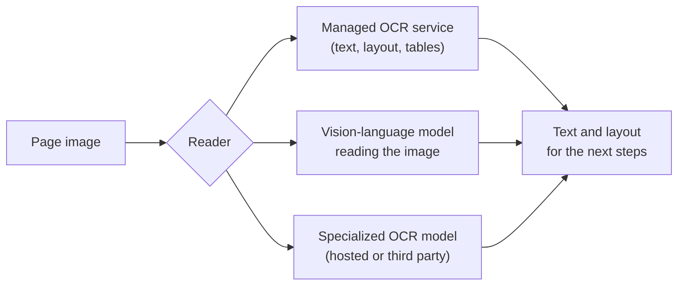

Copyright Amazon.com, Inc. or its affiliates. All Rights Reserved.
SPDX-License-Identifier: MIT-0

# Digitization (OCR)

## What it does

Digitization turns each page image into text and layout: the words, where they sit, which
words make up a line, which cells make up a table, and which boxes are ticked. It is the
first step from a stack of documents to a database. Every later step reads its output, so
clean text here makes everything after it easier.

## Getting it right

- **Keep structure, not just text.** If your documents have tables, use a reader that
  returns table structure, so each value stays in its row and column.
- **Keep resolution high enough** for the smallest print you need. 300 DPI is a safe
  default; [OCR Image Sizing](../ocr-image-sizing-guide.md) covers the trade-offs.
- **Pass the page image along with the text.** Later steps can then check a value against
  the page, which also takes care of checkboxes, signatures and layout cues.
- **Match the reader to your pages.** Clean, born-digital PDFs read well with almost any
  reader. Phone photos, faxes, handwriting and unusual scripts are where the choice of
  reader pays off.

## Choosing a reader

There are three kinds of reader, and you can pick the one that suits your pages.

| Reader | Best at | Keep in mind |
|---|---|---|
| **Managed OCR service** | Word positions and confidence, table and form structure, predictable cost | Very hard handwriting |
| **Vision-language model** | Unusual layouts; returns Markdown tables directly | Check that its fluent output matches the page |
| **Specialized OCR model** | A particular script, layout or document type it was built for | One more service to run or depend on |

## How to measure it

OCR is scored on its own with character or word error rates against a transcription of each
page. Most teams don't have transcriptions of their own documents, and they don't need them:

1. **Shortlist readers with public OCR benchmarks**, such as the
   [OmniAI OCR benchmark](https://github.com/getomni-ai/benchmark),
   [OmniDocBench](https://github.com/opendatalab/OmniDocBench) and
   [olmOCR-Bench](https://huggingface.co/datasets/allenai/olmOCR-bench). Pick the
   benchmarks whose documents look most like yours.
2. **Then compare the shortlist by what it does downstream.** Run the same splitting and
   extraction configuration with each reader on your test set, and compare classification
   and extraction accuracy. That is the number your database depends on, and it uses the
   ground truth you already have for those steps.

## What we measured

We measure OCR the second way: by its effect on extraction. **Run:** release 0.6.14,
November 2026, us-west-2. The extraction model was held fixed (Claude Sonnet 4.6, the
benchmark's control model) and only the reader changed.

| Dataset | Textract with tables (baseline) | Textract with layout only | Bedrock vision-model OCR |
|---|---|---|---|
| RealKIE-FCC-Verified, 20 real invoices | 0.798 weighted accuracy, $0.143 per document | Within 2 points (−1.7, SE 1.3); **35% cheaper** | Within 2 points (−1.6, SE 2.2); 23% cheaper |
| OmniAI-OCR-Benchmark slice, 20 bank-check images | 0.995, $0.034 per document | Same accuracy (+0.3); 34% cheaper | −2.0 points (SE 0.9); 43% cheaper |

Source: `benchmarks/results/v0.6.14/core/summary.json`, compared document by document.

What this shows:

- **On printed business documents, the managed service was as accurate as anything we
  tried, and its layout-only mode was a third cheaper for at most a small difference.**
  That makes it a strong default.
- **Vision-model OCR was the cheapest reader** and close in accuracy on invoices. On a
  synthetic 400-row statement it was the only reader that introduced value errors (up to
  about 2% of cells; release 0.6.12), so check it on table-heavy documents.

**How far this carries:** these datasets are printed and fairly clean. For handwriting,
photos and faxes, run the downstream comparison on your own pages.

## In the accelerator

The accelerator wraps all three kinds of reader, so you can compare them on your documents
by changing one setting:

- **Managed service:** Amazon Textract (text, layout, tables, forms and signatures), or
  Amazon Bedrock Data Automation.
- **Vision-language model:** any supported Bedrock model, prompted to transcribe the page.
- **Specialized model:** your own model or a third-party service, called through a Lambda
  hook. Samples include hosted Chandra, Mistral OCR and Cohere parsing models. See
  [Lambda Hook Inference](../lambda-hook-inference.md).

Settings: [Pipeline mode](../pattern-2.md), [OCR Image Sizing](../ocr-image-sizing-guide.md)
and [Languages](../languages.md).
