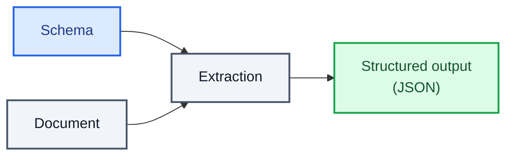
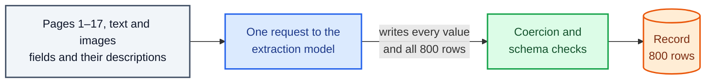
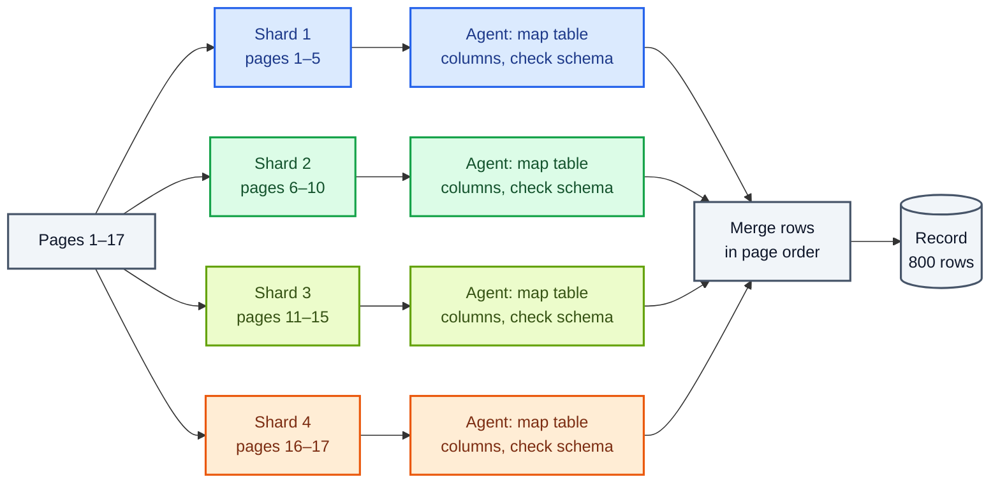

Copyright Amazon.com, Inc. or its affiliates. All Rights Reserved.
SPDX-License-Identifier: MIT-0

# Key Information Extraction

## Overview

You define a **schema** for each document class: the fields you need, what each one means,
and its type. For every section, extraction reads the pages and returns a **record**: JSON in
exactly the structure the schema describes, ready to insert into a database.



The schema is JSON Schema. Here is a trimmed version of the Invoice class in the
`realkie-fcc-verified` preset:

```yaml
classes:
  - x-aws-idp-document-type: Invoice
    description: Invoice document
    type: object
    properties:
      Advertiser:
        type: string
        description: The name of the advertiser
      GrossTotal:
        type: number
        description: The gross total amount. Output null if not shown.
      LineItems:
        type: array
        description: List of line item details on the invoice; each item has several possible elements
        items:
          type: object
          properties:
            LineItemDescription:
              type: string
              description: Description of the line item. Output null if not shown.
            LineItemRate:
              type: number
              description: Rate for the line item. Output null if not shown.
```

For one invoice, extraction returns:

```json
{
  "Advertiser": "Acme Auto Group",
  "GrossTotal": 4250.0,
  "LineItems": [
    {"LineItemDescription": "Evening news, 30-second spot", "LineItemRate": 850.0},
    {"LineItemDescription": "Morning show, 15-second spot", "LineItemRate": 425.0}
  ]
}
```

Each description is the instruction the model follows for that field, and each type decides
what comes back: `GrossTotal` is a number, not the text "$4,250.00". A field such as
`Advertiser` holds one value. A **list field** such as `LineItems` holds **rows**, one per
item, each with its own fields. In a database, the single values fit one row in a table for
the document class, and each list field a second table with one row per item.

## Extraction modes

The **extraction model** (`extraction.model`) reads each section and writes its record.
*Extraction mode* (`extraction.mode`) decides how. *Simple* sends the whole section in one
request. *Advanced* splits the section into shards and runs an agent on each one.

### Model inputs

In both modes, the extraction model receives:

- the section's OCR text, every page in order;
- the page images, which show layout, check boxes and handwriting;
- each field's name, type and description from your schema;
- your few-shot examples for the document class, if you added any.

The model follows each field's description as its instruction for that field. Use the
description to say where the value appears and what format you want.

### Single-pass extraction

*Simple* is the default. The accelerator sends the whole section in one request, and the
model writes the whole record as JSON, including every row of every list.



This has two limits:

- **The section must fit in the model's input window.** The accelerator checks the size
  before it sends the request, and stops with `ExtractionInputTooLarge` if it doesn't fit.
- **The model writes every row.** A long list needs a long response, and a list too long for
  one response comes back short.

With Claude models, a request with more than 20 page images has each image scaled to at most
2,000 pixels on a side; see
[Claude's vision limits](https://platform.claude.com/docs/en/build-with-claude/vision#request-limits).

See [Simple (non-agentic) extraction](../extraction-and-confidence.md#simple-non-agentic-extraction).

### Agentic extraction

*Advanced* runs an **agent**: the extraction model in a loop, calling tools, until the record
is complete and passes your schema.

1. **Shards.** The accelerator splits the section into shards of up to 5 consecutive pages
   (`extraction.agentic.max_pages_per_shard`), with at most 10 shards
   (`extraction.agentic.max_concurrent_batches`). A section of more than 50 pages gets 10
   shards of similar length. Each shard gets its own agent, and all of them run at once, each
   in its own AWS Lambda invocation under AWS Step Functions, so one function's time limit
   doesn't cap a long section. Every shard after the first also gets the column headings from
   the first page.
2. **Table tool.** When Amazon Textract's `TABLES` feature is on, the OCR text holds each
   table as Markdown. The agent maps the table's columns to your row fields, and code builds
   the rows, so the model never writes them out. This is *Table Parsing Tool*
   (`extraction.agentic.table_parsing.enabled`), on by default.
3. **Schema checks.** Each time the agent submits the record, a tool checks it against your
   schema (types, allowed values, patterns and list sizes) and returns the errors. The agent
   fixes them with targeted edits.
4. **Merge.** The accelerator joins the shards' rows in page order, and takes each
   single-value field from the first shard that found it.



If the OCR text holds a Markdown table of more than 30 rows and every list field comes back
empty, the accelerator sends the agent back to try again. The agent also scores confidence
inside each shard; see [Confidence Assessment](confidence-assessment.md).

See [Advanced (agentic) extraction](../extraction-and-confidence.md#advanced-agentic-extraction),
[Deterministic table parsing](../extraction-and-confidence.md#deterministic-table-parsing) and
[sharding](../extraction-and-confidence.md#scalable-extraction-for-large-documents-sharding).

### Checks after extraction

Every record then goes through three checks:

- **Value coercion** (*Value Coercion*, `extraction.coercion`) fixes values that don't match
  their type, without a model call. `"$1,234.00"` in a `number` field becomes `1234.0`, and
  `"03/15/2024"` in a date field becomes `"2024-03-15"`. It leaves an ambiguous value such as
  `01/02/2024` alone, and records every change it makes.
- **Schema validation** (*Schema Validation & Escalation*, `extraction.validation`, on by
  default) checks the record against the full schema, including formats such as dates and
  email addresses, and records each violation on the section.
- **Completeness checks** compare each list with the tables in the OCR text, and raise a
  processing issue when fewer than half the rows came back. See
  [Common mistakes](#common-mistakes).

### Several records in one section

When a section holds several documents of the same class, such as three pay stubs in a row,
turn on *Records per section* (`x-aws-idp-multi-instance`) for the class, and extraction
returns a list of records instead of one. See
[Output Correctness](../extraction-and-confidence.md#2b-output-correctness-coercion-validation--multi-instance-sections).

### Mode comparison

| | Single-pass (*Simple*) | Agentic (*Advanced*) |
|---|---|---|
| Config value | `extraction.mode: simple` (default) | `extraction.mode: advanced` |
| Model requests per section | One | Several per shard, shards in parallel |
| Who writes the list rows | The model, every row | Code, from the OCR's Markdown tables, when the table tool is on |
| Section size | Must fit in one request | Split into shards |
| Schema checks | After the model answers | At every submission, then after the merge |
| Extraction models | Every supported model | Models with tool use, such as Claude Haiku 5.5 and Claude Sonnet 5.5 |

*Extraction mode* applies to every document class in a
[configuration profile](../configuration-profiles.md). To use both modes, give each kind of
document its own profile, and route it there with a
[prefix mapping](../configuration-profiles.md#prefix-mappings-assigning-a-profile-by-where-a-document-lands).

For the configuration we recommend, and the measurements behind it, see
[Key information extraction benchmarks](../benchmark-guidance/extraction.md).

## Token use

Four things decide how many tokens extraction uses:

- **The rows the model writes.** Output tokens grow with the length of the list. In a single
  pass the model writes every row. In agentic mode with table parsing on, the table tool
  assembles the rows in code.
- **How often the model rereads its instructions.** A single-pass reads each page once. An
  agent sends its prompt again on every turn of its loop, and every shard repeats the
  instructions and the schema, so agentic extraction reads more input tokens. For models
  that support prompt caching, the accelerator marks the repeated part for Amazon Bedrock's
  prompt cache, which bills it at a reduced rate.
- **Page images.** Each image adds input tokens, and how many depends on the extraction model
  and the image size.
- **The extraction model.** Models count tokens differently, especially for images, and models
  differ in how many tokens they spend reasoning.

See [When is agentic extraction worth it?](../benchmark-guidance/extraction.md#when-is-agentic-extraction-worth-it)
for what each mode costs.

## Measuring accuracy

Ground truth for this step is the correct value of every field and every row in a sample of
your documents. Two numbers describe a list field, and a third describes the record as a
whole:

| Number | Question it answers |
|---|---|
| **Completeness** | What share of the rows in the ground truth came back? Rows returned ÷ rows in the ground truth. |
| **Accuracy over compared cells** | Of the values compared in the rows that came back, what share match the ground truth? |
| **Weighted accuracy** | How close is the whole record to the ground truth, field by field? Stickler scores each field from 0 to 1 with that field's comparison method, then averages the scores, weighted by each field's weight. |

Read completeness and accuracy together. Accuracy counts only the rows that came back, so a
list that returned 43 of 800 rows, all correct, scores 1.0 on accuracy and 0.054 on
completeness.

Stickler is the open-source library the accelerator uses to compare results with ground truth.
You choose each field's comparison method: exact for IDs, a tolerance for amounts, date-aware
for dates, similarity for names, and item-by-item matching for lists, which pairs each
extracted row with its closest row in the ground truth. See
[Measure with ground truth](index.md#4-measure-with-ground-truth) for the full list and for how
the accelerator drafts the ground truth for you, and
[Weighted Score Calculation](../evaluation.md#weighted-score-calculation) for the formula.

Build a test set of real documents with their correct values, run
it in [Test Studio](../test-studio.md) once in each extraction mode, and compare completeness
and field accuracy.

## Common mistakes

The accelerator reports each of these mistakes as a **processing issue** on the section,
shown in the document list's *Processing Issues* column and on the *Processing Report* tab.

| Configuration | Typical mistake | How the accelerator reports it | What to change |
|---|---|---|---|
| **Single-pass** on a long list | Returns the first rows of the list and reports `COMPLETED` | `extraction_rows_below_ocr_estimate` (warning) | Try agentic extraction, which splits the section into shards |
| **Single-pass** on a section too large for one request | Stops before extracting | The document fails with `ExtractionInputTooLarge`, naming the request size and the remedy | Use agentic extraction, which splits the section into shards |
| **Single-pass or agentic** on a section that holds several records of one class | Returns the first record only | `extraction_multi_instance_suspected`, when *Multi-instance Section Detection* is on | Set *Records per section* to *Several — wrap my single-record class* |
| **Single-pass or agentic** with a value in the wrong format | Stores the value as the model wrote it | `extraction_validation_failed` (warning) | Declare the format on the field, and say it in the description |

**A short list is easy to miss.** A single pass that stops early returns the first rows of
the list and finishes with `COMPLETED`. It also runs faster and writes fewer tokens than a
complete run, so neither the document status nor the run time shows the loss. The accelerator's row-count check does: it compares the rows extracted with
the rows in the section's OCR tables of the same width, and raises
`extraction_rows_below_ocr_estimate` when fewer than half came back.

Three settings change what happens to a short list:

- **Make a short list fail the document.** *Truncated list outcome*
  (`extraction.row_shortfall_action`) is `warn` by default: the accelerator records the issue
  and the document completes. With `fail`, the accelerator saves the rows it extracted and the
  issue, then marks the section and the document failed. The check matches tables by column
  count, so a two-column array that models a group of values, such as an account summary, can
  borrow evidence from an unrelated two-column table on the same statement. Check your
  document classes for such arrays before you choose `fail`; see
  [Making a materially incomplete list fail the section](../extraction-and-confidence.md#making-a-materially-incomplete-list-fail-the-section--extractionrow_shortfall_action).
- **Declare a minimum list length.** *Min Items* (`minItems`) on a list field states the
  fewest rows any real document holds. In single-pass mode a list under the floor raises
  `extraction_list_truncated` and a schema violation, and the rows are kept. In agentic mode
  the extraction tool enforces the floor in every shard, so a floor larger than one shard's
  rows fails the section; leave `minItems` off lists in sections that shard, and use
  `row_shortfall_action` instead. See
  [`minItems` on a list field](../extraction-and-confidence.md#minitems-on-a-list-field--a-warning-in-simple-mode-a-hard-floor-in-advanced).
- **Keep the row-count check able to run.** The check needs OCR that writes Markdown tables
  (Amazon Textract with `TABLES`, or BDA) and a row schema with one field per table column.
  When the check cannot run on a list of 30 or more rows, the accelerator says so with
  `extraction_row_count_unverified` (info).

See [Detecting a truncated list](../extraction-and-confidence.md#detecting-a-truncated-list) for
every completeness signal.

## Improving accuracy

When your test set shows fields with wrong or missing values, try these changes, and score
each one against your test set.

**Write each field description as an instruction.** The extraction model reads the
description as its instruction for the field. Say where the value appears, what it is not,
and the format you want: "Invoice date: the date the invoice was issued, not the due date or
the order date, as YYYY-MM-DD." Edit descriptions in the
[Document Schema Builder](../web-ui.md#document-schema-builder) under *Description*.

**Declare types and formats in the schema.** Give amounts the type `number` and dates
*Format (JSON Schema)* `date`, and use *Pattern (regex)* or *Enum (Allowed Values)* for codes.
Value coercion then repairs common mismatches without a model call, and schema validation
reports the rest. `format: date` means ISO 8601 (YYYY-MM-DD); for dates written day-first or month-first,
set `extraction.coercion.date_order` to your documents' convention. See
[Value coercion](../extraction-and-confidence.md#value-coercion-extractioncoercion),
[Schema validation](../extraction-and-confidence.md#schema-validation-extractionvalidation) and
[Do schema validation and value coercion improve the output?](../benchmark-guidance/extraction.md#do-schema-validation-and-value-coercion-improve-the-output)

**Add a few-shot example for a hard document class.** A few-shot example is a sample document
with its correct values, which the accelerator adds to the extraction prompt for that
document class. Use one for the fields the model keeps getting wrong. Add them
under *Few-Shot Examples* in the schema builder, with the expected values in *Extraction
Prompt (x-aws-idp-attributes-prompt)*. See [Few-Shot Examples](../few-shot-examples.md).

**Use a different extraction model for one document class.** *Extraction Model Override
(Optional)* (`x-aws-idp-extraction-model`) sets the extraction model for one document class
and leaves the rest on `extraction.model`, so you can test another model on one class
without changing the others. See
[Per-class extraction model override](../extraction-and-confidence.md#per-class-extraction-model-override).

**Tell the accelerator which pages a field comes from.** Some packets leave out optional pages,
such as a supplement that only some customers submit. Declare the page types of the document
class and, under *Source Page Types (Optional)* (`x-aws-idp-source-page-types`), which page
type each field comes from. With `extraction.missing_field_handling.enabled`, the accelerator
then marks a field from an absent page as missing instead of blank. See
[Missing pages vs. blank fields](../missing-page-handling.md).

**Extract every record when one section holds several.** When a section can hold several
records of one document class, such as consecutive pay stubs or several checks on one page,
set *Records per section* to *Several — wrap my single-record class*
(`x-aws-idp-multi-instance: true`). The accelerator then returns a list of records,
`instances`, each with its own confidence. Migrate the ground truth of your test sets to the
new shape in the same change. To find the sections that need it, turn on *Multi-instance
Section Detection* (`extraction.multi_instance_detection.enabled`). See
[Multi-instance sections](../extraction-and-confidence.md#multi-instance-sections-x-aws-idp-multi-instance).

**Let an agent do the tuning.** The [Auto Optimizer](../extensions/auto-optimizer.md) tries
changes to descriptions, prompts, models and settings against your test set, within a cost
budget you set, and keeps the ones that score better.

## Configuration reference

- **Choose the extraction mode:** [Choosing a configuration](../extraction-and-confidence.md#0-choosing-a-configuration-start-here)
  and [Simple vs Advanced](../extraction-and-confidence.md#extraction-mode-simple-vs-advanced)
  in Extraction and Confidence.
- **Define document classes and fields:** the
  [Document Schema Builder](../web-ui.md#document-schema-builder),
  [Document classes and attributes](../extraction-and-confidence.md#document-classes-and-attributes)
  and [Configuration Best Practices](../idp-configuration-best-practices.md).
- **Draft a schema from sample documents:** [Discovery](../discovery.md), or
  [Quick Start](../quick-start.md) from a description.
- **Tune agentic extraction for very large documents:**
  [Large-Document Guidance](../extraction-and-confidence.md#8-large-document-guidance).
- **Check every list came back complete:**
  [Detecting a truncated list](../extraction-and-confidence.md#detecting-a-truncated-list).
- **Score how sure the model is of each value:** [Confidence Assessment](confidence-assessment.md).
- **Correct a result by hand:** [Document Details](../web-ui.md#document-details) and
  [Re-extract Sections](../web-ui.md#re-extract-sections).
- **Improve automatically:** the [Auto Optimizer](../extensions/auto-optimizer.md).
