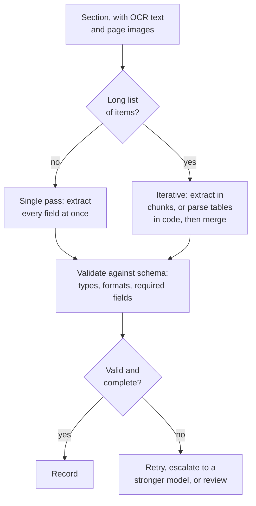

Copyright Amazon.com, Inc. or its affiliates. All Rights Reserved.
SPDX-License-Identifier: MIT-0

# Key Information Extraction

## The problem

Given a section of known type, return the values of the fields you defined for that type:
the vendor, date and total on an invoice; the employer and wages on a tax form; every
transaction on a bank statement. The output is a structured record that matches a schema,
so a program can use it without a person reading the document.

## What makes it hard

- **Label and value are not always next to each other.** A value can sit below its label,
  in a box across the page, or in a column under a shared heading.
- **The same field has many names.** "Invoice date", "Date of issue", "Dated". The wording
  changes across vendors and form editions while the meaning stays the same.
- **Formats vary.** Dates, amounts and identifiers are written many ways, and downstream
  systems need one.
- **Empty fields must stay empty.** A blank field should come back blank, not with a value
  borrowed from the next field.
- **Lists of unknown length.** A statement can have five rows or five thousand. A model has
  a limit on how much it can write in one response, and it may stop early without saying so.
- **Small error rates add up.** One wrong field in 50 means most 50-field forms have at least
  one error.

### How document characteristics affect it

**Fixed-field forms.** The difficulty is precision across many fields. Field descriptions
and output formats matter most. Checkboxes need the page image, because a tick carries no
text.

**Long tables and line items.** The difficulty is **completeness**. A model asked for 800
rows can return 43 and report success, and every row it did return can be right. Count rows
before checking values.

**Varied layouts and poor scans.** The extraction model can only be as good as the text it
is given. If values are wrong across the board, check digitization first; see
[Digitization](digitization.md).

**Handwriting.** Extraction models tend to "correct" misread handwriting into plausible
values. Give the model the page image as well as the text, and validate whatever can be
validated.

**Identity documents.** Short fields that must match exactly. Use the redundancy: where
there is a machine-readable zone or barcode, extract both and compare them.

**Long narrative text.** Facts are in sentences, not labeled fields, and a later clause can
override an earlier one. Extract with a citation to the page, and reconcile overrides in
code rather than in the prompt.

## Approaches



| Approach | Use it for | Watch out for |
|---|---|---|
| **Single pass** | Forms and documents with a bounded number of fields | Long lists: output stops early |
| **Iterative (agentic)** | Long lists, many pages, documents that do not fit in one response | Higher cost and latency on short documents |
| **Deterministic table parsing** | Well-formed tables that OCR has already structured | Tables that OCR broke apart |

Whichever you use:

- **Write precise field descriptions.** The description is the instruction the model
  follows. Say where the field usually appears, what it is not, and the format you want.
- **Declare formats and constraints in the schema** (types, patterns, required fields, a
  minimum number of list items), so violations are caught in code, not by a reviewer.
- **Check completeness against the source** for every list: the number of table rows OCR
  found against the number extracted.
- **Reconcile what can be reconciled,** such as totals, balances and cross-field
  consistency.

## How to measure it

Ground truth is the correct value of every field. With Stickler you choose, per field, the
comparison that reflects what "correct" means for that field:

| Field | Method | Strictness |
|---|---|---|
| Account or invoice number | Exact | — |
| Amount | NumericExact | Tolerance, such as one cent |
| Date | Date | Format-insensitive; optional day-first and tolerance |
| Name, address | Fuzzy or Levenshtein | Similarity threshold, such as 0.9 |
| Free-text description | Semantic, or LLM | Similarity threshold; LLM gives a judged yes/no |
| List of line items | Hungarian | Matches each extracted item to its best ground-truth item before comparing fields |

Weight the fields your business depends on more heavily, so the overall score reflects what
an error costs. See [Evaluation](../evaluation.md#evaluation-methods).

Report two numbers for every list: **completeness** (rows returned ÷ rows in ground truth)
and **accuracy over the rows compared**. 100% accuracy over half the rows is a failure.
Report the share of documents with every field right as well as the average field
accuracy, because the first is what a downstream system sees.

## What we measured

### Long lists: completeness decides the outcome

**Dataset:** [synthetic bank statements](benchmark-datasets.md#synthetic-bank-statements)
with exact, row-level ground truth, from 25 rows on 1 page to 3,200 rows on 66 pages.
**Run:** release 0.6.14, November 2026, extraction model Claude Sonnet 5 (the default)
unless noted.

| Statement | Single pass (Simple) | Iterative (Advanced) |
|---|---|---|
| 100–400 rows, 3–9 pages (n = 1 each) | Every row returned | Every row returned |
| 400 rows, 9 pages (n = 5) | Every row; $0.53 per document; median 260 s | Every row; $0.51; median 139 s |
| 800 rows, 17 pages (n = 6) | **4 of 6 complete.** The other 2 returned 43 rows and reported success. Complete runs cost $1.39–1.64 and took 14–17 min | **6 of 6 complete**; $0.95–1.10; 2.5–3.5 min |
| 3,200 rows, 66 pages (n = 2) | Refused: input too large | **2 of 2 complete**; $3.76–4.20; about 7 min |

Costs are corrected for a known pricing error that overstates Claude Sonnet 5 by 1.5×
([#1830](https://github.com/aws-solutions-library-samples/accelerated-intelligent-document-processing-on-aws/issues/1830)).
Sources: `benchmarks/results/v0.6.14/cost__extraction-model-sonnet5/`,
`coresynth__extraction-model-sonnet5/`, `astravalue/` and `astracap/`.

What this shows:

- **The failure mode on long lists is missing rows, not wrong values.** Every row that came
  back had the right date and amount, in every Textract configuration.
- **Single-pass extraction fails silently past roughly 400 rows** with the default model.
  The truncated runs reported success. Only a completeness check catches them.
- **Iterative extraction was complete at every size, and from about 400 rows it was also
  faster and no more expensive.**
- With the benchmark's control model (Claude Sonnet 4.6), single-pass extraction returned
  every row up to 1,600 rows but took 17–18 minutes there, against about 2.5–4 minutes
  iteratively (`benchmarks/results/v0.6.14/scaling/`). How far a single pass gets depends on
  the model.

### Real invoices: a bounded form with line items

**Dataset:** [RealKIE-FCC-Verified](benchmark-datasets.md#realkie-fcc-verified), 20 public
broadcast-advertising invoices (81 pages) with human-verified labels for header fields and a
short line-item list. **Run:** release 0.6.14, November 2026, extraction model Claude Sonnet
4.6 (the benchmark's control), scored by Stickler as weighted accuracy.

| Change from the default (single pass, Textract tables) | Accuracy change | Standard error | Cost change |
|---|---|---|---|
| Baseline: 0.798 weighted accuracy, $0.143 per document | — | — | — |
| Iterative extraction | −2.5 points | 2.2 | +98% |
| Treat each file as one section (no splitting) | +3.8 points | 2.4 | −12% |
| Textract layout instead of tables | −1.7 points | 1.3 | −35% |
| Bedrock vision-model OCR instead of Textract | −1.6 points | 2.2 | −23% |
| Confidence scoring off | +0.2 points | 0.1 | −3% |

Source: `benchmarks/results/v0.6.14/core/summary.json`, paired by document (n = 20).

What this shows:

- **On short documents, iterative extraction doubled the cost and did not improve accuracy.**
  The direction has been the same across releases, though within about two standard errors.
- **Every invoice is one document, so telling the system that helped,** by removing a source
  of split errors. The size of this effect has varied between releases (from +0.5 to
  +3.8 points), so measure it on your own documents.
- Most other differences are within their uncertainty, so on these invoices the choice can
  be made on cost.

### What this does not tell you

- The statements are synthetic and clean: regular tables, no scan noise, one document type.
- RealKIE is 20 documents of one type, run once per configuration; differences under about
  5 points are within two standard errors.
- The RealKIE runs used the control model, not the default. On an older release
  (0.6.8, with an older version of Stickler), the default model scored slightly lower than
  the control on these invoices (−2.8 points, standard error 3.0).
- Nothing here covers handwriting, identity documents, or long narrative text.

## Reproduce it

**On your own documents.** Build a test set with ground truth, choose a Stickler method,
threshold and weight for each field, run it in [Test Studio](../test-studio.md) for each
configuration you want to compare, and compare the runs field by field. The RealKIE test set
is deployed with every stack, so you can run that comparison on your stack directly.

**The benchmark.**

```bash
python3 benchmarks/harness/gen_corpus.py                  # synthetic statements, exact ground truth
M=benchmarks/harness/make_configs.py
R="python3 benchmarks/harness/run_matrix.py --stack <STACK>"
python3 $M --suite cost --class bank_statement --set extraction_model=sonnet5
$R --suite cost --set extraction_model=sonnet5             # the 400-row comparison, five repeats
for s in astravalue astracap; do python3 $M --suite $s --class bank_statement; $R --suite $s; done
for c in bank_statement realkie ocr_bench; do python3 $M --suite core --class $c; done
$R --suite core                                            # RealKIE and the configuration grid
```

Recompute a figure from the committed results:

```bash
jq '[.rows[] | select(.doc=="realkie" and .cell=="core-tt-simple-sep" and .success)
     | .weighted_accuracy] | add/length' benchmarks/results/v0.6.14/core/summary.json
```

See the [benchmark suite](../benchmarking/index.md) for setup, and
[Configuration guidance](../benchmarking/config-guidance.md) for the full results.

## In the accelerator

- Single-pass and iterative (agentic) extraction, table parsing, schema validation and
  completeness checks: [Extraction and Confidence](../extraction-and-confidence.md) and the
  [Extraction Scaling Guide](../extraction-scaling-guide.md).
- Writing schemas and field descriptions: [Configuration](../configuration.md) and
  [Configuration Best Practices](../idp-configuration-best-practices.md).
- Examples for hard fields: [Few-Shot Examples](../few-shot-examples.md).
- Draft a schema from sample documents: [Discovery](../discovery.md) or
  [Quick Start](../quick-start.md).
