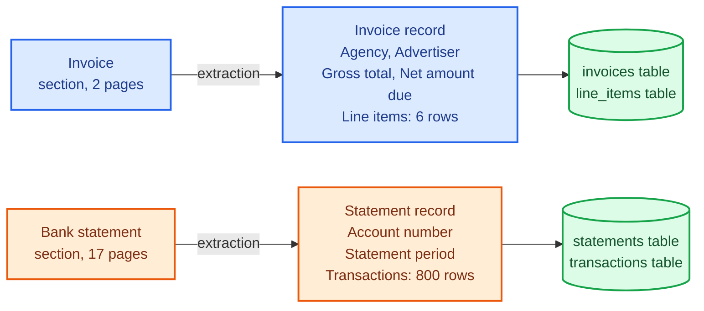
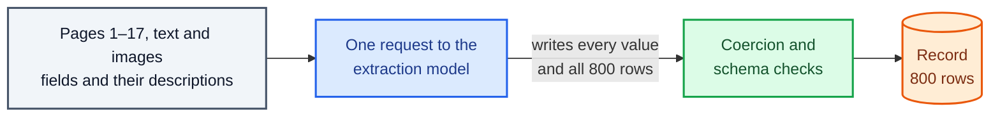
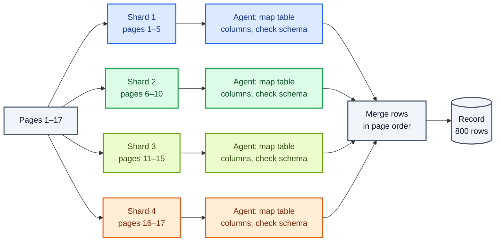

Copyright Amazon.com, Inc. or its affiliates. All Rights Reserved.
SPDX-License-Identifier: MIT-0

# Key Information Extraction

## What extraction does: turn each section into a database record

Extraction is the step that fills your database. For every section, it reads the pages and
returns the values of the fields you defined for the section's document class. The result is
a **record**: one value per field, in the structure your schema describes.

Two kinds of field make up a record:

- A **field** holds one value, such as an invoice's gross total or a statement's account
  number.
- A **list field** holds **rows**, one per item, such as the line items on an invoice or the
  transactions on a bank statement. Each row has its own fields, such as date, description and
  amount.

A record's fields usually become one row in a table for the document class, and each list
field becomes a second table with one row per item. In the example below, extraction turns a
two-page invoice and a 17-page bank statement into two records:



The invoice has a handful of fields and a short list. The statement has two fields and a list
of 800 rows. Both are ordinary documents, and the accelerator offers two ways to extract
them, one suited to each.

## How the accelerator extracts the fields of a section

A language model, the **extraction model**, does the reading. The shipped default is Claude
Sonnet 5 (`extraction.model`). You choose how the model works through the section with
*Extraction mode* (`extraction.mode`): *Simple — single pass* (the default) or *Advanced —
sharded, for large documents*.

### What the extraction model reads

In both modes the extraction model receives four things:

- **The section's text** from OCR, every page in order.
- **The page images,** so the model can see layout, check boxes and handwriting, and check the
  OCR text against the page.
- **The fields of the document class, with their descriptions.** The accelerator sends each
  field's name, type and description to the model. The model treats each description as
  its instruction for that field, so the description is where you say where a value appears
  and what format you want.
- **Few-shot examples,** if you added any for the document class.

### Single-pass extraction (Simple): one request writes the whole record

In Simple mode the accelerator sends everything above to the extraction model in one request.
The model reads the whole section and writes the complete record as JSON: every field, and
every row of every list field.



A single pass is the simplest route, and the one that reads the fewest tokens, for a section
with a bounded number of fields. Three properties follow from the single request:

- **The model writes every row itself,** so the request's output grows with the length of
  the list.
- **The whole section has to fit in one request.** The accelerator estimates the request size
  before it sends it, and stops with an explanation (`ExtractionInputTooLarge`) when the
  section is larger than the extraction model's input window.
- **A request with more than 20 page images** has each image reduced to at most 2,000 pixels
  on a side, because Amazon Bedrock caps images at that size in such requests.

See [Simple (non-agentic) extraction](../extraction-and-confidence.md#simple-non-agentic-extraction).

### Iterative extraction (Advanced): an agent works through the section in shards

In Advanced mode an **agent** does the extraction: the extraction model runs in a loop, calling
tools the accelerator gives it, until the record is complete and valid. Four mechanisms do
most of the work on a long statement.

**1. Shards.** The accelerator splits the section's pages into **shards**: runs of
consecutive pages, up to five pages each by default
(`extraction.agentic.max_pages_per_shard`). Each shard gets its own agent, and the agents run
at the same time. Every shard after the first also receives the column headings from the
first page, so each agent knows what the columns mean. By default the accelerator makes at most 10 shards
(`extraction.agentic.max_concurrent_batches`), so it divides a section of more than 50 pages
into 10 shards of similar text length. Each shard runs as its own AWS Lambda invocation under AWS Step Functions
(`extraction.agentic.runtime: step_functions`), so no single function's time limit applies
to a long section, and a retry repeats only the shards that did not finish.

**2. The table tool.** Before the agents start, the accelerator parses the tables in the OCR
text, which Amazon Textract writes as Markdown when its `TABLES` feature is on (the shipped
default). The agent then maps the table's columns to your row fields (`parse_table`, then
`map_table_to_schema`), and a third tool (`finalize_table_extraction`) assembles the rows in
code. The model chooses the mapping and never has to write each row out. When the tables
parse, the accelerator leaves the page images out of the agent's prompt
(`extraction.agentic.table_parsing.lazy_images`), and the agent can still open any page with its `view_image`
tool. The table tool is *Table Parsing Tool* (`extraction.agentic.table_parsing.enabled`), on
in the shipped configuration.

**3. A schema check at every step.** The agent hands its record to an extraction tool whose
input is your schema. The tool checks types, allowed values, patterns and list sizes, and
returns any error to the agent, which corrects the record with targeted edits
(`apply_json_patches`) instead of starting again. For a record too large to write in one
call, the agent builds it in a scratch buffer, up to 100 rows per edit, and promotes the
buffer to the record when it is complete.

**4. A merge.** When every shard finishes, the accelerator joins the shards' list rows in page
order and takes each single-value field from the first shard that found it.



One more check runs in Advanced mode without any setting: when the OCR text holds a table of
more than 30 rows and every list field comes back empty, the accelerator sends the agent back
for another try, naming the field and the row count. The agent also scores confidence inside
each shard, so confidence scales with the shards; see
[Confidence Assessment](confidence-assessment.md).

See [Advanced (agentic) extraction](../extraction-and-confidence.md#advanced-agentic-extraction),
[Deterministic table parsing](../extraction-and-confidence.md#deterministic-table-parsing) and
[sharding](../extraction-and-confidence.md#scalable-extraction-for-large-documents-sharding).

### What the accelerator checks after either mode

Every record passes through the same checks before the accelerator stores it:

- **Value coercion** (*Value Coercion*, `extraction.coercion`) repairs values that do not
  match their declared type, with no model call: `"$1,234.00"` in a `number` field becomes
  `1234.0`, and `"03/15/2024"` in a date field becomes `"2024-03-15"`. Coercion refuses to
  guess at an ambiguous value such as `01/02/2024`, and records every change. In Simple mode
  this step runs on the returned record; in Advanced mode the extraction tool's schema check
  converts types as values arrive.
- **Schema validation** (*Schema Validation & Escalation*, `extraction.validation`) checks the
  record against the full schema, including formats such as dates and email addresses, and
  records any violation on the section. Validation is on by default and costs nothing.
- **Completeness checks** compare each list with what the section's OCR text shows and raise a
  processing issue when rows appear to be missing.
  [Short lists and other extraction mistakes](#short-lists-and-other-extraction-mistakes-which-configuration-makes-which)
  describes them.

When one section holds several records of the same document class, such as three pay stubs
on consecutive pages, *Records per section* (`x-aws-idp-multi-instance`) tells extraction to
return a list of records instead of one. See
[Output Correctness](../extraction-and-confidence.md#2b-output-correctness-coercion-validation--multi-instance-sections).

### How the two modes compare

| | Single pass (*Simple*) | Iterative (*Advanced*) |
|---|---|---|
| Config value | `extraction.mode: simple` (default) | `extraction.mode: advanced` |
| Model requests per section | One | Several per shard, shards in parallel |
| Who writes the list rows | The model, every row | The table tool, in code, when the OCR has Markdown tables |
| Section size | Must fit in one request | Split into shards |
| Schema checks | After the model answers | At every tool call, then after the merge |
| Extraction models | Every supported model | Models that use tools reliably, such as Claude Sonnet 5 |

*Extraction mode* applies to every document class in a
[configuration profile](../configuration-profiles.md). To process short forms in one mode and
long statements in the other, give each its own profile and route each kind of document to it
with a [prefix mapping](../configuration-profiles.md#prefix-mappings-assigning-a-profile-by-where-a-document-lands).

## The configuration to start with

**For forms and documents with a bounded number of fields, such as invoices, start with
single-pass extraction (*Simple*), the default.** One request reads the whole section and
returns the record. On real invoices, single-pass extraction scored as high as iterative
extraction and read about a tenth of the extraction input tokens (see
[Invoices](#invoices-realkie-fcc-verified)).

**For documents with long lists, from a few hundred rows up, choose iterative extraction
(*Advanced*).** Statements, transaction logs and holdings reports are the typical cases. In
our benchmark, iterative extraction returned every row of every statement we tested, up to
3,200 rows on 66 pages, and from 400 rows it finished in about half the time of a single pass
(see [Long lists](#long-lists-synthetic-bank-statements)).

**In either mode, keep Amazon Textract's `TABLES` feature on** (the shipped default,
`ocr.features`). The table tool and the row-count checks both read the Markdown tables it
produces.

## How many tokens extraction uses, and what drives the count

Four things decide how many tokens extraction uses:

- **The rows the model writes.** Output tokens grow with the length of the list. In a single
  pass, Claude Sonnet 5 wrote about 48 output tokens per row of a three-column statement. In
  iterative mode the table tool assembles the rows, and the agent wrote about 39 per row.
- **How often the model rereads its instructions.** A single pass reads each page once. An
  agent sends its prompt again on every turn of its loop, and every shard repeats the
  instructions and the schema, so iterative extraction reads several times the input tokens.
  Amazon Bedrock serves most of the repeated part from the prompt cache, which it bills at a
  reduced rate.
- **Page images.** Each image adds input tokens, and how many depends on the extraction model
  and the image size.
- **The extraction model.** Models count tokens differently, especially for images, and models
  differ in how many tokens they spend reasoning.

Measured extraction tokens on synthetic bank statements with Claude Sonnet 5, the default
extraction model (release 0.6.14, November 2026; mean over the runs shown):

| Statement | Runs per mode | Mode | Input per document | Output per document | Input per page | Output per page |
|---|---|---|---|---|---|---|
| 100 rows, 3 pages | 6 | Single pass | 20,221 | 4,900 | 6,740 | 1,633 |
| | | Iterative | 82,691 | 4,075 | 27,564 | 1,358 |
| 400 rows, 9 pages | 11 | Single pass | 60,000 | 19,315 | 6,667 | 2,146 |
| | | Iterative | 215,171 | 15,597 | 23,908 | 1,733 |
| 800 rows, 17 pages | 6 | Single pass ¹ | 112,977 | 38,556 | 6,646 | 2,268 |
| | | Iterative | 431,289 | 31,100 | 25,370 | 1,829 |
| 3,200 rows, 66 pages | 2 | Single pass ² | 0 | 0 | — | — |
| | | Iterative | 1,405,276 | 123,564 | 21,292 | 1,872 |

¹ The four runs that returned every row. The two runs that returned part of the list wrote
2,277 output tokens each; see
[Short lists and other extraction mistakes](#short-lists-and-other-extraction-mistakes-which-configuration-makes-which).

² The statement was too large for one request, so the accelerator stopped before sending it
and spent no extraction tokens.

Measured extraction tokens on real invoices with Claude Sonnet 4.6, the benchmark's control
model (20 documents, 81 pages, release 0.6.14):

| Configuration | Input / output per document | Input / output per page |
|---|---|---|
| Single pass | 14,849 / 2,121 | 3,666 / 524 |
| Iterative | 141,719 / 6,031 | 34,992 / 1,489 |

Input tokens include tokens read from and written to the prompt cache. The figures cover the
extraction phase only; classification and confidence assessment use tokens of their own. Sources:
`benchmarks/results/v0.6.14/{cost__extraction-model-sonnet5,coresynth__extraction-model-sonnet5,astravalue,astracap}/summary.json`
for the statements and `benchmarks/results/v0.6.14/core/summary.json` for the invoices, field
`tokens_by_phase.Extraction`.

What this shows:

- **On long statements, iterative extraction read 3.6 to 4.1 times the input tokens of a
  single pass and wrote about a fifth fewer output tokens.** Between 65% and 78% of the
  iterative input came from the prompt cache.
- **On invoices, iterative extraction read about 9.5 times the input tokens and wrote 2.8
  times the output,** with 85% of the input from the prompt cache. An invoice's short list
  gives the table tool little to save, while the agent loop still repeats its prompt.
- **Input tokens per page stayed roughly level as statements grew,** in both modes, so a
  statement's extraction input scales with its page count and its output with its row count.

The same pattern holds with Claude Sonnet 4.6, one run per size: about 3,100 input tokens per
page in a single pass (100 to 1,600 rows) and 17,300 to 21,600 in iterative mode (100 to
3,200 rows). Source: `benchmarks/results/v0.6.14/scaling/summary.json`.

## How to measure extraction on your own documents

Ground truth for this step is the correct value of every field and every row in a sample of
your documents. Two numbers describe a list field, and a third describes the record as a
whole:

| Number | Question it answers |
|---|---|
| **Completeness** | What share of the rows in the ground truth came back? Rows returned ÷ rows in the ground truth. |
| **Accuracy over compared cells** | Of the values compared in the rows that came back, what share match the ground truth? In our statement benchmark, the compared cells are each returned row's date and amount, matched exactly. |
| **Weighted accuracy** | How close is the whole record to the ground truth, field by field? Stickler scores each field from 0 to 1 with that field's comparison method, then averages the scores, weighted by each field's weight. |

Read completeness and accuracy together. Accuracy counts only the rows that came back, so a
list that returned 43 of 800 rows, all correct, scores 1.0 on accuracy and 0.054 on
completeness.

Stickler is the open-source library the accelerator uses to compare results with ground truth.
You choose each field's comparison method: exact for IDs, a tolerance for amounts, date-aware
for dates, similarity for names, and item-by-item matching for lists, which pairs each
extracted row with its closest row in the ground truth. See
[Measure with ground truth](index.md#4-measure-with-ground-truth) for the full list and for how
the accelerator drafts the ground truth for you, and
[Weighted Score Calculation](../evaluation.md#weighted-score-calculation) for the formula.

## Short lists and other extraction mistakes: which configuration makes which

Once you measure completeness and accuracy, look at what kind of mistake you see. Some
mistakes belong to one extraction mode and some to both, and the accelerator reports most of
them as a
**processing issue** on the section, which you see in the document list's *Processing Issues*
column and on the *Processing Report* tab.

| Configuration | Typical mistake | How the accelerator reports it | What to change |
|---|---|---|---|
| **Single pass** on a long list | Returns the first rows of the list and reports `COMPLETED` | `extraction_rows_below_ocr_estimate` (warning) | Use iterative extraction |
| **Single pass** on a section too large for one request | Stops before extracting | The document fails with `ExtractionInputTooLarge`, naming the request size and the remedy | Use iterative extraction |
| **Single pass or iterative** on a section that holds several records of one class | Returns the first record only | `extraction_multi_instance_suspected`, when *Multi-instance Section Detection* is on | Set *Records per section* to *Several — wrap my single-record class* |
| **Single pass or iterative** with a value in the wrong format | Stores the value as the model wrote it | `extraction_validation_failed` (warning) | Declare the format on the field, and say it in the description |

**A short list is the mistake to watch for on long documents.** On the 800-row statement, the
two single-pass runs that returned part of the list returned its first 43 rows and finished
with `COMPLETED`. They also ran faster and wrote far fewer tokens than the complete runs, so
neither the document status nor the run time shows the loss. The accelerator's row-count
check does: it compares the rows extracted with the rows in the section's OCR tables of the
same width, and raises `extraction_rows_below_ocr_estimate` when fewer than half came back.
Across every release 0.6.14 benchmark cell that ran Claude Sonnet 5 in a single pass on that
statement with table-rendering OCR, 9 of 16 runs returned part of the list, and the
accelerator raised `extraction_rows_below_ocr_estimate` on all 9. Source:
`processing_issue_codes` in `benchmarks/results/v0.6.14/coresynth__extraction-model-sonnet5/`
and `astravalue/`.

Three settings change what happens to a short list:

- **Make a short list fail the document.** *Truncated list outcome*
  (`extraction.row_shortfall_action`) is `warn` by default: the accelerator records the issue
  and the document completes. With `fail`, the accelerator saves the rows it extracted and the
  issue, then marks the section and the document failed. The check matches tables by column
  count, so a two-column array that models a group of values, such as an account summary, can
  borrow evidence from an unrelated two-column table on the same statement. Check your
  document classes for such arrays before you choose `fail`; see
  [Making a materially incomplete list fail the section](../extraction-and-confidence.md#making-a-materially-incomplete-list-fail-the-section--extractionrow_shortfall_action).
- **Declare a minimum list length.** *Min Items* (`minItems`) on a list field states the
  fewest rows any real document holds. In single-pass mode a list under the floor raises
  `extraction_list_truncated` and a schema violation, and the rows are kept. In iterative mode
  the extraction tool enforces the floor in every shard, so a floor larger than one shard's
  rows fails the section; leave `minItems` off lists in sections that shard, and use
  `row_shortfall_action` instead. See
  [`minItems` on a list field](../extraction-and-confidence.md#minitems-on-a-list-field--a-warning-in-simple-mode-a-hard-floor-in-advanced).
- **Keep the row-count check able to run.** The check needs OCR that writes Markdown tables
  (Amazon Textract with `TABLES`, or BDA) and a row schema with one field per table column.
  When the check cannot run on a list of 30 or more rows, the accelerator says so with
  `extraction_row_count_unverified` (info).

See [Detecting a truncated list](../extraction-and-confidence.md#detecting-a-truncated-list) for
every completeness signal.

## Benchmark results: completeness, accuracy and tokens by extraction mode

### Long lists: synthetic bank statements

**Dataset:** [synthetic bank statements](benchmark-datasets.md#synthetic-bank-statements) with
exact ground truth for every row: a three-column transaction list from 100 rows on 3 pages to
3,200 rows on 66 pages. **Run:** release 0.6.14, November 2026, extraction model Claude
Sonnet 5 (the default), Amazon Textract with `TABLES`, confidence in a separate pass.

| Statement | Runs per mode | Single pass: runs with every row | Iterative: runs with every row | Single pass: median time | Iterative: median time |
|---|---|---|---|---|---|
| 100 rows, 3 pages | 6 | 6 of 6 | 6 of 6 | 69 s | 65 s |
| 400 rows, 9 pages | 11 | 11 of 11 | 11 of 11 | 262 s | 139 s |
| 800 rows, 17 pages | 6 | 4 of 6; the other 2 returned 43 rows, both flagged | **6 of 6** | 954 s ¹ | 147 s |
| 3,200 rows, 66 pages | 2 | Not sent: too large for one request | **2 of 2** | — | 433 s |

¹ The four complete runs. Times are for the whole document, from upload to result, including
OCR, classification and confidence assessment.

Accuracy over compared cells was 1.000 in every run in the table: every row that came back had
the right date and amount. Sources:
`benchmarks/results/v0.6.14/cost__extraction-model-sonnet5/`, `coresynth__extraction-model-sonnet5/`,
`astravalue/` and `astracap/` (cells `core-tt-simple-sep`, `core-tt-adv-sep`,
`sonnet5-simple-sep` and `sonnet5-adv-sep`).

What this shows:

- **Iterative extraction returned every row at every size,** up to 3,200 rows on 66 pages, in
  under eight minutes.
- **From 400 rows, iterative extraction finished in about half the time of a single pass,**
  because its shards run in parallel while a single pass writes every row in one response.
- **Up to 400 rows on 9 pages, both modes returned every row in every run.** The single pass
  read fewer tokens there.
- **Wrong values were not the issue on long lists. Missing rows were,** which is why
  completeness is the number to follow.

With Claude Sonnet 4.6 (one run per size, `benchmarks/results/v0.6.14/scaling/`), a single
pass returned every row up to 1,600 rows on 33 pages, taking about 17 and 18 minutes at
1,200 and 1,600 rows, and the 3,200-row statement was too large for one request. Iterative extraction
returned every row at every size, in at most about 6 minutes. How long a list a single pass completes
depends on the extraction model.

### Invoices: RealKIE-FCC-Verified

**Dataset:** [RealKIE-FCC-Verified](benchmark-datasets.md#realkie-fcc-verified), 20 real
broadcast-advertising invoices (81 pages) with header fields and a short list of line items.
**Run:** release 0.6.14, November 2026, extraction model Claude Sonnet 4.6 (the benchmark's
control), scored by Stickler as weighted accuracy, one run per configuration. Differences are
paired by document: each configuration's score on a document minus the single pass's score on
the same document, averaged over the 20 documents.

| Configuration | Weighted accuracy | Difference from single pass (SE) | Documents better / worse | Extraction tokens per page, input / output |
|---|---|---|---|---|
| **Single pass** (baseline) | 0.798 | — | — | 3,666 / 524 |
| Iterative | 0.774 | −0.025 (0.022) | 2 / 5 | 34,992 / 1,489 |
| Single pass, each file one section | 0.836 | +0.038 (0.024) | 5 / 3 | 3,066 / 360 |

SE is the standard error of the mean paired difference. Source:
`benchmarks/results/v0.6.14/core/summary.json`, `doc == "realkie"`, cells
`core-tt-simple-sep`, `core-tt-adv-sep` and `split-disabled`.

What this shows:

- **A single pass is the right default for invoices.** Iterative extraction read about 9.5
  times the input tokens per page, and its score was within about one standard error of the
  single pass's, slightly lower.
- **Telling the accelerator that each file holds one invoice helped the most.** With section
  splitting set to *One section*, the single pass scored 0.038 higher (SE 0.024) and used
  fewer tokens. See
  [Splitting and Section Classification](splitting-and-classification.md#the-configuration-to-start-with).

**How far this carries:** the statements are synthetic, clean and regular, with most sizes
run 6 to 11 times; the largest ran twice. RealKIE is 20 documents of one document class, run
once per configuration on the control model rather than the default, so treat differences
under about two standard errors as unresolved. Confirm the choice on your own documents.

## Improving accuracy once your pipeline is running

When your test set shows fields with wrong or missing values, these changes help most, roughly
in this order.

**Write each field description as an instruction.** The extraction model reads the
description as its instruction for the field. Say where the value appears, what it is not,
and the format you want: "Invoice date: the date the invoice was issued, not the due date or
the order date, as YYYY-MM-DD." Edit descriptions in the
[Document Schema Builder](../web-ui.md#document-schema-builder) under *Description*. Most
early fixes are wording fixes, and they cost nothing.

**Declare types and formats in the schema.** Give amounts the type `number` and dates
*Format (JSON Schema)* `date`, and use *Pattern (regex)* or *Enum (Allowed Values)* for codes.
Value coercion then repairs common mismatches for free, and schema validation reports the
rest. `format: date` means ISO 8601 (YYYY-MM-DD); for dates written day-first or month-first,
set `extraction.coercion.date_order` to your documents' convention. See
[Value coercion](../extraction-and-confidence.md#value-coercion-extractioncoercion) and
[Schema validation](../extraction-and-confidence.md#schema-validation-extractionvalidation).

**Add a few-shot example for a hard document class.** A few-shot example is a sample document
with its correct values, which the accelerator adds to the extraction prompt for that
document class. One or two examples often settle a field the model keeps misreading. Add them
under *Few-Shot Examples* in the schema builder, with the expected values in *Extraction
Prompt (x-aws-idp-attributes-prompt)*. See [Few-Shot Examples](../few-shot-examples.md).

**Use a different extraction model for one document class.** *Extraction Model Override
(Optional)* (`x-aws-idp-extraction-model`) sets the extraction model for one document class
and leaves the rest on `extraction.model`. Use a stronger model for a difficult class, or a
smaller one for a simple class at high volume. See
[Per-class extraction model override](../extraction-and-confidence.md#per-class-extraction-model-override).

**Tell the accelerator which pages a field comes from.** Some packets leave out optional pages,
such as a supplement that only some customers submit. Declare the page types of the document
class and, under *Source Page Types (Optional)* (`x-aws-idp-source-page-types`), which page
type each field comes from. With `extraction.missing_field_handling.enabled`, the accelerator
then marks a field from an absent page as missing instead of blank. See
[Missing pages vs. blank fields](../missing-page-handling.md).

**Extract every record when one section holds several.** When a section can hold several
records of one document class, such as consecutive pay stubs or several checks on one page,
set *Records per section* to *Several — wrap my single-record class*
(`x-aws-idp-multi-instance: true`). The accelerator then returns a list of records,
`instances`, each with its own confidence. Migrate the ground truth of your test sets to the
new shape in the same change. To find the sections that need it, turn on *Multi-instance
Section Detection* (`extraction.multi_instance_detection.enabled`) for a while. See
[Multi-instance sections](../extraction-and-confidence.md#multi-instance-sections-x-aws-idp-multi-instance).

**Let an agent do the tuning.** The [Auto Optimizer](../extensions/auto-optimizer.md) tries
changes to descriptions, prompts, models and settings against your test set, within a cost
budget you set, and keeps the ones that score better.

## Run the benchmarks yourself

**On your own documents.** Build a test set of real documents with their correct values, run
it in [Test Studio](../test-studio.md) once in each extraction mode, and compare completeness
and field accuracy. Every stack includes the RealKIE test set, so you can repeat the invoice
comparison above in your own account.

**The benchmark suite.**

```bash
python3 benchmarks/harness/gen_corpus.py          # synthetic statements with exact ground truth
M=benchmarks/harness/make_configs.py
R="python3 benchmarks/harness/run_matrix.py --stack <STACK>"

# Long lists, default extraction model (Claude Sonnet 5)
for s in cost coresynth; do
  python3 $M --suite $s --class bank_statement --set extraction_model=sonnet5
  $R --suite $s --set extraction_model=sonnet5
done
for s in astravalue astracap scaling; do
  python3 $M --suite $s --class bank_statement; $R --suite $s
done

# RealKIE invoices and the configuration grid (control model)
for c in bank_statement realkie ocr_bench; do python3 $M --suite core --class $c; done
$R --suite core
```

Recompute figures from the committed results:

```bash
# Rows returned and processing issues for each single-pass run on the 800-row statement
jq -c '[.rows[] | select(.doc=="large_narrow.pdf" and .cell=="sonnet5-simple-sep")
        | {repeat, rows_extracted, processing_issue_codes}]' \
  benchmarks/results/v0.6.14/astravalue/summary.json

# Mean extraction input tokens, iterative, 400-row statement (prompt-cache tokens included)
jq '[.rows[] | select(.doc=="med_narrow.pdf" and .cell=="core-tt-adv-sep")
     | .tokens_by_phase.Extraction
     | .inputTokens + .cacheReadInputTokens + .cacheWriteInputTokens] | add/length' \
  benchmarks/results/v0.6.14/cost__extraction-model-sonnet5/summary.json
```

See the [benchmark suite](../benchmarking/index.md) for setup and scoring, and
[Configuration guidance](../benchmarking/config-guidance.md#3-scaling-limits-by-document-size)
for how each mode behaves as documents grow.

## Where to configure extraction in the accelerator

- **Choose the extraction mode:** [Choosing a configuration](../extraction-and-confidence.md#0-choosing-a-configuration-start-here)
  and [Simple vs Advanced](../extraction-and-confidence.md#extraction-mode-simple-vs-advanced)
  in Extraction and Confidence.
- **Define document classes and fields:** the
  [Document Schema Builder](../web-ui.md#document-schema-builder),
  [Document classes and attributes](../extraction-and-confidence.md#document-classes-and-attributes)
  and [Configuration Best Practices](../idp-configuration-best-practices.md).
- **Draft a schema from sample documents:** [Discovery](../discovery.md), or
  [Quick Start](../quick-start.md) from a description.
- **Tune iterative extraction for very large documents:**
  [Large-Document Guidance](../extraction-and-confidence.md#8-large-document-guidance).
- **Check every list came back complete:**
  [Detecting a truncated list](../extraction-and-confidence.md#detecting-a-truncated-list).
- **Score how sure the model is of each value:** [Confidence Assessment](confidence-assessment.md).
- **Correct a result by hand:** [Document Details](../web-ui.md#document-details) and
  [Re-extract Sections](../web-ui.md#re-extract-sections).
- **Improve automatically:** the [Auto Optimizer](../extensions/auto-optimizer.md).
