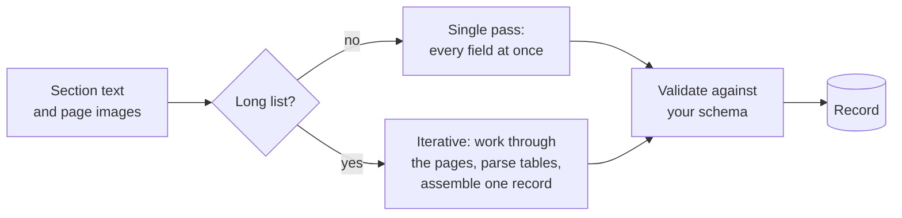

Copyright Amazon.com, Inc. or its affiliates. All Rights Reserved.
SPDX-License-Identifier: MIT-0

# Key Information Extraction

## What it does

Extraction turns each document into a record. You name the fields you need, such as the
vendor, date and total on an invoice, the wages on a tax form, or every transaction on a bank
statement, and extraction returns their values in a structure that matches your schema. That
record is the row your database receives.

## Getting it right

**Describe every field precisely.** The model reads the field description as its
instruction. A good description says where the value appears, what it is not, and the format
you want: "invoice date: the date the invoice was issued, not the due date, as YYYY-MM-DD".
This is the change that improves accuracy most, and it costs nothing.

**Let the schema check the output.** Declare each field's type and format, mark the fields
that must be present, and set a minimum number of items for lists. The accelerator validates
every record against the schema and reports what does not fit, so a wrong format never
reaches your database unnoticed. See
[schema validation](../extraction-and-confidence.md#schema-validation-extractionvalidation)
and [value coercion](../extraction-and-confidence.md#value-coercion-extractioncoercion).

**Match the extraction mode to the document.** A single extraction pass handles forms and
documents with a bounded number of fields quickly and cheaply. Long lists, such as statements
with hundreds of rows, need iterative extraction, which works through the document in pieces
and assembles one complete record. See
[Simple vs Advanced](../extraction-and-confidence.md#extraction-mode-simple-vs-advanced).

**Give the model the page images as well as the text,** so it can read checkboxes, see
layout and check the OCR against the page. See
[image placement](../extraction-and-confidence.md#image-placement-with-document_image).

**Use examples for hard fields.** One or two worked examples of a tricky field often settle
it. See [Few-Shot Examples](../few-shot-examples.md).

## Your documents

- **Forms with many fixed fields.** Precise descriptions and formats carry most of the
  accuracy. Use page images for checkboxes and boxed fields.
- **Long tables and line items.** Use iterative extraction, and let the accelerator check that
  every row came back. It compares the rows it extracted with the table rows the OCR found and
  flags a shortfall.
- **Several records in one section,** such as two W-2 forms on one page: declare the section
  as multi-instance. See
  [multi-instance sections](../extraction-and-confidence.md#multi-instance-sections-x-aws-idp-multi-instance).
- **Documents where an expected page may be missing,** such as a packet without its signature
  page: see [Missing Page Handling](../missing-page-handling.md).
- **Poor scans or handwriting.** If values are wrong across the board, improve the text first.
  See [Digitization](digitization.md).
- **Identity documents.** Where a document carries a machine-readable zone or barcode,
  extract both and compare them.
- **Long narrative text.** Ask for the page each value came from, so a reviewer can check it
  quickly. The accelerator records where each value sits on the page; see
  [bounding boxes](../extraction-and-confidence.md#4-geometry--bounding-boxes).

## How extraction works



| Mode | Best for | Cost and speed |
|---|---|---|
| **Single pass** (Simple) | Forms, invoices and documents with a bounded number of fields | Lowest cost on short documents |
| **Iterative** (Advanced, agentic) | Long lists and many pages | Complete on the longest documents we tested; faster than a single pass from a few hundred rows |

In iterative mode the accelerator also parses well-formed tables in code, so the model spends
its effort on the parts that need judgment. See
[Advanced (agentic) extraction](../extraction-and-confidence.md#advanced-agentic-extraction).

## How to measure it

Score extracted values against ground truth, field by field, with a comparison that fits each
field: exact for IDs, a tolerance for amounts, format-insensitive for dates, similarity for
names, and item-by-item matching for lists. See
[Measure with ground truth](index.md#4-measure-with-ground-truth) for how the accelerator
builds the ground truth and how to set each field's comparison.

For lists, read two numbers together: **completeness** (how many rows came back) and
**accuracy** (how many of those rows are right).

## What we measured

### Long lists

**Dataset:** [synthetic bank statements](benchmark-datasets.md#synthetic-bank-statements)
with exact ground truth for every row, from 25 rows on 1 page to 3,200 rows on 66 pages.
**Run:** release 0.6.14, November 2026, extraction model Claude Sonnet 5 (the default).

| Statement | Single pass | Iterative |
|---|---|---|
| 100–400 rows, 3–9 pages (n = 1 each) | Every row | Every row |
| 400 rows, 9 pages (n = 5) | Every row; $0.53 per document; median 260 s | Every row; $0.51; median 139 s |
| 800 rows, 17 pages (n = 6) | Every row in 4 of 6 runs; the other 2 returned 43 rows, and the accelerator flagged both as short | **Every row in 6 of 6 runs**; $0.95–1.10; 2.5–3.5 min |
| 3,200 rows, 66 pages (n = 2) | Declined: too large for one pass | **Every row in 2 of 2 runs**; $3.76–4.20; about 7 min |

We corrected these costs for a known pricing error that overstates Claude Sonnet 5 by 1.5×
([#1830](https://github.com/aws-solutions-library-samples/accelerated-intelligent-document-processing-on-aws/issues/1830)).
Sources: `benchmarks/results/v0.6.14/cost__extraction-model-sonnet5/`,
`coresynth__extraction-model-sonnet5/`, `astravalue/` and `astracap/`.

What this shows:

- **Iterative extraction returned every row at every size we tested,** up to 3,200 rows on
  66 pages, in minutes. From about 400 rows it was also faster than a single pass, at the same
  cost or less.
- **Every row that came back had the right date and amount.** On long lists, the thing to
  check is that every row is there.
- **Use a single pass up to a few hundred rows, and iterative mode beyond that.** The
  accelerator's row-count check flags a short list either way.

### Real invoices

**Dataset:** [RealKIE-FCC-Verified](benchmark-datasets.md#realkie-fcc-verified), 20 real
broadcast-advertising invoices (81 pages) with header fields and a short list of line items.
**Run:** release 0.6.14, November 2026, extraction model Claude Sonnet 4.6 (the benchmark's
control), scored by Stickler as weighted accuracy, compared document by document.

| Configuration | Weighted accuracy | Cost per document |
|---|---|---|
| Single pass, Textract tables (**baseline**) | 0.798 | $0.143 |
| Each file treated as one document | +3.8 points (SE 2.4) | 12% lower |
| Textract layout instead of tables | −1.7 points (SE 1.3) | 35% lower |
| Iterative extraction | −2.5 points (SE 2.2) | 98% higher |

Source: `benchmarks/results/v0.6.14/core/summary.json` (n = 20).

What this shows:

- **A single pass is the right default for invoices.** Iterative extraction doubled the cost
  without improving accuracy on documents this short.
- **Telling the accelerator what it can assume pays off.** These files always hold one
  invoice, and saying so raised accuracy and lowered cost.
- **Layout-only OCR cut cost by a third** for at most a small change in accuracy.

**How far this carries:** the statements are synthetic and clean, and RealKIE is 20 documents
of one document class, run once per configuration, so treat differences under about 5 points as within
the noise. Confirm the choice on your own documents.

## Reproduce it

**On your own documents.** Build a test set in [Test Studio](../test-studio.md), run it once
per configuration you want to compare, and compare the runs field by field. The RealKIE test
set comes with every stack, so you can repeat the invoice comparison in your own account.

**The benchmark.**

```bash
python3 benchmarks/harness/gen_corpus.py                  # synthetic statements, exact ground truth
M=benchmarks/harness/make_configs.py
R="python3 benchmarks/harness/run_matrix.py --stack <STACK>"
python3 $M --suite cost --class bank_statement --set extraction_model=sonnet5
$R --suite cost --set extraction_model=sonnet5             # the 400-row comparison, five repeats
for s in astravalue astracap; do python3 $M --suite $s --class bank_statement; $R --suite $s; done
for c in bank_statement realkie ocr_bench; do python3 $M --suite core --class $c; done
$R --suite core                                            # RealKIE and the configuration grid
```

Recompute a figure from the committed results:

```bash
jq '[.rows[] | select(.doc=="realkie" and .cell=="core-tt-simple-sep" and .success)
     | .weighted_accuracy] | add/length' benchmarks/results/v0.6.14/core/summary.json
```

See the [benchmark suite](../benchmarking/index.md) for setup, and
[Configuration guidance](../benchmarking/config-guidance.md) for every measured option.

## In the accelerator

- **Start here:** [Choosing a configuration](../extraction-and-confidence.md#0-choosing-a-configuration-start-here)
  in Extraction and Confidence.
- **Define document classes and fields:** [Configuration](../configuration.md), the
  [Document Schema Builder](../web-ui.md#document-schema-builder), and
  [Configuration Best Practices](../idp-configuration-best-practices.md).
- **Draft a schema for you:** [Discovery](../discovery.md) from sample documents, or
  [Quick Start](../quick-start.md) from a description.
- **Use a different model for one document class:**
  [per-class model override](../extraction-and-confidence.md#per-class-extraction-model-override).
- **Correct a result by hand:** [Document Details](../web-ui.md#document-details) and
  [Re-extract Sections](../web-ui.md#re-extract-sections).
- **Improve automatically:** the [Auto Optimizer](../extensions/auto-optimizer.md).
