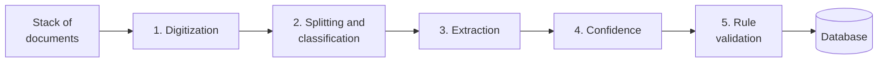

Copyright Amazon.com, Inc. or its affiliates. All Rights Reserved.
SPDX-License-Identifier: MIT-0

# How Document Processing Works

**You have a stack of documents. You want it in a database.**

Intelligent document processing (IDP) gets you there. Invoices, statements, claims,
applications and contracts go in. Structured records come out, one per document or one per
line item, ready to query and to load into the systems you already run.

Every IDP system does this job in five steps, which these pages call **problem sets**. Each
page explains one problem set in terms that apply to any IDP system, shows how to measure it,
reports what we measured, and ends with how to do it in this accelerator.

## The five problem sets

| Problem set | Question it answers | Output |
|---|---|---|
| [Digitization (OCR)](digitization.md) | What does each page say? | Text and layout for every page |
| [Splitting and section classification](splitting-and-classification.md) | Where does each document start and end, and what document class is it? | Sections, each with its pages and a document class |
| [Key information extraction](extraction.md) | What are the values of the fields I need? | A record per section that matches your schema |
| [Confidence assessment](confidence-assessment.md) | Which results can I trust without checking? | A confidence score for every result |
| [Rule validation](rule-validation.md) | Does the document meet my business rules? | A verdict per rule, with its evidence |

Results with low confidence go to a person for review before they reach the database, and
the accelerator reports every rule each document fails.

Each step works from the output of the step before it. When results are wrong, fix the
earliest step that is wrong first. Better extraction cannot recover a misread page or a
document given the wrong document class.

## From setup to a pipeline you trust

You have a working pipeline as soon as you have told it what to look for. Everything after
that is improvement, done at your own pace, and agents can do much of the work for you.

### 1. Define your document classes and fields

You define two things, and the pipeline works from them:

- **Your document classes.** The kinds of document you receive, such as invoice, pay stub or
  bank statement, each with a short description of what sets it apart from the others.
- **The fields for each document class.** What to extract from each one: a name, what the field means,
  and its format, such as "statement period: the date range the statement covers,
  YYYY-MM-DD to YYYY-MM-DD".

These definitions decide which table each document lands in and which columns it fills, so
they come from you. [Discovery](../discovery.md) and [Quick Start](../quick-start.md) can
draft them from sample documents or a plain description, and you review the draft.

With your document classes and fields saved, the pipeline is live: documents go in, records come out.

### 2. Run your documents and look at the results

Process a batch of real documents and open the results. Each record shows the extracted
values next to the page they came from, so you can check them at a glance. The accelerator sends
results with low confidence to review and reports every rule a document fails.

Most early fixes are wording fixes. If a field keeps coming back wrong, make its
description more precise: say where the value appears, what it is not, and the format you
want.

### 3. Improve it as you go

Change a field description, try another model, or turn on a feature, and run the documents
again. You can do this by hand, or let an agent do it: the
[Auto Optimizer](../extensions/auto-optimizer.md) tries changes to prompts, models and
settings on its own, within a cost budget you set, and keeps the ones that score better.

Which problem set to work on depends on your documents. Files that hold several documents
depend on splitting. Long statements depend on extracting every row. Automated decisions
depend on confidence and rules. Start with the earliest step that is getting things wrong.

### 4. Measure with ground truth

Ground truth is optional, and it turns "this looks better" into a score. It is the correct
answer for a sample of your documents: the page range and document class of each section in a file, and
the right value of every field. With it, you can score every change against the same
answers.

**The accelerator builds most of it for you.** You upload a few dozen documents, and the
accelerator:

- **drafts the answers** by running your configuration over them
  ([draft labeling](../test-studio.md#draft-labeling-unlabeled-documents--ground-truth));
- **ranks the drafts worst-first,** so you start with the answers it is least sure of;
- **tells you how many to check** to reach the label accuracy you want
  ([review-effort estimate](../test-studio.md#how-much-review-is-enough));
- **splits the checking across your team** with scoped review links
  ([team annotation](../test-studio.md#team-annotation-the-scoped-queue));
- **saves the result as a versioned test set** in Test Studio.

From then on, Test Studio scores every run against your test set field by field, compares
any two runs side by side, and gives the Auto Optimizer the answers it optimizes toward. See
[Bootstrap the labels](../creating-custom-test-sets.md#path-a--bootstrap-the-labels-recommended)
for the full flow.

**You decide what counts as a match.** The accelerator scores results with
[Stickler](https://github.com/awslabs/stickler), an open-source library for comparing
structured data. For each field, you choose the comparison method, how strict it is, and
how much the field counts toward the overall score:

| Kind of field | Comparison method | Strictness you set |
|---|---|---|
| IDs, codes, yes/no values | Exact | None needed |
| Amounts and quantities | NumericExact | Tolerance, such as one cent |
| Dates | Date | Day-first or month-first; tolerance in days |
| Names, addresses, short text | Fuzzy or Levenshtein | Minimum similarity, such as 0.9 |
| Descriptions and free text | Semantic or LLM | Minimum similarity (Semantic); a judged yes or no (LLM) |
| Lists of line items | Hungarian | Minimum similarity for pairing each item with its match |
| Nested objects | AggregateObject | Set on each field inside |

Stickler scores splitting too: whether each page received the right document class and
landed in the right section. One run reports both. See [Evaluation](../evaluation.md) for every option.

Keep your test set after you go live. Re-run it whenever you change the configuration or
upgrade, and you will see a regression in your scores before you see it in your data. Run
the same comparison twice before you act on a difference of a few points, because model
output varies slightly from run to run.

## What our benchmarks measure, and how to run them yourself

Each problem-set page reports results from this repository's
[benchmark suite](../benchmarking/index.md). The suite runs public and synthetic datasets
through a deployed stack under many configurations and scores every run. The results show
what each option buys, so you can start your own testing from a configuration that already
works.

| Problem set | Benchmarked |
|---|---|
| Digitization (OCR) | Through its effect on extraction. Public OCR benchmarks cover OCR on its own |
| Splitting and section classification | Yes |
| Key information extraction | Yes |
| Confidence assessment | Yes |
| Rule validation | Not yet |

**Each benchmark measures one problem set,** so you can trace each result to a single choice.
The coverage has gaps. For example, no benchmark yet combines packet splitting with
extraction, so we measure how well the accelerator splits documents and how well it extracts
fields, but not yet how a split error changes the extracted values. Each page states its dataset, the
release and date of the run, and the sample size, so you can judge how closely it matches
your documents. [Benchmark Datasets](benchmark-datasets.md) describes each dataset and what
it covers.

**You can run the same benchmarks.** Every stack loads most of these datasets into Test
Studio as test sets, each with a matching configuration. Repeat our comparisons in your own
account, then run them on your own test set.
