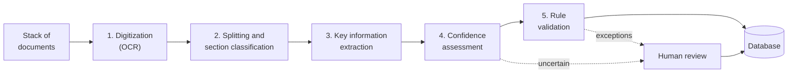

Copyright Amazon.com, Inc. or its affiliates. All Rights Reserved.
SPDX-License-Identifier: MIT-0

# How Document Processing Works

**You have a stack of documents. You want it in a database.**

Intelligent document processing (IDP) is how you get there: invoices, statements, claims,
applications and contracts in, one clean row per document (or per line item) out, ready to
query, report on and feed into the systems you already run. This section explains how that
works, in terms that apply to any IDP system. It divides the job into five **problem sets**,
shows what good looks like for each, and shows how to measure that you have it, using
results we measured ourselves. Each page ends with how to do it in this accelerator.

## From a stack of documents to a database

| Problem set | What it gives you |
|---|---|
| [Digitization (OCR)](digitization.md) | The text and layout of every page, ready for a model to read |
| [Splitting and section classification](splitting-and-classification.md) | Each document in a file found and given its type, so the right fields are pulled from it |
| [Key information extraction](extraction.md) | The fields you define, as structured data that matches your schema |
| [Confidence assessment](confidence-assessment.md) | A score per result, so people review only what needs reviewing |
| [Rule validation](rule-validation.md) | A verdict against your business rules, with the evidence behind it |

Each problem set builds on the one before it, so it pays to get them right in order. When
you tune, start upstream: clean text makes splitting easy, correct sections make extraction
easy, and good extraction makes confidence and rules meaningful.

## Measure it on your documents

You'll know your pipeline works when you've measured it on your own documents. That takes
three things.

**Ground truth.** The correct result for a few dozen representative documents: the type and
pages of each document in a file, and the value of every field. You check it once, then
re-use it every time you change a setting.

**A definition of "correct" that matches your business.** The accelerator evaluates with
[Stickler](https://github.com/awslabs/stickler), an open-source library for comparing
structured data. Stickler lets you decide, **for every field, how it is compared, how strict
the comparison is, and how much it counts**, so the score reflects what your business cares
about:

| You set, per field | Options | Example |
|---|---|---|
| **Comparison method** | Exact, NumericExact (with a tolerance), Fuzzy, Levenshtein, Semantic (embeddings), Date (format-insensitive), LLM (judged equivalence), Hungarian (best match between list items), AggregateObject (nested) | Exact for an account number, NumericExact for an amount, Date for a statement date, Fuzzy for a vendor name |
| **Strictness** | A similarity threshold, a numeric tolerance, date options | Accept a name at 0.9 similarity; accept an amount within one cent |
| **Weight** | How much the field counts toward the overall score | Weight the account number 2.0 and a free-text note 0.5 |

Stickler also scores page classification and section grouping, so one evaluation run tells
you how well every stage is doing. See [Evaluation](../evaluation.md).

**A fair comparison.** Run each configuration on the same documents and compare document by
document. A few dozen documents shows you large differences clearly; to separate
configurations that are within a few points of each other, use more documents and more than
one run.

## What we measured

The "What we measured" section on each page reports results from this repository's
[benchmark suite](../benchmarking/index.md), which processes a fixed set of documents with a
range of configurations on a deployed stack and scores every run. They show what each choice
buys you, so you can start from a configuration that works and spend your own testing time
on your documents.

| Problem set | Measured here |
|---|---|
| Digitization (OCR) | Through its effect on extraction. For OCR on its own, public OCR benchmarks are the place to look |
| Splitting and section classification | Yes |
| Key information extraction | Yes |
| Confidence assessment | Yes |
| Rule validation | Not yet |

**We benchmark the problem sets one at a time.** Each benchmark isolates one problem set so
that a result can be traced to a single choice. No benchmark is perfect, and the coverage
has gaps. For example, there is no benchmark today that combines packet splitting with
extraction ground truth, so we measure how well documents are split and how well fields are
extracted, but not yet how a split error carries through to the extracted values. Each
section states the dataset, the release and date of the run, and the sample size, so you
can judge how far it carries to your documents. [Benchmark Datasets](benchmark-datasets.md)
describes each dataset and what it does and does not cover.

**You can run the same benchmarks, and build your own.** Most of these datasets are loaded
into Test Studio as test sets on every stack, each with a matching configuration, so you can
repeat our comparisons in your own account. Building a test set from your own documents is
just as direct: the pipeline drafts the ground truth for you, and you review and correct it,
worst-first, instead of labeling every field by hand. See
[Bootstrap the labels](../creating-custom-test-sets.md#path-a--bootstrap-the-labels-recommended)
for the step-by-step flow.
