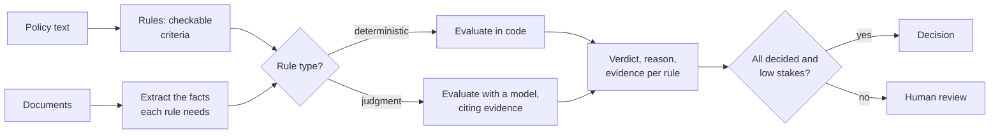

Copyright Amazon.com, Inc. or its affiliates. All Rights Reserved.
SPDX-License-Identifier: MIT-0

# Rule Validation

> **Not yet measured.** We have no benchmark results for rule validation, so this page
> gives reasoning and guidance only. Measure on your own documents before relying on any of
> it. Planned measurements are tracked in
> [issue #1842](https://github.com/aws-solutions-library-samples/accelerated-intelligent-document-processing-on-aws/issues/1842).

## The problem

Deciding whether a document, or a set of documents, meets a set of business rules, and
saying why. Examples: does a prior-authorization request satisfy the insurer's
medical-necessity criteria; does a loan file meet underwriting policy; does a contract
contain the required clauses; does an invoice match its purchase order. The output is a
verdict per rule, with the evidence it rests on.

## What makes it hard

- **Rules are written for people.** Policies use judgment words ("documented history",
  "reasonable", "unless clinically indicated") that have to be turned into something
  checkable.
- **Evidence is scattered.** The facts a rule needs may be spread across several documents
  in a packet and many pages of each.
- **A verdict needs a reason.** A bare pass or fail cannot be audited or appealed.
- **Errors have uneven costs.** Wrongly passing a non-compliant case usually costs more than
  wrongly failing a compliant one, so the decision threshold is a business choice.
- **The document can argue its own case.** Text such as "this request meets all criteria"
  can sway a language model. Keep the facts separate from the verdict.

### How document characteristics affect it

- **Multi-document files:** a rule often needs facts from several sections, so splitting
  and classification errors become rule errors.
- **Long narrative text:** the evidence is in sentences across many pages, so citations
  matter more than anywhere else.
- **Fixed-field forms and identity documents:** many rules are formats, check digits and
  date ranges, which need no model at all.

## Approaches

- **Separate fact-finding from judgment.** Extract the facts the rules depend on as fields
  you can check against ground truth, then evaluate the rules over those facts. Each half
  can be measured and fixed on its own.
- **Decide deterministic rules in code.** "Amount under the limit" or "date within 90 days"
  needs no model.
- **Require evidence.** Every verdict should cite the page and text it relied on. Send
  verdicts without evidence to review.
- **Route by stakes.** Send failures, rules the system could not decide, and high-value cases
  to a person.

## How to measure it

Build ground truth at two levels:

1. **The facts.** Measure them as extraction, with Stickler, field by field. See
   [Key Information Extraction](extraction.md#how-to-measure-it).
2. **The verdicts.** Compare each rule's verdict with an expert's. Report precision and
   recall for "fail" separately, because a false pass and a false fail cost different
   amounts.

Also check a sample of the cited evidence by hand. A right verdict for the wrong reason will
not survive the next case.

## What we measured

Nothing yet. There is no rule-validation dataset in the benchmark suite, and we have not
found a public dataset that pairs real documents with expert rule verdicts. The fact-finding half can
be measured today, as extraction.

## In the accelerator

- Define rules and evaluate them per document: [Rule Validation](../rule-validation.md).
- Draft rules from a policy document: [Policy Discovery](../policy-discovery.md).
- A worked prior-authorization example is the `rule-validation` preset. The
  [Health Insurance Review sample](../extensions/sample-health-insurance-review.md) packages
  it as an installable extension.
- Route undecided or failed rules to a person: [Human Review](../human-review.md).
