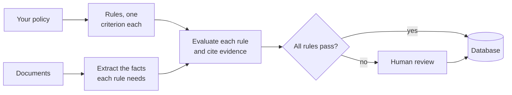

Copyright Amazon.com, Inc. or its affiliates. All Rights Reserved.
SPDX-License-Identifier: MIT-0

# Rule Validation

## What it does

Rule validation checks each document, or each set of documents, against your business rules
and returns a verdict per rule with the evidence behind it. It answers the question your team
asks once the data is out of the documents: does this prior-authorization request meet the medical
necessity criteria, does this loan file meet underwriting policy, does this invoice match its
purchase order? Cases that pass go straight through. Your reviewers see only the exceptions,
with the reason already written down.

## Getting it right

**Separate the facts from the judgment.** First extract the facts each rule depends on, as
ordinary fields, then evaluate the rules over those facts. You can check each half on its
own, and a wrong verdict traces back to either a wrong fact or an unclear rule.

**Decide exact rules exactly.** "The amount is under the limit" and "the date is within
90 days" need no judgment. The accelerator can evaluate rules like these with a symbolic
solver, which gives the same answer every time, and keep the language model for rules that
need judgment, such as "the record documents a failed conservative treatment". You choose the
engine per rule. See [Z3 rule validation](../rule-validation-z3.md).

**Require evidence for every verdict.** Each verdict should cite the page and passage it
relied on, so a reviewer can confirm it in seconds and an auditor can follow it later.

**Write rules the way you would brief a new analyst:** one criterion per rule, in plain
language, with the terms defined. See
[Writing Effective Rules](../rule-validation.md#writing-effective-rules).

**Send exceptions to people.** Route failed rules, rules the system could not decide, and
high-value cases to review.

## Your documents

- **Several documents per file,** such as a claim with its supporting records: a rule often
  needs facts from more than one document, so accurate splitting matters here. See
  [Splitting and Section Classification](splitting-and-classification.md).
- **Long narrative records:** evidence is spread across many pages, so citations matter most.
- **Forms and identity documents:** many rules are formats, limits and date ranges, which the
  symbolic solver decides exactly.

## How rule validation works

The accelerator can draft the rules for you: [Policy Discovery](../policy-discovery.md) reads
a policy document and proposes rules for you to review.

## How to measure it

Measure the two halves separately:

1. **The facts,** as extraction: field by field against ground truth. See
   [Measure with ground truth](index.md#4-measure-with-ground-truth).
2. **The verdicts:** compare each rule's verdict with an expert's verdict on the same case.
   Count wrong passes and wrong fails separately, because they cost your business different
   amounts.

Also read a sample of the cited evidence. A right verdict needs the right reason behind it.

## What we measured

We have not benchmarked rule validation yet. The benchmark suite has no rule-validation
dataset, and we have not found a public dataset that pairs real documents with expert rule
verdicts. You can measure the facts behind each rule today, as extraction. We track the
planned measurements in
[issue #1842](https://github.com/aws-solutions-library-samples/accelerated-intelligent-document-processing-on-aws/issues/1842).

## In the accelerator

- **Turn it on and configure rules:** [Rule Validation](../rule-validation.md), including the
  [Quick Start with Healthcare Example](../rule-validation.md#quick-start-with-healthcare-example).
- **Draft rules from a policy:** [Policy Discovery](../policy-discovery.md).
- **See a complete example:** the `rule-validation` preset, packaged with a claim-status UI as
  the [Health Insurance Review sample](../extensions/sample-health-insurance-review.md).
- **Read the results:** [Output Formats](../rule-validation.md#output-formats) and the Rule
  Validation Summary on each document's [Document Details](../web-ui.md#document-details)
  page.
- **Route exceptions to people:**
  [Human-in-the-Loop](../rule-validation.md#human-in-the-loop-hitl) and
  [Review Queues](../review-queues.md).
