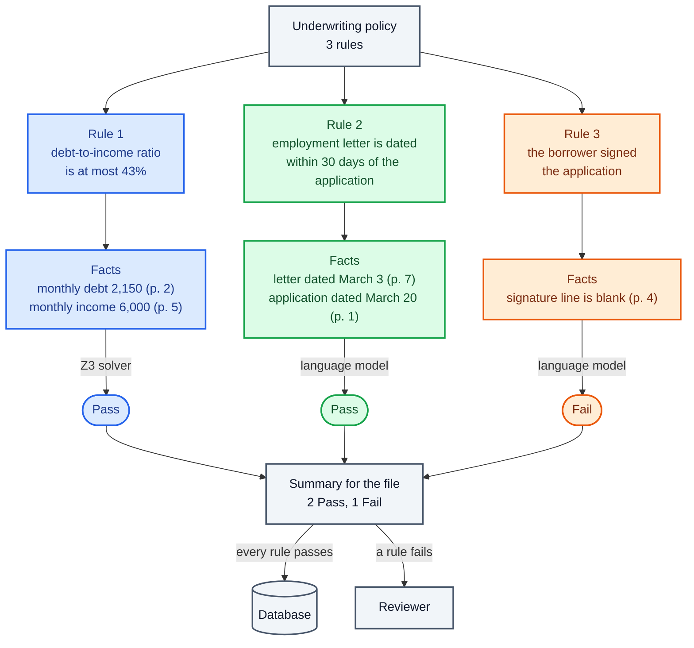
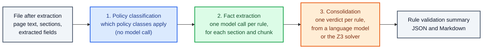

Copyright Amazon.com, Inc. or its affiliates. All Rights Reserved.
SPDX-License-Identifier: MIT-0

# Rule Validation

## What rule validation does for your database

Extraction puts the values from your documents into a record. Rule validation answers the
question your team asks next: does this file meet our rules? Does the loan file meet
underwriting policy? Does the prior-authorization request meet the medical necessity
criteria? Does the invoice match its purchase order?

Rule validation checks each file against your business rules and returns a **verdict** for
every rule: a short answer such as *Pass*, *Fail* or *Information Not Found*, with the
reasoning and the page numbers it relied on. The verdicts go into your database next to the
extracted record. Files that pass every rule can go straight through, and your reviewers see
only the exceptions, with the reason already written down.

The page uses these terms:

- A **rule** is one criterion, written in plain language, such as "The debt-to-income ratio
  is at most 43%".
- A **policy class** is a named group of rules, such as *Loan underwriting*. You can keep
  several policy classes, one for each policy you enforce.
- A **fact** is a piece of evidence a rule needs, such as "Monthly income: 6,000 (page 5)".
- A **verdict** is the answer for one rule on one file.

In the example below, rule validation checks a loan file against three underwriting rules.
The accelerator finds the facts each rule needs, decides each rule, and writes three
verdicts.



The accelerator writes the verdicts; you decide what happens to a file that fails a rule.
The last two arrows show one common choice.

## How the accelerator validates a file against your rules

Rule validation runs after extraction, once for every file, in three steps:

1. **Policy classification** decides which of your policy classes apply to the file.
2. **Fact extraction** reads each section of the file and finds the facts each rule needs.
3. **Consolidation** gathers each rule's facts from every section and decides the rule.



### Policy classes and rules

You keep your rules in the configuration's **Policy Schema** tab, stored under
`policy_classes`. Each policy class has a name (`x-aws-idp-policy-type`) and a set of rules
(`rule_properties`). Each rule has a short name and a **description**, and the description
is the rule text the models read. For example:

```yaml
policy_classes:
  - x-aws-idp-policy-type: loan_underwriting
    x-aws-idp-document-name-regex: "(?i).*loan.*"
    rule_properties:
      application_signed:
        type: string
        description: "Did the borrower sign the loan application?"
```

### Which policy classes apply to a file

When you keep one policy class, the accelerator applies it to every file. When you keep
several, each policy class needs a pattern that says which files it covers. The
accelerator matches the patterns, without a model call, against the file name
(**Document Name Regex**, `x-aws-idp-document-name-regex`) or the text of the file's pages
(**Page Content Regex**, `x-aws-idp-document-page-content-regex`), and validates only the
policy classes that match. A file that matches no policy class gets a short note in place of
verdicts. See [No-Policy-Match Behavior](../rule-validation.md#no-policy-match-behavior).

### How the accelerator gathers the facts each rule needs

The **fact extraction model** reads two sources for each section of the file:

- the **page text** from OCR, with each page marked by its page number, and
- the **extracted fields** of the section, the record that extraction produced.

For each rule, the model lists every fact that bears on the rule, both for and against,
with the page number it came from. The fact extraction model gathers evidence only; it
does not decide the rule. A long section does not fit in one call, so the accelerator splits
its text into **chunks** along page boundaries, of about 8,000 tokens each by default
(`rule_validation.max_chunk_size`), and repeats the end of each chunk at the start of the next
so that a fact on the boundary stays readable. The accelerator then asks the model about every
rule in every chunk.

Sections whose document class you mark as excluded (`x-aws-idp-exclude-from-processing`),
such as instruction pages, get no fact extraction call. See
[Skipping Rule Validation for Excluded Classes](../rule-validation.md#skipping-rule-validation-for-excluded-classes).

### Two engines: a language model for judgment, the Z3 solver for exact rules

Consolidation decides each rule with one of two engines. You choose the engine per rule in
the Policy Schema tab with **Validation Engine** (`x-aws-idp-validation-engine`).

| Engine | Editor label | How it decides | Use it for |
|---|---|---|---|
| Language model (default) | *Semantic (LLM)* | The **orchestrator model** reads every fact the sections gathered for the rule, and chooses one of your recommendation options with its reasoning | Rules that need judgment or reading: "the record documents a failed conservative treatment", "the borrower signed the application" |
| Z3 solver | *Symbolic (Z3)* | A model reads each value the rule needs (such as `monthly_debt` and `monthly_income`) from the facts, and the [Z3 theorem prover](https://github.com/Z3Prover/z3) checks the rule's formula against those values | Arithmetic, thresholds and comparisons: "total equals subtotal plus tax", "the debt-to-income ratio is at most 43%" |

For a Z3 rule, you click **Generate RuleJSON** in the Policy Schema tab. A model translates
the rule text once into a formula with named, typed parameters (`Int`, `Real`, `Bool` or
`String`), and the accelerator stores the result with the rule (`x-aws-idp-rule-json`), next
to its **Rule ID** (`x-aws-idp-rule-id`). The solver gives the same answer every time for
the same values, so a Z3 verdict changes only when the values read from the facts change.

The Z3 engine answers *Pass* when the values satisfy the formula, *Fail* when they violate
it, and *Information Not Found* when a required value is missing or does not fit the kind
of value its parameter declares. The Z3 engine always uses those three answers, even when you define your own
recommendation options. See [Z3 rule validation](../rule-validation-z3.md).

### Verdicts, recommendation options and evidence

The **recommendation options** (`rule_validation.recommendation_options`) are the answers the
orchestrator model may choose from, each with a one-line meaning. The default options are:

- **Pass:** the requirement criteria are fully met.
- **Fail:** the requirement is partially met or requires additional information.
- **Information Not Found:** no relevant data exists in the document content.

You can replace them with your own, such as *Compliant*, *Non-Compliant* and *Requires
Review*. See [Customizing Recommendation Options](../rule-validation.md#customizing-recommendation-options).

Each verdict carries its evidence at page level:

- **Reasoning:** one paragraph that names the facts behind the verdict and the pages they came
  from.
- **Supporting pages:** the page numbers that hold the evidence.
- **Facts:** the facts each section contributed, each with its page citation, stored with the
  file's rule validation output.

The accelerator writes a **rule validation summary** for each file, as JSON for your database
and as Markdown for people, with a count of each answer across all rules. The Web UI shows it
as the **Rule Validation Summary** on the file's Document Details page. See
[Output Formats](../rule-validation.md#output-formats).

When a model call fails for a temporary reason, such as throttling, the accelerator retries
the step. The accelerator never answers *Information Not Found* because a model was busy. See
[A transient fault is never answered with a verdict](../rule-validation.md#a-transient-fault-is-never-answered-with-a-verdict).

### Where people review the results

Rule validation runs after human review of the extracted values. When a file's confidence
sends it to a review queue, the accelerator holds rule validation until a reviewer finishes
the file, and then validates the corrected values. A new stack has its Default review queue
turned on. If an Admin turns the Default queue off, the accelerator validates the
machine-extracted values and does not repeat rule validation after the review. See
[Human-in-the-Loop Review](../human-review.md#architecture).

A failed rule does not, on its own, put a file in a review queue. Reviewers read the verdicts
in the Rule Validation Summary. To act on verdicts automatically, add a `postRuleValidation`
pipeline hook. The [Health Insurance Review sample](../extensions/sample-health-insurance-review.md)
uses one to mark each claim *Clean claim*, *Review required* or *Insufficient documentation*
from its verdicts.

### Drafting rules from a policy document with Policy Discovery

You do not have to write rules by hand. [Policy Discovery](../policy-discovery.md) reads a
policy document, such as an underwriting guide or a payer's prior-authorization policy, and
drafts its rules for you:

1. On the **Discovery** page, open the **Policy Discovery** tab, choose a configuration
   profile, and upload the policy PDF.
2. A model reads the whole document and writes each rule as a yes-or-no question, with the
   page or section of the policy it came from.
3. The accelerator adds the rules to the profile as a new policy class. **View in
   Configuration** opens it in the Policy Schema tab for your review.

Policy Discovery has two modes. The default reads the policy in one model call. The agentic
mode (`discovery.rules.agentic.enabled`) lets a model revise its draft, and can add a second
model that reviews the draft against the policy, which helps on long or complex policies.
See [Choosing the Right Method](../policy-discovery.md#choosing-the-right-method).

Policy Discovery drafts rules with the language-model engine and without a Document Name
Regex. When the profile holds more than one policy class, add a regex to each, so that the
accelerator knows which files each one covers. See
[Required: Add a Document Matching Regex](../policy-discovery.md#required-add-a-document-matching-regex).

## The configuration to start with

**Start from the `rule-validation` preset, or turn on rule validation in your own profile.**
The preset holds a complete prior-authorization example with sample files. In any profile,
turn on **Rule Validation (Optional)** in the configuration editor
(`rule_validation.enabled`). The accelerator runs rule validation only when the profile also
holds at least one policy class.

**Draft the rules with Policy Discovery, then edit them so each rule tests one criterion.**
Write each rule the way you would brief a new analyst: one criterion, in plain words, with
its terms and thresholds defined. "The employment letter is dated no more than 30 days before
the application date" is a rule a model decides consistently. "The file meets employment
verification standards" is not. See
[Writing Effective Rules](../rule-validation.md#writing-effective-rules).

**Add the facts your rules depend on as extraction fields.** Give the document classes in
your configuration fields such as *Monthly income* and *Application date*. The fact
extraction model reads the extracted fields alongside the page text, and you can measure
those fields against ground truth like any other field.

**Keep the default engine, models and options, and move exact rules to Z3.** The default
fact extraction and orchestrator model is Claude Sonnet 4.6, with the three default
recommendation options. Leave rules that need judgment on the language-model engine. Switch
rules that are pure arithmetic or comparisons to *Symbolic (Z3)*, and declare a value that can
hold a fraction, such as a ratio or an amount, as `Real`.

**Give each policy class a Document Name Regex as soon as you have more than one.** Without
one, the accelerator cannot tell which policy classes apply, and it validates none of them.

## How many tokens rule validation uses, and what drives the count

We have not measured rule validation tokens. The benchmark suite does not run rule
validation, so no committed benchmark result reports its tokens. The accelerator records
the tokens on every file it processes, so you can measure them on your own files (see
[the next section](#how-to-measure-rule-validation-on-your-own-files)).

What drives the count:

- **Rules multiply by sections and chunks.** Fact extraction makes one model call for every
  rule, in every chunk of every section, for every policy class that applies. A file of three
  short sections checked against ten rules takes 30 fact extraction calls, even when only one
  section holds the facts for a given rule.
- **Each fact extraction call carries the section's text and record.** The call reads the
  instructions, the section's extracted fields, up to one chunk of page text, and the rule.
  Larger sections and larger records mean more input tokens per call.
- **Consolidation adds one call per rule.** A language-model rule takes one orchestrator
  call that reads all of the rule's facts. A Z3 rule takes one smaller call to read its
  values, and the solver itself uses no tokens.
- **Policy classification uses no tokens.** Matching the patterns needs no model.
- **The prompt cache reuses the instructions.** The default prompts mark the instructions,
  and for fact extraction the section's extracted fields, for the prompt cache, so calls for
  different rules on the same section can read that part from the cache. See
  [Prompt Caching](../rule-validation.md#prompt-caching).

The surest way to use fewer tokens is to run fewer rules on each file: give each policy class
a regex so that only the policy classes that apply run, remove rules that duplicate each
other, and exclude sections that carry no facts.

## How to measure rule validation on your own files

Measure the facts and the verdicts separately, so that a wrong verdict traces back to a
wrong fact or to an unclear rule.

**The facts, as extraction.** For the fields your rules depend on, build ground truth and
score them field by field in Test Studio, as for any extracted field. See
[Measure with ground truth](index.md#4-measure-with-ground-truth). A rule cannot be more
reliable than the facts it reads.

**The verdicts, against an expert.** Ask a domain expert to decide each rule on a sample of
files, then compare the accelerator's verdicts with the expert's. Test Studio does not score
verdicts, so read them from each file's summary
(`rule_validation/consolidated/consolidated_summary.json` in the output bucket). Count these
numbers:

| Number | Question it answers |
|---|---|
| **Verdict agreement** | Of all the (file, rule) pairs, what share received the expert's verdict? |
| **Wrong passes** | Of the pairs the expert failed, how many did the accelerator pass? |
| **Wrong fails** | Of the pairs the expert passed, how many did the accelerator fail? |
| **Missed evidence** | Of the pairs the accelerator answered *Information Not Found*, how many did the expert decide from evidence in the file? |
| **Evidence check** | On a sample of verdicts, do the supporting pages hold the facts the reasoning names? |

Count wrong passes and wrong fails separately, because they cost your business different
amounts. A wrong pass lets a file through that should have stopped. A wrong fail holds up a good
file for review. Read the evidence check too: a right verdict for the wrong reason is
likely to go wrong on the next file.

**Tokens.** The accelerator records rule validation tokens in each file's metering under the
`RuleValidation` key, and under `Z3ValueExtraction` for the value reads of Z3 rules. The
**Estimated Cost** report on Document Details and the
[reporting database](../reporting-database.md#metering-table) show them. Count prompt-cache
reads as input tokens when you add them up.

## Wrong passes, wrong fails and missing facts: what causes each, and what to change

Once you have measured, sort the disagreements by where they start.

| What you see | Usual cause | What to change |
|---|---|---|
| **Wrong verdict, wrong fact** | A model misread the fact behind the rule, or took it from the wrong section | Fix the fact first: improve the field description, or check section detection. See [Splitting and Section Classification](splitting-and-classification.md) |
| **Wrong verdict, right facts** | The rule is ambiguous, or combines several criteria | Split the rule into one criterion per rule and define its terms |
| **Borderline cases fail** | The default *Fail* option also covers "partially met or requires additional information" | Reword the recommendation options, or add one such as *Requires Review* |
| ***Information Not Found* when the evidence is there** | The fact is on a page with poor OCR, or the rule names it differently from the document | Check the page text, use the document's own words in the rule, or add the fact as an extraction field |
| ***Information Not Found* on a Z3 rule** | A required value is missing from the facts, or the model read a value such as 30.9 for a parameter declared `Int` | Declare fractional values as `Real`, and check that the facts hold every parameter. See [A numeric reading must be exact in its declared type](../rule-validation-z3.md#a-numeric-reading-must-be-exact-in-its-declared-type) |
| **Two rules contradict each other** | Two policy classes hold the same rule in different words | Keep one copy |
| **No verdicts at all** | No policy class matched the file, often because the profile gained a second policy class without a regex | Add a Document Name Regex or Page Content Regex to every policy class |

## Benchmark results: rule validation is not yet benchmarked

We have not benchmarked rule validation. The benchmark suite has no rule validation
dataset, and we have not found a public dataset that pairs real documents with expert rule
verdicts. You can measure the facts behind your rules today, as extraction: see
[Key Information Extraction](extraction.md) for what we measured there. We track the planned
rule validation measurements in
[issue #1842](https://github.com/aws-solutions-library-samples/accelerated-intelligent-document-processing-on-aws/issues/1842).
Until those measurements exist, the expert comparison above is the way to judge rule
validation on your files.

## Improving rule verdicts once your pipeline is running

When your comparison shows verdicts that disagree with your expert, these changes help most,
roughly in this order.

**Rewrite the rules that disagree most.** Put one criterion in each rule, state the
threshold, and define any term your industry uses loosely. Use the words your documents use:
if the form says "gross monthly income", the rule should too.

**Turn the facts behind each rule into extraction fields.** A fact that extraction pulls into
the record is a fact you can measure and correct. The fact extraction model reads the record,
so a better field description improves every rule that depends on the field.

**Move exact rules to Z3.** For a rule that is arithmetic or a comparison, the Z3 solver
removes judgment from the decision. Generate the RuleJSON, check that its parameters match
the facts your documents hold, and run a few files through before you rely on the rule.

**Make the recommendation options match your decisions.** If your team treats "missing
document" and "failed criterion" differently, give each its own option with a one-line
meaning, so that the orchestrator model can tell them apart.

**Review the rules Policy Discovery drafts against the policy.** Check each drafted rule
against the page it cites, and remove any rule whose page does not hold it. For a long
policy, try the agentic mode with its reviewer.

**Run only the rules that apply.** Give each policy class a regex, and mark the document
classes of pages that carry no facts as excluded. Fewer irrelevant calls mean fewer tokens and
fewer chances for a stray fact to sway a verdict.

## Where to configure rule validation in the accelerator

- **Turn it on and set the models, chunking and recommendation options:**
  [Rule Validation](../rule-validation.md), including its
  [configuration parameters](../rule-validation.md#configuration-parameters) and the
  [Quick Start with Healthcare Example](../rule-validation.md#quick-start-with-healthcare-example).
- **Choose the engine for each rule, and generate a Z3 rule:**
  [Per-Rule Engine Selection](../rule-validation-z3.md#per-rule-engine-selection) and the
  [Validation Engine dropdown](../rule-validation-z3.md#ui-schema-builder-dropdown).
- **Draft rules from a policy document:** [Policy Discovery](../policy-discovery.md),
  including [the Web UI flow](../policy-discovery.md#web-ui-interface).
- **Say which files a policy class covers:**
  [Required: Add a Document Matching Regex](../policy-discovery.md#required-add-a-document-matching-regex).
- **See a complete example:** the `rule-validation` preset, packaged with a claim-status UI as
  the [Health Insurance Review sample](../extensions/sample-health-insurance-review.md).
- **Read the results:** [Output Formats](../rule-validation.md#output-formats), and the Rule
  Validation Summary on each file's [Document Details](../web-ui.md#document-details) page.
- **Find out why a file has no verdicts:**
  [Where a failed rule validation shows up](../rule-validation.md#where-a-failed-rule-validation-shows-up).
- **Review files before their rules run:** [Human-in-the-Loop Review](../human-review.md) and
  [Review Queues](../review-queues.md).
