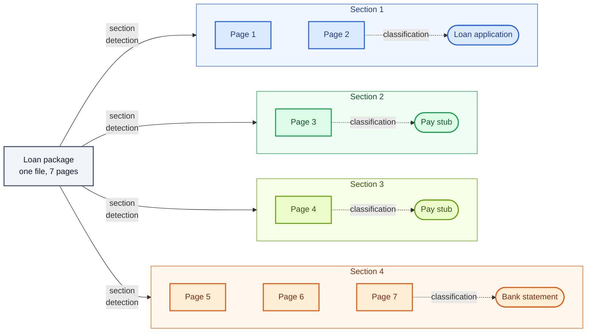
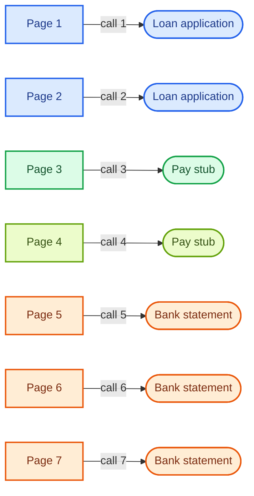
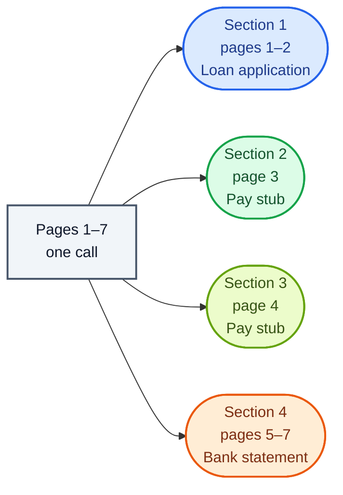

Copyright Amazon.com, Inc. or its affiliates. All Rights Reserved.
SPDX-License-Identifier: MIT-0

# Splitting and Section Classification

## What section detection and classification do

Stacks of documents rarely arrive one document per file. A loan package holds an
application, pay stubs, bank statements and an ID. A claim holds a claim form, invoices and
medical records. A scanned batch holds whatever arrived that day.

This step does two jobs for every file:

- **Section detection** finds where each document in the file starts and ends. Each document
  it finds is a **section**: a run of consecutive pages.
- **Classification** assigns each section a **document class**. A document class is a kind of
  document you define, such as *Pay stub*, with a description and the fields to extract
  from it.

The document class decides which fields extraction pulls from the section, and so which table
in your database the section's record goes to. A file that always holds exactly one document
is one section, and it still gets a document class.

In the example below, section detection finds four sections in a seven-page loan package,
including two pay stubs on consecutive pages. Classification then assigns each section its
document class.



Extraction then reads each section with the fields of its document class: the loan
application fields from pages 1–2, the pay stub fields from page 3, the pay stub fields again
from page 4, and the bank statement fields from pages 5–7.

## How the accelerator detects and classifies sections

A language model does both jobs. You make three choices about how it works: how much of the
file the model reads at once, whether detection and classification happen in one model call
or two, and whether the model reads the page text, the page images, or both.

### Choice 1: read the file page by page, or all at once

**Page by page.** The model reads one page per call and assigns that page a document class.
The accelerator then groups consecutive pages into sections, starting a new section where the
document class changes or where the page shows that a new document begins, such as a new
letterhead or "Page 1 of 2". The model can also be shown the neighboring pages as context,
at extra cost.



The accelerator then groups pages 1–2 into one section and pages 5–7 into another. Pages 3
and 4 both receive *Pay stub*, so they become two sections only if page 4 shows that a new
pay stub starts there, such as a new pay period.

**All at once (holistic).** The model reads the whole file in one call and returns the
sections and their document classes together. Because it sees every page, it can tell where
one document ends and the next begins even when the two look alike. By default one call
covers up to 20 pages. For a longer file, the accelerator reads it in overlapping 20-page
windows and merges the results.




In the configuration editor this choice is **granularity**: *page* or *packet*.

The two ways of reading make opposite mistakes. Page by page, a long document that repeats
its header on every page can be cut into several sections, because each page looks like a
new start. Holistically, two documents of the same class on consecutive pages, such as two
statements filed back to back, can be joined into one section. See
[Page versus packet granularity](../classification.md#page-versus-packet-granularity-opposite-failure-modes).

### Choice 2: detect and classify in one call, or in two

**One call.** The same model call that finds the sections also assigns their document
classes. This is the default, shown in the editor as *Split and classify together (one
call)*.

**Two calls.** A first call only finds where each section starts, without the list of
document classes. A second call then classifies each section, reading its first pages. This
is *Split first, then classify each section*. Separating the jobs lets the first call focus
on boundaries, and the classification call sees a whole section rather than one page.

### Choice 3: what the model reads

The model can read each page's **text** (from OCR), its **image**, or **both**. The text
carries the words; the image carries layout, letterheads, logos and checkboxes, which are often
the clearest signs that a new document has started. The default classification prompts send
both. In the editor these are **Send page text** and **Send page images**.

### How the choices combine

| Configuration | Granularity | Strategy | Model reads |
|---|---|---|---|
| Holistic, one call, with images | *packet* | *Split and classify together* | Text and images |
| Page by page, one call per page (default) | *page* | *Split and classify together* | Text and images |
| Detect sections first, then classify | *page* or *packet* | *Split first, then classify each section* | Text and images |
| Holistic, text only (lowest cost) | *packet* | *Split and classify together* | Text |

For every setting, see
[How the classification settings are organized](../classification.md#how-the-classification-settings-are-organised).

## The configuration to start with

**For files of up to about 40 pages, start with holistic classification in one call, with
page images.** The model sees the whole file at once, which is what it needs to place section
boundaries, and the images give it the visual cues. We have seen strong results with this
configuration, and in our benchmark it found document boundaries more
accurately than page-by-page classification (see
[the benchmark results](#benchmark-results-section-accuracy-and-cost-by-configuration)).

**For complex packets, especially files over about 30 pages, test the alternatives on your
own files.** Past the 20-page window, a holistic call no longer sees the whole file at once.
Test page-by-page classification too if your files often hold several documents of the same
class back to back, such as a run of pay stubs. Compare holistic classification with *Split first, then classify each section* and with
page-by-page classification, using a test set of your own files.

**If every file holds exactly one document, skip section detection.** Set section splitting
to *One section*. The accelerator keeps all of a file's pages in one section and gives it the
document class that most of its pages receive.

## What classification costs, and how page images change the cost

Classification runs on every page of every file, so at high volume it can become one of the
largest costs in the pipeline. Four things decide it:

- **Page images.** An image is usually the largest input on a page, about 1,100–4,800 tokens
  depending on the model and the image size, against a few hundred tokens of text.
- **Page by page or holistic.** A page-by-page call repeats the instructions and the list of
  document classes for every page. A holistic call sends them once per file.
- **Neighboring pages as context.** Showing the model one neighbor on each side of a page
  triples the text and images it reads per call.
- **The classification model.** A larger model costs many times more per page.

Measured classification cost per page, on 20 public packets (release 0.6.14, November 2026):

| Configuration | Cost per page | Cost per 1,000 pages |
|---|---|---|
| Holistic, text only, Amazon Nova 2 Lite | $0.00036 | $0.36 |
| Holistic, text and images, Amazon Nova 2 Lite | $0.00057 | $0.57 |
| Page by page, text and images, Amazon Nova 2 Lite (default) | $0.00097 | $0.97 |
| Page by page, text and images, Claude Sonnet 5 | about $0.017¹ | about $17 |

¹ Measured on single-document statements (`coresynth__classification-model-sonnet5`) and
corrected for a known pricing error that overstates Claude Sonnet 5 by 1.5×
([#1830](https://github.com/aws-solutions-library-samples/accelerated-intelligent-document-processing-on-aws/issues/1830)).

With the default classification model, classification was about 3% of the total cost of
processing a real invoice. The cost grows quickly with a larger model, neighboring-page
context, or a very high volume of pages. At that scale, compare holistic classification with
text only against the same configuration with images, and keep images only if your test set
shows they improve section accuracy for your files. See
[What each setting costs](../classification.md#what-each-setting-costs).

## How to measure section detection and classification on your own files

Ground truth for this step is the page range and document class of every section in each
file. Three numbers show how well section detection and classification are working:

| Number | Question it answers |
|---|---|
| **Page accuracy** | What share of pages received the right document class? |
| **Section accuracy** | What share of sections came back with exactly the right pages **and** the right document class? Extraction depends on this number. |
| **Over-splits and merges** | When a section is wrong, was one document cut into several sections, or were several documents joined into one? |

Stickler reports page accuracy as *page-level accuracy* and section accuracy as *split
accuracy*, with and without page order. See
[Document split classification metrics](../evaluation.md#document-split-classification-metrics).
To build the ground truth, see [Measure with ground truth](index.md#4-measure-with-ground-truth).

## Benchmark results: section accuracy and cost by configuration

### Files that hold many documents

**Dataset:** [DocSplit-Poly-Seq](benchmark-datasets.md#docsplit-poly-seq), 20 public files
(298 pages, 13 document classes, 5–20 pages per file, so every file fits in one holistic
call). **Run:** release 0.6.14, November 2026, classification model Amazon Nova 2 Lite (the
default), one run per configuration.

| Configuration | Page accuracy | Section accuracy | Cost per page |
|---|---|---|---|
| Page by page, text and images (default) | 0.818 | 0.553 | $0.00097 |
| Page by page, text only | 0.797 | 0.518 | $0.00095 |
| **Holistic, text and images** | 0.720 | **0.659** | $0.00057 |
| Holistic, text only | 0.735 | 0.644 | $0.00036 |
| Holistic, images only | 0.836 | 0.578 | $0.00028 |
| Detect sections first (page by page), then classify | 0.797 | **0.694** | $0.00097 |
| Detect sections first (holistic), then classify | 0.732 | 0.656 | $0.00070 |

Source: `benchmarks/results/v0.6.14/clsvariants/summary.json`.

What this shows:

- **Holistic classification found more of the document boundaries, at lower cost.** Against
  the default, holistic classification with text and images raised section accuracy by
  0.20 (SE 0.09, 19 files) and cost 40% less per page. The previous release measured +0.35
  for the same comparison.
- **It gave fewer individual pages the right document class** (−0.07, SE 0.07). Extraction
  depends on whole sections being right, so section accuracy is the number to follow.
- **Detecting sections first, then classifying, scored highest on section accuracy** in this
  run. It is the main alternative to test on complex packets.

### Files that hold one or two documents

**Dataset:** synthetic bank statements with exact ground truth. **Run:** release 0.6.14, page
by page (the default), five runs per file, unless noted.

| File | Sections detected |
|---|---|
| Two statements in one file | **Two sections, in 5 of 5 runs** |
| One 3-page statement, with or without "Page k of n" | **One section, in 5 of 5 runs** |
| One 3-page statement with its header repeated on every page | Three sections, in 5 of 5 runs (release 0.6.9). Holistic classification, or section splitting set to *One section*, keeps it as one |

On single statements, every classification model we compared produced the right number of
sections in at least 132 of 133 runs, so the default classification model is enough there.

Sources: `benchmarks/results/v0.6.14/boundary/`, `benchmarks/results/v0.6.9/boundaryab/` and
`benchmarks/results/v0.6.14/coresynth__classification-model-*/`.

**How far this carries:** 20 files, one run per configuration, with one classification
model, and the gap between configurations has varied between releases. Confirm the choice on
your own files.

## Improving accuracy once your pipeline is running

When your test set shows sections with the wrong pages or the wrong document class, these
changes help most, roughly in this order.

**Write a description for each document class that separates it from its closest
neighbor.** The classification model picks a document class by comparing each section with
the description of every document class in your configuration. Name the features that tell
two classes apart: "Quote: shows a 'valid until' date and has no payment terms" separates a
quote from an invoice, and "Quote: a price quote" does not. See
[class descriptions](../classification.md#class-descriptions).

**Add few-shot examples for document classes that look alike.** A few-shot example is a
sample page with its correct document class, which the accelerator adds to the
classification prompt. One or two examples for each pair of document classes that the model
confuses, such as invoice and quote, usually stop the confusion. See
[Few-Shot Examples](../few-shot-examples.md).

**Separate documents of the same class on consecutive pages,** such as three pay stubs. If
holistic classification joins them into one section, try page-by-page classification, which
starts a new section at cues inside the pages such as "Page 1 of 2" or a new pay period. See
[Multiple W-2 Forms](../classification.md#real-world-example-multiple-w-2-forms).

**Check the pages that matched no document class.** When the model cannot match a page to
any document class in your configuration, the accelerator labels the page `unclassified`
instead of assigning the closest class. Extraction skips the section that holds the page, and
the accelerator records a processing issue on that section, which you see on the document's
Sections panel. A recurring unclassified page usually means a document class is missing. See
[Pages Classification Could Not Classify](../classification.md#pages-classification-could-not-classify).

**Exclude pages that carry no data.** Instruction pages and legal boilerplate repeat on every
copy of a form. Define a document class for them and mark it excluded
(`x-aws-idp-exclude-from-processing: true`). The model still recognizes those pages, and
extraction, confidence assessment and rule validation skip them. See
[Excluding Static Pages](../classification.md#excluding-static-pages-eg-instructions-legal-boilerplate).

## Run the benchmarks yourself

**On your own files.** Build a test set of real files with their correct sections, run it in
[Test Studio](../test-studio.md) once per configuration, and compare page accuracy and section
accuracy. Every stack includes the DocSplit test set, so you can repeat the comparison above
in your own account.

**The benchmark suite.**

```bash
# DocSplit configurations (the test set comes with the stack)
python3 benchmarks/harness/run_classification_bench.py --stack <STACK> --testset docsplit \
  --n 20 --models nova2lite --mode topk \
  --variants page-both,page-text,packet-both,packet-text,packet-images,split-then-classify-packet,split-then-classify-page

# Synthetic one- and two-document files
python3 benchmarks/harness/gen_corpus.py --only small_narrow,twodocs_2x20,paginated_3pg,repeathdr_3pg
python3 benchmarks/harness/make_configs.py --suite boundary --class bank_statement
python3 benchmarks/harness/run_matrix.py --stack <STACK> --suite boundary
```

Recompute a row from the committed results:

```bash
jq '."nova2lite-packet-both" | {boundary_accuracy, class_accuracy, classification_cost_per_page}' \
  benchmarks/results/v0.6.14/clsvariants/summary.json
```

See the [benchmark suite](../benchmarking/index.md) for setup and scoring.

## Where to configure this in the accelerator

- **Granularity, strategy and what the model reads:** [Classification](../classification.md),
  including [choosing granularity, modality and strategy](../classification.md#choosing-granularity-modality-and-strategy)
  and [the split-then-classify strategy](../classification.md#the-split-then-classify-strategy).
- **One section per file:** [Section Splitting](../classification.md#section-splitting).
- **Draft your document classes from sample files,** including multi-document packages:
  [Discovery](../discovery.md#multi-section-package-discovery).
- **Score how sure the model is of each document class:**
  [classification confidence](../configuration.md#classification-confidence-classificationcombinedllmconfidence),
  and [Confidence Assessment](confidence-assessment.md#document-class-confidence) for what we
  measured.
- **Fix a document's sections by hand:**
  [re-grouping pages](../web-ui.md#re-grouping-a-processed-documents-pages) in the Web UI.
- **Use BDA mode instead:** [classification in BDA mode](../classification.md#bda-mode-use_bda-true).
