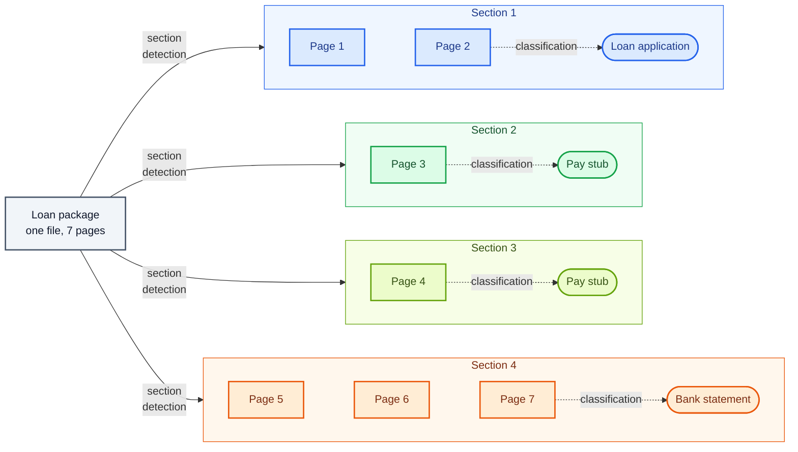
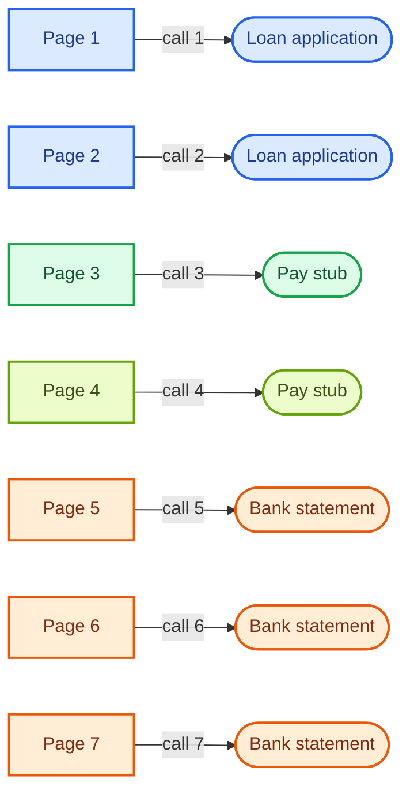
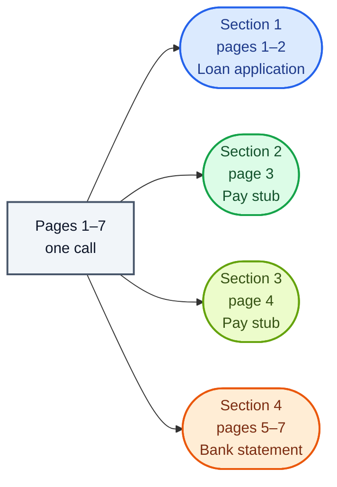

Copyright Amazon.com, Inc. or its affiliates. All Rights Reserved.
SPDX-License-Identifier: MIT-0

# Splitting and Section Classification

## Overview

Stacks of documents rarely arrive one document per file. A loan package holds an
application, pay stubs, bank statements and an ID. A claim holds a claim form, invoices and
medical records. A scanned batch holds whatever arrived that day.

This step does two jobs for every file:

- **Section detection** finds where each document in the file starts and ends. Each document
  it finds is a **section**: a run of consecutive pages.
- **Classification** assigns each section a **document class**. A document class is a kind of
  document you define, such as *Pay stub*, with a description and the fields to extract
  from it.

The document class decides which fields extraction pulls from the section, and so which table
in your database the section's record goes to. A file that always holds exactly one document
is one section, and it still gets a document class.

In the example below, section detection finds four sections in a seven-page loan package,
including two pay stubs on consecutive pages. Classification then assigns each section its
document class.

Extraction then reads each section with the fields of its document class: the loan
application fields from pages 1–2, the pay stub fields from page 3, the pay stub fields again
from page 4, and the bank statement fields from pages 5–7.

## Section detection and classification

A language model does both jobs. You make three choices about how it works: how much of the
file the model reads at once, whether detection and classification happen in one model call
or two, and whether the model reads the page text, the page images, or both.

### Choice 1: granularity

**Page by page.** The model reads one page per call and assigns that page a document class.
The accelerator then groups consecutive pages into sections, starting a new section where the
document class changes or where the page shows that a new document begins, such as a new
letterhead or "Page 1 of 2". The model can also be shown the neighboring pages as context,
which multiplies the tokens each call reads.

The accelerator then groups pages 1–2 into one section and pages 5–7 into another. Pages 3
and 4 both receive *Pay stub*, so they become two sections only if page 4 shows that a new
pay stub starts there, such as a new pay period.

**All at once (holistic).** The model reads the whole file in one call and returns the
sections and their document classes together. Because it sees every page, it can compare
them to decide where one document ends and the next begins. One call covers up to 20 pages
by default (`classification.combined.packet.window_pages`). For a longer file, the
accelerator reads it in overlapping windows of that many pages and merges the results.

In the configuration editor this choice is **granularity**: *page* or *packet*.

### Choice 2: strategy

**One call.** The same model call that finds the sections also assigns their document
classes. This is the default, shown in the editor as *Split and classify together (one
call)*.

**Two calls.** A first call only finds where each section starts, without the list of
document classes. A second call then classifies each section, reading its first pages. This
is *Split first, then classify each section*. Separating the jobs lets the first call focus
on boundaries, and the classification call sees a whole section rather than one page.

### Choice 3: model inputs

The model can read each page's **text** (from OCR), its **image**, or **both**. The text
carries the words; the image carries layout, letterheads, logos and checkboxes, which can show
that a new document has started. The default classification prompts send
both. In the editor these are **Send page text** and **Send page images**.

### Configurations

| Configuration | Granularity | Strategy | Model reads |
|---|---|---|---|
| Holistic, one call, with images | *packet* | *Split and classify together* | Text and images |
| Page by page, one call per page (default) | *page* | *Split and classify together* | Text and images |
| Detect sections first, then classify | *page* or *packet* | *Split first, then classify each section* | Text and images |
| Detect sections first, then a decision model classifies | *page* or *packet* | *Split first, then classify each section*, with the method set to *decision model* | Images of each section's first pages |
| Holistic, text only (fewest tokens) | *packet* | *Split and classify together* | Text |

For every setting, see
[How the classification settings are organized](../classification.md#how-the-classification-settings-are-organised).
For the configuration we recommend, and the measurements behind it, see
[Splitting and Classification benchmarks](../benchmark-guidance/splitting-and-classification.md).

## Token use

Classification runs on every page of every file. Four things decide how many tokens it uses:

- **Page by page or holistic.** A page-by-page call repeats the instructions, the list of
  document classes and their descriptions for every page, and the model writes its reasoning
  for every page. A holistic call sends the instructions once per file and returns one
  answer.
- **Page images.** Each image adds input tokens. How many depends on the classification
  model and the image size.
- **Neighboring pages as context.** Showing the model one neighbor on each side of a page
  triples the text and images each call reads; two neighbors on each side multiply it by
  five.
- **The classification model.** Models count tokens differently, especially for images, and
  larger models charge more for each token.

Reading text only leaves out the image tokens. Add page images only if your test set shows
they place more section boundaries right on your files. See
[What each setting costs](../classification.md#what-each-setting-costs).

## Measuring accuracy

Ground truth for this step is the page range and document class of every section in each
file. Four numbers show how well section detection and classification are working:

| Number | Question it answers |
|---|---|
| **Page accuracy** | What share of pages received the right document class, whatever section they landed in? |
| **Boundary accuracy** | What share of the true sections came back with exactly the right page range? The document class is not checked. |
| **Label accuracy** | Of the sections with the right page range, what share also received the right document class? |
| **Over-splits and merges** | When a page range is wrong, was one document cut into several sections, or were several documents joined into one? |

Boundary accuracy measures section detection and label accuracy measures classification, so
together they show which of the two jobs needs work. Extraction needs both: a section with the
right pages and the right document class. Page accuracy alone can look high while boundaries
are wrong, because a page can carry the right document class inside the wrong section.

Stickler reports page accuracy as *page-level accuracy*, and reports *split accuracy*, which
counts a section as correct only when its page range and its document class are both right.
See [Document split classification metrics](../evaluation.md#document-split-classification-metrics).
To build the ground truth, see [Measure with ground truth](index.md#4-measure-with-ground-truth).

Build a test set of real files with their correct sections, run it in
[Test Studio](../test-studio.md) once per configuration, and compare page accuracy and section
accuracy.

## Common mistakes

Once you measure boundary accuracy, look at how the wrong page ranges are wrong. Page-by-page and
holistic classification tend to make opposite mistakes:

| Configuration | Typical mistake | Example |
|---|---|---|
| **Page by page** | **Over-split:** one document cut into several sections | A long statement that repeats its header on every page, where each page looks like a new start |
| **Holistic** | **Merge:** several documents joined into one section | Two statements of the same class filed back to back |

If your test set shows mostly over-splits, try holistic classification, or set section
splitting to *One section* when each file holds one document. If it shows mostly merges of
same-class documents, such as a run of pay stubs, try page-by-page classification. See
[Page versus packet granularity](../classification.md#page-versus-packet-granularity-opposite-failure-modes).

## Improving accuracy

When your test set shows sections with the wrong pages or the wrong document class, try these
changes, and score each one against your test set.

**Get your document class definitions right first; nothing else matters as much.** Every
kind of document you receive needs a class, and each class needs a description that separates
it from its closest neighbor. The classification model picks a document class by comparing
each section with the description of every document class in your configuration. Name the features that tell
two classes apart: "Quote: shows a 'valid until' date and has no payment terms" separates a
quote from an invoice, and "Quote: a price quote" does not. See
[class descriptions](../classification.md#class-descriptions).

**Add few-shot examples for document classes that look alike.** A few-shot example is a
sample page with its correct document class, which the accelerator adds to the
classification prompt. Add them for each pair of document classes the model confuses, such
as invoice and quote. See
[Few-Shot Examples](../few-shot-examples.md).

**Separate documents of the same class on consecutive pages,** such as three pay stubs. If
holistic classification joins them into one section, try page-by-page classification, which
starts a new section at cues inside the pages such as "Page 1 of 2" or a new pay period. See
[Multiple W-2 Forms](../classification.md#real-world-example-multiple-w-2-forms).

**Check the pages that matched no document class.** When the model cannot match a page to
any document class in your configuration, the accelerator labels the page `unclassified`
instead of assigning the closest class. Extraction skips the section that holds the page, and
the accelerator records a processing issue on that section, which you see on the document's
Sections panel. If the same kind of page keeps coming back unclassified, add a document
class for it. See
[Pages Classification Could Not Classify](../classification.md#pages-classification-could-not-classify).

**Exclude pages that carry no data.** Instruction pages and legal boilerplate repeat on every
copy of a form. Define a document class for them and mark it excluded
(`x-aws-idp-exclude-from-processing: true`). The model still recognizes those pages, and
extraction, confidence assessment and rule validation skip them. See
[Excluding Static Pages](../classification.md#excluding-static-pages-eg-instructions-legal-boilerplate).

## Configuration reference

- **Granularity, strategy and what the model reads:** [Classification](../classification.md),
  including [choosing granularity, modality and strategy](../classification.md#choosing-granularity-modality-and-strategy)
  and [the split-then-classify strategy](../classification.md#the-split-then-classify-strategy).
- **One section per file:** [Section Splitting](../classification.md#section-splitting).
- **Draft your document classes from sample files,** including multi-document packages:
  [Discovery](../discovery.md#multi-section-package-discovery).
- **Score how sure the model is of each document class:**
  [classification confidence](../configuration.md#classification-confidence-classificationcombinedllmconfidence),
  and [Confidence Assessment](../benchmark-guidance/confidence-assessment.md) for what we
  measured.
- **Fix a document's sections by hand:**
  [re-grouping pages](../web-ui.md#re-grouping-a-processed-documents-pages) in the Web UI.
- **Use BDA mode instead:** [classification in BDA mode](../classification.md#bda-mode-use_bda-true).
