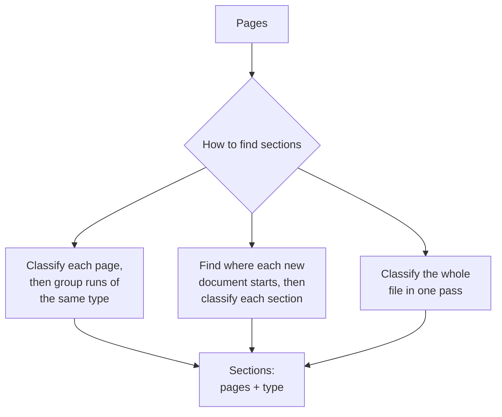

Copyright Amazon.com, Inc. or its affiliates. All Rights Reserved.
SPDX-License-Identifier: MIT-0

# Splitting and Section Classification

## What it does

Real stacks of documents don't arrive one document per file. A loan package holds an
application, pay stubs, bank statements and an ID; a claim holds a claim form, invoices and
medical records; a scanned batch holds whatever arrived that day. Splitting and section
classification finds every document in a file, records its pages, and gives it a type. Each
type has its own schema, so each document lands in the right table of your database with
the right fields.

Even a file that is always one document gets classified, so the right schema is used for it.

## Getting it right

- **Describe each type by what sets it apart** from its closest neighbor: "a quote shows
  'valid until' and no payment terms", not just "a quote".
- **Add an "other" type,** so a document you didn't plan for is set aside rather than
  filed under the nearest match.
- **Use page images as well as text.** Letterheads, logos and layout changes are the
  clearest signs that a new document has started.
- **Give examples for look-alike types.** One or two labeled examples of each confusable
  pair usually settles it.
- **Tell the system what it can assume.** If every file is exactly one document, say so and
  skip splitting. If a loan package always has one application, check for it.
- **For your kind of documents:**
  - *Several documents per file:* section accuracy is the number to watch.
  - *Many document types:* make sure your test set includes the rare types.
  - *Long statements with repeated headers:* check that they stay in one section.
  - *Several documents of the same type in a row* (three pay stubs, two statements): rely
    on page-level cues such as "Page 1 of 2" or a new statement date.

## Approaches



| Approach | Best for | Keep in mind |
|---|---|---|
| **Classify each page, then group** | Files where neighboring documents differ in type | Two same-type neighbors need a boundary cue to stay apart |
| **Find boundaries first, then classify** | Packets with many documents; gave the best sections in our tests | One more step per file |
| **Classify the whole file at once** | Short files; lowest cost | Long files may exceed what one call can see |

## How to measure it

Ground truth is the type and pages of every document in each file. Look at three numbers:

| Metric | Tells you |
|---|---|
| **Page classification accuracy** | How often each page gets the right type |
| **Section accuracy** | How often a whole document comes back with exactly the right pages **and** type. This is what extraction depends on |
| **Over-splits and merges** | Whether errors cut documents apart or join them, which have different costs for you |

Stickler scores page classification and section grouping, with and without page order. See
[Document split classification metrics](../evaluation.md#document-split-classification-metrics).

## What we measured

### Packets with many document types

**Dataset:** [DocSplit-Poly-Seq](benchmark-datasets.md#docsplit-poly-seq), 20 public packets
(298 pages, 13 document types, 5–20 pages each). **Run:** release 0.6.14, November 2026,
classifier Amazon Nova 2 Lite (the default), one run per method.

| Method | Page accuracy | Section accuracy (pages and type) | Classification cost per page |
|---|---|---|---|
| Classify each page, text and image (**default**) | 0.818 | 0.553 | $0.00097 |
| Classify the whole packet, text and image | 0.720 | 0.659 | $0.00057 |
| Classify the whole packet, images only | 0.836 | 0.578 | $0.00028 |
| **Find boundaries first, then classify each section** | 0.797 | **0.694** | $0.00097 |

Source: `benchmarks/results/v0.6.14/clsvariants/summary.json`.

What this shows:

- **Classification itself is cheap and accurate:** about 80% of pages typed correctly for
  under a tenth of a cent per page, across 13 document types.
- **Section accuracy is the number to improve, and the method choice moves it.** Finding
  boundaries first raised it from 55% to 69% at no extra cost, which makes it the
  configuration to start from for multi-document packets.
- **Classifying the whole packet at once also found more boundaries,** for less money, while
  typing fewer pages correctly (section accuracy +0.20, standard error 0.09; page accuracy
  −0.07, standard error 0.07; 19 packets).

### Files that hold one or two documents

**Dataset:** synthetic bank statements with exact ground truth. **Run:** release 0.6.14,
five runs per file, unless noted.

| File | Default splitting |
|---|---|
| Two statements in one file | **5 of 5** split into two documents |
| One 3-page statement, with or without "Page k of n" | **5 of 5** kept as one document |
| One 3-page statement with its header repeated on every page | Split into three in 5 of 5 runs (release 0.6.9). For documents like this, tell the system each file is one document |

Every classification model we compared typed these single statements into the right number
of sections in at least 132 of 133 runs, so the default classifier is all you need here; a
larger one cost about 18 times as much per page for no gain.¹

¹ Corrected for a known pricing error that overstates Claude Sonnet 5 by 1.5×
([#1830](https://github.com/aws-solutions-library-samples/accelerated-intelligent-document-processing-on-aws/issues/1830)).

Sources: `benchmarks/results/v0.6.14/boundary/`, `benchmarks/results/v0.6.9/boundaryab/` and
`benchmarks/results/v0.6.14/coresynth__classification-model-*/`.

**How far this carries:** 20 packets with one run per method, and differences between
methods moved between releases, so confirm the best method on your own packets. The
synthetic files hold at most two documents of the same type.

## Reproduce it

**On your own documents.** Build a test set of real files with the correct sections, run it
in [Test Studio](../test-studio.md) once per method, and compare page and section accuracy.
The DocSplit test set is deployed with every stack, so you can also run the comparison above
on your own stack.

**The benchmark.**

```bash
# DocSplit methods (the test set is deployed with the stack)
python3 benchmarks/harness/run_classification_bench.py --stack <STACK> --testset docsplit \
  --n 20 --models nova2lite --mode topk \
  --variants page-both,packet-both,packet-images,split-then-classify-page

# Synthetic one- and two-document files
python3 benchmarks/harness/gen_corpus.py --only small_narrow,twodocs_2x20,paginated_3pg,repeathdr_3pg
python3 benchmarks/harness/make_configs.py --suite boundary --class bank_statement
python3 benchmarks/harness/run_matrix.py --stack <STACK> --suite boundary
```

Recompute a row from the committed results:

```bash
jq '."nova2lite-page-both" | {boundary_accuracy, class_accuracy, classification_cost_per_page}' \
  benchmarks/results/v0.6.14/clsvariants/summary.json
```

See the [benchmark suite](../benchmarking/index.md) for setup and scoring.

## In the accelerator

- Splitting methods, granularity, page images and the boundary prompt:
  [Classification](../classification.md).
- Examples for look-alike types: [Few-Shot Examples](../few-shot-examples.md).
- Draft types from sample documents: [Discovery](../discovery.md).
- Fix a processed document's sections by hand:
  [Web UI](../web-ui.md#re-grouping-a-processed-documents-pages).
- Measured trade-offs for each option:
  [Configuration guidance](../benchmarking/config-guidance.md).
