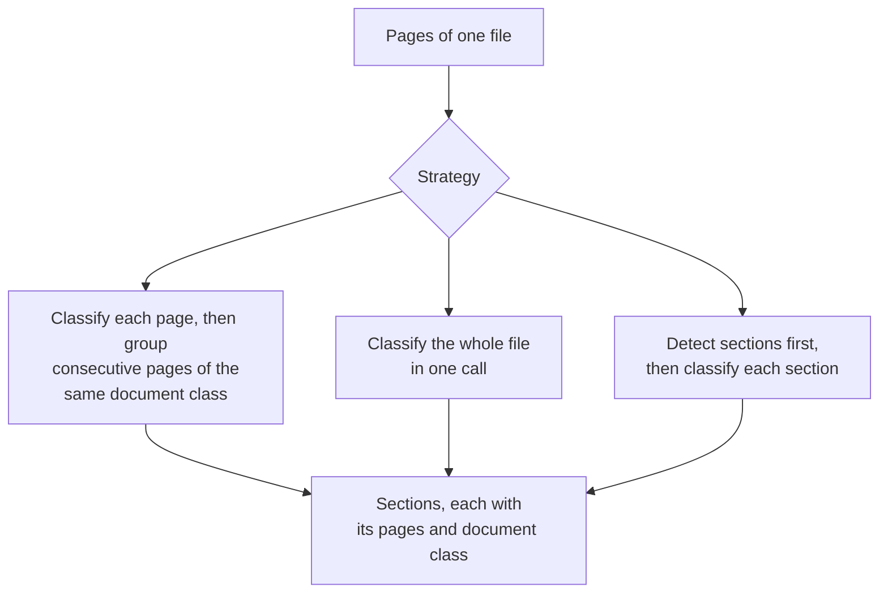

Copyright Amazon.com, Inc. or its affiliates. All Rights Reserved.
SPDX-License-Identifier: MIT-0

# Splitting and Section Classification

## What it does

Stacks of documents rarely arrive one document per file. A loan package holds an
application, pay stubs, bank statements and an ID. A claim holds a claim form, invoices and
medical records. A scanned batch holds whatever arrived that day.

This step does two jobs for every file:

- **Section detection** finds where each document in the file starts and ends. Each document
  it finds is a **section**: a run of consecutive pages.
- **Classification** assigns each section a **document class**. A document class is a kind of
  document you define, such as *Pay stub*, with a description and the fields to extract
  from it.

The document class decides which fields extraction pulls from the section, and so which table
in your database the section's record goes to. A file that always holds exactly one document
is one section, and it still gets a document class.

In the example below, section detection finds four sections in a seven-page loan package,
including two pay stubs on consecutive pages. Classification then assigns each section its
document class.


Extraction then reads each section with the fields of its document class: the loan
application fields from pages 1–2, the pay stub fields from page 3, the pay stub fields again
from page 4, and the bank statement fields from pages 5–7.


## Getting it right

**Write a description for each document class that separates it from its closest
neighbor.** The classification model picks a document class by comparing each page with the
description of every document class in your configuration. Name the features that tell two
classes apart: "Quote: shows a 'valid until' date and has no payment terms" separates a quote
from an invoice, and "Quote: a price quote" does not. See
[class descriptions](../classification.md#class-descriptions).

**Expect pages that match no document class.** When the classification model cannot match a
page to any document class in your configuration, the accelerator labels the page
`unclassified` instead of assigning the closest class. Extraction skips the section that
holds the page, and the accelerator records a processing issue on that section, which you
see on the document's Sections panel. See
[Pages Classification Could Not Classify](../classification.md#pages-classification-could-not-classify).

**Keep page images in the classification prompt.** A letterhead, a logo or a change of layout
is often the clearest evidence that a new document starts on a page, and the classification
model sees those only in the page image. The default classification prompt sends each page's
image with its OCR text; in the configuration editor this is **Send page images**. See
[how the classification settings are organized](../classification.md#how-the-classification-settings-are-organised).

**Add few-shot examples for document classes that look alike.** A few-shot example is a
sample page with its correct document class, which the accelerator adds to the
classification prompt. One or two examples for each pair of document classes that the
classification model confuses, such as invoice and quote, usually stop the confusion. See
[Few-Shot Examples](../few-shot-examples.md).

**Set section splitting to *One section* when every file holds exactly one document.** The
accelerator then keeps all of a file's pages in one section and gives that section the
document class that most of its pages receive, so a stray page cannot split the document. If
your configuration has only one document class, the accelerator makes no classification call
at all. See [Section Splitting](../classification.md#section-splitting).

**Exclude pages that carry no data.** Instruction pages and legal boilerplate repeat on every
copy of a form. Define a document class for them and mark it excluded
(`x-aws-idp-exclude-from-processing: true`). The classification model still recognizes those
pages, and extraction, confidence assessment and rule validation skip them. See
[Excluding Static Pages](../classification.md#excluding-static-pages-eg-instructions-legal-boilerplate).

## Your documents

- **Files that hold several documents,** such as loan packages: measure section accuracy
  (right pages and right document class), not just page accuracy, and start from the
  *Split first, then classify* strategy described below.
- **Many document classes:** include examples of your rarest document classes in your test
  set, and add few-shot examples for the classes the classification model confuses.
- **Several documents of the same class on consecutive pages,** such as three pay stubs:
  section detection relies on cues inside the pages, such as "Page 1 of 2" or a new pay
  period, to start a new section. See
  [Multiple W-2 Forms](../classification.md#real-world-example-multiple-w-2-forms).
- **Long single documents that repeat their header on every page,** such as statements: set
  section splitting to *One section*, so the repeated header does not start a new section on
  every page.

## How splitting works

The accelerator offers three strategies for detecting sections and classifying them. You
choose one in the classification settings of the configuration editor.



| Strategy | Configuration editor setting | Best for |
|---|---|---|
| **Classify each page, then group** (default) | *Split and classify together (one call)*, granularity *page* | Files where consecutive documents have different document classes |
| **Classify the whole file in one call** | *Split and classify together (one call)*, granularity *packet* | Short files, at the lowest cost |
| **Detect sections first, then classify each section** | *Split first, then classify each section* | Files that hold many documents; produced the most accurate sections in our tests |

See [Choosing granularity, modality and strategy](../classification.md#choosing-granularity-modality-and-strategy)
and [the split-then-classify strategy](../classification.md#the-split-then-classify-strategy).

## How to measure it

Ground truth for this step is the page range and document class of every section in each
file. Three numbers show how well section detection and classification are working:

| Number | Question it answers |
|---|---|
| **Page accuracy** | What share of pages received the right document class? |
| **Section accuracy** | What share of sections came back with exactly the right pages **and** the right document class? Extraction depends on this number. |
| **Over-splits and merges** | When a section is wrong, was one document cut into several sections, or were several documents joined into one? |

Stickler reports page accuracy as *page-level accuracy* and section accuracy as *split
accuracy*, with and without page order. See
[Document split classification metrics](../evaluation.md#document-split-classification-metrics).
To build the ground truth, see [Measure with ground truth](index.md#4-measure-with-ground-truth).

## What we measured

### Files that hold many documents

**Dataset:** [DocSplit-Poly-Seq](benchmark-datasets.md#docsplit-poly-seq), 20 public files
(298 pages, 13 document classes, 5–20 pages per file). **Run:** release 0.6.14,
November 2026, classification model Amazon Nova 2 Lite (the default), one run per strategy.

| Strategy | Page accuracy | Section accuracy | Classification cost per page |
|---|---|---|---|
| Classify each page, with text and images (**default**) | 0.818 | 0.553 | $0.00097 |
| Classify the whole file in one call, with text and images | 0.720 | 0.659 | $0.00057 |
| Classify the whole file in one call, with images only | 0.836 | 0.578 | $0.00028 |
| **Detect sections first, then classify each section** | 0.797 | **0.694** | $0.00097 |

Source: `benchmarks/results/v0.6.14/clsvariants/summary.json`.

What this shows:

- **Page classification is fast, cheap and accurate:** about 80% of pages received the right
  document class across 13 classes, for under a tenth of a cent per page.
- **For files that hold many documents, start with *Detect sections first, then classify
  each section*.** It raised section accuracy from 55% to 69% at the same cost as the
  default.
- **Classifying the whole file in one call also found more section boundaries, for less
  money,** but gave fewer pages the right document class (section accuracy +0.20, SE 0.09;
  page accuracy −0.07, SE 0.07; 19 files).

### Files that hold one or two documents

**Dataset:** synthetic bank statements with exact ground truth. **Run:** release 0.6.14,
five runs per file, unless noted.

| File | Sections detected with the default strategy |
|---|---|
| Two statements in one file | **Two sections, in 5 of 5 runs** |
| One 3-page statement, with or without "Page k of n" | **One section, in 5 of 5 runs** |
| One 3-page statement with its header repeated on every page | Three sections, in 5 of 5 runs (release 0.6.9). Setting section splitting to *One section* keeps it as one |

On single statements, every classification model we compared produced the right number of
sections in at least 132 of 133 runs, so the default classification model is enough there.
Claude Sonnet 5 cost about 18 times as much per page for no gain.¹

¹ Corrected for a known pricing error that overstates Claude Sonnet 5 by 1.5×
([#1830](https://github.com/aws-solutions-library-samples/accelerated-intelligent-document-processing-on-aws/issues/1830)).

Sources: `benchmarks/results/v0.6.14/boundary/`, `benchmarks/results/v0.6.9/boundaryab/` and
`benchmarks/results/v0.6.14/coresynth__classification-model-*/`.

**How far this carries:** 20 files, one run per strategy, and the gap between strategies has
varied between releases. Confirm the best strategy on your own files.

## Reproduce it

**On your own documents.** Build a test set of real files with their correct sections, run
it in [Test Studio](../test-studio.md) once per strategy, and compare page accuracy and
section accuracy. Every stack includes the DocSplit test set, so you can repeat the comparison above
in your own account.

**The benchmark.**

```bash
# DocSplit strategies (the test set comes with the stack)
python3 benchmarks/harness/run_classification_bench.py --stack <STACK> --testset docsplit \
  --n 20 --models nova2lite --mode topk \
  --variants page-both,packet-both,packet-images,split-then-classify-page

# Synthetic one- and two-document files
python3 benchmarks/harness/gen_corpus.py --only small_narrow,twodocs_2x20,paginated_3pg,repeathdr_3pg
python3 benchmarks/harness/make_configs.py --suite boundary --class bank_statement
python3 benchmarks/harness/run_matrix.py --stack <STACK> --suite boundary
```

Recompute a row from the committed results:

```bash
jq '."nova2lite-page-both" | {boundary_accuracy, class_accuracy, classification_cost_per_page}' \
  benchmarks/results/v0.6.14/clsvariants/summary.json
```

See the [benchmark suite](../benchmarking/index.md) for setup and scoring.

## In the accelerator

- **Configure section detection and classification:** [Classification](../classification.md), starting with
  [how the settings are organized](../classification.md#how-the-classification-settings-are-organised).
- **Draft your document classes from sample files,** including multi-document packages:
  [Discovery](../discovery.md#multi-section-package-discovery).
- **Score how sure the classifier is:**
  [classification confidence](../configuration.md#classification-confidence-classificationcombinedllmconfidence),
  and [Confidence Assessment](confidence-assessment.md#document-class-confidence) for what we
  measured.
- **Fix a document's sections by hand:**
  [re-grouping pages](../web-ui.md#re-grouping-a-processed-documents-pages) in the Web UI.
- **Use BDA mode instead:** [classification in BDA mode](../classification.md#bda-mode-use_bda-true).
- **See every measured option:** [Configuration guidance](../benchmarking/config-guidance.md).
