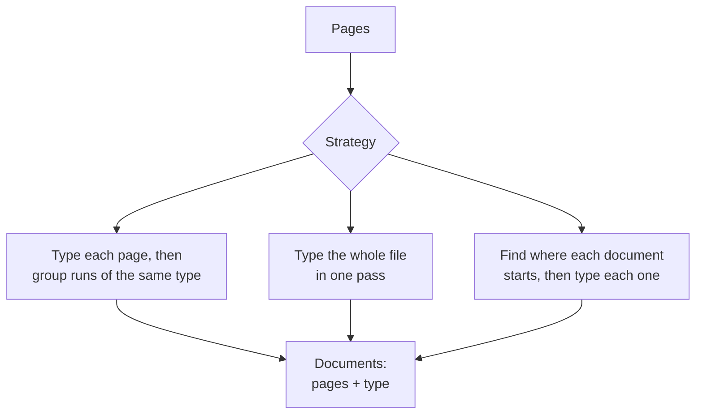

Copyright Amazon.com, Inc. or its affiliates. All Rights Reserved.
SPDX-License-Identifier: MIT-0

# Splitting and Section Classification

## What it does

Stacks of documents rarely arrive one document per file. A loan package holds an
application, pay stubs, bank statements and an ID. A claim holds a claim form, invoices and
medical records. A scanned batch holds whatever arrived that day. Splitting and section
classification finds every document in a file, records which pages belong to it, and gives
it a type. Each type has its own fields, so each document lands in the right table of your
database with the right columns filled.

A file that always holds exactly one document still gets a type, so the pipeline uses the
right fields for it.

## Getting it right

**Describe each type by what sets it apart** from its closest neighbor. "A quote shows a
'valid until' date and no payment terms" helps the model far more than "a quote". See
[class descriptions](../classification.md#class-descriptions).

**Plan for documents you didn't define.** When a page fits none of your types, the
accelerator marks it unclassified and reports it rather than forcing it into the nearest
type. See [Pages Classification Could Not Classify](../classification.md#pages-classification-could-not-classify).

**Send page images as well as text.** Letterheads, logos and layout changes are the clearest
signs that a new document has started.

**Give examples for look-alike types.** One or two labeled examples of each confusable pair
usually settle it. See [Few-Shot Examples](../few-shot-examples.md).

**Tell the accelerator what it can assume.** If every file holds exactly one document, set
section splitting to one section and the accelerator skips splitting entirely. See
[Section Splitting](../classification.md#section-splitting).

**Skip the pages you don't need.** You can exclude instruction pages and legal boilerplate
from extraction. See
[Excluding Static Pages](../classification.md#excluding-static-pages-eg-instructions-legal-boilerplate).

## Your documents

- **Several documents per file:** section accuracy is the number that matters. Start from the
  split-first strategy below.
- **Many document types:** include the rarest types in your test set, and give examples for
  the ones that look alike.
- **Several documents of the same type in a row,** such as three pay stubs: page-level cues
  like "Page 1 of 2" or a new statement date separate them. See
  [Multiple W-2 Forms](../classification.md#real-world-example-multiple-w-2-forms).
- **Long documents with a header repeated on every page:** if each file is one document, set
  section splitting to one section.

## How splitting works

The accelerator offers three ways to find the documents in a file. You choose one in the
classification settings.



| Strategy | Setting | Best for |
|---|---|---|
| **Type each page, then group** (default) | Split and classify together, `granularity: page` | Files where neighboring documents are of different types |
| **Type the whole file in one pass** | Split and classify together, `granularity: packet` | Short files, at the lowest cost |
| **Split first, then type each document** | `strategy: split_then_classify` | Packets with many documents; gave the best document boundaries in our tests |

See [Choosing granularity, modality and strategy](../classification.md#choosing-granularity-modality-and-strategy)
and [the split-then-classify strategy](../classification.md#the-split-then-classify-strategy).

## How to measure it

Ground truth is the type and pages of every document in each file. Three numbers tell you how
splitting is doing:

| Number | Question it answers |
|---|---|
| **Page accuracy** | Did each page get the right type? |
| **Document accuracy** | Did each document come back with exactly the right pages **and** the right type? This is what extraction depends on. |
| **Over-splits and merges** | Did errors cut documents apart, or join them together? |

Stickler reports page accuracy and document accuracy, with and without page order. See
[Document split classification metrics](../evaluation.md#document-split-classification-metrics).
To build the ground truth, see [Measure with ground truth](index.md#4-measure-with-ground-truth).

## What we measured

### Packets with many document types

**Dataset:** [DocSplit-Poly-Seq](benchmark-datasets.md#docsplit-poly-seq), 20 public packets
(298 pages, 13 document types, 5–20 pages each). **Run:** release 0.6.14, November 2026,
classifier Amazon Nova 2 Lite (the default), one run per strategy.

| Strategy | Page accuracy | Document accuracy | Classification cost per page |
|---|---|---|---|
| Type each page, text and images (**default**) | 0.818 | 0.553 | $0.00097 |
| Type the whole file, text and images | 0.720 | 0.659 | $0.00057 |
| Type the whole file, images only | 0.836 | 0.578 | $0.00028 |
| **Split first, then type each document** | 0.797 | **0.694** | $0.00097 |

Source: `benchmarks/results/v0.6.14/clsvariants/summary.json`.

What this shows:

- **Typing pages is fast, cheap and accurate:** about 80% of pages typed correctly across
  13 document types, for under a tenth of a cent per page.
- **For multi-document packets, start with split-first.** It raised document accuracy from 55%
  to 69% at the same cost as the default.
- **Typing the whole file in one pass also found more boundaries, for less money,** while
  typing fewer pages correctly (document accuracy +0.20, SE 0.09; page accuracy −0.07,
  SE 0.07; 19 packets).

### Files that hold one or two documents

**Dataset:** synthetic bank statements with exact ground truth. **Run:** release 0.6.14,
five runs per file, unless noted.

| File | Result with default splitting |
|---|---|
| Two statements in one file | **Split into two documents in 5 of 5 runs** |
| One 3-page statement, with or without "Page k of n" | **Kept as one document in 5 of 5 runs** |
| One 3-page statement with its header repeated on every page | Split into three in 5 of 5 runs (release 0.6.9). Setting section splitting to one section keeps it whole |

On single statements, every classification model we compared produced the right number of
documents in at least 132 of 133 runs. The default classifier is all you need there. Claude
Sonnet 5 cost about 18 times as much per page for no gain.¹

¹ Corrected for a known pricing error that overstates Claude Sonnet 5 by 1.5×
([#1830](https://github.com/aws-solutions-library-samples/accelerated-intelligent-document-processing-on-aws/issues/1830)).

Sources: `benchmarks/results/v0.6.14/boundary/`, `benchmarks/results/v0.6.9/boundaryab/` and
`benchmarks/results/v0.6.14/coresynth__classification-model-*/`.

**How far this carries:** 20 packets, one run per strategy, and the gap between strategies
has varied between releases. Confirm the best strategy on your own packets.

## Reproduce it

**On your own documents.** Build a test set of real files with their correct documents, run
it in [Test Studio](../test-studio.md) once per strategy, and compare page and document
accuracy. Every stack includes the DocSplit test set, so you can repeat the comparison above
in your own account.

**The benchmark.**

```bash
# DocSplit strategies (the test set comes with the stack)
python3 benchmarks/harness/run_classification_bench.py --stack <STACK> --testset docsplit \
  --n 20 --models nova2lite --mode topk \
  --variants page-both,packet-both,packet-images,split-then-classify-page

# Synthetic one- and two-document files
python3 benchmarks/harness/gen_corpus.py --only small_narrow,twodocs_2x20,paginated_3pg,repeathdr_3pg
python3 benchmarks/harness/make_configs.py --suite boundary --class bank_statement
python3 benchmarks/harness/run_matrix.py --stack <STACK> --suite boundary
```

Recompute a row from the committed results:

```bash
jq '."nova2lite-page-both" | {boundary_accuracy, class_accuracy, classification_cost_per_page}' \
  benchmarks/results/v0.6.14/clsvariants/summary.json
```

See the [benchmark suite](../benchmarking/index.md) for setup and scoring.

## In the accelerator

- **Configure splitting and typing:** [Classification](../classification.md), starting with
  [how the settings are organized](../classification.md#how-the-classification-settings-are-organised).
- **Draft your types from sample files,** including multi-document packages:
  [Discovery](../discovery.md#multi-section-package-discovery).
- **Score how sure the classifier is:**
  [classification confidence](../configuration.md#classification-confidence-classificationcombinedllmconfidence),
  and [Confidence Assessment](confidence-assessment.md#document-type-confidence) for what we
  measured.
- **Fix a document's sections by hand:**
  [re-grouping pages](../web-ui.md#re-grouping-a-processed-documents-pages) in the Web UI.
- **Use BDA mode instead:** [classification in BDA mode](../classification.md#bda-mode-use_bda-true).
- **See every measured option:** [Configuration guidance](../benchmarking/config-guidance.md).
