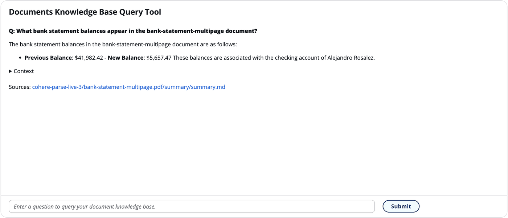

Copyright Amazon.com, Inc. or its affiliates. All Rights Reserved.
SPDX-License-Identifier: MIT-0

# Document Knowledge Base Query

The GenAIIDP solution includes an integrated Document Knowledge Base query feature that enables you to interactively ask questions about your processed document collection using natural language. This feature leverages the processed data to create a searchable knowledge base.

https://github.com/user-attachments/assets/991b4112-0fc9-4e4d-98ab-ef4e3cbae04a

## How It Works

1. **Document Processing & Indexing**
   - Processed documents are automatically indexed in a vector database
   - Documents are chunked into semantic segments for efficient retrieval
   - Each chunk maintains reference to its source document
   - **Ingestion Schedule**: Documents are ingested into the knowledge base every 30 minutes, so newly processed documents may not be immediately available for querying

2. **Interactive Query Interface**
   - Access through the Web UI via the "Knowledge Base" section
   - Ask natural language questions about your document collection
   - View responses with citations to source documents
   - Follow-up with contextual questions in a chat-like interface

3. **AI-Powered Responses**
   - LLM generates responses based on relevant document chunks
   - Responses include citations to source documents
   - Links to original documents for reference
   - Context-aware for follow-up questions

## Query Features

- **Natural Language Understanding**: Ask questions in plain English rather than using keywords or query syntax
- **Document Citations**: Responses include references to the specific documents used to generate answers
- **Contextual Follow-ups**: Ask follow-up questions without repeating context
- **Direct Document Links**: Click on document references to view the original source
- **Markdown Formatting**: Responses support rich formatting for better readability
- **Real-time Processing**: Get answers in seconds, even across large document collections

## Architecture & Vector Storage Options

The Knowledge Base feature supports two vector storage backends to optimize for different performance and cost requirements:

### Vector Store Comparison

| Aspect | OpenSearch Serverless | S3 Vectors |
|--------|----------------------|------------|
| **Query Latency** | Sub-millisecond | Sub-second |
| **Pricing Model** | Always On (continuous capacity costs) | On Demand (pay-per-query) |
| **Storage Cost** | Higher | 40-60% lower |
| **Best For** | Real-time applications | Cost-sensitive deployments |
| **Features** | Full-text search, advanced filtering | Native S3 integration |

### Choosing Your Vector Store

- **S3 Vectors** (Default): Choose for cost optimization with acceptable sub-second query latency
- **OpenSearch Serverless**: Choose for applications requiring ultra-fast retrieval and real-time performance

## Configuration

The Document Knowledge Base Query feature is configured with these stack parameters at
deployment time:

| Parameter | Values | Purpose |
|---|---|---|
| `DocumentKnowledgeBase` | `DISABLED`, `BEDROCK_KNOWLEDGE_BASE (Create)` (default) | Turns the feature on. The "Create" value is what provisions the knowledge base and its vector store. |
| `KnowledgeBaseVectorStore` | `S3_VECTORS` (default), `OPENSEARCH_SERVERLESS` | Which vector store backs the knowledge base. See the comparison above. |
| `KnowledgeBaseEmbeddingModel` | `amazon.titan-embed-text-v2:0` (default), `cohere.embed-english-v3`, `cohere.embed-multilingual-v3` | The Bedrock model that embeds documents into the vector store. See [Embedding Model](#embedding-model). |
| `KnowledgeBaseModelId` | A Bedrock model id, default `us.amazon.nova-pro-v1:0` | The model that generates the answer from the retrieved passages. |

`KnowledgeBaseModelId` has an explicit `AllowedValues` list, so the picker in the
CloudFormation console shows exactly what is selectable; read it from
`template.yaml` rather than from a copy here, because the list moves as models are added
and retired. Two region-specific behaviours are worth knowing before you pick one:

- **Canada.** A `ca-central-1` or `ca-west-1` stack left at the default is switched to
  `ca.amazon.nova-lite-v1:0` automatically, because the default has no inference profile
  in Canada. An explicit choice is passed through unchanged and must be callable from the
  stack's region.
- **GovCloud.** None of the `us.` / `eu.` / `global.` cross-region inference-profile
  prefixes resolve in GovCloud. Use one of the bare or `us-gov.` ids the parameter lists;
  the `--govcloud` template transform overrides the commercial default for you.

Whichever model you choose must have model access granted in Amazon Bedrock in the
deployment region.

> **Note:** `ShouldUseDocumentKnowledgeBase` is not a parameter you set. It is a
> CloudFormation **Condition**, derived from `DocumentKnowledgeBase`, which the parent
> stack passes down to the pattern stack as a boolean. Setting `DocumentKnowledgeBase` is
> the whole of the control.

### Embedding Model

`KnowledgeBaseEmbeddingModel` selects the model that turns documents into vectors, for
either vector store type. It accepts `amazon.titan-embed-text-v2:0` (the default),
`cohere.embed-english-v3` and `cohere.embed-multilingual-v3`. All three produce
1024-dimension vectors, which is the size the vector index is created with.

Choose it when the knowledge base is first created. Changing it on an existing stack is
not supported. With OpenSearch Serverless the update rebuilds the vector index, discarding
the vectors already in it. With S3 Vectors the knowledge base keeps the embedding model it
was created with, so the new choice does not take effect, and the vector index and its
vectors are kept. The S3 Vectors index is rebuilt, which discards its vectors, only when
an update changes its dimension, distance metric or metadata configuration, and the
template sets all three to fixed values, so a stack parameter change does not rebuild it.

Deleting the stack deletes the S3 Vectors bucket and every index in it, including an
index left under an earlier index name. S3 Vectors will not delete a bucket that still
holds an index, so the custom resource lists the bucket's indexes and deletes each one
first. This applies to the bucket the stack names for itself. When the nested stack's
`pS3VectorBucketName` parameter names the bucket, which may be one that existed before
the stack, only the stack's own index is deleted, and a bucket that still holds other
indexes is left in place. In either case, if the bucket cannot be deleted, the stack
delete fails with a message naming the bucket rather than reporting success. An update
that changes only the index name creates the new index and keeps the old one. For the
bucket the stack names for itself, the stack delete then removes the old index; for a
bucket named by `pS3VectorBucketName`, the old index stays and the stack delete fails
until it is deleted.

Grant model access for the model you choose in Amazon Bedrock, in the deployment region,
before deploying with this feature enabled — without it, ingestion fails. When GovCloud
model availability was checked on 2026-07-17, `amazon.titan-embed-text-v2:0` was the only
embedding model offered there, so keep the default in GovCloud unless you have confirmed
the alternative is available.

When the feature is enabled, the solution:
- Creates the selected vector storage resources (OpenSearch or S3 Vectors)
- Configures API endpoints for querying the knowledge base
- Adds the query interface to the Web UI

## Using the Knowledge Base

### Accessing the Knowledge Base

1. Log in to the Web UI
2. Navigate to the "Knowledge Base" section in the main navigation
3. You'll see a chat-like interface for querying your document collection

### Asking Questions

1. Type your question in the input field at the bottom of the screen
2. Press Enter or click **Submit**
3. The system will process your question and return an answer
4. The answer will include:
   - A direct response to your question
   - Citations to the source documents
   - Links to view the original documents

### Exploring Document Context

1. Click on document citations to view the original source
2. The system will highlight the relevant sections in the document
3. You can navigate to other parts of the document to explore the full context

### Follow-up Questions

1. After receiving an answer, you can ask related follow-up questions
2. The system maintains context from previous questions
3. This allows for a natural conversation about your documents
4. You can start a new topic at any time by asking an unrelated question

## Best Practices

1. **Be specific**: Clearly state what information you're looking for
2. **Start broad, then narrow**: Begin with general questions before diving into specifics
3. **Use follow-ups**: Build on previous questions to explore topics in depth
4. **Check citations**: Verify information by consulting the source documents
5. **Refine questions**: If you don't get the expected answer, try rephrasing your question

## Performance Considerations

- **Document Collection Size**: Performance may vary with very large document collections
- **Query Complexity**: More complex queries may take longer to process
- **Document Types**: Some document types may be indexed more effectively than others
- **Model Selection**: Different Bedrock models offer different performance/accuracy tradeoffs

## Security Considerations

The Knowledge Base feature maintains the security controls of the overall solution:

- Access is restricted to authenticated users
- Document visibility respects user permissions
- Questions and answers are processed securely within your AWS account
- No data is sent to external services beyond the configured Bedrock models

## Future Enhancements

### Potential Improvements & Community Contributions
- **CloudFormation Support**: When S3 Vectors gains native CloudFormation support
- **Migration Tools**: Utilities to migrate between vector store types
- **Hybrid Deployment**: Support for multiple Knowledge Bases with different vector stores
- **Document Chunking Options**: The system currently uses default chunking strategies, with additional chunking methods available for optimization based on document types and use cases
- Performance optimization suggestions
- Additional embedding model support
- Enhanced monitoring and alerting
