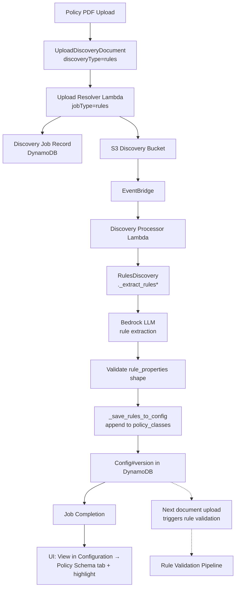

Copyright Amazon.com, Inc. or its affiliates. All Rights Reserved.
SPDX-License-Identifier: MIT-0

# Policy Discovery Module

The Policy Discovery module extracts **business rules** from policy documents (Medicare/Medicaid policy manuals, prior authorization guidelines, compliance manuals, etc.) and saves them into the selected configuration profile as `policy_classes`. Those policy classes are then consumed by the [Rule Validation](rule-validation.md) stage of the unified processing pipeline to evaluate pass/fail for each incoming document against the extracted rules.

Policy Discovery is the **rules counterpart** of the classes-based [Discovery Module](discovery.md). Where Discovery tells the system *what fields a document type has*, Policy Discovery tells the system *what rules a document must satisfy to be compliant*.


## Table of Contents

- [Overview](#overview)
  - [What is Policy Discovery](#what-is-policy-discovery)
  - [Key Features](#key-features)
  - [Use Cases](#use-cases)
- [Architecture](#architecture)
  - [Core Components](#core-components)
  - [Processing Flow](#processing-flow)
  - [Integration Points](#integration-points)
- [Discovery Methods](#discovery-methods)
  - [Traditional Rule Extraction](#traditional-rule-extraction)
  - [Agentic Rule Extraction](#agentic-rule-extraction)
  - [Choosing the Right Method](#choosing-the-right-method)
- [Configuration](#configuration)
  - [Model Configuration](#model-configuration)
  - [Prompt Customization](#prompt-customization)
  - [Default Prompts](#default-prompts)
- [Using the Module](#using-the-module)
  - [Web UI Interface](#web-ui-interface)
  - [Policy Groups](#policy-groups)
  - [API Integration](#api-integration)
  - [Output Format](#output-format)
- [Rule Validation Integration](#rule-validation-integration)
  - [How Extracted Rules Are Used](#how-extracted-rules-are-used)
  - [Required: Add a Document Matching Regex](#required-add-a-document-matching-regex)
- [Best Practices](#best-practices)
- [Troubleshooting](#troubleshooting)
- [Limitations](#limitations)


## Overview

### What is Policy Discovery

Policy Discovery analyzes a policy document (e.g., the NCCI Medicare Policy Manual, a payer's prior-authorization guideline, an internal compliance manual) and produces a flat list of **individual rules**, each phrased as a yes/no validation question with:

- A short, descriptive **snake_case rule name** (e.g., `modifier_59_distinct_sites`, `prior_auth_required_for_imaging`)
- A **description** written as a yes/no question the validator can answer for each incoming document (e.g., *"Is modifier 59 appended only when reporting a service distinct from other services on the same day?"*)
- The **page number or section** in the source policy where the rule was found (for auditability)

All rules for a policy document are grouped into a single **policy class** — a JSON-Schema-shaped object — and appended to `Config#<version>.policy_classes` in the Configuration DynamoDB table. From there, the [Rule Validation](rule-validation.md) stage of the pipeline uses them to evaluate incoming documents.

### Key Features

- **🤖 Automated Rule Extraction**: Parse a policy PDF into a structured list of rules using Bedrock LLMs
- **🔄 Traditional & Agentic Modes**: Single-shot LLM call or multi-turn Strands agent with reviewer feedback loop
- **📚 Append-Only Persistence**: Re-uploading or uploading a second policy document appends a new policy class — earlier policies are never overwritten
- **🔖 Unique Class Naming**: Class names are derived from the source filename with a hex suffix (e.g., `NCCI_Medicare_Policy_839f3946`) so multiple uploads remain distinguishable
- **🗂 Policy Groups**: Uploads that name the same optional **policy group** — the chapters of one manual, say — add their rules to **one** policy class, so one regex matches the whole policy. A later upload can replace the group's rules (an amended manual) or supersede rules you choose (a rider). See [Policy Groups](#policy-groups) and [Superseding rules in a group](#superseding-rules-in-a-group)
- **🏷 Discriminated Jobs**: Policy discovery jobs are tagged with `jobType: 'rules'` so the UI can surface them distinctly from classes discovery jobs
- **🔗 Deep-Link to Configuration**: Finishing a job renders a "View in Configuration" link that navigates to the Policy Schema tab and auto-selects the newly extracted class

### Use Cases

**Regulatory Compliance Onboarding:**
- Drop a payer's policy manual in; get the validation ruleset without hand-authoring each rule
- Extract NCCI Medicare rules from the published manual

**Internal Policy Automation:**
- Convert an internal compliance handbook into machine-checkable rules
- Keep validation logic in sync with the authoritative policy document

**Cross-Policy Coverage:**
- Upload multiple policy manuals covering different procedures or payers; each becomes its own policy class, composable at validation time

**Rule Authoring Acceleration:**
- Use extracted rules as a starting point; manually refine wording or thresholds before production use


## Architecture

### Core Components

**Discovery Processor Lambda (`src/lambda/discovery_processor/index.py`):**
- Dispatches between classes discovery and rules discovery based on the job's `discoveryType` field
- For rules jobs, waits for the S3 upload to land (HeadObject poll) before invoking the discovery service
- Updates job status messages (e.g., `Extracted N rules - appended to policy_classes...`)

**Rules Discovery Service (`lib/idp_common_pkg/idp_common/discovery/rules_discovery.py`):**
- Core engine for rule extraction from policy documents
- Two code paths: `_extract_rules` (traditional, single LLM call) and `_extract_rules_agentic` (Strands-agent with optional reviewer)
- Validates each rule object (`_validate_rule_class`) has the required `rule_properties` shape
- Writes results via `_save_rules_to_config`, which performs the append-only merge into `Config#<version>.policy_classes`

**Upload Resolver Lambda (`nested/api-resolvers/src/lambda/discovery_upload_resolver/index.py`):**
- Handles the `UploadDiscoveryDocument` operation for both classes and rules discovery
- When `discoveryType == 'rules'`, sets `jobType: 'rules'` on the tracking record so the UI can discriminate
- Issues a presigned upload URL and creates the initial job record in DynamoDB

**Discovery Panel UI (`src/ui/src/components/discovery/DiscoveryPanel.tsx`):**
- The **Policy Discovery** tab renders inside the same panel as Single Document and Multiple Documents discovery
- When the Policy Discovery tab is active, the mode selector (Single/Multi-Section), ground-truth file input, and page-range selector are hidden — none of those apply to whole-document rule extraction
- Submits `UploadDiscoveryDocument` with `discoveryType: "rules"` and the active configuration profile

**Job Details UI (`src/ui/src/components/discovery/DiscoveryJobDetails.tsx`):**
- Breadcrumb reads "Policy Discovery Job" when `jobType === 'rules'`
- "View in Configuration" link navigates to `?tab=rule-schema&highlight=<extractedClassName>`, deep-linking to the Policy Schema tab with the newly-added class pre-selected

**Schema Builder UI (`src/ui/src/components/json-schema-builder/SchemaBuilder.tsx`):**
- Accepts an optional `highlightClassName` prop; when set, auto-selects the matching class card and scrolls it into view via the `data-schema-class-id` attribute

### Processing Flow



### Integration Points

**S3 Integration:**
- Policy document storage in the discovery bucket
- HeadObject poll to avoid racing the upload

**DynamoDB Integration:**
- Discovery job tracking (with `jobType='rules'` and `discoveryType='rules'` fields)
- Configuration profile storage (`Config#<profile>.policy_classes`)

**Bedrock Integration:**
- LLM rule extraction (defaults to `global.anthropic.claude-sonnet-4-6`; substitute `us.anthropic.claude-sonnet-4-6` or a regional equivalent if your stack doesn't have access to global inference profiles)
- Optional Strands agent with reviewer in agentic mode

**Web UI API Integration:**
- `UploadDiscoveryDocument` carries the `discoveryType` argument
- Progress is read by polling the discovery job records (reused from classes discovery)

**Rule Validation Integration:**
- See [Rule Validation Integration](#rule-validation-integration) below. The `PolicyClassificationService` reads from the same `policy_classes` list at pipeline runtime.


## Discovery Methods

### Traditional Rule Extraction

A single Bedrock LLM call that analyzes the full policy document in one pass and returns a flat list of rules.

**How it Works:**
1. Policy PDF is uploaded to the discovery bucket
2. The Discovery Processor invokes `RulesDiscovery._extract_rules`
3. The policy document (as image or text) is sent to the configured Bedrock model with the Policy Discovery prompt
4. The response is parsed as JSON and each rule object is validated for the required fields (`$schema`, `$id`, `rule_properties`, etc.)
5. Valid rules are reshaped and appended to `policy_classes`

**Best For:**
- Well-structured policy manuals where a single pass captures all rules
- Cost-sensitive workloads (single LLM call per document)
- Deterministic output (low temperature, high top_k discipline)

**Configuration Example:**
```yaml
discovery:
  rules:
    model: "global.anthropic.claude-sonnet-4-6"
    temperature: 0.0
    top_p: 0.0
    top_k: 5
    max_tokens: ""    # empty = the model's maximum output (the default)
    agentic:
      enabled: false
```

### Agentic Rule Extraction

A multi-turn Strands agent flow with an optional reviewer agent that iterates on the extracted ruleset.

**How it Works:**
1. The `_extract_rules_agentic` path spins up a Strands agent configured to return structured output
2. The agent iteratively refines the ruleset — re-reading the policy, catching missed rules, correcting phrasing
3. When a reviewer is enabled, a second agent audits the ruleset against the source document and suggests revisions
4. Final output is validated and saved identically to the traditional path

**Best For:**
- Long or fragmented policy documents where a single pass under-extracts
- Policies with complex exception handling that benefit from a review pass
- Higher-stakes compliance domains where completeness matters more than cost

**Configuration Example:**
```yaml
discovery:
  rules:
    model: "global.anthropic.claude-sonnet-4-6"
    agentic:
      enabled: true
      review_agent: true           # optional second-pass reviewer
      review_agent_model: ""       # defaults to the main model if blank
```

### Choosing the Right Method

| Factor | Traditional | Agentic |
|--------|-------------|---------|
| **LLM calls per document** | 1 | 2-N (loop + optional review) |
| **Latency** | Seconds to a minute | Minutes |
| **Cost** | Low | Higher (multiple calls) |
| **Rule coverage** | Good for clean manuals | Better for long or messy documents |
| **Best for** | Short-to-medium policies, deterministic workflows | Long manuals, compliance-critical domains |


## Configuration

All Policy Discovery settings live under the `discovery.rules` section of the Configuration, editable via the web UI's View/Edit Configuration panel.

### Model Configuration

**Supported Models:** The same Bedrock model catalog as the Discovery module. Recommended: `us.anthropic.claude-sonnet-4-6` for quality (or `global.anthropic.claude-sonnet-4-6` if your deployment uses global inference profiles); any Claude or Nova model may be substituted.

> **⚠️ OpenAI GPT-5.x is NOT supported for Policy/Rule Discovery.** Rule
> discovery sends whole-PDF `document` blocks (and agentic rule discovery uses
> the Converse-based Strands path), neither of which the OpenAI Responses API
> supports. All `openai.gpt-5.*` models (including GPT-5.6 Sol/Terra/Luna) are
> rejected by `idp-cli config-validate` and guarded at runtime. See
> [OpenAI GPT-5.x Models](openai-models.md).

> **⚠️ xAI Grok is NOT supported for Policy/Rule Discovery.** Unlike GPT-5.x,
> Grok 4.6 does support the Converse-based Strands path — but rule discovery also
> sends whole-PDF `document` blocks, which Grok rejects (*"This model doesn't
> support documents"*). Both `us.xai.grok-4.6` and `global.xai.grok-4.6` are
> rejected by config validation and guarded at runtime. See
> [xAI Grok Models](grok-models.md).

> **⚠️ OpenAI GPT-6 Astra is NOT supported for Policy/Rule Discovery.** Astra is
> excluded for exactly the same reason as Grok: it supports the Converse-based
> Strands path, but rule discovery also sends whole-PDF `document` blocks, which
> Astra rejects (*"This model doesn't support the document field for user
> messages"*). Both `us.openai.gpt-6-astra` and `global.openai.gpt-6-astra` are
> absent from the Policy Discovery picklists, rejected by config validation, and
> guarded at runtime. See
> [OpenAI Models](openai-models.md#gpt-6-astra-converse).

**Parameter Guidelines:**
- **Temperature: `0.0`** — deterministic rule extraction; re-running on the same document should give the same rules
- **Top P: `0.0` / Top K: `5`** — strict decoding, minimizes off-rule hallucination
- **Max Tokens: `64000`** — policy manuals often have dozens to hundreds of rules; a high cap avoids mid-JSON truncation

### Prompt Customization

Both `system_prompt` and `task_prompt` are fully editable. The task prompt supports the same text templating as other discovery prompts; no special placeholders are required because the policy document itself is passed as inline content.

### Default Prompts

The system defaults live in `lib/idp_common_pkg/idp_common/config/system_defaults/base-rule-discovery.yaml`:

```yaml
discovery:
  rules:
    system_prompt: >-
      You are an expert in analyzing policy documents and extracting
      business rules, regulations, and compliance requirements.
      Extract rules as structured, actionable validation statements.
    task_prompt: >-
      Analyze the policy document thoroughly, page by page. For each rule found:
      1. Give the rule a short, descriptive snake_case name
      2. Write a clear, actionable description — phrased as a yes/no validation question
      3. Include specific codes, numbers, thresholds, or conditions mentioned
      4. Note any exceptions or special cases within the description
      5. Reference the page number or section where the rule was found
```

The full default task prompt also defines the JSON output format the LLM must return — one object with a `rule_properties` dict keyed by snake_case rule names.


## Using the Module

### Web UI Interface

**Accessing Policy Discovery:**
1. Navigate to the **Discovery** page
2. Select the **Policy Discovery** tab (the third tab, after Single Document and Multiple Documents)
3. Select a **Configuration Profile** to save the extracted rules to
4. Optionally enter a **Policy group** (see [Policy Groups](#policy-groups)). If the profile already holds that group, choose how this upload changes it: **Add to group**, **Replace this group's rules**, or **Supersede chosen rules** (see [Superseding rules in a group](#superseding-rules-in-a-group))
5. Upload a policy PDF
6. Click **"Start Discovery"**
7. Monitor progress in the Discovery Jobs table below

**Monitoring Progress:**
- Status messages refreshed by 10-second polling (e.g., `Analyzing policy document...`, `Extracted N rules - appended to policy_classes...`); GraphQL subscriptions are not used
- Jobs with `jobType === 'rules'` display a **"Policy Discovery Job"** breadcrumb when opened

**Reviewing Results:**
- On the completed job detail page, click **"View in Configuration"**
- The link navigates to Configuration → **Policy Schema** tab with `?tab=rule-schema&highlight=<className>`
- The newly extracted class is auto-selected and scrolled into view
- Inspect the rules, optionally edit descriptions, and save

### Policy Groups

A policy too large for one extraction has to be uploaded in parts, usually by chapter. Without a group each part becomes its own policy class, and each class then needs the same document-matching regex. A **policy group** is a name you give to the upload that says "these uploads are one policy":

- The **first** upload naming a group creates one policy class for it. The class name is derived from the group name rather than the filename, with characters other than letters and digits replaced by `_` (`NCCI Policy Manual` → `NCCI_Policy_Manual`), and the group is stored on the class as `x-aws-idp-policy-group`.
- Every **later** upload naming the same group adds its rules to that class. Group names are compared ignoring case and spacing, so `ncci  policy manual` is the same group; the class keeps the first upload's spelling.
- Everything else on the class is left as it was: its name, its description, and any Document Name Regex or Page Content Regex you have added. **One regex configured on the group's class covers every upload in the group.**
- All rule categories the model returns for a grouped upload go into the group's one class.
- An upload with no group behaves exactly as before: it creates its own class, named from the filename with a random suffix.

**By default, re-uploading into a group appends.** With **Add to group** (the default, and what the API does when `policyGroupMode` is omitted) a later upload adds rules and does not supersede, merge or delete any rule already in the group. If an uploaded rule has a name the class already holds, it is added beside the earlier one under a suffixed name (`limit_on_units` → `limit_on_units_2`), and the job's status message lists every such rename. Both copies are then evaluated on every document. So re-uploading the same chapter doubles its rules, and an amendment uploaded with Add restates a rule as a second rule rather than replacing the first. To have the later upload win, upload it with one of the two superseding choices below.

Group names are 1 to 64 characters, start with a letter or digit, and contain only letters, digits, spaces, underscores, hyphens and dots. A name outside that is refused when you submit the upload, and the API refuses a `policyGroup` on a classes discovery.

**A group cannot be combined with Save mode "Replace existing schema".** Replace removes every policy class in the profile — the group's class and every other one — before discovery runs, so a grouped upload under Replace would lose the earlier uploads it was meant to join. The form disables Start Discovery for that combination and the API refuses it (`saveMode: "replace"` with a `policyGroup`). To rebuild one group from an amended manual, use **Replace this group's rules** instead, which leaves every other policy class alone. The API also refuses a `policyGroup` together with `pageRanges`. If two policy classes in the profile carry the same group (for example, after one was copied by hand), the job fails without saving, because there is no single class to add to; remove the group from all but one of them.

**Relation to the regex requirement and to duplicate rules.** A profile whose policy is one group holds one policy class, so the [multiple-class regex requirement](#required-add-a-document-matching-regex) does not apply to it, and a regex you add to the group's class keeps working as more chapters arrive. Uploading two different policies, grouped or not, still creates two classes, and the requirement then applies as usual. The job's [duplicate-rule warning](#limitations) still compares against rules in *other* classes; rules that collide *inside* the group are reported by the rename warning above instead.

**Concurrent uploads.** Two Policy Discovery jobs saving into one configuration profile at the same time are serialised by a short lease, so the rules of two chapters uploaded together both land. A job that cannot take the lease within a minute fails rather than saving unguarded; run it again. A job that stopped while saving holds the lease until it expires, five minutes after that save began, so a retry within that window fails the same way. The lease covers Policy Discovery saves only. The profile's other writers do not take it — a Policy Schema edit saved from the UI, a classes discovery saving into the same profile, and the Replace clear at the start of a discovery — so one of those overlapping a Policy Discovery save can still overwrite one with the other.

### Superseding rules in a group

When you name a group the selected profile already holds, the form reads the group's current rules from the profile and offers three choices. Rule identity is never inferred: a rule is superseded only when you choose it, or when the whole group is replaced. A model guessing that two differently worded rules are the same rule would feed a confident wrong answer into compliance validation, so that is deliberately not offered.

- **Add to group** — the default described above.
- **Replace this group's rules** — for an amended manual. The upload's rules become the group's whole ruleset: every rule the group held is removed and the upload's rules are added. The class keeps its name, description, Document Name Regex, Page Content Regex and group, so the regex you set once keeps matching. No other policy class is touched, which is the difference from Save mode "Replace existing schema".
- **Supersede chosen rules** — for a rider or amendment page. Choose the rules the upload supersedes from the group's current rules. Those rules are removed and the upload's rules are added. An uploaded rule with the same name as a superseded rule takes its place; every other uploaded rule is added as with Add, including the `_2` rename when its name matches a rule you did not choose. Choose a rule even when you expect the rider to restate it under the same name: a matching name alone is not treated as a supersession.

Both choices need the group to exist, and a superseded rule name must be one the group holds now, matched exactly (case included). The API refuses anything else with a 400 that names the missing group or rules, before the document is uploaded. The discovery job checks again before it calls the model, and once more when it saves, under the same lease that serialises saves, because the group can change in between. If a chosen rule or the group is gone by then, the job fails and saves nothing, rather than reporting a supersession that removed nothing. A replace or supersede whose upload produced no rules also fails without changing the group, because an empty extraction is far likelier to be a failure than an intended repeal. A job refused this way is **final**: it is marked failed and not retried, so it cannot apply itself later after the group has changed. Run the upload again if you still want it. Other failures, such as a throttled model call, are retried as before, and a retried job whose rules were already saved saves nothing a second time.

A supersession names rules, not the upload that supplied them. If one rider supersedes `limit` and restates it, a second rider that also chooses `limit` removes the first rider's `limit`, and its status message says so by naming the first rider's document.

Superseded rules are removed from the profile's active rules, so rule validation stops evaluating them. Every save cuts a profile revision, and the revision before the save still holds them, so a mistaken replace can be undone by restoring that revision from the profile's [revision history](configuration-profiles.md). That holds only while the revision is retained: each upload and each Policy Schema save cuts one, older unprotected revisions are pruned, and revision bodies expire (see [Retention](configuration-profiles.md#retention)). Label the revision before a large replace if you may want it back later. Revisions cut by a discovery job are recorded as saved by `system`, so the upload record below, not the revision list, is where to see which upload made the change.

The job's status message says what changed: how many rules a replace removed, or which rules a supersede removed, each with the document that had supplied it.

**The upload record.** Every Policy Discovery save records itself on the policy class it wrote, in `x-aws-idp-policy-uploads`: one entry per upload, oldest first, holding the discovery job id (`uploadId`), the document's file name, when it was saved, the choice (`append`, `replace` or `supersede`), the rule names it supplied (after any `_2` rename), and the rules it superseded, each with the `uploadId` and document of the upload that had supplied it. The **Policy Schema** tab shows it as a read-only **Policy Discovery uploads** table when you select the class, so you can audit which document each rule came from and which upload replaced it. Rule validation does not read the record. The record identifies rules by name only. A rule added by hand in the Policy Schema tab under a new name has no entry, and is shown as from *an unrecorded upload* if a later upload supersedes it. A rule you delete and then write again by hand under the same name is still attributed to the upload that first supplied that name, unless an upload superseded it in between. Renaming a rule in the Policy Schema tab is not recorded either, so the record names the rule as it was saved. Classes saved before the record existed start one with their next upload. The record gains an entry for every upload and is never trimmed, so a group replaced many times carries a long record. It is stored with the profile and shown in full.

### API Integration

**API operation** (`POST /op/uploadDiscoveryDocument`; the shape below is the contract in `schema.graphql`):
```graphql
mutation UploadDiscoveryDocument(
  $fileName: String!
  $discoveryType: String
  $version: String
  $policyGroup: String
  $policyGroupMode: String
  $supersededRules: [String]
) {
  uploadDiscoveryDocument(
    fileName: $fileName
    discoveryType: $discoveryType
    version: $version
    policyGroup: $policyGroup
    policyGroupMode: $policyGroupMode
    supersededRules: $supersededRules
  ) {
    presignedUrl
    objectKey
  }
}
```

Pass `discoveryType: "rules"` to route the upload to Policy Discovery instead of classes discovery. Pass `policyGroup` to add the upload's rules to that [policy group](#policy-groups); omit it, or send an empty string, for an ungrouped upload. `policyGroupMode` is `append` (the default when omitted), `replace` or `supersede`, and the last takes `supersededRules`, the exact names of the group's rules the upload supersedes. `replace` and `supersede` need a `policyGroup` the profile already holds, `supersededRules` is refused with any other mode, and every name in it must be a rule of the group; see [Superseding rules in a group](#superseding-rules-in-a-group).

**Reading job status:** poll `listDiscoveryJobs` and filter client-side for the
job id. GraphQL subscriptions are not used — `onDiscoveryJobStatusChange` is
still declared in the schema, but no GraphQL service evaluates it and it has no
entry in the dispatcher's RBAC manifest.

**Direct API Usage (idp_common):**
```python
from idp_common.discovery.rules_discovery import RulesDiscovery

discovery = RulesDiscovery(
    input_bucket="my-discovery-bucket",
    input_prefix="policies/ncci-medicare-manual.pdf",
    config=my_rule_discovery_config,
    version="rule-validation",  # configuration profile to save into
    region="us-east-1",
)

# Extract and persist rules into Config#rule-validation.policy_classes
result = discovery.discovery_rules_from_document(
    input_bucket="my-discovery-bucket",
    input_prefix="policies/ncci-medicare-manual.pdf",
)

# Or add them to a policy group, creating its one class on the first upload
result = discovery.discovery_rules_from_document(
    input_bucket="my-discovery-bucket",
    input_prefix="policies/ncci-medicare-manual-ch2.pdf",
    policy_group="NCCI Medicare Manual",
)

# Replace the group's rules with an amended manual's
result = discovery.discovery_rules_from_document(
    input_bucket="my-discovery-bucket",
    input_prefix="policies/ncci-medicare-manual-2027.pdf",
    policy_group="NCCI Medicare Manual",
    policy_group_mode="replace",
)

# Or supersede named rules with a rider's
result = discovery.discovery_rules_from_document(
    input_bucket="my-discovery-bucket",
    input_prefix="policies/ncci-rider-3.pdf",
    policy_group="NCCI Medicare Manual",
    policy_group_mode="supersede",
    superseded_rules=["limit_on_units"],
)
print(result["groupChange"])  # {"mode": ..., "rules": [...], "superseded": [...]}

# Or extract from a local file without persisting
result = discovery.discovery_rules_from_document_local(
    file_path="/tmp/ncci-medicare-manual.pdf",
)
```

### Output Format

A rule class appended to `policy_classes` has the following JSON-Schema shape:

```json
{
  "$schema": "https://json-schema.org/draft/2020-12/schema",
  "$id": "NCCI_Medicare_Policy_839f3946",
  "type": "object",
  "x-aws-idp-policy-type": "NCCI_Medicare_Policy_839f3946",
  "description": "All rules extracted from the policy document",
  "rule_properties": {
    "report_most_specific_code": {
      "type": "string",
      "description": "Is the HCPCS/CPT code that describes the procedure performed to the greatest specificity possible reported?",
      "page": "V-3"
    },
    "modifier_59_distinct_sites": {
      "type": "string",
      "description": "Is modifier 59 appended only when reporting a service distinct from other services on the same day?",
      "page": "V-7"
    }
  }
}
```

**Field explanations:**
- `$id` / `x-aws-idp-policy-type`: the unique policy class name, derived from the source filename (first 20 sanitized chars) plus an 8-hex suffix so repeated uploads of the same document each land as a distinct class. A grouped upload's class is named from the group instead, and also carries `x-aws-idp-policy-group` (see [Policy Groups](#policy-groups))
- `rule_properties`: a dict keyed by snake_case rule name. Each value carries a `description` (the validation question) and a `page` reference into the source policy
- `description` at the class level: a free-text summary of the policy document's overall purpose


## Rule Validation Integration

### How Extracted Rules Are Used

Policy Discovery is only the **authoring** side. The rules are evaluated by the Rule Validation stage of the unified processing pipeline, which runs after extraction and assessment, and before [review routing](review-routing.md), on every document submitted to the main input bucket (and again after a completed review, on the corrected values):

1. `ProcessResultsFunction` checks whether `rule_validation.enabled == true` **AND** `policy_classes` is non-empty. If yes, it sets `rule_validation_enabled: true` on the Step Functions state input.
2. The state machine routes to `PolicyClassificationStep` (Lambda: `RuleValidationPolicyClassificationFunction`), which uses `PolicyClassificationService` to decide which policy classes apply to *this* document.
3. `PolicyClassificationService.classify_document` runs the regex matchers defined on each policy class (see next section). Matched policy classes are passed downstream; unmatched ones are skipped.
4. The `ValidatePolicyRulesBySection` Map state iterates over document sections, invoking `RuleValidationFunction` per section to answer each rule's yes/no question from the extracted section data.
5. `PolicyRuleConsolidationStep` consolidates the per-section responses into `consolidated_summary.json` and `consolidated_summary.md` written to the Output bucket under `<document>/rule_validation/consolidated/`.

See [docs/rule-validation.md](rule-validation.md) for the validator-side details.

### Required: Add a Document Matching Regex

Policy Discovery saves the rule class *without* a matching regex. That means **rules extracted by Policy Discovery will not automatically run against future documents** until you give the policy class a document-matching pattern. This is intentional — the same NCCI Medicare rules apply only to medicare PA packets, not to every document in the system.

After a Policy Discovery job completes, add either (or both) of the following fields on the newly created policy class via the Policy Schema UI:

- **`Document Name Regex`** (`x-aws-idp-document-name-regex`): case-insensitive pattern matched against the document filename. Example for medicare PA packets:
  ```
  (?i).*(medicare|medicaid|pa_packet|prior_auth).*
  ```
- **`Page Content Regex`** (`x-aws-idp-document-page-content-regex`): case-insensitive pattern matched against each page's OCR text. Useful when filenames aren't diagnostic. Example:
  ```
  (?i)(medicare\s+number|prior\s+authorization)
  ```

If **multiple policy classes** are configured, `PolicyClassificationService` requires at least one regex pattern to be present on *some* class — otherwise no match is possible and rule validation is skipped. If **only one** policy class is configured, the regex is optional (single-class mode always matches).

> **Tip:** When iterating on a new policy, lean on `Document Name Regex` first — filenames are stable and cheap to match. Fall back to `Page Content Regex` only when filenames don't carry enough signal.


## Best Practices

**Document Selection:**
- Upload the **authoritative, source-of-truth** policy document — a superseded version will produce stale rules
- Prefer text-based PDFs over scanned images when available; the LLM extracts rules more reliably from clean text
- One upload per policy domain — don't concatenate multiple policies into a single PDF; the extractor will blur the boundaries

**Reviewing Extracted Rules:**
- Treat rule extraction as a first pass, not a final answer. Walk the extracted rules against the source document once before putting them into production validation.
- Watch for hallucinated rules — rules with no `page` reference or page references that don't actually contain the rule should be removed.
- Normalize rule names if the LLM produced inconsistent style (e.g., some `camelCase`, some `snake_case`).

**Configuration Tuning:**
- Keep `temperature: 0.0` for rule extraction. Determinism matters more than creativity here — you want the same document to produce the same rules on every run.
- Leave `max_tokens` empty, which is the default: it requests the model's maximum output. If you have set a lower value and the LLM truncates mid-JSON on a long manual, clear it (not temperature). At the default, a manual that still truncates has to be split.

**Naming & Regex:**
- Immediately after each extraction, set the `Document Name Regex` on the new class. Undocumented regex ⇒ rules never fire.
- When you upload the same policy document twice (e.g., iterating on prompts), remember each upload creates a new class with a fresh 8-hex suffix. Delete or disable the stale ones.
- When a policy has to be uploaded in parts, give every part the same **Policy group**, and set the regex once on the group's class. Re-uploading a part with Add adds its rules a second time; upload an amended manual with **Replace this group's rules**, and a rider with **Supersede chosen rules**.


## Troubleshooting

### Common Issues

**Job completes but no new class appears in Policy Schema:**
- Check the job's `discoveryType` field — must be `"rules"`, not `"classes"`. A misrouted mutation saves to the wrong place.
- Confirm the `Config#<profile>` record in DynamoDB exists for the profile the job names — rules are saved only into the profile chosen when the job was submitted, never into the active one. A job submitted without a profile is refused, and `RulesDiscovery` refuses to save without `version=`.

**Job fails with "Failed to extract data from document":**
- If you have set `max_tokens`, clear it so the model's maximum output is requested. At the default it already is, so split a long manual (100+ rules) instead.
- Switch to agentic mode for complex manuals where a single pass under-extracts.
- Check the source PDF's text layer — purely scanned policy manuals may need OCR preprocessing before rule extraction.

**Document Uploads but Rule Validation doesn't fire on subsequent documents:**
- **Most common cause:** the extracted policy class has no `Document Name Regex` or `Page Content Regex`. See [Required: Add a Document Matching Regex](#required-add-a-document-matching-regex).
- Check `ProcessResultsFunction` CloudWatch logs for `Rule validation enabled: False`. If you see that, either `policy_classes` is empty or `rule_validation.enabled` is off in the configuration profile the document ran with.
- Check the Step Functions execution history for whether `PolicyClassificationStep` and `ValidatePolicyRulesBySection` actually ran, or whether it short-circuited to `SetEmptyPolicyRuleValidationResult`.

**Two identical rule classes after re-uploading:**
- Expected — uploads are append-only by design so accidental re-uploads don't clobber prior work. Delete the duplicate in the Policy Schema UI.


## Limitations

- **Single-document rule extraction only.** Policy Discovery does not currently support multi-document clustering (unlike [Multi-Document Collection Discovery](discovery.md#multi-document-collection-discovery)). Each upload is extracted independently; giving several uploads one [policy group](#policy-groups) is what puts their rules into one policy class.
- **Superseding is declared, never inferred.** A later upload supersedes earlier rules only when it replaces its whole group or when you choose the rules it supersedes. An amendment uploaded with Add that rewords a rule produces a second rule beside the first, and both are evaluated. See [Superseding rules in a group](#superseding-rules-in-a-group).
- **No automatic regex generation.** The LLM extracts rules but does not propose a `Document Name Regex` for the policy class. Regex authoring is a manual step today.

  Because rule validation requires a regex once a configuration holds **more than one** policy class, a *second* ungrouped Policy Discovery run (or one into a different [policy group](#policy-groups)) switches rule validation off for **every** policy class until you add one — the first policy's rules were evaluating, and now nothing is. The discovery job reports this in its status message when its save creates that state, but the remedy is manual: add a `Document Name Regex` (or `Page Content Regex`) to each policy class in **Configuration → Policy Schema**.
- **No cross-policy deduplication.** If two policy documents contain the same underlying rule, it will appear in both policy classes. Duplicate detection across policies is not provided.

  This is more than untidy output: Rule Validation answers **each copy** with its own LLM call for **every** document processed, so a rule duplicated across three payer manuals is a standing 3× cost multiplier on that rule, not a one-time extraction cost. The copies are also worded differently (each is extracted verbatim from its own source), so they can return **contradictory** Pass/Fail answers with nothing indicating they were ever the same rule. The discovery job now reports rule names that collide with other policy classes in its status message; removing the duplicates in **Configuration → Policy Schema** is still manual.
- **Token limits on very large manuals.** Manuals with thousands of rules may exceed a single Bedrock call's output token limit even at the default `max_tokens`, which requests the model's maximum output. Split the document by chapter/section into multiple uploads for very large sources, giving every upload the same [policy group](#policy-groups) so the chapters stay one policy class.

  A truncated response does **not** silently persist a partial ruleset — a compliance validation set quietly missing rules would report documents as compliant against a fraction of the policy, so the job fails instead. The mechanism differs by extraction method, and both end in a failed job naming the remedy:

  - **Traditional:** the model's stop reason is checked directly. A truncated response is retried, and if every attempt truncates the job fails rather than saving what was recovered.
  - **Agentic:** Strands fails hard on a truncated response (`MaxTokensReachedException`) before any result is returned, so there is no partial ruleset to save. That error is translated into the same actionable message as the traditional path.

  If a job fails with a truncation message, split the document by chapter, or set `discovery.rules.model` to a model with a larger output limit. `discovery.rules.max_tokens` ships empty, which already requests the model's full output limit, so it helps only if you set a lower cap, in which case clear it. The message says which case applies.
- **Validation-question phrasing depends on prompt.** Rule descriptions are only as good as the `task_prompt`'s instruction to phrase them as yes/no questions. Customize the prompt if the default phrasing doesn't match your validator's expectations.
