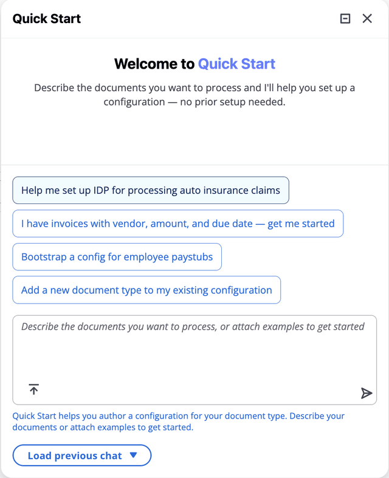

---
title: "Quick Start"
---

Copyright Amazon.com, Inc. or its affiliates. All Rights Reserved.
SPDX-License-Identifier: MIT-0

# Quick Start

**Quick Start** sets the application up for a new kind of document. It helps a
first-time user go from a plain-language description of their document type to a
working, active IDP configuration — entirely through
conversation, with no manual schema editing. It solves the "cold-start" problem:
a fresh deployment has no configuration tuned to *your* documents, and writing
one by hand means learning the [JSON-Schema document-class format](json-schema-migration.md)
first.

A conversational agent:

1. **Understands your document type** from a natural-language description (asking
   brief clarifying questions when needed).
2. **Reuses an existing template** when one fits — it searches the document
   classes already in your configuration profiles and adapts a close match rather
   than starting from scratch.
3. **Authors an extraction schema** and shows you the fields in readable form for
   review; you refine it in chat until it's right.
4. **Creates a configuration profile and makes it active**, so you can upload a
   document and start processing immediately — no trip to the Configuration page
   required. It also chooses how files are split into documents, whether long tables need
   the advanced extraction engine, and whether each document is summarized, from
   what you've told it.

For the **highest-fidelity** result, you can attach your own example documents in
the chat; they run through [Discovery](discovery.md), which infers schemas from
the *real* documents instead of a prompt-only draft, and saves them into a new
configuration profile of their own.

Quick Start is available two ways:

- **Web UI** — a Quick Start chat you open from the side navigation, the Welcome
  page or the end of the guided tour (gated by the `EnableQuickStartWidget`
  parameter, default `true`).
- **CLI** — `idp-cli bootstrap`, for scripted or headless cold-start.

> **Related:** Quick Start handles *setup* (schema + config). For questions about
> your processed documents, analytics, errors, or the codebase, use the
> [Agent Companion Chat](agent-companion-chat.md). To infer a config directly from
> real documents, see [Discovery](discovery.md). To improve an existing config's
> accuracy/cost, see the [Auto Optimizer](extensions/auto-optimizer.md) extension on
> the Extensions page.


https://github.com/user-attachments/assets/7096c812-08be-4716-ad37-7ae4f3797fa7


---

## Web UI

Quick Start is for **Admins**: it creates and activates a configuration profile,
which only an Admin may create (see [Role-based access control](rbac.md#permission-matrix)).
Other roles are not offered it, and the chat routes refuse a Quick Start message
from them.

When `EnableQuickStartWidget=true` (the default), an Admin can open Quick Start from:

- **The side navigation** — the **Quick Start** button at the top, on every page.
- **The Welcome page** — new users land on a Welcome screen with a **Quick Start**
  button (alongside *Take the tour* and *Enter IDP Console*). It explains the
  three common starting points: no config yet → Quick Start; already have a config
  → Configuration › View/Edit Configuration; want to test a document → Upload
  Documents.
- **The guided tour** — its last step points at the Quick Start button, and
  **Finish** opens it.

Quick Start opens as a floating panel over the page you are on. **Minimize** keeps
the conversation and leaves a round launcher in the corner to reopen it; **Close**
ends the conversation.



### A typical conversation

1. **Describe your document.** For example: *"I process California driver's
   licenses and need the license number, name, date of birth, and expiration
   date."*
2. **Review the draft schema.** The agent checks for a matching template, drafts a
   document-class schema, and lists the fields for you to confirm or change.
   Refining is cheap — iterate freely ("add the issuing state", "make expiration a
   date", "remove the address").
3. **(Optional) Start from a bundled sample.** If a curated
   [sample document](web-ui.md#upload-documents) of the same type exists, the
   agent links it inline so you can open the real document as a reference.
4. **(Optional) Attach an example document.** Use the upload control in the chat to
   attach your own document(s): PDF, PNG, JPEG, TIFF or WebP files, or a zip of
   them. One document runs through single-document Discovery and several, or a
   zip, through multi-document Discovery, in the background; the agent
   summarizes the discovered document types when they're ready. A schema inferred
   from a real document is higher-fidelity than a prompt-only draft.

   Discovery saves what it finds into a **new** profile named
   `quickstart-<date>-<time>-<code>` (UTC, with a short random code), one per
   conversation; documents you attach later in the same conversation go into that
   same profile. On a stack that has no profile of its own yet — `default` is
   active, and the only other profiles are the stack-managed presets it was
   deployed with — it becomes active straight away. Otherwise the agent asks
   before making it the active profile, because the active profile is what every
   new document on the stack is processed with.
5. **Processing options.** For the profile it saves, the agent decides three
   things from your description and any examples, and tells you in one sentence
   what it chose:

   | What the agent decides | Its choices | The setting it writes |
   |---|---|---|
   | How many documents a file holds | one (an invoice, a W-2, a statement) · several (a loan packet, a bundle of forms) · one per page (a stack of scanned receipts) | **Section splitting** under Classification › *Advanced — known document shape*: `disabled`, `llm_determined` or `page` |
   | Whether a document can hold a long table | yes (a bank statement, a transaction log, an invoice with pages of line items) · no | **Extraction mode** under Extraction: `advanced` or `simple` |
   | Whether to summarize each document | off unless you ask for summaries | **Enabled** under *Summarization (Optional)*: `true` or `false` |

   It asks one plain question only when it can't tell, such as *"Does each file
   hold one invoice, or can one file hold several documents?"* Simple extraction
   reads a document in one pass and can stop partway through a long list of rows;
   the advanced engine keeps every row, and takes longer and costs more per
   document, which is why it's used only where tables run long. If processed
   documents come out split wrongly or with rows missing, or you change your mind
   about summaries, tell Quick Start and it changes the setting; then process the
   documents again. Other extraction settings, such as models and prompts, are not
   something Quick Start changes: they're under **Extraction** on the Configuration
   page.
6. **Activate.** When you approve, the agent creates a configuration profile and
   **activates** it, then confirms it's ready. As with attached documents, it
   activates straight away only on a stack with no profile of its own yet;
   otherwise it names the profile in use and asks first. Upload a document from
   **Upload Documents** in the side navigation and it's processed with your new
   configuration.

The agent's own writes, processing options included, refuse `default` and
stack-managed profiles (presets the stack deployed, which a stack update replaces).
Documents you attach never reach an existing profile, because the panel always sends
them to the new one it named. The agent is instructed to add a class to another
existing profile only when you name that profile and ask it to; the refusal of
`default` and stack-managed profiles is what the code enforces.

You can review or switch configurations at any time from
**Configuration › View/Edit Configuration** (see
[Configuration Profiles](configuration-profiles.md)).

### Turning Quick Start off

Set `EnableQuickStartWidget=false` at deploy time to turn Quick Start off in the
web UI (for example, on a mature deployment where every user already has a tuned
configuration). The UI hides the side navigation button, the Welcome page's button
and its mention, the guided tour's last step, and the floating panel, and both chat
routes refuse a Quick Start message, so it cannot be reached by calling the API
directly either. `idp-cli bootstrap` does not go through the chat routes and still
works.

---

## CLI: `idp-cli bootstrap`

`idp-cli bootstrap` is the scriptable, headless equivalent. It authors a
document-class schema from your prompt (reusing a catalog match when one fits),
creates a configuration profile, and — when the optional document generator is
available — generates a small labeled synthetic **test set** attached to that
profile.

```bash
idp-cli bootstrap \
    --prompt "Invoices with vendor name, invoice number, date, and total amount" \
    --stack-name my-idp-stack
```

On success it prints the created configuration profile, the resolution tier
(`catalog_adapt` when it adapted a template, `pure_llm` when authored from
scratch), any catalog match, and — if the generator is installed — the test set id
and document count.

### Local mode (no save)

Omit `--stack-name` to author and **print** the schema as JSON without touching any
stack — useful for previewing what the agent would create before committing:

```bash
idp-cli bootstrap --prompt "Bank statements with account holder and transactions"
```

### Options

| Option | Description |
|--------|-------------|
| `--prompt`, `-p` | **(required)** Natural-language description of the document type. |
| `--stack-name` | Target CloudFormation stack. **Omit for local mode** (print schema, no save). |
| `--class-name` | Document class name to use as the schema `$id` / document type. |
| `--field-hint` | A field the schema must include. Repeatable: `--field-hint X --field-hint Y`. |
| `--config-profile` (alias: `--config-version`) | Existing configuration profile whose classes are searched for a template to adapt. Nothing is written to it. |
| `--target-profile` (alias: `--target-version`) | Configuration profile to create, or to add the class to (default: `bootstrap-<class>`). `default` and stack-managed profiles are refused. |
| `--count`, `-c` | Number of synthetic documents to generate (default: `3`). |
| `--threshold` | Generation quality threshold, 1–10 (default: `7`). |
| `--augment` | Apply scan/fax-style image augmentation to generated documents. |
| `--model-id` | Bedrock model id override for schema authoring / generation. |
| `--region` | AWS region (optional). |

> **Note:** Unlike the web UI, `idp-cli bootstrap` does not activate the created
> profile. Activate it from **Configuration › View/Edit Configuration** in the UI,
> or with the SDK, when you're ready to process documents with it.

---

## Synthetic document generation (optional)

Beyond authoring a config, Quick Start can generate a small **labeled synthetic
test set** — realistic sample documents plus ground-truth `result.json` — so you
can evaluate the configuration before you have real documents.

This capability is **optional and degrades gracefully**: schema authoring, config
creation, and activation always work. Only document generation requires the
generator, which is provided by the **Test Set Generator** extension. When it isn't
installed, the CLI and agent tell you so and continue without a test set — you can
upload your own documents instead.

- **In a deployed stack**, install the **Test Set Generator** extension from the
  **Extensions** page (Feature Platform). The Quick Start agent discovers it at
  runtime and offers generation only when it's present.
- **Locally**, install the generator alongside the library:
  `pip install -e "lib/idp_common_pkg[synthesis]"`.

Generation is slow (minutes) and costs money — roughly a few dollars and several
minutes per document at the default quality threshold, more at higher thresholds
— so the agent always confirms with a cost/time estimate before starting.

---

## How schema resolution works

1. **Catalog match.** Your existing configuration profiles' document classes are
   indexed and an LLM picks the single best match for your description (only when
   its confidence clears a threshold). A match seeds the authored schema; no match
   just means authoring from scratch.
2. **Authoring.** The schema is authored from your prompt (plus any `--field-hint`
   fields and the seed), producing a JSON-Schema document class in the standard
   IDP format.
3. **Configuration profile.** The new class is merged into the target profile (creating it
   if needed; default name `bootstrap-<class>`), replacing any class with the same
   id. `default` and stack-managed profiles are refused as targets. In the UI, the
   agent then activates the profile.
4. **(Optional) Test set.** If the generator is available, N documents are
   generated, their field names validated against the schema (extras pruned), and
   the packet is registered as a [test set](creating-custom-test-sets.md) named for
   the configuration profile.

---

## Requirements

- **Bedrock model access.** Schema authoring and catalog matching use a Claude
  model on Amazon Bedrock; request access before use (see
  [AWS Service Requirements](../README.md)).
- **Synthetic generation** additionally requires the Test Set Generator extension
  (deployed stack) or `idp_common[synthesis]` (local), as above.
