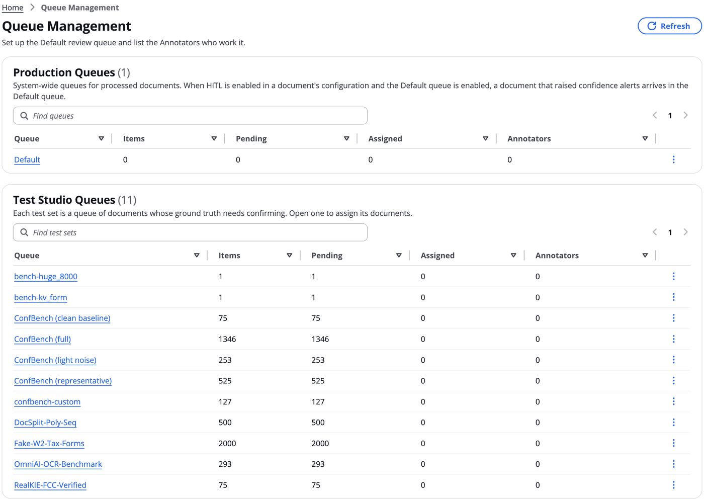

Copyright Amazon.com, Inc. or its affiliates. All Rights Reserved.
SPDX-License-Identifier: MIT-0

# Review Queues

## Table of Contents

- [Overview](#overview)
- [How a document reaches a queue](#how-a-document-reaches-a-queue)
- [How a review ends](#how-a-review-ends)
- [Regrouping pages in a review](#regrouping-pages-in-a-review)
- [Annotator guide](#annotator-guide)
- [Admin guide: Review Management](#admin-guide-review-management)
- [Reviewing from the document page](#reviewing-from-the-document-page)
- [Turning review queues on](#turning-review-queues-on)
- [Review status for downstream consumers](#review-status-for-downstream-consumers)
- [Limits and behaviour to know](#limits-and-behaviour-to-know)

## Overview

Review queues send documents to people before the documents finish. This is
HITL (human-in-the-loop) review, and it works in both BDA mode and Pipeline mode.
There are two kinds of queue:

- **Production** queues hold processed documents that a routing rule sent to
  review. A document waits in its queue along with the routing rule that sent it
  there, the reason that routing rule gives the reviewer, the policy rules the
  document failed and the confidence alerts it raised.
- **Test Studio** queues come one per test set, automatically. They hold the
  set's documents whose labels need a human check before they become ground truth.

An **Admin** assigns queue items to **Annotators**. An Annotator corrects the
item and finishes it with **Process Changes**, rejects it, or skips it to give it
back to its queue. An Admin can work
a Production item too. For a Production
document, the corrections are applied by a second run, which produces the
document's final outputs. The system decides where that run starts; the reviewer
does not choose a step (see [How a review ends](#how-a-review-ends)). For a
Test Studio document, they become the set's reviewed labels.

Queues are **system-wide**. Admins create and manage them in
**Review Studio › Review Management**; they aren't part of any Configuration Profile.
Which queue a document goes to is decided by the **routing rules** of its
configuration profile (see [Review Routing](./review-routing.md)). A profile with
no routing rules of its own uses the built-in ones, which send a document to the
**Default** queue when a section's extraction failed, when it raised confidence
alerts or when it left a required field without a value. A document is held only while Review Routing is on in its
configuration (`hitl.enabled`) and the Default queue is enabled. Queues have no
confidence threshold of their own: the alerts use each field's own threshold,
otherwise `hitl.confidence_threshold`. The Default queue is enabled on a new
stack, and a new stack turns Review Routing on in the profiles it creates (see
[The Review Routing switch](./review-routing.md#the-review-routing-switch)). While
Review Routing is off in a document's configuration, no document of that profile
is held. While it is on and the Default queue is off, documents keep the
document-page review flow (see
[When the Default queue is off](./human-review.md#when-the-default-queue-is-off)).

## How a document reaches a queue

1. The document is processed as usual (OCR, classification, extraction,
   assessment, policy rule validation).
2. The **Review Routing** step evaluates the routing table of the document's
   configuration, if Review Routing is on in it and the Default queue is enabled.
   The first routing rule whose conditions hold decides: it names a queue, or says
   the document needs no review. Routing rules can test extracted values, the
   classes of the document's sections, policy rule verdicts and more; see
   [Review Routing](./review-routing.md). With the built-in routing rules, the
   document is held in the Default queue when one of these is true:
   - a section's extraction failed without failing the document, so the section
     has no extracted data: Amazon Bedrock's content filter withheld the
     extraction model's reply, for example. Its review reason reads **Extraction
     failed**, and its details give the section and the section's
     `extraction_failed` issue message (see
     [Where a failed section shows up](./extraction-and-confidence.md#where-a-failed-section-shows-up)).
     This built-in routing rule is tried first, so the reason the reviewer reads
     says how many sections failed
   - a section raised a confidence alert: a field's confidence is under its own
     threshold (`x-aws-idp-confidence-threshold` in the class schema), or under
     `hitl.confidence_threshold` when it has none. Only a field with an extracted
     value can raise one; a field with no value does not
   - a field the class schema marks `required` has no extracted value, while
     `hitl.route_missing_required_fields` is on (the default). Its review reason
     reads **Missing required: <field>** (see
     [Absent values and missing required fields](./extraction-and-confidence.md#absent-values-and-missing-required-fields))
   - in BDA mode, the matched blueprint's confidence is under
     `hitl.confidence_threshold`, or BDA matched a blueprint but returned no
     usable confidence for it: null, NaN, infinite, `true` or `false`, a string
     that is not a plain number (including a percentage string such as
     `"95%"`), or a value that is still outside 0 to 1 after a bare number
     between 1 and 100 is read as a percentage (`95` reads as 0.95; `150` and
     `-0.2` are unscored). An unscored blueprint is held at every threshold, the
     same as in legacy HITL mode

   These are the same alerts the document page shows, and each one becomes an
   alert of the review item, as does each failed section. A document that a
   routing rule of your own placed can have no alert: its review item then shows
   the routing rule that placed it and that routing rule's reason. A routing table
   with no routing rule that tests the failed extraction count
   (`extraction_failed_count`) does not hold a document for a failed section.

   The document's status becomes `HITL_IN_PROGRESS`, and the machine output is
   kept as the run's manifest. The review item records the routing rule that
   placed it (**Routed by rule: …**), the reason for the reviewer (the routing
   rule's [reason](./review-routing.md#the-reason) with this document's values in
   it, or a generated one when the routing rule has none), the policy rules the
   document failed, and, when the routing rule's own queue was missing or
   disabled, why the document is in the Default queue instead. The reviewer reads
   all of it in the item's **Review Reason** panel (see the
   [Annotator guide](#annotator-guide)). Admins
   see the item waiting in Review Studio › Review Management.
3. An Annotator listed on the queue claims it, or an Admin assigns it to one (or
   works it themselves, see [Working an item as an Admin](#working-an-item-as-an-admin)),
   and the assignee ends the review (see [How a review ends](#how-a-review-ends)).

## How a review ends

| Action | Who | What happens to the document |
|---|---|---|
| **Process Changes** › **Complete review** | The item's holder, or an Admin | The corrections are kept and processing continues with them. The system decides where the run starts (see the table of runs below): policy rule validation runs again on the corrected values, the routing table is evaluated again, then summarization and evaluation run. The document ends `COMPLETED`, unless a routing rule sends it to a queue again (see [Reviewed documents and the placement limit](./review-routing.md#reviewed-documents-and-the-placement-limit)) |
| **Process Changes** › **Send back** | The item's holder, or an Admin | The review is withdrawn, and its corrections and any page regrouping are discarded. The document is processed again from classification (from the beginning in BDA mode), and is routed again when that run reaches the Review Routing step, so it can return to a queue |
| **Reject** | The item's holder, or an Admin | The document ends `REJECTED` with the machine output unchanged. A reason from the queue's reject reasons is required. Nothing runs afterwards: no summarization, no evaluation, no hook |
| **Skip** | The item's holder | The item goes back to its queue, unassigned and not finished, with a reason from the queue's skip list |
| **Remove from queue…** | An Admin | The document continues with the machine output, as if it had not been held: policy rule validation, summarization and evaluation run, and it ends `COMPLETED` |

**The dialog that finishes a review.** **Process Changes** saves your latest
edits and opens the **Finish the review** dialog. It asks one question, **How
does this review end?**, with two answers: **Complete the review** and **Send
back for reprocessing**. You choose the ending and nothing else. There is no step
to pick: the system decides where the run starts, from the document as it now is.

Under the choice, **Steps of the run** shows what the ending you chose will run,
before you confirm it:

- **Starts at**, with the step the run starts at.
- Every step of the document's processing mode, in pipeline order, each with what
  the run does with it: **Runs**, **Skipped** (the run does not do the step; a
  step before the start keeps what it produced) or **Not enabled** (the run
  reaches the step, and the document's configuration has it switched off).
- **Sections extracted again**, when completing the review extracts sections
  again, with the cause of each: *added*, *pages changed* or *no result*.

With **Send back for reprocessing** chosen, the dialog warns that the corrections
and any page regrouping are discarded and that the document is processed again
from classification (from the beginning in BDA mode), and takes an optional note,
which is kept in the review history. The button is **Complete review** or **Send
back**, for the ending chosen.

The list is read when the dialog opens. If it cannot be read, the dialog says so
and offers **Retry**, and the review can still be finished. If the document's
review was replaced while the dialog was open (for example because someone
reprocessed the document), a send-back is refused and the dialog says so.

**What each run does:**

| Run | Starts at | Steps it does |
|---|---|---|
| First run of a document | The beginning | Every step up to Review Routing. A held document stops there |
| After **Complete review**, when no section has to be extracted again | Apply Review Changes | Apply Review Changes, policy rule validation, Review Routing, summarization, evaluation |
| After **Complete review**, when a section has to be extracted again (Pipeline mode; see [Regrouping pages in a review](#regrouping-pages-in-a-review)) | Extraction, for those sections | Extraction and assessment of those sections, then Apply Review Changes, policy rule validation, Review Routing, summarization, evaluation |
| After **Reject** | — | None. The document is recorded as `REJECTED` |
| After **Remove from queue…** or **Skip All Reviews** | Policy rule validation | Policy rule validation, Review Routing (which does not hold the document again), summarization, evaluation |
| After **Send back** | Classification in Pipeline mode, the beginning in BDA mode. A document whose page text or images are missing starts at the beginning | That step and every step after it |

In BDA mode a completed review always starts at Apply Review Changes: one Bedrock
Data Automation call produces a document's sections and values, so no section is
extracted again on its own.

Pipeline hooks fire for the steps a run does. On the run after a completed
review the hooks of OCR and classification do not fire, `postExtraction` fires
only for a section that run extracts again, and `postRuleValidation` fires again:
it also fired before the document was held. A sent-back document fires the hooks
of every step its new run does. See
[When hooks fire](./feature-platform.md#when-hooks-fire).

## Regrouping pages in a review

**Edit Page Grouping**, on the queue item's **Document Editor** panel, corrects how
the document is split into sections as part of the review. When you then complete
the review, the system compares the document's sections with the ones it had when
it was placed in the queue, and extracts again each section that needs it:

| Cause shown in the dialog | The section |
|---|---|
| *added* | did not exist when the document was placed in the queue |
| *pages changed* | does not have the pages it had then |
| *no result* | has no extracted values |

- **The other sections keep their extracted values** and your corrections, and are
  not extracted again. A section whose class is marked as excluded is left as it
  is.
- **Your corrections to a section that is extracted again are applied afterwards.**
  The run extracts the section first, then sets each value you changed on the new
  result. A correction is not applied when its field is not in the new result (a
  row of a list that the new extraction does not have, for example), and a value
  you removed is not removed from the new result.
- **A section that was extracted again is not confirmed by a reviewer**, because
  nobody has seen its new values. It keeps the confidence alerts and missing
  required fields that your corrections did not answer, and the document does not
  count as reviewed when the routing table is evaluated again. A routing rule,
  the built-in ones included, can therefore place the document in a queue again.
  Each such placement counts toward the
  [placement limit](./review-routing.md#reviewed-documents-and-the-placement-limit).
- **A section you remove takes its draft with it.** The corrections saved for it
  are deleted when the page grouping is saved.
- **In BDA mode the page grouping cannot be changed in a review.** Edit Page
  Grouping is disabled with the reason *Page grouping cannot be changed for a
  document processed with Bedrock Data Automation (BDA). Field values can still be
  edited.*, and the server refuses the change. On an item that was sent to review
  by hand the button can be enabled; the server then refuses the save. Field
  values are corrected as in Pipeline mode.

The item's holder can regroup it, an Annotator it is assigned to or an Admin; an
Annotator claims an unassigned item first, and an Admin's first regroup assigns an
unassigned item to them. Changing a section's class isn't available for Production
documents in review.

## Annotator guide

An Annotator-only user, and a Reviewer with no Admin, Author or Viewer role, sees only
**Home** (**Inbox**, **Tasks** and **Queues**), **Deployment Info** and the
notifications bell, lands on Home › Tasks, and opens a document through its edit page
(`#/documents/<document>/edit`), from Tasks, Queues or an Inbox message. Every user has **Home › Inbox** and the bell; **Tasks** and
**Queues** are there for Annotators and Reviewers. A Reviewer works every Production
queue, with no Admin assignment needed, and no Test Studio queue: Test Studio queues
are worked by Annotators, Admins and Authors. **Reviewers find their work in Home ›
Queues and Home › Tasks, not in the Document List**, which is no longer in their
navigation.

Every item is held to your configuration scope (`allowedConfigVersions`): an item whose
profile is outside it is not listed in any queue or in Tasks, is not counted in a
queue's item counts, oldest-item age or your claim count, is skipped by **Claim
next**, and can't be opened, claimed, saved, skipped, finished or rejected — even one
you already hold, if your scope has been narrowed since.

- **Queues** lists the Production and Test Studio queues you're listed on (a queue's
  **Eligible Annotators**), or, for a Reviewer, every Production queue. Open one to see its items. You can open any item
  read-only, and **Claim** one that nobody holds: it's assigned to you and appears
  in your Tasks. On a Test Studio queue you can also select several documents
  nobody holds and choose **Claim (n)** to take them all at once; any that another
  Annotator took first are listed and left with them. Items someone else holds stay
  view-only.
- **Tasks** lists everything assigned to you, whether you claimed it or an Admin
  assigned it: Production review items and Test Studio documents, each with its
  **Document**, **Queue**, **Age** and **Reason**. Its badge counts both. You get
  an Inbox message when an Admin assigns you work.
- **Reason**, in Tasks and in a queue's **Documents** table, says in a few words
  why the item is in review: the reason its routing rule gives, otherwise its
  first confidence alert (with how many more there are), otherwise the routing
  rule that placed it. The number of policy rules the document failed follows it.
  A long reason is shortened, and choosing it shows the whole text.
- Both tables have **Preferences** (the gear icon): the **Page size**, and
  **Column preferences**, which chooses the columns shown. Tasks can also show
  **Source** and **Priority**; a queue's table can also show **Source**,
  **Priority** and **Age**. **Document** is always shown. The choice is kept in
  the browser, for each of the two tables.
- In a queue's items and in Tasks, a document is named by the shortest end of its key
  that tells it apart from the other rows, so two `invoice.pdf` files in different
  folders show as `folder-a/invoice.pdf` and `folder-b/invoice.pdf`. A long name is
  shortened in the middle, and the full key is shown on hover.
- Select an item to open it in the **edit page**. Production items, Test
  Studio items and direct edits of a document all use the same edit page, whether
  you open them from Tasks, an Inbox message or Review Management. A Production item
  opens at its document's edit page, `#/documents/<document>/edit`, which shows the
  item while the document is in review; a Test Studio item is at
  `#/review-queues/test-sets/<id>/items/<document>`. `?section=`, `?field=` and
  `?view=source` work on both, and an older `#/review-queues/items/<document>` link
  opens the document's edit page with the same query.
  - The actions are in one bar at the top, left to right: **Edit | View**, the
    **Reports** menu (**History**, **Summary**, **Policy Rule Validation Summary**,
    **Processing Report**), the **More
    Actions** menu (**Use As Evaluation Baseline**), then **Skip**, **Reject** (on a
    Production item), **Cancel**, **Save** and **Process Changes** last (or **Reports** and **Claim**, for
    an Annotator viewing an unassigned item). A button that doesn't apply is left out.
    A menu item that doesn't apply yet stays in its menu, disabled, with the reason on
    hover: **Summary** and **Use As Evaluation Baseline** wait for a finished document (a
    direct edit of a processed document, or a queue item whose review is complete),
    **Policy Rule Validation Summary** is disabled for a document that has no such
    report, and
    the baseline copy is listed only for Admins and Authors. Test Studio items have no
    Summary, Policy Rule Validation Summary or baseline, since their labels already are the baseline. The info icon opens a panel describing the
    screen. **View** shows the original file in the editor's place; unsaved edits are
    kept while it is shown.
  - The title is the document's name followed by its status in parentheses, in the
    subtitle's text style, for example `insurance_package-1.pdf (Claimed)`, and the
    full object key is under it.
  - The **Document Editor** panel holds the editor: the page images beside the
    fields, with a **Section** dropdown at its top left (for a document with more
    than one section) listing each section with its class, for example
    **Section 1 (Letter)** and **Section 2 (Form)**.
  - **History** has two tabs. **Field Edits** and **Review Activity** are tables
    of the same shape, newest first. **Field Edits** has a row for every field a
    save changed in the open section: **When**, **By**, **Field**, **From** and
    **To**, plus **Applies to** (prediction or baseline) when a baseline was edited.
    Every save that changes a field records it, including a Production draft
    autosave and a Test Studio label save. **Review Activity** lists who claimed,
    was assigned, skipped or completed the item, with any skip reason and note. For
    a Production item it also lists the routing rule that placed it and its reason
    (**Routing rule: …**, **Routing reason: …**), for a completed review the step
    the run after it starts at and the sections it extracts again (**Run starts
    at: …**, **Sections extracted again: …**), a send-back with its start step and
    note, and a document that reached the placement limit.
  - **Policy Rule Validation Summary** shows the policy rules the document passed
    and failed, with the reason for each. It is the whole report; the Review Reason
    panel lists the failed policy rules only.
  - **Processing Report** shows how the open section was extracted.
  - **Cancel** leaves the item without finishing it. If the open section has
    unsaved edits, it asks before discarding them; anything already saved, such as
    a Production draft, is kept.
  - **Production item**: above the editor, the **Review Reason** panel says why
    the document is in review. Its header counts what it lists: the routing notice,
    the alerts and the failed policy rules.
    - **The routing notice** comes first. Its heading names the routing rule that
      placed the document, **Routed by rule: …**, or reads **Routed by the default
      outcome**. Under it is the **reason**: what the routing rule's author wrote
      for the reviewer, with this document's values in it, or a generated sentence
      when the routing rule has no reason (see
      [The reason](./review-routing.md#the-reason)). A long reason shows its
      beginning, with **Show more** and **Show less**. When the document is in the
      Default queue because the routing rule's own queue was missing or disabled,
      the notice says so.
    - **Failed policy rules (n)** follows, when policy rule validation gave the
      document failed policy rules, whichever routing rule placed it. The first
      three are listed, each as the policy rule's name, its policy and the reason
      policy rule validation gave. A long reason is shortened: choose it to read
      the whole text and the pages it cites. A failed policy rule with no reason
      reads *No reason was given.* When more failed than are listed, **Show all n
      failed policy rules** opens a dialog with the columns **Policy rule**,
      **Policy**, **Reason** and **Pages**. The review keeps the first ten failed
      policy rules; the dialog says when the document failed more, and **Reports ›
      Policy Rule Validation Summary** has all of them.
    - **The alerts** are listed worst first, each as its own yellow chip: the
      confidence alerts, the required fields that have no value and the sections
      whose extraction failed (**Extraction failed**). The five
      lowest-confidence alerts are shown; **+N more alerts** lists the rest and
      **Show fewer** collapses them again. Hover a chip to see the field, the score
      and the threshold; choose it (or press Enter on it) to move to that field.
      **Next alert**, in the Review Reason header, steps through the alerts' fields
      in turn.

    Your edits are saved as a draft as
    you type, or straight away with **Save**. **Process Changes** saves
    your latest edits and opens **Finish the review**, where you choose **Complete
    review** or **Send back** and see the steps each ending runs (see
    [How a review ends](#how-a-review-ends)).
    **Reject** asks for a reason from the queue's reject reasons and an optional
    note, and ends the document as rejected; it is disabled, with the reason on
    hover, when the queue lists no reject reasons. The editor opens with **Show
    Fields** set to **Confidence alerts only** when the item has alerts. **Edit
    Page Grouping**, on the **Document Editor** panel, corrects
    how the document is split into sections as part of the review: the board shows every section of
    the document. The extracted values and your drafts stay with the sections you
    leave as they are; a section you add, or whose pages you change, is extracted
    again when you complete the review, and your saved corrections are applied
    afterwards (see [Regrouping pages in a review](#regrouping-pages-in-a-review)).
    In BDA mode it is disabled with the reason.
  - **Test Studio item**: correct the labels and choose **Process Changes**, which
    saves the open section, applies every section and reprocesses the document's
    review copy. Authored ground truth has no review copy, so for it **Process Changes** only
    marks the labels reviewed. You can also choose it without
    changing anything, which confirms the labels as correct. Editing is
    draft-first: the fields are editable with no step to start, and **Save** keeps
    the open section's changes as a draft, which is not reviewed and opens no
    version: any later session, and the next assignee after a **Skip**, opens the
    document with it. **Process Changes** applies the drafts and marks the
    sections reviewed, and leaves once the server counts the document reviewed.
    When no draft version of the set is open, it first asks **Open a new version
    and save ground truth**, because it opens the next version of the set (the
    current one stays as it is); while one is open, the header shows a
    `v{base} → v{draft}` badge and it runs at once. A document with confidence
    alerts opens on them, and its notice offers **Next alert** to step through the
    open section's alert fields. Switching sections with unsaved changes asks first.
    **Edit Page Grouping** opens the page-grouping board in a dialog, where each section's
    pages and class are changed; there is no separate class dropdown. After a class
    change, the section offers **Re-extract**, so its fields match the new class; on a document with several sections it re-extracts
    that section only and leaves the others as they are. Versioning works exactly
    as in Test Studio.
  - **Skip**, on either kind of item assigned to you, gives it back: it leaves your
    Tasks and goes back to its queue unassigned, where another Annotator can claim
    it. It isn't finished, and a Production item's draft is kept. Choose a reason
    from the queue's skip list and optionally add a note; both are recorded with the
    skip (in a Production item's review history).
  - The breadcrumbs read **Home**, then the item's queue or test set (linking to its
    page), then the document, for every role, and **Home** alone while the item is
    loading. An item that can't be read shows an error with **Retry**; one whose
    queue doesn't list you says so, with a link to **Home › Queues**.
- When you complete an item, it leaves your Tasks and the queue's progress counts it
  as completed. The server takes a draft save or a skip only from the item's
  assignee, and a complete, a reject or a send-back from the assignee or an Admin.
- An assignment doesn't expire. If the queue's time limit passes while the item is
  still open, you get one **still to complete** reminder in the Inbox.

Changing a section's class isn't available for Production documents in review.
Regrouping pages is, from the queue item, in Pipeline mode (see
[Regrouping pages in a review](#regrouping-pages-in-a-review)).

## Admin guide: Review Management

**Review Studio › Review Management** is visible to Admins only. It has two tables,
**Production Queues** and **Test Studio Queues**, shown one at a time: the **Production
| Test Studio** switch beside **Refresh** chooses which, and only the table shown is
kept up to date. A queue's breadcrumbs (**Review Studio › Review Management › {queue}**)
lead back to the table it is in. Both tables have the same columns: **Queue**,
**Items**, **Pending**, **Assigned**, **Annotators** and an actions menu. A queue's
other settings, such as its priority and Enabled switch, are in its **Settings**. The
info icon opens a panel describing the page.

Above the **Production Queues** table, the page warns when documents are not being
held for review:

| Warning | Shown while | What it offers |
|---|---|---|
| *Review Routing is off in the active configuration profile, so no document is held for review. Turn it on in the profile's Processing Settings, on the Configuration page.* | The Review Routing switch of the active configuration profile is off | A link to **Configuration** |
| *The Default review queue is off, so routing rules are not evaluated.* | The Default queue is disabled | **Open Default queue settings**, which opens that queue's settings, where it is turned on |

A state the page could not read shows no warning. The first warning is about the
active profile only: the queues hold items of several profiles, and each profile has
its own switch (see
[The Review Routing switch](./review-routing.md#the-review-routing-switch)).

**Who the Annotators are.** Work can be assigned only to members of the Cognito
**Annotator** group, the same group that authorizes the Annotator's API calls. A user
joins it when User Management gives them the Annotator role, or when the external
identity provider maps them to it (`ExternalIdPAnnotatorGroupName`, see
[external-idp.md](./external-idp.md)). A user may hold Annotator alongside another
role, Admin for example. A queue's **Eligible Annotators** setting is which Annotators
work it:
only the Annotators listed there see the queue in Home › Queues, can claim its
items, and can be assigned them. Reviewers are not listed and not assigned work: each
Reviewer works every Production queue, sees all of them in Home › Queues, and claims and
finishes their items without an Admin, within their configuration-profile scope. A queue with nobody listed has no Annotators until
you add some. Listing an Annotator on a Test Studio queue also gives them access to
that test set. A user added to the group in Cognito directly can be listed at once:
their User Management record is created when they're first given a test set.

Each row's actions menu offers **View** and **Settings**; a production queue also
offers **Delete**. Each queue's page has a **Settings** button too.

If another Admin saves a production queue's **Settings** while you have them open,
your **Save** is refused rather than overwriting their change: the dialog says the
queue was changed by someone else, and **Reload queue** fills it with the current
settings so you can make your change again. Reloading replaces what you had entered.
Through the API, send back the `version` that `listReviewQueues` returned with
`updateReviewQueue`; a stale one is refused with `QUEUE_CHANGED`. An update that sends
no `version` (an older client) replaces whatever is stored when it is made, and is
refused only if another save lands while it is being written.

### Creating a queue

**Production queues** are created, edited in **Settings** and deleted here.
**Create queue**, above the **Production Queues** table, opens the queue form. A
new queue receives documents once a routing rule names it: add the routing rule on
the **Routing Rules** tab of a configuration profile (see
[Review Routing](./review-routing.md)), or create the queue with the CLI
(`idp-cli review-queues create`) or the SDK (`client.review_queues`). Each queue
has:

| Setting | Meaning | Default |
|---|---|---|
| Id | Lowercase letters, digits, `_`, `.` and `-` (up to 64 characters). Routing rules, links and the API refer to the queue by its id, and it cannot be changed after the queue is created | — |
| Name, description | What Admins and Annotators see; the name defaults from the id | — |
| Priority | Higher-priority queues are listed first, and **Next item** takes from them first (0–100) | `50` |
| Time limit | Minutes after which an Annotator with an open assigned item gets a reminder (1–10080). For information: one reminder is sent, and the item stays assigned | `60` |
| Eligible Annotators | The Annotators who work this queue: they see it, claim its items and can be assigned them. Reviewers work every Production queue without being listed, and claim their own items. Empty means no Annotators (Admins and Reviewers only). Taking an Annotator off the list stops them seeing the queue and claiming from it; items they already hold stay assigned to them until they finish or release them, or you unassign them. A change can take up to 30 seconds to apply everywhere | empty |
| Enabled | When off, no documents are added to the queue: a document a routing rule sends to it goes to the Default queue instead. While the Default queue is off, no document is held for review at all | on |
| Skip reasons | The reasons an Annotator chooses from to give an item back unfinished, one per line (up to 20) | Needs expert review; Document unclear or incomplete; Conflict of interest; Out of time; Other (see note) |

A saved change shows at once on the queue's page, including its name in the title and the breadcrumb, and in Review Management.

The **Default** queue is created automatically, enabled and with nobody listed, and
it is created again if it is ever missing; a Default queue that already exists keeps
its settings. Add Annotators in **Settings**; see
[Turning review queues on](#turning-review-queues-on). It is the only queue that
can't be deleted. The built-in routing rules send documents to it, and so does a
routing rule whose own queue is missing or disabled. Items also reach a queue when
an Admin moves them there.

**Routing rules that use this queue**, on a queue's page, lists the configuration
profiles whose routing rules (or default outcome) send documents to the queue,
each with a link to that profile's Routing Rules tab, and says whether the routing
rule is in the configuration new documents run or in a newer revision that is not
published. The confirmation for deleting a queue shows the same list: documents
those routing rules send afterwards go to the Default queue.

**Upgrading.** See the
[v0.6.15 → v0.6.16 migration page](./migration-v0615-to-v0616.md) for what changes
for documents in review during an update.

Deleting a queue that still holds items moves them to the Default queue, and
the confirmation says how many will move:
open and assigned items become unassigned there (an assignee is told), and items
still waiting for their first run to finish are activated in Default. Deleting is
refused while one of the queue's items is being finalized; try again a minute later.
The queue is deleted before its items move, so a delete that is refused has moved
nothing. If one stops part-way, the queue stays listed as no longer defined while
it still holds open or assigned items, and deleting it again moves them; items
still waiting for their first run are activated in Default either way.
An **Escalation** queue that an earlier release created is an ordinary queue and can
be deleted.

Both tables, **Production Queues** and **Test Studio Queues**, show for each queue:

| Column | Meaning |
|---|---|
| Documents | Everything in the queue (for a test set, its documents) |
| Pending | Not yet assigned |
| Assigned | Assigned to an Annotator, whether or not they've started on it |
| Annotators | How many Annotators are listed in the queue's Eligible Annotators (the names on hover). A change in Settings shows as soon as the dialog closes |

The top of each queue's page, **Queue Progress**, is a bar of the documents an
Annotator is working on: assigned or in progress, of all the queue's documents (a
finished document leaves the queue). **Key Metrics** below it shows **Pending**,
**Assigned** (not started yet), **In Progress** (the Annotator has saved work),
**Annotators** (how many are listed) and **Priority**. The **Annotators** table lists
each listed Annotator, and anyone still holding the queue's documents, with how many
documents each is assigned. The **Documents** table shows each item's **Document**, **Queue**,
**Reason** (why it is in review: its routing rule's reason, or its first alert, and how
many policy rules the document failed), **State** and **Annotator** (who it is assigned
to; sortable), with its actions in the row menu. **Source**, **Priority** and **Age** can
be added in the table's **Preferences** (the gear icon), which also sets the page size;
the choice is kept in the browser. The info icon opens a panel describing the page.

To work a queue, open its page, select items, and choose **Assign to…** or **Unassign**
above the **Documents** table, or one of the actions in its **More actions** menu, grouped
as **Queue** (**Move…**, **Remove from queue…**) and **Skip reviews** (**Skip All Reviews
(N)**, **Skip All Reviews by profile…**):

- **Assign to…** picks one of the queue's Annotators. The item appears in their Tasks and
  they get an Inbox message. Assigning an item that already has an assignee
  reassigns it.
- **Unassign** returns the item to the queue. Its draft is kept, and the former
  assignee is told.
- **Move…** sends the item to another queue. It is unavailable when there is no
  other queue.
- **Remove from queue…** (for items waiting or assigned) asks for confirmation and
  an optional note, then takes the item out of review: the document ends `COMPLETED`
  with its machine output, no draft is applied, and the review status object is
  deleted. An assignee is told. The note is optional and is kept in the item's
  history.
- **Skip All Reviews (N)** and **Skip All Reviews by profile…** finish items with their
  machine output, like Remove, but with a required reason, and are recorded as
  **Skipped (Skip All Reviews)** in each item's history. Reviewers have them too, for
  items waiting for review and their own claims; an Admin can skip any waiting or
  assigned item. See [bulk Skip All Reviews](human-review.md#skip-all-reviews-for-many-documents).
- An item that someone created with **Send to review** shows **Sent to review** with
  its reason in the item's **Review Reason** panel; it is worked like any other item.
  See [Send to review](human-review.md#send-to-review).

**Test Studio queues** come from test sets: each test set is a queue, created and
deleted with the set. Its page shows **Queue Progress**, a bar of the documents completed,
and **Key Metrics**: **Status** (percent of documents completed), **Pending**,
**Assigned** and **Annotators**, then the label-accuracy estimate (**Estimated label
accuracy** and **Evidence**) once there is one. For an Admin, the **Annotators** table
follows, as on a Production queue's page. Below that are the
draft-labeling status, the ground-truth version being annotated toward, and every
document, worst first, with columns **Document**, **Labels**, **Confidence** and
**Annotator** (who it is assigned to). Sorting by **Annotator** groups each person's
documents, worst first within each, with unassigned documents last. The document list filters to
**All documents**, **Assigned** or **Not assigned**, and opens on **Not assigned**,
which is exactly the documents that can still be claimed.
Each row's menu offers **View** (the source document), **Edit**, and for Admins
**Assign** and **Delete** (removes the document from the test set, after a
confirmation). An Admin can also select several documents and choose **Assign to…** to
give them all to one Annotator, or **Unassign** to take them back. Every document can be
assigned, including authored ground truth: the Annotator checks or corrects its
labels and completes it. A document with no labels yet needs draft labels first.
Assigning a document also gives the Annotator access to that test set.

A Test Studio queue's **Settings** are the production settings less the id, name
and Enabled switch (its documents come from the set, not from the pipeline): description, priority, time limit (the reminder), skip
reasons and Eligible Annotators. They are kept with the test set.

A Test Studio queue loads quickly because each document's summary (label source,
alert count, lowest confidence, classes, sections, assignee, reviewed) is kept in
DynamoDB, in the stack's `HITLTable`, while the labels and documents stay in S3. The
queue page reads only the summaries; it never reads a set's labels. Review Management
lists every test set in one call from the counts stored with each set (documents,
reviewed, assigned), refreshed every 20 seconds; a set still being summarized shows
**Preparing…** in its counts.

The summaries are built in the background, by the same Lambda that copies documents
into a test set:

- when documents are copied into a set, at the end of the copy;
- when a set has none yet, or its labels were cleared, reset or removed as a whole.
  Opening Review Management or the queue page requests the build.

While a build runs, the queue page says **Preparing this queue** and refreshes
itself until it finishes. A large set takes a few minutes once. A single
document's summary is updated when its labels are saved, when it is re-extracted,
and when a draft-labeling run writes its draft.

### Working an item as an Admin

Open an item from its queue's page. Its breadcrumbs read **Home**, then the queue's
name, then the document, and the queue links back to its page.

- **An unassigned item** says **Not assigned yet. Editing it, or choosing Process
  Changes, assigns it to you.** You can edit it straight away: your first saved edit, or **Process Changes**, assigns the item to you first. If an Annotator claimed it a moment earlier, the
  screen says who and turns view-only.
- **An item assigned to someone else** is view-only, with **Take over**. Taking over
  assigns the item to you, keeps its draft so you carry on from the Annotator's
  edits, and tells the former assignee in their Inbox. Then you can edit and
  reprocess it.
- **An item assigned to you** has **Process Changes** and **Skip**, as for an Annotator.

## Reviewing from the document page

While a document is in a review queue (status **In Review**), it is reviewed from
its queue item:

- The document page's **Review Owner** is the queue item's assignee: it is filled in when
  the item is claimed, assigned, reassigned or taken over, cleared when it goes back to
  the queue, and kept once the review finishes. **Review Completed By** is whoever
  finished it, filled in once its corrections have been applied.
- The document page's **Edit** and **Edit Data** in a section row's **⋮** menu open the document's
  edit page, which shows the queue item for Admins, Annotators and Reviewers, the roles
  that can open queue items. For other roles it opens the direct edit, read-only, saying the
  document is edited in its queue.
- The document page's change actions (**More Actions** › **Edit Page Grouping**,
  **Re-extract Sections**, **Edit Page Text**, **Reset Page Class**, **Use As Evaluation
  Baseline**) are disabled, with the reason that the document is in a review queue;
  correct and regroup the document from its queue item. The server refuses the same
  changes too: a regroup by anyone but the queue item's holder, and processing changes
  on a document in review. **Skip All Reviews** is shown disabled with the reason
  that the document is in a review queue, and **Start Review** isn't offered; skip
  queue items in bulk from the queue's page or the Document List's **Review** menu.
  A direct upload of the
  document's section results (`uploadDocument`) is refused as well, with
  `QUEUE_MANAGED`.
- In the document list, the **In Review** status links to the document's edit page
  for Admins and Annotators.

Once the review finishes, the document page can be edited as usual. The edit page's **Process Changes**
on a finished review is refused to every caller who is not an Admin; for an Admin it
doesn't mark the review completed again or replace the reviewer the queue recorded.

## Turning review queues on

1. **Give people the Annotator role** in **User Management**, which adds them to the
   Cognito Annotator group. With an external identity provider, you can map a group
   instead with `ExternalIdPAnnotatorGroupName` (see [external-idp.md](./external-idp.md)).
   An Annotator's `allowedConfigVersions` limits which profiles' Production items they
   can see and work: a queue holds items of several profiles, and each item's own
   profile decides, in the queue lists as when it is opened or claimed.
2. **Check that Review Routing is on** in each Configuration Profile whose documents
   should be reviewed (`hitl.enabled`; **Configuration › Processing Settings ›
   Review Routing (Optional)** › **Review Routing**), and set
   `hitl.confidence_threshold`, the threshold for fields with none of their own. A
   new stack turns Review Routing on in the profiles it creates; a stack update
   leaves each profile as it is (see
   [The Review Routing switch](./review-routing.md#the-review-routing-switch)).
3. **Check the Default queue.** In **Review Studio › Review Management**, open the Default
   queue's **Settings**, make sure **Enabled** is on, and list the **Eligible
   Annotators**. A change applies to documents processed after it (definitions are
   cached for about 30 seconds).
4. **What decides routing.** The profile's routing rules decide it (the
   **Routing Rules** tab; see [Review Routing](./review-routing.md)). With the
   built-in routing rules, a failed section, the confidence alerts and the missing
   required fields decide. The alerts use a field's own
   threshold in the class schema (`x-aws-idp-confidence-threshold`), otherwise
   `hitl.confidence_threshold`, the same thresholds that drive the alerts and field
   highlights (see [extraction-and-confidence.md](./extraction-and-confidence.md)).
   Without confidence scoring, only BDA's blueprint confidence raises an alert.
5. **More queues (optional).** Create a queue, list its Annotators, and add a
   routing rule that sends documents to it.

Turning the Default queue off, or Review Routing off in a profile, stops new
documents from being queued; items already
in review stay there and can be finished. **Review Management** warns Admins of
both (see [Admin guide: Review Management](#admin-guide-review-management)). Headless deployments have no review queue
resources and always use the legacy HITL flow.

## Review status for downstream consumers

Each routed document has one status object,
`s3://<OutputBucket>/<documentKey>/review/status.json` (schema version `1.1`).
Its `status` is `in_review` at first, then `complete` or `rejected`, and its
`routed_by` names the routing rule that placed the document (`table_id`,
`rule_id`, `rule_label`, `placed_queue`, `fallback_reason`) and says what its
reviewer is told: `reason` and `reason_source`, and the policy rules the document
failed (`policy_failures`, `policy_failure_count`). The reason can hold extracted
values. When an Admin removes the
document from review, or its review is withdrawn, the object is deleted. It is written **last**, after
the tracking status, the reporting rows and the final manifest. The OutputBucket
sends S3 events to EventBridge, so a consumer can trigger on that key instead of
polling for `COMPLETED`. The SDK and CLI report the same value as `review_status`.
The full contract, including the schema, the ordering, `sequence` and an
EventBridge rule pattern, is in the
[review queues module README](https://github.com/aws-solutions-library-samples/accelerated-intelligent-document-processing-on-aws/blob/develop/lib/idp_common_pkg/idp_common/review_queues/README.md#review-status-contract).

A batch watched with `idp-cli run-inference --monitor` or `idp-cli status --wait`,
or polled through the SDK's `batch.get_status`, counts a document held in a queue
as **awaiting review** and stops waiting once nothing else is queued or running.
See [IDP CLI](./idp-cli.md#process--run-inference) and
[IDP SDK](./idp-sdk.md#batchget_status).

## Limits and behaviour to know

- `REJECTED` is a terminal status, but it isn't success: the SDK counts it as
  failed and the CLI exits 1.
- A reviewed document runs policy rule validation twice: before it is held, so
  that routing rules can read the verdicts, and again on the corrected values.
- Hooks fire for the steps a run does. The hooks before the review point
  (preprocessing, post-OCR, post-classification, post-extraction) fire on the
  first run and not on the run after a completed review, except that
  `postExtraction` fires for each section that run extracts again;
  `postRuleValidation` fires on the first run and again after a completed review.
- Reprocessing, aborting or deleting a document in review withdraws its review and
  deletes the status object. So does sending it back.
- Documents processed by a Test Studio run are never held in a production review
  queue, whatever the Default queue's settings. Test runs are scored on the machine's output,
  and their documents are reviewed in the test set's own queue instead.
- The legacy Document List **Start Review** flow is separate from review queues and
  works as before for users who have the Document List. A Reviewer with no Admin,
  Author or Viewer role works from Home › Queues and Home › Tasks instead.
- The Integration API and IDP Monitor don't yet distinguish review states.
