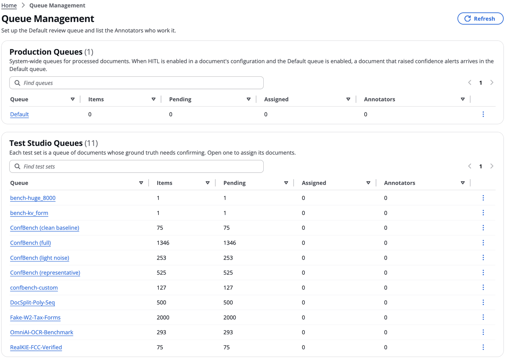

# Review Queues

Copyright Amazon.com, Inc. or its affiliates. All Rights Reserved.
SPDX-License-Identifier: MIT-0

## Table of Contents

- [Overview](#overview)
- [How a document reaches a queue](#how-a-document-reaches-a-queue)
- [Annotator guide](#annotator-guide)
- [Admin guide: Queue Management](#admin-guide-queue-management)
- [Reviewing from the document page](#reviewing-from-the-document-page)
- [Turning review queues on](#turning-review-queues-on)
- [Review status for downstream consumers](#review-status-for-downstream-consumers)
- [Limits and behaviour to know](#limits-and-behaviour-to-know)

## Overview

Review queues send documents to people before the documents finish. This is
HITL (human-in-the-loop) review, and it works in both BDA mode and Pipeline mode.
There are two kinds of queue:

- **Production** queues hold processed documents that raised confidence alerts. A
  document waits in its queue along with the reasons it is there.
- **Test Studio** queues come one per test set, automatically. They hold the
  set's documents whose labels need a human check before they become ground truth.

An **Admin** assigns queue items to **Annotators**. An Annotator corrects the
item and finishes it with **Process Changes**, or skips it to give it back to its
queue. An Admin can work
a Production item too. For a Production
document, the corrections are applied by a second (finalize) run, which produces
the document's final outputs. For a Test Studio document, they become the set's
reviewed labels.

Queues are **system-wide**, and they are managed only by Admins in
**HITL › Queue Management**; they aren't part of any Configuration Profile.
Production documents go to the **Default** queue. A document is routed there when
HITL is enabled in its configuration (`hitl.enabled`), the Default queue is enabled,
and the document raised confidence alerts. Queues have no confidence threshold of
their own: the alerts use each field's own threshold, otherwise
`hitl.confidence_threshold`. The Default queue is enabled on a new stack. While HITL
is off in a document's configuration, or the Default queue is off, documents keep
the existing [Human-in-the-Loop review](./human-review.md) flow.

## How a document reaches a queue

1. The document is processed as usual (OCR, classification, extraction,
   assessment).
2. If HITL is enabled in the document's configuration and the Default queue is
   enabled, the document is held in the Default queue when either of these is true:
   - a section raised a confidence alert: a field's confidence is under its own
     threshold (`x-aws-idp-confidence-threshold` in the class schema), or under
     `hitl.confidence_threshold` when it has none
   - in BDA mode, the matched blueprint's confidence is under
     `hitl.confidence_threshold`, or BDA matched a blueprint but returned no
     usable confidence for it: null, NaN, infinite, `true` or `false`, a string
     that is not a plain number (including a percentage string such as
     `"95%"`), or a value that is still outside 0 to 1 after a bare number
     between 1 and 100 is read as a percentage (`95` reads as 0.95; `150` and
     `-0.2` are unscored). An unscored blueprint is held at every threshold, the
     same as in legacy HITL mode

   These are the same alerts the document page shows, and each one becomes a
   review reason. Routing reads them from the processed document; it doesn't read
   the extraction results again. A document with no alerts isn't queued.

   Its status becomes `HITL_IN_PROGRESS`, and the machine output is
   kept as the run's manifest. Admins see it waiting in HITL › Queue Management.
3. An Annotator listed on the queue claims it, or an Admin assigns it to one (or
   works it themselves, see [Working an item as an Admin](#working-an-item-as-an-admin)),
   and the assignee finishes it.
   - **Process Changes** applies the corrections in the finalize run, and the document ends `COMPLETED`. Like the Sections panel's **Process Changes**, that run reuses the document's OCR, classification and extraction, and re-runs summarization, evaluation and the hooks on the corrected data.
   - **Skip** gives it back to its queue, unassigned and not finished, with a reason
     from the queue's skip list.
   - An Admin can instead **Remove** it from the queue: it ends `COMPLETED` with the
     machine output unchanged.
   - The API's `rejectReviewItem` ends it `REJECTED` with the machine output
     unchanged; the web UI doesn't offer it.
4. Summarization, evaluation, rule validation and the post-processing hooks run in
   the finalize run, after review. They don't run at all for rejected documents.

## Annotator guide

An Annotator-only user sees only **Home** (**Inbox**, **Tasks** and **Queues**) and the
notifications bell, and opens a document only through its edit page
(`#/documents/<document>/edit`), from Tasks or an Inbox message. Every user has **Home › Inbox** and the bell; **Tasks** and
**Queues** are there only for Annotators.

- **Queues** lists the Production and Test Studio queues you're listed on (a queue's
  **Eligible Annotators**). Open one to see its items. You can open any item
  read-only, and **Claim** one that nobody holds: it's assigned to you and appears
  in your Tasks. On a Test Studio queue you can also select several documents
  nobody holds and choose **Claim (n)** to take them all at once; any that another
  Annotator took first are listed and left with them. Items someone else holds stay
  view-only.
- **Tasks** lists everything assigned to you, whether you claimed it or an Admin
  assigned it: Production review items and Test Studio documents, each with its
  document, source, queue and age. Its badge counts both. You get an Inbox message
  when an Admin assigns you work.
- Select an item to open it in the **edit page**. Production items, Test
  Studio items and direct edits of a document all use the same edit page, whether
  you open them from Tasks, an Inbox message or Queue Management. A Production item
  opens at its document's edit page, `#/documents/<document>/edit`, which shows the
  item while the document is in review; a Test Studio item is at
  `#/review-queues/test-sets/<id>/items/<document>`. `?section=`, `?field=` and
  `?view=source` work on both, and an older `#/review-queues/items/<document>` link
  opens the document's edit page with the same query.
  - The actions are in one bar at the top, left to right: **Edit | View**, the
    **Reports** menu (**History**, **Summary**, **Processing Report**), the **More
    Actions** menu (**Edit Page Class**, **Use As Evaluation Baseline**), then **Skip**,
    **Cancel**, **Save** and **Process Changes** last (or **Reports** and **Claim**, for
    an Annotator viewing an unassigned item). A button that doesn't apply is left out.
    A menu item that doesn't apply yet stays in its menu, disabled, with the reason on
    hover: **Summary** and **Use As Evaluation Baseline** wait for a finished document (a
    direct edit of a processed document, or a queue item whose review is complete), and
    the baseline copy is listed only for Admins and Authors. Test Studio items have no
    Summary or baseline, since their labels already are the baseline. The info icon opens a panel describing the
    screen. **View** shows the original file in the editor's place; unsaved edits are
    kept while it is shown.
  - The title is the document's name followed by its status in parentheses, in the
    subtitle's text style, for example `insurance_package-1.pdf (Claimed)`, and the
    full object key is under it.
  - The **Document Editor** panel holds the editor: the page images beside the
    fields, with a **Section** dropdown at its top left (for a document with more
    than one section) listing each section with its class, for example
    **Section 1 (Letter)** and **Section 2 (Form)**.
  - **History** has two tabs. **Field Edits** and **Review Activity** are tables
    of the same shape, newest first. **Field Edits** has a row for every field a
    save changed in the open section: **When**, **By**, **Field**, **From** and
    **To**, plus **Applies to** (prediction or baseline) when a baseline was edited.
    Every save that changes a field records it, including a Production draft
    autosave and a Test Studio label save. **Review Activity** lists who claimed,
    was assigned, skipped or completed the item, with any skip reason and note.
  - **Processing Report** shows how the open section was extracted.
  - **Cancel** leaves the item without finishing it. If the open section has
    unsaved edits, it asks before discarding them; anything already saved, such as
    a Production draft, is kept.
  - **Production item**: **Review Reason**, above the editor, lists why it is in review,
    worst first. The five lowest-confidence alerts are shown; **+N more alerts**
    lists the rest and **Show fewer** collapses them again. Hover a reason chip to
    see the field, the score and the threshold. Your edits are saved as a draft as
    you type, or straight away with **Save**. **Process Changes** saves
    your latest edits and applies your corrections. The editor opens with **Fields
    to show** set to **Confidence alerts only** when the item has review reasons. **Edit Page Class** corrects
    how the document is split into sections as part of the review: the board shows every section of
    the document, and the extracted values and your drafts stay with their sections
    (a section you remove takes its draft with it). Only an Admin holding the item
    can regroup it (for an Annotator it is disabled, with the reason); an Admin's
    first regroup assigns an unassigned item to them.
  - **Test Studio item**: correct the labels and choose **Process Changes**, which
    saves the open section, applies every section and reprocesses the document's
    review copy. Authored ground truth has no review copy, so for it **Process Changes** only
    marks the labels reviewed. You can also choose it without
    changing anything, which confirms the labels as correct; it needs no **Start
    editing** first. **Save** keeps the open section's changes as a draft, which
    is not reviewed: any later session, and the next assignee after a **Skip**,
    opens the document with it. **Process Changes** applies the drafts and marks the
    sections reviewed, and leaves once the server counts the document reviewed.
    Switching sections with unsaved changes asks first.
    **Edit Page Class** opens the page-grouping board in a dialog, where each section's
    pages and class are changed; there is no separate class dropdown. After a class
    change, the section offers **Re-extract**, so its fields match the new class. Versioning works exactly
    as in Test Studio.
  - **Skip**, on either kind of item assigned to you, gives it back: it leaves your
    Tasks and goes back to its queue unassigned, where another Annotator can claim
    it. It isn't finished, and a Production item's draft is kept. Choose a reason
    from the queue's skip list and optionally add a note; both are recorded with the
    skip (in a Production item's review history).
  - The breadcrumbs read **Home**, then the item's queue or test set (linking to its
    page), then the document, for every role, and **Home** alone while the item is
    loading. An item that can't be read shows an error with **Retry**; one whose
    queue doesn't list you says so, with a link to **Home › Queues**.
- When you complete an item, it leaves your Tasks and the queue's progress counts it
  as completed. The server takes a draft save or a skip only from the item's
  assignee, and a complete from the assignee or an Admin.
- An assignment doesn't expire. If the queue's time limit passes while the item is
  still open, you get one **still to complete** reminder in the Inbox.

Changing a section's class isn't available for Production documents in review.
Regrouping pages is, from the queue item.

## Admin guide: Queue Management

**HITL › Queue Management** is visible to Admins only. It has two tables,
**Production Queues** and **Test Studio Queues**, with the same columns: **Queue**,
**Items**, **Pending**, **Assigned**, **Annotators** and an actions menu. A queue's
other settings, such as its priority and Enabled switch, are in its **Settings**. The
info icon opens a panel describing the page.

**Who the Annotators are.** Work can be assigned only to members of the Cognito
**Annotator** group, the same group that authorizes the Annotator's API calls. A user
joins it when User Management gives them the Annotator role, or when the external
identity provider maps them to it (`ExternalIdPAnnotatorGroupName`, see
[external-idp.md](./external-idp.md)). A user may hold Annotator alongside another
role, Admin for example. A queue's **Eligible Annotators** setting is who works it:
only the Annotators listed there see the queue in Home › Queues, can claim its
items, and can be assigned them. A queue with nobody listed has no Annotators until
you add some. Listing an Annotator on a Test Studio queue also gives them access to
that test set. A user added to the group in Cognito directly can be listed at once:
their User Management record is created when they're first given a test set.

Each row's actions menu offers **View** and **Settings**; a production queue also
offers **Delete**. Each queue's page has a **Settings** button too.

**Production queues** are edited in **Settings** and deleted here. Queue
Management has no **Create queue**: documents are routed to the Default queue, and
any other queue that already exists stays listed and usable. Each queue has:

| Setting | Meaning | Default |
|---|---|---|
| Id | Lowercase letters, digits, `_`, `.` and `-` (up to 64 characters). Links and the API refer to the queue by its id | — |
| Name, description | What Admins and Annotators see; the name defaults from the id | — |
| Priority | Higher-priority queues are listed first, and **Next item** takes from them first (0–100). For information: kept for when there is more than one queue; with only the Default queue it changes nothing yet | `50` |
| Time limit | Minutes after which an Annotator with an open assigned item gets a reminder (1–10080). For information: one reminder is sent, and the item stays assigned | `60` |
| Eligible Annotators | The Annotators who work this queue: they see it, claim its items and can be assigned them. Empty means none (only Admins) | empty |
| Enabled | When off, no documents are added to the queue | on |

A saved change shows at once on the queue's page, including its name in the title and the breadcrumb, and in Queue Management.
| Skip reasons | The reasons an Annotator chooses from to give an item back unfinished, one per line (up to 20) | Needs expert review; Document unclear or incomplete; Conflict of interest; Out of time; Other (see note) |

The **Default** queue is created automatically, enabled and with nobody listed, and
it is created again if it is ever missing; a Default queue that already exists keeps
its settings. Add Annotators in **Settings**; see
[Turning review queues on](#turning-review-queues-on). It is the only queue that
can't be deleted. All routing goes to Default, so the Enabled switch of any other
queue is stored but not used for routing; items reach other queues when an Admin
moves them there.

**Upgrading.** A stack that already has a Default queue keeps its Enabled setting:
if it was off, turn it on in Queue Management. Documents from profiles with HITL
off are no longer queued.

Deleting a queue that still holds items moves them to the Default queue first, and
the confirmation says how many will move:
open and assigned items become unassigned there (an assignee is told), and items
still waiting for their first run to finish are activated in Default. Deleting is
refused while one of the queue's items is being finalized; try again a minute later.
An **Escalation** queue that an earlier release created is an ordinary queue and can
be deleted.

Both tables, **Production Queues** and **Test Studio Queues**, show for each queue:

| Column | Meaning |
|---|---|
| Documents | Everything in the queue (for a test set, its documents) |
| Pending | Not yet assigned |
| Assigned | Assigned to an Annotator, whether or not they've started on it |
| Annotators | How many Annotators are listed in the queue's Eligible Annotators (the names on hover). A change in Settings shows as soon as the dialog closes |

The top of each queue's page, **Queue Progress**, is a bar of the documents an
Annotator is working on: assigned or in progress, of all the queue's documents (a
finished document leaves the queue). **Key Metrics** below it shows **Pending**,
**Assigned** (not started yet), **In Progress** (the Annotator has saved work),
**Annotators** (how many are listed) and **Priority**. The **Annotators** table lists
each listed Annotator, and anyone still holding the queue's documents, with how many
documents each is assigned. The **Documents** table shows each item's **Document**, **Source**, **Queue**,
**Priority**, **State** and **Annotator** (who it is assigned to; sortable), with its
actions in the row menu. The info icon opens a panel describing the page.

To work a queue, open its page, select items, and choose one of:

- **Assign to…** picks one of the queue's Annotators. The item appears in their Tasks and
  they get an Inbox message. Assigning an item that already has an assignee
  reassigns it.
- **Unassign** returns the item to the queue. Its draft is kept, and the former
  assignee is told.
- **Move…** sends the item to another queue. It is unavailable when there is no
  other queue.
- **Remove from queue…** (for items waiting or assigned) asks for confirmation and
  an optional note, then takes the item out of review: the document ends `COMPLETED`
  with its machine output, no draft is applied, and the review status object is
  deleted. An assignee is told. The note is optional and is kept in the item's
  history.

**Test Studio queues** come from test sets: each test set is a queue, created and
deleted with the set. Its page shows **Queue Progress**, a bar of the documents completed,
and **Key Metrics**: **Status** (percent of documents completed), **Pending**,
**Assigned** and **Annotators**, then the label-accuracy estimate (**Estimated label
accuracy** and **Evidence**) once there is one. For an Admin, the **Annotators** table
follows, as on a Production queue's page. Below that are the
draft-labeling status, the ground-truth version being annotated toward, and every
document, worst first, with columns **Document**, **Labels**, **Confidence** and
**Annotator** (who it is assigned to). Sorting by **Annotator** groups each person's
documents, worst first within each, with unassigned documents last. The document list filters to
**All documents**, **Assigned** or **Not assigned**, and opens on **Not assigned**,
which is exactly the documents that can still be claimed.
Each row's menu offers **View** (the source document), **Edit**, and for Admins
**Assign** and **Delete** (removes the document from the test set, after a
confirmation). An Admin can also select several documents and choose **Assign to…** to
give them all to one Annotator, or **Unassign** to take them back. Every document can be
assigned, including authored ground truth: the Annotator checks or corrects its
labels and completes it. A document with no labels yet needs draft labels first.
Assigning a document also gives the Annotator access to that test set.

A Test Studio queue's **Settings** are the production settings less the id, name
and Enabled switch (its documents come from the set, not from the pipeline): description, priority, time limit (the reminder), skip
reasons and Eligible Annotators. They are kept with the test set.

A Test Studio queue loads quickly because each document's summary (label source,
alert count, lowest confidence, classes, sections, assignee, reviewed) is kept in
DynamoDB, in the stack's `HITLTable`, while the labels and documents stay in S3. The
queue page reads only the summaries; it never reads a set's labels. Queue Management
lists every test set in one call from the counts stored with each set (documents,
reviewed, assigned), refreshed every 20 seconds; a set still being summarized shows
**Preparing…** in its counts.

The summaries are built in the background, by the same Lambda that copies documents
into a test set:

- when documents are copied into a set, at the end of the copy;
- when a set has none yet, or its labels were cleared, reset or removed as a whole.
  Opening Queue Management or the queue page requests the build.

While a build runs, the queue page says **Preparing this queue** and refreshes
itself until it finishes. A large set takes a few minutes once. A single
document's summary is updated when its labels are saved, when it is re-extracted,
and when a draft-labeling run writes its draft.

### Working an item as an Admin

Open an item from its queue's page. Its breadcrumbs read **Home**, then the queue's
name, then the document, and the queue links back to its page.

- **An unassigned item** says **Not assigned yet. Editing it, or choosing Process
  Changes, assigns it to you.** You can edit it straight away: your first saved edit, or **Process Changes**, assigns the item to you first. If an Annotator claimed it a moment earlier, the
  screen says who and turns view-only.
- **An item assigned to someone else** is view-only, with **Take over**. Taking over
  assigns the item to you, keeps its draft so you carry on from the Annotator's
  edits, and tells the former assignee in their Inbox. Then you can edit and
  reprocess it.
- **An item assigned to you** has **Process Changes** and **Skip**, as for an Annotator.

## Reviewing from the document page

While a document is in a review queue (status **In Review**), it is reviewed from
its queue item:

- The document page's **Review Owner** is the queue item's assignee: it is filled in when
  the item is claimed, assigned, reassigned or taken over, cleared when it goes back to
  the queue, and kept once the review finishes. **Review Completed By** is whoever
  finished it, filled in once its corrections have been applied.
- The document page's **Edit** and a section's **Edit Data** open the document's
  edit page, which shows the queue item for Admins and Annotators, the roles that can
  open queue items. For other roles it opens the direct edit, read-only, saying the
  document is edited in its queue.
- **Edit Mode** and the Sections panel's **Edit Page Grouping** stay enabled, but the
  server refuses what it can't take: **Process Changes** (Edit Mode) on a document in review, and
  a regroup by anyone but the queue item's holder. Regroup from the queue item.
  **Skip All Reviews** and **Start Review** aren't offered. A direct upload of the
  document's section results (`uploadDocument`) is refused as well, with
  `QUEUE_MANAGED`.
- In the document list, the **In Review** status links to the document's edit page
  for Admins and Annotators.

Once the review finishes, the document page can be edited as usual. **Process Changes**
on a finished review is refused to every caller who is not an Admin; for an Admin it
doesn't mark the review completed again or replace the reviewer the queue recorded.

## Turning review queues on

1. **Give people the Annotator role** in **User Management**, which adds them to the
   Cognito Annotator group. With an external identity provider, you can map a group
   instead with `ExternalIdPAnnotatorGroupName` (see [external-idp.md](./external-idp.md)).
   An Annotator's `allowedConfigVersions` limits which profiles' Production items they
   can work.
2. **Turn on HITL** in each Configuration Profile whose documents should be
   reviewed (`hitl.enabled`), and set `hitl.confidence_threshold`, the threshold for
   fields with none of their own.
3. **Check the Default queue.** In **HITL › Queue Management**, open the Default
   queue's **Settings**, make sure **Enabled** is on, and list the **Eligible
   Annotators**. A change applies to documents processed after it (definitions are
   cached for about 30 seconds).
4. **What decides routing.** The confidence alerts decide it: a field's own
   threshold in the class schema (`x-aws-idp-confidence-threshold`), otherwise
   `hitl.confidence_threshold`, the same thresholds that drive the alerts and field
   highlights (see [extraction-and-confidence.md](./extraction-and-confidence.md)).
   Without confidence scoring, only BDA's blueprint confidence can queue a document.

Turning the Default queue off, or HITL off in a profile, stops new documents from
being queued; items already
in review stay there and can be finished. Headless deployments have no review queue
resources and always use the legacy HITL flow.

## Review status for downstream consumers

Each routed document has one status object,
`s3://<OutputBucket>/<documentKey>/review/status.json`. Its `status` is
`in_review` at first, then `complete` or `rejected`. When an Admin removes the
document from review, or its review is withdrawn, the object is deleted. It is written **last**, after
the tracking status, the reporting rows and the final manifest. The OutputBucket
sends S3 events to EventBridge, so a consumer can trigger on that key instead of
polling for `COMPLETED`. The SDK and CLI report the same value as `review_status`.
The full contract, including the schema, the ordering, `sequence` and an
EventBridge rule pattern, is in the
[review queues module README](https://github.com/aws-solutions-library-samples/accelerated-intelligent-document-processing-on-aws/blob/develop/lib/idp_common_pkg/idp_common/review_queues/README.md#review-status-contract).

## Limits and behaviour to know

- `REJECTED` is a terminal status, but it isn't success: the SDK counts it as
  failed and the CLI exits 1.
- While review queues are on, the hooks before the review point (preprocessing,
  post-OCR, post-classification, post-extraction) run in both the first run and the
  finalize run, so they must be idempotent.
- Reprocessing, aborting or deleting a document in review withdraws its review and
  deletes the status object.
- Documents processed by a Test Studio run are never held in a production review
  queue, whatever the Default queue's settings. Test runs are scored on the machine's output,
  and their documents are reviewed in the test set's own queue instead.
- The legacy Reviewer role and the Document List **Start Review** flow are separate
  from review queues and work as before.
- The Integration API and IDP Monitor don't yet distinguish review states.
