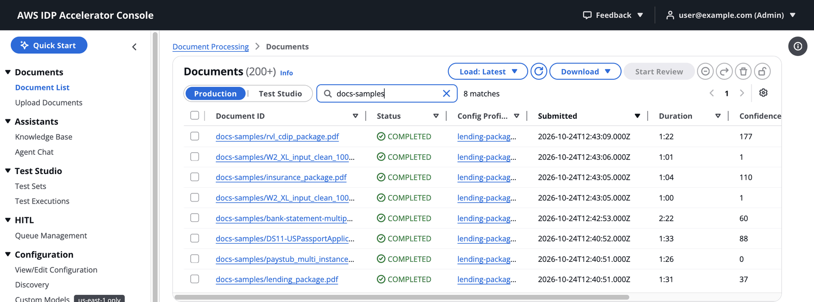
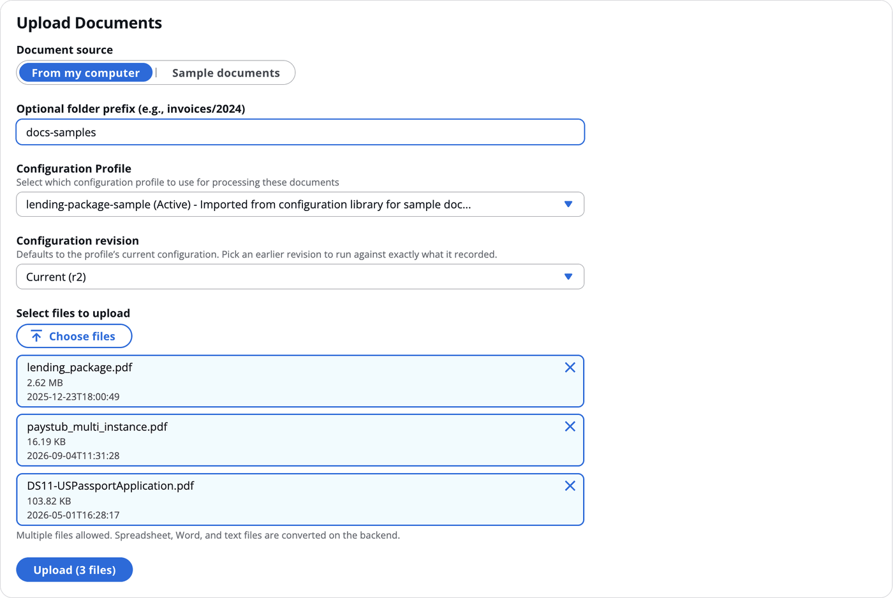
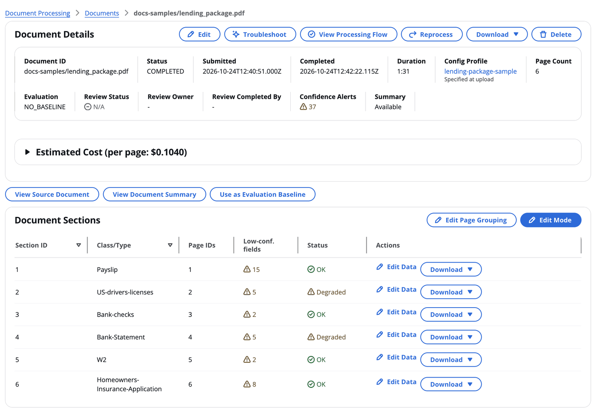
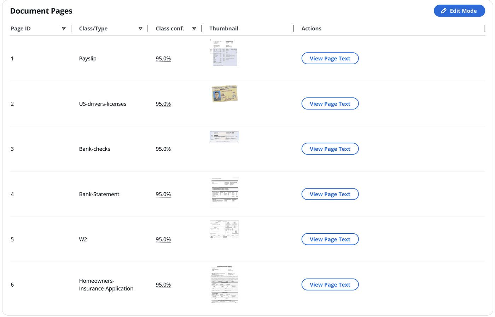
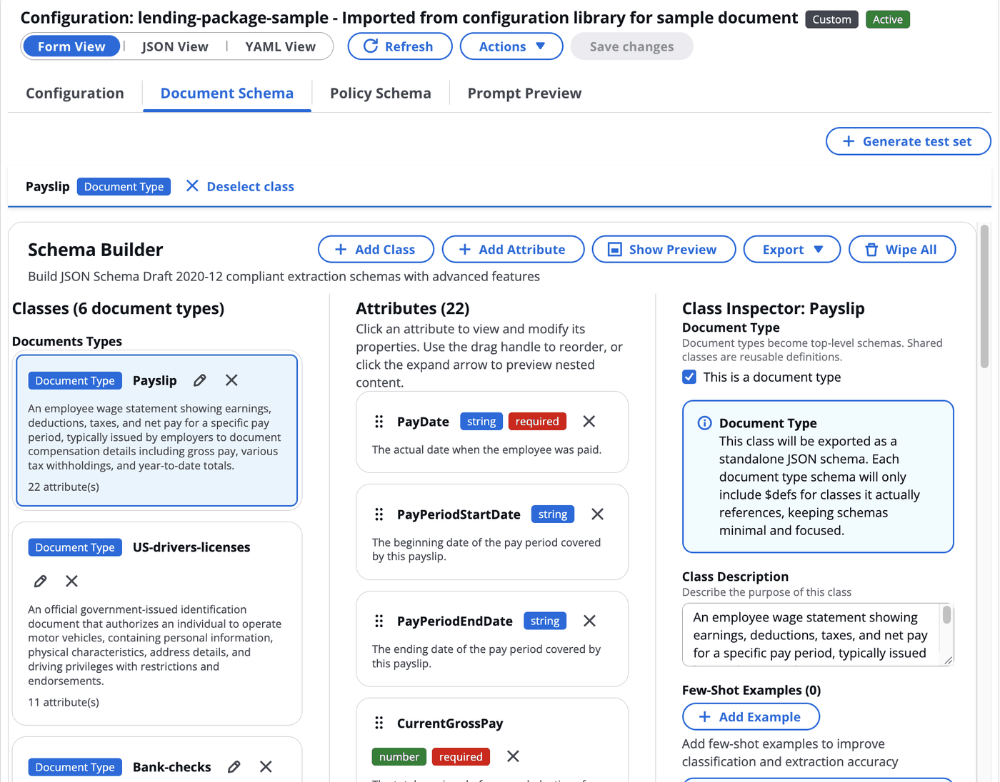
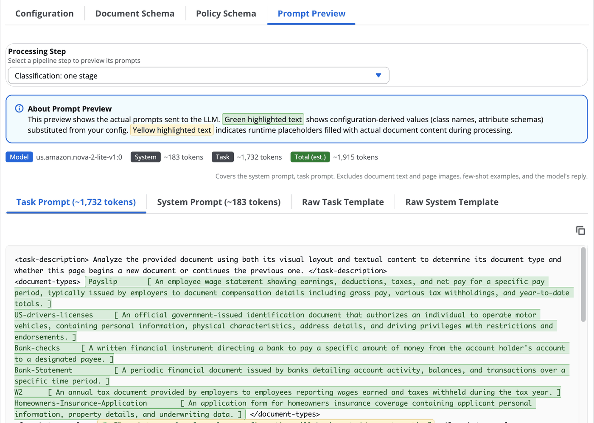
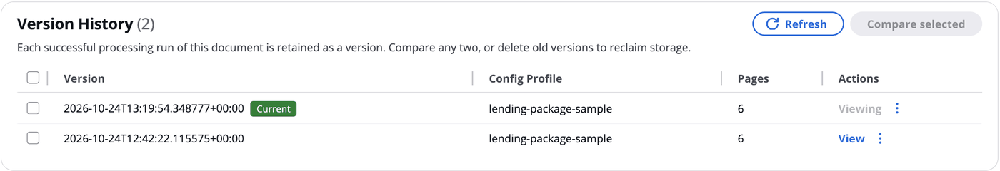
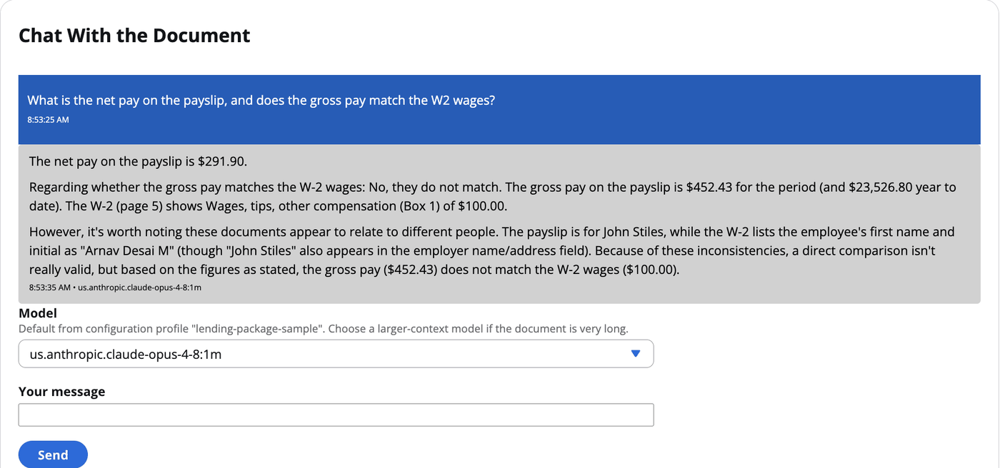

Copyright Amazon.com, Inc. or its affiliates. All Rights Reserved.
SPDX-License-Identifier: MIT-0

# GenAIIDP Web User Interface

The solution includes a responsive web-based user interface built with React that provides comprehensive document management and monitoring capabilities.



_The Document List, filtered to a folder of processed sample documents, with status, configuration profile, duration and confidence-alert columns._

## Features

- Document tracking and monitoring capabilities
- Real-time status updates of document processing
- Secure authentication using Amazon Cognito
- Searchable document history
- Detailed document processing metrics and status information
- Inspection of processing outputs for section classification and information extraction, with every action on a document in one bar (see [Document Details](#document-details))
- Accuracy evaluation reports when baseline data is provided
- View and edit pattern configuration, including document classes, prompt engineering, and model settings
- Manage multiple configuration profiles — create, compare, activate, and delete profiles, and view/compare/restore each profile's revision history (see [configuration-profiles.md](configuration-profiles.md))
- Retain, view, compare, and delete **document versions** — every processing run of a document is kept and viewable read-only (see [document-versions.md](document-versions.md))
- **Confidence threshold configuration** for HITL (Human-in-the-Loop) triggering through the **Human-in-the-Loop (HITL) Review (Optional)** configuration section
- Document upload from your local computer, or from the **bundled sample documents** shipped with the deployment (no local download needed)
- Knowledge base querying for document collections
- "Chat with document" from the detailed view of the document
- **Document Process Flow visualization** for detailed workflow execution monitoring and troubleshooting
- **Document Analytics** for querying and visualizing processed document data
- **Inbox** — a bell and an Inbox page for messages addressed to you or your groups, with read state, bulk actions and per-type muting (see [Inbox](#inbox))
- **Home** and **HITL** — every user gets Home with their Inbox, and Annotators also get their assigned Tasks and Queues there; Admins manage the Default review queue and assign its items in HITL › Queue Management; every document edit opens one edit page (see [HITL](#hitl))
- **Feedback & issue reporting** — report bugs or request features on GitHub directly from the UI, with your deployment details pre-filled

## Document List

The default page lists processed documents, over a scope chosen with the **Load** menu:

- **Latest** (the default) — the most recent documents regardless of age. It is the default because a time window shows an empty table whenever the stack has been quiet for longer than the window, which reads as a broken deployment rather than as "nothing recent"; Latest is empty only when there are genuinely no documents. It is also the cheapest option, since a time window loads *every* document in its range while Latest stops after the newest 200. Capped at 200 documents: when more exist beyond those loaded, the header counter reads `(200+)` instead of `(200)`.
- **A time window** — 2 hours through 30 days, or **Custom range…** for explicit start and end dates. Pick one of these when you want activity in a specific period rather than the most recent work.

Your choice is remembered, so changing it once sticks for later visits.

**The date picker will not accept a custom range longer than 365 days.** That bound
is in the picker only. The list itself is served by a single indexed query over the
chosen window, so its cost tracks the *number of documents it returns* rather than
the length of the window — a quiet year costs no more to page through than a quiet
week.

### Production vs Test Studio documents

Test Studio submits its documents through the same pipeline as ordinary uploads — deliberately, so confidence and cost figures match what real runs produce. Because it makes them indistinguishable once processed, they are recorded on a separate index partition and the Document List shows one partition at a time, selected with the **Production / Test Studio** control beside the search box:

- **Production** (the default on every visit) — documents submitted by upload, the API, the CLI, or an extension.
- **Test Studio** — documents submitted by a [Test Studio](test-studio.md) run. Adds a **Test Run** column linking to that run's results, and holds the **Abort**, **Reprocess** and **Delete** actions: a run's results (and the confidence calibration derived from them) are scored against these exact documents, so a run's lifecycle is managed from **Test Executions**, not here.

The two views are mutually exclusive by design — there is no combined view. On a stack that uses Test Studio regularly the test documents outnumber real uploads by an order of magnitude, so merging them would bury the uploads. The selection is not remembered between visits, so the list always opens on Production.

### Deleting documents

Select one or more rows and use **Delete**. The confirmation modal applies to the whole
selection, and deleting a document removes its input object, every version of its output
objects, its tracking record and its version history. It is not reversible.

**A delete that does not finish is reported as an error naming the documents it could not
remove and why.** That matters because the cleanup spans S3 and DynamoDB, which cannot be
made one transaction, so a step can fail on its own — and the two failures seen in
practice are deployment-level rather than per-document: a permission the execution role
is missing, or a request the service refuses. Both affect every document in the selection
identically, so the banner names the cause rather than only a count.

**What is left behind depends on which step failed, and the error reports what each step
did remove.** Only one of the three cases leaves the document in the list, so it is worth
reading which one you have:

- **The list-index cleanup failed.** The document's **tracking record is deliberately
  kept**: that record's queued timestamp is the only route to its row in the list index,
  so discarding it would leave that row orphaned with nothing able to find it again. The
  document stays in the list, and retrying the delete from the UI once the underlying
  cause is fixed completes the job.
- **The output-object purge failed.** That does not hold the tracking record back, so the
  document *is* removed from the list and some or all of its output objects remain in the
  bucket. The UI has no row left to select, so finishing the job means `idp-cli` against
  the key, or deleting the prefix directly. Those objects are noncurrent versions, so the
  bucket's lifecycle rule expires them eventually; the cost of leaving them is storage
  until it does.
- **The input-object delete failed.** The document is likewise removed from the list, and
  **the originally uploaded file is still in the input bucket**. This is the case worth
  acting on if the reason for deleting was that the document should not be held — the
  remedy is the same `idp-cli` delete, or removing that one object.

A selection where some documents were removed and others were not reports the failure for
the whole call and names each document it could not finish; the ones that were removed are
gone.

> **Note:** documents processed before v0.6.5 carry no provenance metadata. The `ItemType` backfill run at upgrade retypes them where it can prove they came from a test run; any it cannot prove remain in the Production view. See the 0.6.5 upgrade note in [CHANGELOG.md](../CHANGELOG.md).

## Upload Documents

The **Upload Documents** panel accepts documents from two sources, selected with the **Document source** toggle:

- **From my computer** — pick one or more files with the file picker (or drag-and-drop). Files are uploaded directly to the InputBucket via a presigned POST and processed automatically.
- **Sample documents** — choose from the sample documents bundled with the deployment (e.g. a multi-page bank statement, a lending package, a batch of W-2 forms). Selecting a sample copies it server-side into the InputBucket — no local download required. This is the easiest way to try the accelerator or evaluate a configuration preset end-to-end.

In both modes you can set an optional **folder prefix** and pick the **Configuration Profile** and **Configuration revision** used to process the document(s).



### One-click config for samples

Many bundled samples are tuned for a specific configuration preset in the [Configuration Library](configuration-profiles.md) (for example, the bank-statement sample pairs with the `bank-statement-sample` config). When you select such a sample:

- If the associated configuration is **not yet imported**, a pre-checked **"Also import and use its configuration"** checkbox appears. Leaving it checked imports the preset from the library as a new (non-active) configuration profile and processes the sample with it. Uncheck it to process the sample under the currently selected profile instead.
- If the associated configuration is **already imported**, that profile is preselected automatically.
- Samples with no associated configuration are simply uploaded under the selected profile.

The bundled sample documents and their config associations are published to the deployment's ConfigurationBucket at deploy time (under `samples/`, described by `config_library/samples-manifest.json`).

## Document Details

Opening a document from the Document List shows its Document Details page
(`#/documents/<document>`). The page title is the document's name with its status in
parentheses, over the full object key, and every action on the page is in one bar
beside it, left to right:

- **Details | Source** — Source shows the original file in place of the page's panels;
  Details brings them back, as you left them.
- **Reports** — read-only views, each in a dialog: **Summary**, **Evaluation Report**
  (see [Evaluation report](#evaluation-report)), **Rule Validation Summary** and
  **Processing Flow** (see
  [Document Process Flow Visualization](#document-process-flow-visualization)).
- **More Actions** — the changes, then the downloads, then Reprocess, Abort and Delete,
  each group set apart by a separator:
  - **Edit Page Class** — move pages between sections and change a section's class
    (see [Re-grouping a processed document's pages](#re-grouping-a-processed-documents-pages)).
  - **Re-extract Sections** — extract chosen sections again (see
    [Re-extract Sections](#re-extract-sections)).
  - **Edit Page Text** and **Reset Page Class** (see [Edit Pages](#edit-pages)).
  - **Use As Evaluation Baseline** — copy the document's results into the evaluation
    baseline. The **Evaluation** field shows the copy while it runs and when it is done
    or has failed, and a failed copy is reported.
  - **Skip All Reviews** — finish a pending review without checking it, with a reason
    (see [Human review](human-review.md)).
  - **Download All (ZIP)**, **Download Predictions (ZIP)** and **Download Baselines
    (ZIP)** — the document's outputs as a ZIP (see
    [Download Document Data](#download-document-data)).
  - **Reprocess**, **Abort** and **Delete**, Delete last.
- **Refresh** — read the document again.
- **Troubleshoot** — an AI analysis of what went wrong with the document. Reopened on
  the same document it shows the last result; **Run again** starts a new analysis.
- **Start Review** — claim a pending review, where a document has one nobody holds yet.
- **Edit** — the primary action: the document's edit page (see [HITL](#hitl)), or its
  queue item while it is in a review queue and you work queues.

An action your role can never perform is not shown. One your role may perform but that
doesn't apply now is shown disabled, and hovering it says why: you are viewing a past
version, the document is in a review queue or still processing, its configuration is
still loading, it ran in BDA mode, or there is no report to show. Who may do what:

| Action | Roles |
|---|---|
| Reports, the downloads, Refresh, Details \| Source | every role |
| Edit Page Class, Re-extract Sections, Reset Page Class, Skip All Reviews, Start Review | Admin, Reviewer |
| Edit Page Text | Admin (it saves the page text and reprocesses the document, and only Admins may do both) |
| Use As Evaluation Baseline, Reprocess, Abort, Delete | Admin, Author |
| Troubleshoot | Admin, Author, Viewer |
| Edit | Admin, Author, Reviewer; and Admins and Annotators on a document in a review queue |

A Reviewer, or any caller who isn't an Admin, may run Re-extract Sections, Reset Page
Class and Edit Page Class's **Save and Re-extract** only while holding the document's
open review: they are disabled on a finished review, on one not yet started (choose
**Start Review** first), and on one someone else holds.

The server enforces the same rules; see [RBAC](rbac.md).

Below the bar, **Document Details** lists the document's fields in four aligned columns,
fewer on a narrow screen, and **Estimated Cost** is in its own panel beneath it. Then come
**Document Sections** and **Document Pages**, each row with a **⋮** menu for that row:
a section's **Edit Data** (**View Data** for a role that can't edit), **Download Data**
and **Download Baseline**; a page's **View Page Text** and, for Admins, **Edit Page
Text**. **Version History** and **Chat with Document** follow.

A document that no longer exists shows "Document not found"; one that can't be read shows
the reason with **Retry**.

## Evaluation report

On a document that was evaluated against a baseline, **Reports › Evaluation Report** on
the document page opens a summary that leads with the figures the report exists to
answer:

- **Extraction accuracy** — weighted by field importance when the configuration
  assigns weights, otherwise the plain proportion of fields that matched (the
  label says which, because they are not the same number).
- **Classification accuracy** — page level, with the page count beneath it. Shown
  separately because classification and extraction fail independently: a
  document can be classified perfectly and extracted badly, or the reverse.
- **Split accuracy** — for a packet evaluated against section-level ground truth:
  how many expected sections were reproduced with the same pages and class, with
  the stricter in-order figure beside it.
- **F1 score**, with precision and recall beneath it.

A figure with no value is **omitted rather than shown as 0%** — a zero would be
indistinguishable from "scored nothing correctly", which is the one actively
wrong reading available. A document that could not be scored at all (no section
had an extractable schema) says so instead of showing zeros.

The report then follows the same order as the markdown it replaces, each part
collapsed unless it has something to show:

- **Sections not evaluated** — each excluded section with its class, the reason
  it was skipped, and its pages.
- **Section split analysis** — for a packet: one row per expected section
  (matched or not, page order kept or not, expected and predicted class and
  pages, which predicted section it paired with), then every predicted section
  that matched nothing, the graded packet score, and any split errors. Expanded
  automatically when a section or its ordering was wrong.
- **All metrics** — every figure the run recorded, split and extraction, with the
  rating the report applies to it.
- One expandable section per document section, its own score in the header so
  the section that pulled the document down is visible without opening each one.
  Inside: a **Section metrics** table; the per-field table with expected and
  extracted values, confidence against its threshold, score, weight, and the
  comparison method with the evaluator's reason in a tooltip; and for an
  aggregate field (a nested object or a matched list) an expandable row that
  opens into the field-by-field comparisons beneath it — which is where a
  Hungarian-matched list shows which item was paired with which. A section that
  could not be evaluated says why, with the same how-to-fix steps the markdown
  gives for that failure type.
- **Comparison methods used** — the comparators this document's evaluation
  applied. Worth checking when a score is surprising: "Acme Inc" not matching
  "Acme, Inc." is usually a comparison-method question rather than an extraction
  one.
- **How scores are computed** — the field-level methods, array matching, field
  weighting and, for packets, the split metrics, condensed from the markdown.

A list or object value is shown as what it is — "3 items", "5 fields" — and
opens into its structure on demand, rather than being flattened into one
truncated string. **Mismatches only** hides everything that matched, for working
through problems on a wide document. A wrong class is called out at the top,
because it makes the field tables below it meaningless rather than merely wrong.

The markdown report is still generated and is one click away via **Markdown
report**, which is also where **download** and **print** live. Documents
evaluated by an older build, whose JSON results cannot be read, fall back to the
markdown automatically.

## Comparing a document against its baseline

On a document that has an evaluation baseline, **Edit Data** (or **View Data**) in a
section row's ⋮ menu opens the edit screen, which shows the **document class** comparison straight away — predicted, expected, and a verdict
— and **Show evaluation** adds the field-by-field comparison, highlighting
mismatched fields with their scores and reasons. The class is
model output like any other, and getting it wrong invalidates everything beneath
it — extraction runs against that class's schema, so the fields can be filled in
competently and still be wrong. A banner above the fields reports one of:

- **Classification matches ground truth** — the class agrees.
- **Wrong class** — expected and predicted are both named, with a note that the
  fields below were extracted under the predicted class's schema.
- **No matching section** — the ground truth expects a section covering these
  pages that no predicted section matched. A splitting difference, not a
  labelling one.
- **Page order** — right class and pages, different order. Extraction is
  unaffected.

The banner is omitted when the evaluation carries no split detail, and also when
a multi-section document's section cannot be matched to a ground-truth section
unambiguously — showing a *guessed* expected class would be worse than showing
none, since a reviewer might "correct" a document that was already right.

For the run-level view of the same information across every document in a test
set, see
[Finding classification errors](./test-studio.md#finding-classification-errors).

## Re-grouping a processed document's pages

**More Actions › Edit Page Class** on the document page, or **More Actions › Edit Page
Class** on the edit page (**Edit** on the document page), opens a board with every section
side by side and each page as a thumbnail. Drag pages between sections, or use a page's
**Move to section** menu — the keyboard and screen-reader route to the same operation.
Shift-click selects a run of pages so they move together, which is usually what a wrong
split needs. A section's class can be changed from its column, except that a user who is
only a Reviewer can't change it once the document's review has finished, while the
document is processing, or before they hold its review.

Pages within a section can also be **reordered**: drop a page onto another to place it
immediately before that one, or use **Order within this section → Move earlier / Move
later**. **View full page** in the same menu opens the page at full size, for when the
thumbnail is too small to decide. Dropping onto the column's empty space instead places the page in document order,
so an ordinary move does not create a custom order by accident. It is the same board as
the annotate view, so the gesture is identical — see
[Page order within a section](./test-studio.md#page-order-within-a-section), which also
covers why order matters for scoring.

One caveat specific to this surface: extraction sorts a section's pages before reading
them, so reordering here does not change what the pipeline extracts. It is stored and it
matters if the document is used as the prediction side of an evaluation.

The board has two saves:

| | Save page grouping | Save and Re-extract (document page only) |
|---|---|---|
| Page assignments and classes | saved | saved |
| Extracted values | **kept**, including any a reviewer corrected | **replaced** for the sections whose class or pages changed |
| Reprocessing | none | the changed sections are extracted again; OCR and classification are not repeated |
| A pending review | unchanged | marked as completed |
| Rule validation results | unchanged | cleared |
| Roles | Admin, Reviewer | Admin, Reviewer |

**Save page grouping** writes the page grouping and the section classes and nothing else.
The extracted values were extracted from a different set of pages, so they may no longer
match. **Save and Re-extract** first lists the sections it will extract again and asks
you to confirm, then saves the grouping and re-extracts those sections; their classes are
recorded as confirmed. If the grouping is saved but the re-extract fails, a dialog says
so, with **Re-extract again**. It is unavailable when only the page order changed (there
is nothing to re-extract), while a changed section has no class, and in BDA mode, where
the pipeline's extraction does not run. The edit page's own **Process Changes** re-runs
evaluation and summarization only, so it keeps the values too.

**Refused while the document is processing, in a review queue, or under a review in
progress.** A grouping save writes the document directly, so it would race a run in
progress; on the document page Edit Page Class is disabled with the reason, and if the
server refuses a save anyway, the arrangement you made stays on the board with the
message.

In BDA mode Edit Page Class is disabled with the reason; see [BDA-mode documents](#bda-mode-documents-offer-data-only-editing).

Every page must end up in exactly one section, and a section with no pages blocks the
save rather than vanishing — deleting a section discards its extracted values, so it
stays a deliberate act. The same board and the same rules are used for test-set ground
truth; see
[test-studio.md](test-studio.md#correcting-a-wrong-packet-split), where the values
being preserved matters most because they are the annotations being built.

## Re-extract Sections

**More Actions › Re-extract Sections** on the document page extracts chosen sections
again, each with its current class and pages, without regrouping anything — for values
that look wrong while the grouping is right. Choose the sections in the dialog; a section
with no class, and one its configuration skips, can't be chosen. Before you commit, the
dialog says what re-extracting does: the sections' extracted values, including any
corrected by hand, are replaced, and their classes are recorded as confirmed; a pending
review is marked as completed and rule validation results are cleared; the other
sections keep their values, and OCR and classification are not repeated.



Admins and Reviewers can re-extract. It is disabled with the reason for a past version,
for a document in a review queue or still processing, and in BDA mode: there, Bedrock
Data Automation produced the values, and the workflow skips it for any document that
still has sections, so a re-extracted section would come back with no values. To correct
a value in any mode, use **Edit Data** in the section row's ⋮ menu: it opens the edit
screen on the section and writes the value without reprocessing anything.

## BDA-mode documents offer data-only editing

A document is in **BDA mode** when its configuration profile routes it to Bedrock Data
Automation: the profile sets `use_bda` and a BDA project is linked to it. A profile that
sets `use_bda` with no linked project processes in pipeline mode. The Web UI reads the
profile's `use_bda` alone, so for such a profile it offers data-only editing although the
server would accept the change. The Web UI reads the profile as it is now. The server
reads `use_bda` from the configuration revision the document is pinned to, which is the
revision the requeued run is routed by, and reads the profile as it is now only for a
document with no pinned revision. So after a profile's `use_bda` changes, the Web UI can
offer or withhold an edit that the server decides the other way for a document pinned to
an earlier revision. For a BDA-mode document the Web UI disables, with the reason, the
edits that change its structure or text:

- **Edit Page Class**, on the document page's **More Actions** and on the edit page.
- **Re-extract Sections**, **Edit Page Text** and **Reset Page Class**, and **Save and
  Re-extract** on the Edit Page Class board.

Field values stay editable everywhere: **Edit Data** on a section row, and the edit
page's **Save** and **Process Changes**.

The server applies the same rule. `processChanges` refuses any section or page change to
a document whose profile routes it to BDA, for every role including Admin, with an error
beginning `BDA_MODE:`, and nothing about the document is changed. A request with no
section or page changes — field values already saved, reprocessed for evaluation and
summarization — is accepted. The mode is the one the requeued run will take, so a
document whose profile sets `use_bda` with no BDA project linked takes section and page
changes. If the profile or the document's pinned revision cannot be read, a section or
page change is refused rather than assumed to be safe.

The reason is how a BDA-mode document is reprocessed. Bedrock Data Automation decided the
section boundaries and the extracted values in the first place, and a structural or text
edit clears the values of the sections it touches before the document is requeued. The
workflow then skips Bedrock Data Automation for any document that still has at least one
section, whatever state that section's extraction data is in, and nothing else in the
BDA branch extracts values. So an edited section would come back with its values gone and
nothing to replace them.

⚠️ **The Web UI can only tell that a document is in BDA mode when it can read the
document's configuration profile.** Users in none of the **Admin**, **Author** and
**Viewer** groups — a **Reviewer**, for example, or a **Reviewer** who is also an
**Annotator** — receive only a profile's class list, so for them these actions stay
enabled, and the server then refuses the reprocess with the `BDA_MODE:` error, which the
page shows; nothing is lost. A reviewer correcting a BDA-mode document should use **Edit
Data** on the section row, which writes the value without touching the structure. The
page-grouping save keeps the extracted values and does not reprocess, and the server does
not refuse it.


## Edit Pages

Each row of **Document Pages** has a ⋮ menu with **View Page Text**, and the document
page's **More Actions** has **Edit Page Text** and **Reset Page Class**.



### View Page Text

**View Page Text** opens the page's text read-only. The page image is shown on the left
(when available), with a right-pane toggle. **OCR Lines** (the default) lists the OCR
text lines with per-line confidence; click a line to draw its bounding box on the image;
zoom with the mouse wheel, pan by dragging, and move between pages with **Previous Page**
and **Next Page**. (Bounding boxes require an OCR backend that provides geometry, e.g.
Textract or the Mistral hook — the Cohere Parse hook boxes tables and figures only;
otherwise the lines are shown without overlays.) **Markdown** shows the page's extracted
markdown, with a Rendered ↔ Raw toggle.

The text is stored as `{"text": "..."}`; the editor shows and edits the plain text.

### Edit Page Text

**Edit Page Text** (More Actions, or a page row's ⋮ menu) opens the same viewer for
editing, at the first page with text or at the row's page. Switch the right pane to
**Markdown** and choose **Raw (editable)** to edit the text, then **Save and Reprocess**:
it saves the page's text, then extracts again the sections that hold the page, replacing
their values, including any corrected by hand. A pending review is marked as completed
and rule validation results are cleared. Moving to another page with unsaved edits is
disabled until you save or discard them.

If the text is saved but the reprocess fails, the dialog says so and offers **Retry
reprocess** (reprocess again, without saving the text again) and **Restore original
text** (put back the text as you opened it; nothing is reprocessed). Closing it then
leaves a notice on the page with **Retry reprocess**, so the text is never left changed
without saying so.

Only Admins can edit page text: it saves the text and reprocesses the document, and
Admin is the only role allowed both.

### Reset Page Class

**Reset Page Class** clears the class of the pages you choose and reprocesses the
document. ⚠️ **It classifies the whole document again**, not only those pages: every page
is classified again, so pages can move to other sections and sections can be added or
removed, and every section is rebuilt and extracted again, so values corrected by hand
in any section are replaced. A pending review is marked as completed and rule validation
results are cleared. The dialog says so before anything is sent. Admins and Reviewers can
reset; a user who is only a Reviewer can't once the review has finished, or before they
hold it.

### When they are unavailable

Edit Page Text and Reset Page Class are disabled with the reason for a past version, for
a document in a review queue or still processing, and in BDA mode: Bedrock Data
Automation produced the values, and the workflow skips it for any document that still
has sections, so the affected sections would come back empty. **View Page Text** is
always available and changes nothing.

## Document Schema Builder

The **Document Schema** tab on the Configuration page provides a visual **Schema Builder** for defining the document types (classes) and fields (attributes) that extraction produces — a JSON Schema Draft 2020-12 editor that requires no hand-editing of JSON. (The same builder powers the **Policy Schema** tab for rule validation.)



### Layout

A three-pane master-detail: the **class list** (left, split into **Document Types** and reusable **Shared Classes**), the **attribute list** for the selected class (middle), and a **property inspector** for the selected class or attribute (right). Document types become top-level schemas; shared classes are referenced from attributes via `$ref` (single object) or `items.$ref` (array/list of that class).

### Key Capabilities

- **Add Class**: create a **Custom Class**, or import a **Standard Class** from 35+ pre-built document types derived from AWS BDA blueprints (fully editable after import).
- **Add Attribute**: add fields to the selected class. The dialog includes an **Add another** button that saves the current field and immediately starts a new one, so multiple attributes can be added without reopening the dialog. A newly-created class with no fields shows an **Add first attribute** button.
- **Show Preview**: opens preview tabs for the schema:
  - **Diagram** — a graphical entity-relationship view. Each class is a node listing its attributes; relationships are drawn as labelled edges (**solid** arrow = a single referenced object, **dashed** arrow = an array/list of that class). Document types are colored and laid out on the left, referenced shared classes to the right by reference depth. Click a node to open that class in the editor.
  - **JSON Schema** — the exported JSON Schema (one per document type, each carrying only the `$defs` it references).
  - **Statistics** — attribute counts and type distribution for the selected class.
- **Export**: download the schema as JSON — **Export all** (every document type) or **Export "&lt;class&gt;"** (the currently-selected document type plus only the shared classes it references).
- **Reorder / edit / remove**: drag attributes to reorder; click any class or attribute to edit its properties, constraints, few-shot examples, and per-class overrides in the inspector.

For the schema format itself and how to author it by hand, see the [JSON Schema Migration Guide](json-schema-migration.md).

## Prompt Preview

The **Prompt Preview** tab in the Configuration page allows you to see exactly what prompts are sent to the LLM for each processing step, with configuration-derived placeholders filled in using your actual class definitions and schemas.



### Key Capabilities

- **Step Selection**: Preview prompts for each classification call, Extraction, Confidence Assessment, or Summarization. The classification steps follow `classification.strategy`: under `combined` there is one, *Classification: split and classify together*; under `split_then_classify` there are two, *Classification: splitting (split then classify)* and *Classification: section classification (split then classify)*
- **Class Selection**: For Extraction and Confidence Assessment, select a specific document class to see how its JSON Schema appears in the prompt
- **Filled Placeholders**: Config-derived values (`{CLASS_NAMES_AND_DESCRIPTIONS}`, `{ATTRIBUTE_NAMES_AND_DESCRIPTIONS}`, `{DOCUMENT_CLASS}`) are replaced with actual values from your configuration
- **Runtime Markers**: Document-specific placeholders (`{DOCUMENT_TEXT}`, `{DOCUMENT_IMAGE}`, etc.) are shown as highlighted yellow markers indicating where document content will be inserted at processing time
- **Token Estimates**: Approximate token counts for the system prompt, task prompt and — when Schema Enforcement is on — the tool schema, so the total reflects everything your configuration puts on the wire
- **Tool Schema**: With Extraction mode Simple and [Schema Enforcement](extraction-and-confidence.md#forced-tool-use-extractionforced_tool--experimental-off-by-default) on, a **Tool Schema** tab shows the `toolSpec` (tool name, description, input schema) the model is forced to call
- **Agentic Schema Restatement**: With Extraction mode Advanced, the System Prompt tab includes the `Expected Schema:` block that [`restate_schema_in_system_prompt`](extraction-and-confidence.md#dropping-the-duplicated-schema-restate_schema_in_system_prompt) controls, shown as a labelled approximation of the generated schema
- **Copy to Clipboard**: Copy rendered or raw prompt templates for use in external tools
- **Substitution Details**: See the exact formatted class list or cleaned JSON Schema that gets inserted into the prompt

### How to Use

1. Navigate to the Configuration page
2. Click the **Prompt Preview** tab (alongside Configuration, Document Schema, Rule Schema)
3. Select a **Processing Step** from the dropdown: the classification step or steps your configured strategy makes (see above), Extraction, Confidence Assessment, or Summarization
4. For Extraction or Confidence Assessment, select a **Document Class** to preview its schema in the prompt
5. View the rendered prompts in the Task Prompt and System Prompt sub-tabs
6. Use the Raw Task Template and Raw System Template sub-tabs to see the unprocessed templates with placeholder syntax

### Use Cases

- **Schema Optimization**: See how your document class attributes appear in the extraction prompt — optimize descriptions and structure for better LLM comprehension
- **Prompt Debugging**: Verify that custom prompt edits render correctly with actual placeholder values
- **Cost Awareness**: Estimate prompt token usage before processing documents
- **Training**: Help new users understand what the LLM actually sees during each processing step

## Document Analytics

The Document Analytics feature allows users to query their processed documents using natural language and receive results in various formats including charts, tables, and text responses.

### Key Capabilities

- **Natural Language Queries**: Ask questions about your processed documents in plain English
- **Multiple Response Types**: Results can be displayed as:
  - Interactive charts and graphs (using Chart.js)
  - Structured data tables with pagination and sorting
  - Text-based responses and summaries
- **Real-time Processing**: Query processing status updates with visual indicators
- **Query History**: Track and review previous analytics queries

### Technical Implementation Notes

Analytics job status is delivered by **polling**, not server push:

- **Mechanism**: the analytics panel polls `getAgentJobStatus` through the REST API every 5 seconds while a job is in flight, and stops once the job reaches a terminal state. Polling pauses while the browser tab is hidden (`src/ui/src/hooks/use-polling.ts`), so a backgrounded tab costs nothing.
- **Latency**: a completed query surfaces within one poll interval rather than instantly. This is the deliberate trade made when AWS AppSync's subscriptions were removed — see [AppSync → REST API Migration](./migration-appsync-to-rest.md) §2 for why polling is acceptable for a document-processing console and where true streaming was kept instead.
- **Result fetch**: the status poll returns job state; the panel issues a separate query for the result payload once the job completes.

### How to Use

1. Navigate to the "Document Analytics" section in the web UI
2. Enter your question in natural language (e.g., "How many documents were processed last week?")
3. Click "Submit Query" to start processing
4. Monitor the status indicator as your query is processed
5. View results in the appropriate format (chart, table, or text)
6. Use the debug information toggle to inspect raw response data if needed

## Document Process Flow Visualization

The Document Process Flow feature provides a visual representation of the Step Functions workflow execution for each document:


_The Document Process Flow visualization showing the execution steps, status, and details._

### Key Capabilities

- **Interactive Flow Diagram**: Visual representation of the document processing workflow with color-coded status indicators
- **Step Details**: Detailed information about each processing step including inputs, outputs, and execution time
- **Error Diagnostics**: Clear visualization of failed steps with detailed error messages for troubleshooting
- **Timeline View**: Chronological view of all processing steps with duration information
- **Auto-Refresh**: Option to automatically refresh the flow data for active executions
- **Map State Support**: Visualization of Map state iterations for parallel processing workflows

### How to Use

1. Navigate to a document's detail page
2. Choose **Reports › Processing Flow** in the page's action bar
3. The flow diagram will display all steps in the document's processing workflow
4. Click on any step to view its detailed information including:
   - Input/output data
   - Execution duration
   - Error messages (if applicable)
   - Start and completion times
5. For active executions, toggle the auto-refresh option to monitor progress in real-time

### Troubleshooting with Process Flow

The Document Process Flow visualization is particularly useful for troubleshooting processing issues:

- Quickly identify which step in the workflow failed
- View detailed error messages and stack traces
- Understand the sequence of processing steps
- Analyze execution times to identify performance bottlenecks
- Inspect the input and output of each step to verify data transformation

## Download Document Data

The Document Details page's **More Actions** menu has a group of downloads that packages the document's outputs into a single ZIP archive, suitable for sharing, archival, or downstream analysis outside the IDP console. The same three scopes are available in bulk from the document list — see [Bulk download from the document list](#bulk-download-from-the-document-list) below.

### Folder layout

The ZIP preserves the **real S3 key structure** under three top-level folders that mirror their source buckets:

- `output/<key>` — files from the **OutputBucket** (section results, page OCR/confidence, page images, summary, evaluation, rule validation)
- `baseline/<key>` — files from the **EvaluationBaselineBucket** (ground-truth section results)
- `input/<key>` — files from the **InputBucket** (the original uploaded source document, optional)

This makes the archive directly comparable to the output of an `aws s3 sync` of the same buckets — users can diff, script against, or re-upload the archive without translating paths.

A self-describing `manifest.json` is written at the ZIP root capturing the export timestamp, scope, document attributes, bucket-to-folder mapping, and the list of files included. If any individual file cannot be fetched (for example, a permissions error), the download continues and the failure is recorded under `errors[]` in the manifest rather than aborting the whole archive.

### Scope options

- **Download All (ZIP)** — every output artifact for the document (summary, evaluation & rule-validation reports, per-section predictions, baselines when available, per-page text, confidence, and consolidated OCR page data). The options dialog offers two checkboxes:
  - **Include page images** (off by default) — includes the rendered page image for each page (can significantly increase archive size).
  - **Include source document** (off by default) — includes the original uploaded file from the **InputBucket** under `input/<key>`.
- **Download Predictions (ZIP)** — only the per-section `sections/<id>/result.json` files (under `output/`) plus the `manifest.json` and `document-attributes.json`.
- **Download Baselines (ZIP)** — only the per-section `sections/<id>/result.json` files from the **EvaluationBaselineBucket** (under `baseline/`). This option is shown only when an evaluation baseline is available.

### Fetching mechanics

Every file in the archive is fetched directly from S3 using a short-lived presigned URL, preserving binary content byte-for-byte. **Every URL is signed by the backend**, through the `getFilePresignedUrl` resolver, whichever bucket the file is in — the **OutputBucket** and **InputBucket** included. Your browser's Cognito credentials grant **nothing** on the document buckets, so a URL signed in the browser would fail with HTTP 403 at fetch time; routing the signature through the resolver is also what puts a group check and the caller's configuration-profile scope in front of the bytes. Up to 5 files are fetched in parallel. The surfaces that show many pages at once — the page-image viewer and the page thumbnails — use the batch form, `getFilePresignedUrls`, so opening a document asks for its page URLs in a single call — or, for a document of more than 250 pages, in one call per 250 — rather than one call per page. A progress modal reports status during the download and offers a **Cancel** button for large documents. A section row's ⋮ menu has **Download Data** and **Download Baseline** for single-file downloads.

### Bulk download from the document list

The document list's **Download** menu covers both the table itself and the artifacts of the documents you select. The two are grouped separately because they differ in scope:

- **Document list → Table as Excel (N rows)** — the document list as a spreadsheet, covering every row currently passing the filter (not just the selected ones). This is the same export the list's download button previously offered on its own.
- **Selected documents (N) → All data / Predictions / Baselines (ZIP)** — the same three scopes described above, applied to every document you tick in the table. Disabled until you select at least one row; **Baselines** additionally requires that at least one selected document has an evaluation baseline.

A bulk archive contains **one top-level folder per document**, named after its object key, each laid out exactly as a single-document archive (`output/`, `baseline/`, `input/`, `document-attributes.json`, `manifest.json`). An additional `manifest.json` at the ZIP root indexes every document with its folder, file count, and error count. Documents whose keys would collide once sanitized for the filesystem (for example `a/b.pdf` and `a_b.pdf`) get a numeric suffix rather than overwriting each other.

Selecting a scope opens a confirmation dialog stating how many documents are included; for **All data** it also carries the page-image and source-document toggles. The progress modal reports both file and document counts (`24 of 60 files processed · 3 of 5 documents`), and **Cancel** stops the export at the next file. Per-file failures are recorded per document and reported in the completion dialog prefixed with the document they belong to, so one document with a permissions problem does not spoil the rest of the archive.

Two practical limits, since the archive is assembled in your browser rather than server-side:

- Selections above 25 documents raise a warning in the confirmation dialog. Large exports take minutes and hold the whole archive in tab memory, so prefer several smaller batches.
- **Include page images** multiplies size by roughly the page count; leave it off for bulk exports unless you specifically need the images.

For unattended or very large extractions, use the CLI instead — `idp-cli download-results` pulls a batch's outputs straight from S3 with no browser involved.

## Document Versions

The Document Details page includes a **Version History** panel listing every retained processing run of the document, newest first (with the current run badged). Re-uploading a document under the same key — or reprocessing it — no longer discards the prior results; each successful run is kept as an immutable version whose exact output bytes are pinned by S3 object version.

From the panel you can:

- **View** any past version's outputs read-only — its sections, page text/images, extraction results, and summary/evaluation reports are fetched from that run's pinned S3 versions, so you see exactly what that run produced even after later runs overwrote the outputs. While you view a past version, every action that changes the document is disabled with the reason, as are **Refresh** and **Edit**, and **Rule Validation Summary** is unavailable because rule validation isn't kept for past versions; a banner offers **Return to current version**.
- **Compare** any two versions — a section-by-section, field-level diff of their extraction results.
- **Delete** a version (Admin only) — permanently removes that run's pinned object versions; the current version cannot be deleted, and versions still referenced by another retained run are preserved.



See the [Document Versions guide](document-versions.md) for how versioning works, retention, the CLI/API surfaces, and caveats.

## Chat with Document

The "Chat with Document" feature is available at the bottom of the Document Detail view. It provides an interactive Q&A interface grounded in the text of the single document you are viewing — no other documents are considered. The feature is only available after the document's status is **COMPLETE**.



### Model selection

Chat has its own dedicated configuration section (**Configuration tab → "Chat-with-Document Configuration"**) — it is **independent from summarization**. This is important because chat sends the entire document text to the model in a single prompt, so a large-context model (such as `us.anthropic.claude-opus-4-8:1m` — the default — or `us.anthropic.claude-sonnet-4-6:1m`) is usually the best choice, even if you've configured a smaller, cheaper model for summarization.

The Chat panel includes a **Model** selector that defaults to the `chat.model` configured in the version of the config that was used to process the document. You can override the model for the current chat session via the dropdown. The list of selectable models comes from the `chat.model` enum in the configuration schema.

> **OpenAI GPT-5.x in chat:** `openai.gpt-5.4`, `openai.gpt-5.5`, and GPT-5.6 (`openai.gpt-5.6-sol` / `-terra` / `-luna`) are supported for Chat-with-Document and **stream** token-by-token like other models. They run on the `bedrock-mantle` Responses API (US regions only) and are tuned via `chat.reasoning_effort` rather than temperature/top_p. They are hidden from the model selector in EU-region deployments. Note: chat sends the document as **text** (extracted full text), so the PDF-document-block limitation that excludes GPT-5.x from Discovery does not apply here. See [OpenAI GPT-5.x Models](./openai-models.md).

> **xAI Grok in chat:** `us.xai.grok-4.6` and `global.xai.grok-4.6` are supported for Chat-with-Document. They run on the standard Converse API and are tuned via `chat.reasoning_effort` (`none`/`low`/`medium`/`high`/`xhigh`) rather than temperature/top_p, which Grok rejects. In EU-region deployments only the `global.` ID appears in the selector — there is no `eu.` Grok profile. A large-context model is recommended for chat; Grok's 500K window is ample, though not the largest offered (the `:1m` Claude variants and GPT-6 Astra's 1.05M window are bigger). See [xAI Grok Models](./grok-models.md).

> **OpenAI GPT-6 Astra in chat:** `us.openai.gpt-6-astra` and `global.openai.gpt-6-astra` are supported for Chat-with-Document. Like Grok they run on the standard Converse API (**not** the bedrock-mantle path the GPT-5.x models use) and are tuned via `chat.reasoning_effort` (`none`/`low`/`medium`/`high`/`xhigh`/`max`) rather than temperature/top_p, which Astra rejects with a 400. In EU-region deployments only the `global.` ID appears in the selector — there is no `eu.` Astra profile. Astra's 1.05M context window is the largest offered, which suits long chat sessions over big documents, but it is also the most expensive model available — its automatic prompt caching offsets much of the repeated-history cost. Note a long chat history can push a turn past 272K input tokens, where Astra's rate roughly doubles. See [OpenAI Models](./openai-models.md#gpt-6-astra-converse).

If a document is "too large for chat context window" — i.e. Bedrock returns an `Input Tokens Exceeded` error — pick a larger-context model in the Chat panel's Model selector and retry. For documents that are larger than any single-prompt model can fit, use the [Knowledge Base](./knowledge-base.md) feature instead.

### Chat history

Your chat history is preserved while you remain on the Document Detail screen; leaving and returning erases it. Prompt caching is used for the document contents across successive turns on the same document to reduce latency and cost.

### Streaming & live status

Chat-with-Document runs as an asynchronous workflow so it can use long-latency large-context models without hitting the API's synchronous-request timeout. Tokens are delivered by a dedicated **Lambda Function URL** with `InvokeMode=RESPONSE_STREAM` that the browser reads directly, not through the REST API (see [AppSync → REST API Migration](./migration-appsync-to-rest.md) §3). When you submit a prompt:

1. A **status pill** appears above the input area and transitions as the backend makes progress: **Queued → Loading document text → Querying {model} → Streaming response**.
2. As soon as the model starts producing output, the assistant bubble appears with a blinking cursor and **tokens stream in** live (throttled to ~200 ms / 200-char batches server-side so the UI stays responsive under heavy throttling).
3. When generation completes the status pill clears and the bubble finalizes with a timestamp and the model ID used.
4. Errors render inline in the assistant bubble in red so you can see what went wrong without losing the context of the conversation. A configuration-version scope denial — a document outside your `allowedConfigVersions` — is rendered the same way, on deployments where the chat turn reaches the backend through the REST API. Chat streamed from the Lambda Function URL is not restricted by that scope; see [Known Limitations in the RBAC guide](./rbac.md#known-limitations).

The session is scoped to your user — other users cannot subscribe to or continue your chat session even if they know the session ID.

See the feature in action in this video:

https://github.com/user-attachments/assets/50607084-96d6-4833-85a6-3dc0e72b28ac

### How to Use

1. Navigate to a document's detail page and scroll to the bottom
2. In the text area, type in your question and you'll see an answer pop up after the document is analyzed with the Nova Pro model

## HITL

**HITL** (human-in-the-loop) brings every kind of human review work into one place:
production documents held in review queues, and test sets that need ground truth.
The pages are described in [review-queues.md](review-queues.md). In outline:

- **Navigation.** A user whose only role is Annotator sees exactly **Home**
  (**Inbox**, **Tasks**, **Queues**). Other users have **Home** with the **Inbox**
  only, then the usual sections their roles
  allow: **Documents**, **Assistants**, **Test Studio**, **Configuration**,
  **Extensions** and **Resources**. Admins also see **HITL › Queue Management**.
- **Queue Management** (Admins) has two tables, **Production Queues** and **Test Studio
  Queues** (one per test set), each listing Queue, Items, Pending, Assigned and
  Annotators with an actions menu. Admins edit and delete Production queues here,
  setting each one's name, priority, time limit, eligible Annotators (who works the
  queue) and **Enabled** switch in its **Settings**; there is no **Create queue**.
  When HITL is enabled in a document's configuration and the Default queue is
  enabled, a production document that raised confidence alerts goes to the Default
  queue. Queues have no threshold of their own: the alerts use each field's own
  threshold, otherwise `hitl.confidence_threshold`. Deleting a queue moves its
  items to Default; Default itself can't be deleted. On each queue's page, Admins
  select items and **Assign** them to an Annotator, **Unassign** them, **Move** them
  to another queue, or **Remove from queue** (the document completes with
  its machine output).
- **Home › Queues** lists the queues you're listed on. On a queue's page you can
  open any item read-only and **Claim** one nobody holds, which assigns it to you.
- **Home › Tasks** lists everything assigned to you, both Production review items
  and Test Studio documents, with their document, source, queue and age. Selecting
  one opens it. The **Tasks** badge counts them; completing or skipping an item
  removes it from the list and the count straight away (**Skip** gives the item back
  to its queue, unassigned and not finished), and work assigned to you by an Admin
  appears within about 30 seconds.
- **The edit page** is the same for every edit, whether you open a queue item from
  Tasks, an Inbox message or Queue Management, or edit a document directly.
  - A document's edit page is `#/documents/<document>/edit`. It opens the
    document's review-queue item while the document is in review and you are an
    Admin or an Annotator; for anyone else, and for a document that is not in review,
    it opens the direct edit. A document in review opens read-only in the direct
    edit, saying it is edited in its queue. **Edit** on the document page, **Edit
    Data** in a section row's ⋮ menu, **In Review** in the Document List, Home › Tasks and
    Inbox messages all open it. Annotators whose only role is Annotator can open it
    too, although they have no Documents.
  - A Test Studio document's edit page is `#/review-queues/test-sets/<id>/items/<document>`.
  - `?section=<id>` opens a section, `?field=<path>` selects a field and
    `?view=source` opens the original file, on either page. An older Production item
    link, `#/review-queues/items/<document>`, opens the document's edit page with the
    same query, and an older Test Studio document link,
    `#/test-studio/sets/<id>/doc/<document>`, opens its Test Studio item.

  The breadcrumb is **Home › {queue, test set, Documents or Tasks} › {document}**,
  from the mode: the queue for a queue item, Documents for a direct edit (Tasks for
  an Annotator-only user), and Home alone while the page is still loading. The title is the document's name with its status in parentheses, over the
  full object key; a queue item's **Review Reason** follows, then the **Document
  Editor** panel, which holds the editor with a **Section** dropdown at its top left.
  The actions are in one bar at the top, left to right: **Edit | View** (the original
  file in the editor's place); **Reports** (**History**, field edits and review
  activity; **Summary**; **Processing Report**); **More Actions** (**Edit Page Class**,
  each section's pages and class, for the roles that may change them: an Admin or a
  Reviewer on a direct edit, an Admin on a queue item; **Use As Evaluation Baseline**,
  for Admins and Authors); **Refresh** (read the document again, asking first when there
  are unsaved edits); then **Skip** (queue items, for the assignee, with a reason), **Cancel**
  (leave, discarding unsaved edits after asking), **Save** and **Process Changes**. A
  menu item that doesn't apply yet, such as Summary before a document is finished, is
  disabled with the reason on hover. The info icon opens a panel describing the screen. Process Changes re-runs
  evaluation and summarization on the corrected document, and OCR, classification and
  extraction are not repeated. It finishes a queue item, and on a direct edit saves
  the edits and confirms first. For a Test Studio document with authored ground truth,
  which has no review copy, it only marks the labels reviewed. A direct edit also shows the evaluation
  baseline when the document has one: the class comparison, **Show Evaluation** to
  compare every field, and baseline editing. An Admin edits an unassigned Production
  item directly (the first saved edit, or Process Changes, assigns it to them) and
  uses **Take over** on one assigned to someone else.
- The Document List shows a queue-held document's **Status** as **HITL_IN_PROGRESS** and its
  **Review Status** as **In Review**, which for Admins and Annotators links to the
  document's edit page (its queue item). A queued document is reviewed only from that
  item, and the server refuses a direct upload of its section results meanwhile; the legacy Reviewer flow
  (**Start Review**) applies to documents outside the queues.

## Inbox

Every user has an **Inbox**, in **Home**: messages that platform components post to you,
either by name or to a Cognito group you belong to. Messages are private to you;
marking, deleting or muting them does not affect anyone else's copy. There are three
entry points:

- **Bell (top navigation).** The bell shows a badge while you have unread messages and
  opens a menu with your five most recent messages, read and unread, with unread ones
  flagged. Choosing a message opens the page it links to (or the Inbox page when it has
  no link) and marks it read. The menu also offers **Mark all as read** and
  **View all in Inbox**.
- **Inbox (left navigation).** **Inbox** is the first entry of **Home**, with a badge
  showing the unread count, for every user.
- **Inbox page.** The Inbox page lists your messages with when they were received,
  their title (bold while unread; long titles are shortened, with the full title on
  hover), type and severity. Find messages by text, or filter by read
  state (**All** or **Unread**), type and severity, and sort by any column (severity
  sorts from success to error). Select messages to **Mark as read**, **Mark as unread**
  or **Delete** them. **More actions** offers **Mark all as read** and **Clear read**
  (which deletes every read message) without a selection. Each row's actions menu
  (**⋮**) opens, marks or deletes that one message. Opening a message shows its details
  and marks it read; **Open related page** follows its link.

**Settings.** The settings button (gear icon) at the top right of the Inbox page opens
**Inbox settings**, which lists the message types and lets you turn off the ones you
don't want. A muted type isn't delivered to you at all:
it is not stored and not counted. Turning a type back on affects new messages only.

**How quickly messages appear.** The bell, the navigation badge and the Inbox page
share one check for new messages, about every 60 seconds while the browser tab is
visible. Checking pauses while the tab is hidden and resumes when you return to it.
New messages update the badges and never raise a pop-up notification. Your own
actions (marking messages read or unread, deleting them) update the unread count
on the bell and the navigation badge straight away.

**Retention.** Messages are kept for a limited time and up to a per-user cap; when
the cap is reached, the oldest read messages are removed first. Administrators set
both in the configuration — see
[Inbox message retention](configuration.md#inbox-message-retention).

**What arrives in the Inbox.** HITL review queues post three kinds of message to the
Annotator concerned, for production items and Test Studio documents alike:

| Type (Inbox settings) | Sent when |
|---|---|
| **Review item assigned to you** | An Admin assigns an item or document to you. |
| **Your review claim was released** | An item you hold is unassigned, reassigned or moved by an Admin, or an Admin completes, rejects or removes it from review. |
| **Task reminder** | An item or document assigned to you is still open after its queue's time limit; one reminder per assignment. |

Inbox settings also list **Review queue items waiting**, **Review claim expiring** and
**Review claim expired**. This release does not send them: arrivals in a queue are
announced to nobody (Admins see waiting work in Queue Management), and assignments do
not expire. See [Review queues](review-queues.md) for the queue workflow. Developers
posting messages should read the
[notifications module README](../lib/idp_common_pkg/idp_common/notifications/README.md).

## Feedback & Issue Reporting

The UI makes it easy to report bugs or request enhancements on the project's public
GitHub repository, with your deployment details pre-filled so you don't have to
hand-type them. There are three entry points:

- **Feedback menu (top navigation).** A **Feedback** menu is available in the top
  navigation bar to every user, with **Report a bug**, **Request a feature**, and
  **View existing issues**. Bug/feature links open a pre-filled GitHub issue form in
  a new tab.
- **Report this issue on GitHub (Troubleshoot modal).** After running the
  [Error Analyzer](error-analyzer.md) on a failed document, the Troubleshoot modal
  footer offers **Report this issue on GitHub** — it pre-fills the bug form with the
  document context (object key, status, config version, execution ARN, and the
  agent's findings) in addition to the environment details. A **Copy full details**
  button copies the complete environment + findings text to your clipboard for
  pasting anything the URL can't carry (long transcripts are length-capped in the
  link). The modal only closes via its **Close** button (clicking outside or pressing
  Esc no longer dismisses it, so a running analysis isn't interrupted), and a
  **Minimize** button collapses it to a small restore chip while the analysis
  continues in the background.
- **Create GitHub issue (Agent Companion Chat).** The [Agent Companion Chat](agent-companion-chat.md)
  — which can also run the Error Analyzer — shows a **Create GitHub issue** button
  under the latest agent answer, offering *Report a bug* or *Request a feature*, each
  with the answer attached as additional context.
- **Resources & help panel.** The side navigation **Resources** section includes a
  **Report an issue** link, and the right-side info (Help) panel on the Document List
  includes a **Feedback & support** section with the same links.

**What gets pre-filled.** Every link opens the repository's **Bug report** or
**Feature request** issue form with its fields pre-populated, so a report filed from
the accelerator has the same structure — and the same labels and required fields — as
one filed from GitHub's own **New issue** chooser. *Accelerator Version / Build*
carries an environment summary (**Version**, **Build**, **Stack name**, and the stack
pattern) sourced from the deployment's settings, and the bug form's *AWS Region* and
*Accelerator Processing Mode* fields are filled from the same place. Context goes to
the field that describes it: the Troubleshoot path fills *Output of the 'Troubleshoot'
agent* with the document context and the agent's findings, and the Agent Companion
Chat path fills *Additional context* with the agent's answer. The report/copy
affordances appear once the agent job completes.

*Accelerator Processing Mode* is left for you to fill in on a unified-pattern stack,
which is every current deployment: the unified pattern can run either the BDA or the
Pipeline branch and which one a document takes is decided per configuration, so the
UI cannot answer the question. The stack's pattern is reported in the version field
instead.

> **Privacy note:** issues on the public repository are visible to everyone. Nothing
> is submitted automatically — GitHub always shows you the pre-filled form to review
> first. **Please review every field and redact any sensitive document data**
> (names, account numbers, PII) before submitting.

The in-app links select an issue form with `?template=` and fill its individual
fields by name. A pre-filled `body` cannot be combined with that — GitHub ignores
`body` once a form template is selected — so the fields are the mechanism, and the
labels each form declares are applied automatically. The forms are read from the
repository's default branch rather than from the release a deployment was built from.
Very long findings are length-capped so the URL stays inside GitHub's limit; use
**Copy full details** in the Troubleshoot modal to grab the complete text.

## Authentication Features

The web UI uses Amazon Cognito for secure user authentication and authorization:

### User Management

- Admin users can be created during stack deployment
- Optional self-service sign-up with email domain restrictions
- Automatic email verification
- Password policies and account recovery

### Security Controls

- Multi-factor authentication (MFA) support
- Temporary credentials and automatic token refresh
- Role-based access control using Cognito user groups
- Secure session management

## Deploying the Web UI

The web UI is automatically deployed as part of the CloudFormation stack. The deployment:

1. Creates required Cognito resources (User Pool, Identity Pool)
2. Builds and deploys the React application to S3
3. Sets up CloudFront distribution for content delivery (or API Gateway for VPC-based hosting — see [API Gateway Hosting](./apigateway-hosting.md))
4. Configures necessary IAM roles and permissions

## Accessing the Web UI

Once the stack is deployed:

1. Navigate to the `ApplicationWebURL` provided in the stack outputs
2. For first-time access:
   - Use the admin email address specified during stack deployment
   - Check your email for temporary credentials
   - You will be prompted to change your password on first login

## Running the UI Locally

To run the web UI locally for development:

1. Navigate to the `/ui` directory
2. Create a `.env` file using the `WebUITestEnvFile` output from the CloudFormation stack:

```
VITE_USER_POOL_ID=<value>
VITE_USER_POOL_CLIENT_ID=<value>
VITE_IDENTITY_POOL_ID=<value>
VITE_API_BASE_URL=<value>
VITE_STREAM_URL=<value>
VITE_AWS_REGION=<value>
VITE_SETTINGS_PARAMETER=<value>
```

Copy the output verbatim — it carries additional variables (external-IdP
settings, bucket names, feature flags) beyond the ones shown above.

3. Install dependencies: `npm install`
4. Start the development server: `npm run start`
5. Open [http://localhost:3000](http://localhost:3000) in your browser

## Configuration Options

The following parameters are configured during stack deployment:

- `AdminEmail`: Email address for the admin user
- `AllowedSignUpEmailDomain`: Optional comma-separated list of allowed email domains for self-service signup

### Parameters baked into the UI at build time

Some CloudFormation parameters are read by the UI as build-time constants
(`import.meta.env.VITE_*`), which Vite substitutes into the JavaScript bundle
when CodeBuild runs `npm run build`. Changing one of these therefore requires the
UI to be rebuilt before it takes effect in the browser:

| Parameter | Affects |
|-----------|---------|
| `AllowedSignUpEmailDomain` | Whether the login page offers the **Sign Up** tab |
| `ExternalIdPType` / `ExternalIdPName` | The federated "Sign in with …" button and Amplify's OAuth configuration |
| `ExternalIdPAutoLogin` | Automatic redirect to the external IdP |
| `EnableQuickStartWidget` | The Quick Start widget |
| `WebUIHosting` | The SPA's asset base path (`/` vs `/api/`) and the OAuth redirect origin |
| `CustomDomainUrl` | The OAuth redirect origin |

Changing any of these on an existing stack triggers the UI rebuild
automatically, so no manual step is needed. (Before v0.6.3 it did not — see the
note below.) Everything else the UI shows is resolved at runtime and takes
effect on the next page load without a rebuild.

If a UI-affecting parameter change ever appears not to have taken effect, you
can rebuild manually:

```bash
STACK=<your-stack-name>
aws codebuild start-build --project-name ${STACK}-webui-build
# After the build succeeds, invalidate the CDN cache (CloudFront hosting only):
DIST=$(aws cloudformation describe-stack-resources --stack-name "$STACK" \
  --logical-resource-id CloudFrontDistribution \
  --query 'StackResources[0].PhysicalResourceId' --output text)
aws cloudfront create-invalidation --distribution-id "$DIST" --paths '/*'
```

Then hard-reload the page.

> **Note for stacks updated before v0.6.3:** changing one of these parameters on
> an existing stack used to leave the previously-built bundle in place, so the
> change silently had no effect in the UI. Most visibly, adding
> `AllowedSignUpEmailDomain` correctly enabled self-service signup in Cognito
> while the login page went on hiding the **Sign Up** tab. No manual step is
> needed to recover: upgrading to a new release changes the UI source location,
> which rebuilds the bundle with your current parameter values. The manual
> rebuild above is only needed if you want to fix it without upgrading.

## Security Considerations

The web UI implementation includes several security features:

- All communication is encrypted using HTTPS
- Authentication tokens are automatically rotated
- Session timeouts are enforced
- CloudFront distribution uses secure configuration (or API Gateway with AWS-managed TLS for VPC-based hosting)
- S3 buckets are configured with appropriate security policies
- API access is controlled through Cognito (the REST API's User Pools authorizer) and IAM (the chat streaming Function URL)
- Optional Web Application Firewall (WAF) protection for the REST API

### Web Application Firewall (WAF)

The solution can attach a **REGIONAL WAFv2 WebACL to the REST API stage** that
carries every UI query and mutation:

- **IP-based access control**: Restrict API access to specific IP ranges
- **Default behavior**: By default (`0.0.0.0/0`), WAF is disabled and all IPs are allowed
- **Configuration**: Use the `WAFAllowedIPv4Ranges` parameter to specify allowed IP ranges
  - Example: `"192.168.1.0/24,10.0.0.0/16"` (comma-separated list of CIDR blocks)
- **Security benefit**: the WebACL's default action is `Block`, so only your listed IPv4 ranges reach the API at all

When configuring the WAF:

- IP ranges must be in valid CIDR notation (e.g., `192.168.1.0/24`)
- Multiple ranges should be comma-separated
- The WAF is only enabled when the parameter is set to something other than the default `0.0.0.0/0`
- The allow-list is exactly what you specify. Nothing is added implicitly — in particular there is **no** automatically maintained IPSet of AWS Lambda service ranges, because backend Lambdas write DynamoDB directly and never call the UI API. If you restrict ranges, make sure the ranges your browsers egress from are included, or the UI will not load data.
- The WebACL is REGIONAL and lives in the stack's own Region. Unlike CloudFront, API Gateway does not require a us-east-1 WebACL.
- WAF protects the data API, not the static-asset origin. For access control on the UI itself, use CloudFront geo-restrictions or the private API Gateway hosting option (see [API Gateway Hosting](./apigateway-hosting.md)).

## Monitoring and Troubleshooting

The web UI includes built-in monitoring:

- CloudWatch metrics for API and authentication activity
- Access logs in CloudWatch Logs
- CloudFront distribution logs (or API Gateway access logs for VPC-based hosting)
- Error tracking and reporting
- Performance monitoring

To troubleshoot issues:

1. Check CloudWatch Logs for application errors
2. Verify Cognito user status in the AWS Console
3. Check CloudFront distribution status (or API Gateway stage / execute-api endpoint health for VPC-based hosting)
4. Verify API endpoints are accessible
5. Review browser console for client-side errors