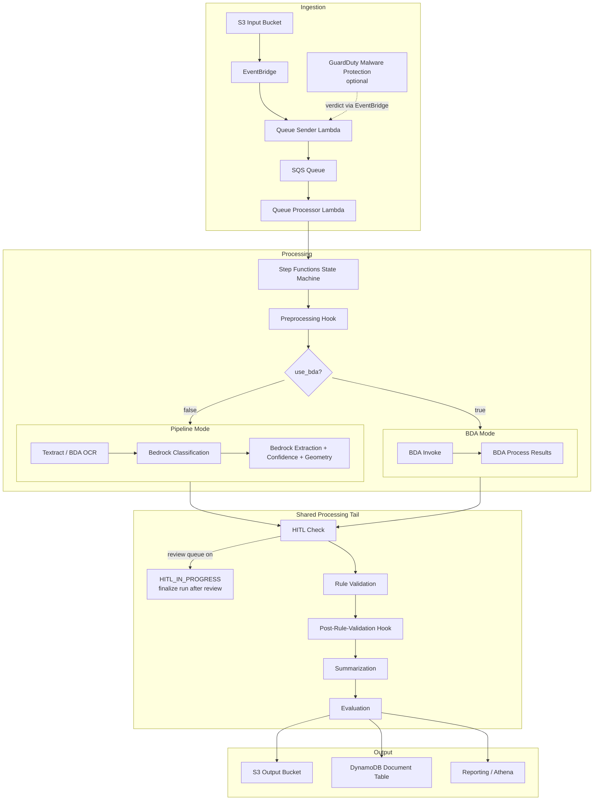

# System Overview

## Document Information

| Field | Value |
|-------|-------|
| **Document Version** | 3.6 |
| **Last Updated** | 2026-11-24 |
| **Applies to release** | v0.6.16 |
| **Classification** | Internal |
| **System Name** | GenAI Intelligent Document Processing (IDP) Accelerator |

> **v3.0 architecture update.** This document was rewritten for the v0.6 line.
> Material changes from v2.0: **AWS AppSync is fully removed** (replaced by an
> API Gateway REST API + polling + a Lambda Function URL for chat streaming);
> **ALB Web UI hosting is removed** (replaced by API Gateway S3-proxy hosting);
> **Amazon A2I / SageMaker HITL is removed** (replaced by a built-in review
> portal in the Web UI); and the **Feature Platform**, **Jobs API**, and
> **preprocessing hook** are new trust-boundary-crossing surfaces.

> **Sources.** The sections below are taken from `template.yaml`, the nested
> stacks it deploys (`patterns/unified`, `nested/api-resolvers`, `nested/bedrockkb`,
> `nested/multi-doc-discovery`, the feature-platform main-stack extensions),
> `patterns/unified/statemachine/workflow.asl.json`,
> `scripts/api_rbac_expectations.yaml`, the dispatcher / queue-processor /
> review-queue / MCP interceptor source, the Terraform translator
> (`terraform/translator`) and `lib/idp_sdk/idp_sdk/_core/terraform_deploy.py`. The
> main user pool has **five** groups; **189** operations are routable through the
> dispatcher, with the group distribution in §5 taken from
> `scripts/api_rbac_expectations.yaml`; §5 names what each layer does *not* cover;
> §5.2 covers the three non-REST authenticated entry points (chat streaming, the
> Jobs API and the MCP gateway), §5.3 admission control and §5.4 the review-queue
> surface; §6 states encryption per store; §7 covers the two deployment routes
> (CloudFormation and the experimental Terraform module) and §7.1
> deployment-time privilege. Where a gap's fix is in flight it is cited by issue
> number and marked **pending** — a pending fix is not a control, and nothing below
> should be read as one.

## 1. System Purpose

The GenAI IDP Accelerator is an AWS-deployed intelligent document processing solution that automates the extraction, classification, and analysis of information from documents using generative AI. It provides a configurable, serverless pipeline that processes documents through multiple stages—preprocessing, OCR, classification, extraction (with integrated confidence and bounding-box geometry), rule validation, summarization, and evaluation—with optional human-in-the-loop (HITL) review.

## 2. Unified Architecture

The system uses a **unified deployment model** with two processing modes selectable at runtime via the `use_bda` configuration flag:

- **Pipeline Mode** (`use_bda: false`, default): Uses Amazon Textract (or BDA-as-OCR) for OCR and Amazon Bedrock foundation models (Claude, Nova, OpenAI GPT-5.x via `bedrock-mantle`) for classification, extraction, and confidence; optionally a customer-deployed decision model (a `GENAIIDP-*` Lambda function) names sections under split-then-classify or scores extracted values.
- **BDA Mode** (`use_bda: true`): Uses Amazon Bedrock Data Automation (BDA) as an integrated service for document processing, with results mapped back into the standard pipeline output format.

Both modes share common infrastructure for document ingestion, preprocessing, queueing, tracking, human review, rule validation, evaluation, reporting, and the web UI.

> **Note on the preprocessing hook.** `preprocessing` runs *first*, before the
> BDA/pipeline routing, so it fires in both modes and even when OCR is
> disabled. It operates on the source document itself and may return
> `halt: true` to end the execution. This is the extension point the bundled
> **PII Anonymization** feature consumes. See HOOK.T06 and PII.T01–T03.

## 3. Key Components

### 3.1 Infrastructure Layer

| Component | Service | Purpose |
|-----------|---------|---------|
| **Input/Output Storage** | Amazon S3 (13 buckets) | Document upload, processing output, configuration, reporting, test sets, evaluation baseline, Web UI assets |
| **Document Queue** | Amazon SQS (20 queues incl. DLQs) | Decouples ingestion from processing; manages throughput |
| **Event Routing** | Amazon EventBridge | S3 events → Lambda, Step Functions status tracking, GuardDuty malware verdicts → queue sender (when `MalwareScanning` is on), scheduled sweepers; the Output bucket also sends every object event to the default bus for external consumers of `review/status.json`, with no consumer in the stack |
| **Workflow Orchestration** | AWS Step Functions (5 state machines) | Multi-step document processing, agentic shard Distributed Map |
| **Document Tracking** | Amazon DynamoDB (17 tables across the parent and nested stacks) | Tracking, Concurrency, Configuration, Users, Agent, ChatSessions, ChatMessages, **`ChatSessionOwnersTable`** (the owner of each chat session id), IdHelperChatMemory, **`McpCredentialsTable`** (the MCP service-credential registry, when `EnableMCP=true`), DiscoveryTracking, BootstrapTracking, **`HITLTable`** (review queues, items, drafts, history), **`NotificationsTable`** (each user's Inbox), plus ChatDocumentSessions, BDAMetadata and InstalledFeatures in nested stacks |
| **UI API Layer** | **Amazon API Gateway REST** (`POST /op/{field}`) | Single Cognito-authorized route + dispatcher to resolver Lambdas |
| **Chat Streaming** | **AWS Lambda Function URL** (`AuthType=AWS_IAM`, `RESPONSE_STREAM`) | SSE token-delta streaming for the two chat flows |
| **Jobs API** (optional) | Amazon API Gateway REST (PRIVATE) | `EnableJobsApi=true`: `/jobs` endpoints for machine-to-machine batch submission |
| **Edge / WAF** | CloudFront, optional WAFv2 (REGIONAL) | SPA delivery with a content security policy in both hosting modes; optional IP allow-list WebACL on the REST API stage, whose requests are logged to `aws-waf-logs-<StackName>-api` (`ApiWafLogGroup`, KMS-encrypted) |
| **Authentication** | Amazon Cognito (2 user pools + 1 identity pool) | Main user pool (**5 RBAC groups**: Admin, Author, Reviewer, Annotator, Viewer), which also holds the MCP app clients (`ExternalAppClient` for signed-in users, `MCPConnectorClient` and each Admin-created client-credentials app); Identity Pool mints the SigV4 credentials the chat Function URL requires; separate M2M pool for the Jobs API |
| **Secrets** | AWS Secrets Manager (CMK-encrypted) | With `EnableMCP=true`: the stack-created MCP clients' IDs and secrets (`McpConnectorClientSecret`, `McpUserClientSecret`, published as the ARNs `MCPConnectorClientSecretArn` and `MCPClientSecretArn`, never as values), one secret per Admin-created MCP credential under `<StackName>/mcp/credentials/`, and the key that signs MCP caller identities (`McpCallerSigningSecret`) |
| **Encryption keys** | AWS KMS customer-managed key | One deployment CMK — the stack-owned `CustomerManagedEncryptionKey` (`EnableKeyRotation: true`, retained on stack deletion), or since v0.6.16 a key the customer supplies through `CustomerManagedKmsKeyArn`, in which case the stack creates none — used by 11 of the 13 buckets, the DynamoDB tables except `InstalledFeaturesTable` (AWS-managed key), the SQS queues, the Secrets Manager secrets and 136 of the 139 explicitly declared log groups; the optional bastion host adds a second key of its own |
| **Compute** | AWS Lambda (130+ functions) | Processing logic, API resolvers, agents, hooks |
| **Monitoring** | Amazon CloudWatch | Alarms, dashboards, KMS-encrypted log groups |

### 3.2 AI/ML Services

| Service | Usage |
|---------|-------|
| **Amazon Bedrock** | Foundation models (Claude 3.x–5, Nova) for classification, extraction, confidence, summarization, agent chat |
| **Amazon Bedrock (`bedrock-mantle`)** | OpenAI GPT-5.x (Sol/Terra/Luna) via the OpenAI Responses API — a **non-Anthropic model family** reachable with document content (see PM.T08) |
| **Amazon Bedrock Data Automation (BDA)** | Whole-pipeline processing (`use_bda`) **or** OCR-only engine (`ocr.backend: bda`) |
| **Amazon Textract** | OCR (DetectDocumentText, AnalyzeDocument incl. `TABLES`/`LAYOUT`) |
| **Amazon Bedrock Knowledge Bases** | RAG retrieval over OpenSearch Serverless or S3 Vectors |
| **Amazon Bedrock AgentCore** | MCP Gateway (external tool access) and AgentCore Runtime (e.g. Test Set Generator) |
| **Decision models** (optional) | A customer-deployed Lambda function named `GENAIIDP-*` (for example the Strands Decider) answering System One yes/no or choice questions with page images, for section classification (`section_classification.method: decision_model`) and extraction confidence (`extraction.confidence.method: decision_model`); a TB6 component, invoked by `idp_common.decision_model.invoker` |
| **Amazon Athena / Glue** | SQL analytics over processed document data |

### 3.3 Application Features

| Feature | Description | Key Services |
|---------|-------------|--------------|
| **Web UI** | React/Cloudscape SPA for configuration, monitoring, review | CloudFront **or** API Gateway S3 proxy, S3, REST API, Cognito |
| **Agent Analysis** | Multi-agent AI for interactive document analysis | Bedrock, Athena, AgentCore |
| **Companion Chat** | Multi-turn conversational AI with SSE streaming | **Lambda Function URL**, Bedrock, DynamoDB |
| **MCP Integration** | MCP server for external clients (`EnableMCP`, default `false`): tools act as the signed-in caller or as an Admin-managed service credential, with that principal's role and configuration scope; plus External MCP agents in chat, opt-in per conversation | AgentCore Gateway, gateway interceptor Lambda, MCP handler Lambda, Cognito app clients, Secrets Manager, DynamoDB (`McpCredentialsTable`) |
| **RBAC** | **5-group** role-based access control, plus config-version scope (`allowedConfigVersions`) and test-set scope (`allowedTestSets`) | Cognito Groups, resolver Lambdas |
| **Human Review (HITL)** | **Built-in review in the Web UI** (no A2I/SageMaker): the legacy Reviewer flow, and **review queues** (v0.6.13) worked by eligible Annotators with Admin supervision, a per-user Inbox, a second (finalize) execution per reviewed document, and Admin/Reviewer bulk operations (Bulk Skip All Reviews as background jobs, Send to review) — see §5.4 | REST API, DynamoDB (`HITLTable`, `NotificationsTable`), S3, SQS (`BulkReviewJobQueue`), Step Functions |
| **Malware scanning** (optional) | GuardDuty Malware Protection for S3 holds each upload at ingest until a verdict arrives; `QUARANTINED` and `MALWARE_SCAN_FAILED` documents never start a workflow (PM.T09) | GuardDuty, EventBridge, Lambda |
| **Configuration prefix mappings** | An Input-bucket prefix decides a document's Configuration Profile and so its visibility partition; Admin-only CRUD (AUTH.T07) | DynamoDB, Lambda |
| **Discovery** | AI-driven configuration generation from sample documents | Bedrock, Lambda, multi-doc-discovery ECR container |
| **SDK/CLI** | Programmatic access for automation and integration | Python packages, Cognito auth |
| **Knowledge Base** | RAG integration for context-enhanced processing | Bedrock KB, OpenSearch Serverless / S3 Vectors |
| **Pipeline Hooks** | `preprocessing` + per-step `postHook` extensibility | Lambda, customer-managed code |
| **Feature Platform / Extensions** | Installable extensions that inject **UI bundles into the host SPA origin** and register their own APIs | S3 (WebUIBucket), CloudFormation, Lambda |
| **PII Anonymization** | Bundled preprocessing extension that redacts PII pre-inference | Bedrock, S3, DynamoDB (mapping table) |
| **Document Versions** | Immutable per-run snapshots with pinned S3 object versions | S3 versioning, DynamoDB |
| **Test Studio** | Test sets, document browser, **ground-truth visual editor** | REST API, Lambda, S3 (TestSetBucket) |
| **Test Set Generator** | Synthetic labeled test-set generation | AgentCore Runtime, Bedrock |
| **Reporting** | Analytics database with Athena, Glue, Parquet | S3, Glue, Athena |
| **Rule Validation** | Configurable business rule checks on extracted data | Lambda, Bedrock |
| **Evaluation** | Automated accuracy measurement against ground truth | Lambda, S3 |
| **Quick Start** | Conversational config bootstrap agent; Admin-only, and off on the server when `EnableQuickStartWidget=false` (v0.6.16) | Bedrock, AgentCore |
| **Review routing** (v0.6.16) | A per-profile routing table, Admin-only to change and importable from DMN, decides whether a processed document is held for review and in which production queue; review outcomes include send-back for reprocessing (HITL.T06) | Lambda, DynamoDB (`HITLTable`), Step Functions |
| **Document attributes** (v0.6.16) | Uploader-supplied key-value pairs carried from upload to results and the post-processing hook (PM.T10) | S3 metadata, DynamoDB |
| **Decision models** | Optional classification and extraction-confidence calls to a deployment-named decision model, including the Strands Decider extension built in the account (HOOK.T08 to HOOK.T10, FEAT.T06) | Lambda, CodeBuild, ECR |

## 4. Trust Boundaries

```mermaid
flowchart TD
    subgraph TB1[Trust Boundary: Internet / End User]
        Browser[Web Browser]
        CLI[SDK/CLI Client]
        M2M[M2M Clients / External MCP]
    end

    subgraph TB7[Trust Boundary: Deployment / IaC]
        Deployer[Deploying principal: CloudFormation or Terraform apply]
        TFState[Terraform state + idp-terraform working directory]
        Label[Read-only label stack + resource directory object]
    end

    subgraph TB2[Trust Boundary: AWS Edge]
        CF[CloudFront Distribution]
        Cognito[Cognito User Pools]
        WAF[Optional WAFv2 IP allow-list]
    end

    subgraph TB3[Trust Boundary: AWS Account - Application Layer]
        APIGW[API Gateway REST: POST /op/field]
        Disp[HTTP API Dispatcher Lambda]
        FURL[Lambda Function URL: chat SSE]
        JobsAPI[Jobs API PRIVATE]
        S3Buckets[S3 Buckets]
        Lambda[Resolver + Processing Lambdas]
        SFN[Step Functions]
        SQS[SQS Queue]
        DDB[DynamoDB Tables]
        EB[EventBridge]
    end

    subgraph TB4[Trust Boundary: AWS Managed AI Services]
        Bedrock[Amazon Bedrock - Anthropic/Nova]
        Mantle[Bedrock Mantle - OpenAI GPT-5.x]
        Textract[Amazon Textract]
        BDA[Bedrock Data Automation]
        BedrockKB[Bedrock Knowledge Bases]
        AgentCore[Bedrock AgentCore Gateway + Runtime]
    end

    subgraph TB3b[Application Layer: MCP path]
        Interceptor[MCP identity interceptor Lambda]
        MCPHandler[MCP handler Lambda]
        Secrets[Secrets Manager: MCP client secrets + caller-signing key]
    end

    subgraph TB5[Trust Boundary: Analytics Layer]
        Athena[Amazon Athena]
        Glue[AWS Glue]
        OpenSearch[OpenSearch Serverless / S3 Vectors]
    end

    subgraph TB6[Trust Boundary: Customer-Managed Extensions]
        HookLambda[Pipeline Hook Functions]
        CustomMCP[Custom MCP Agents]
        Decider[Decision model Lambda GENAIIDP-*]
        FeatStack[Installed Feature Stacks]
        FeatBundle[Feature UI Bundles - run in host SPA origin]
    end

    Browser --> CF --> APIGW
    Browser --> WAF --> APIGW
    Browser --> CF --> S3Buckets
    Browser -->|SigV4 Cognito Identity Pool| FURL
    CLI --> Cognito --> APIGW
    M2M -->|client_credentials| JobsAPI
    M2M -->|Cognito access token| AgentCore
    AgentCore -->|validated token| Interceptor
    Interceptor -->|signed caller block| AgentCore
    AgentCore --> MCPHandler
    Interceptor --> Secrets
    MCPHandler --> Secrets
    MCPHandler --> S3Buckets
    MCPHandler --> DDB
    APIGW --> Disp --> Lambda
    FURL --> Bedrock
    JobsAPI --> Lambda
    Lambda --> DDB
    Lambda --> S3Buckets
    Lambda --> Bedrock
    Lambda --> Mantle
    Lambda --> Textract
    Lambda --> BDA
    Lambda --> BedrockKB
    Lambda --> AgentCore
    Lambda --> Athena
    Lambda --> HookLambda
    Lambda --> CustomMCP
    Lambda -->|page images + questions| Decider
    S3Buckets --> EB --> Lambda
    Lambda --> SQS
    SQS --> Lambda
    Lambda --> SFN
    BedrockKB --> OpenSearch
    FeatStack -->|writes ui-bundle.js| S3Buckets
    S3Buckets -->|served same-origin| FeatBundle
    FeatBundle -->|host credentials| APIGW
    Deployer --> TFState
    Deployer --> Label
    Deployer -->|creates roles, key, buckets| S3Buckets
    CLI -->|SDK hook reads resource directory| Label
```

### Trust Boundary Descriptions

| Boundary | Description | Controls |
|----------|-------------|----------|
| **TB1: Internet/End User** | Untrusted external users and clients | TLS 1.2+, authentication required |
| **TB2: AWS Edge** | CDN, identity, optional WAF, and the MCP gateway's token check | CloudFront OAC, Cognito JWT validation, optional WAFv2 IP allow-list (default-block WebACL, requests logged), the same content security policy in both hosting modes (`SecurityHeadersPolicy` in `template.yaml`, the `WebUiSecurity` mapping in `nested/api-resolvers/template.yaml`, held in sync by `scripts/tests/test_csp_policies_in_sync.py`; `default-src 'self'` with named sources per resource kind, but `script-src` keeps `'unsafe-inline'` and `'unsafe-eval'` — UI.T01, UI.T07), and the AgentCore Gateway's JWT authorizer, which admits access tokens only from the stack's MCP app clients |
| **TB3: Application Layer** | Core application infrastructure | IAM roles, least-privilege Lambda execution roles, a **default-deny group floor at the dispatcher** with every narrower check (scope, ownership, review-queue eligibility) in the resolver Lambdas, VPC-optional (`ApiGatewayVisibility=PRIVATE`). On the MCP path the same role and scope model is applied by `idp_common.mcp_access` in two halves — the gateway interceptor and the MCP handler — joined by an HMAC-signed caller block (§5.2) |
| **TB4: Managed AI Services** | AWS-managed AI/ML services | Service-linked roles, encryption in transit/at rest, an optional Bedrock guardrail, applied when configured through `idp_common/bedrock/guardrail.py` on the shared client and on the agentic extraction, Chat with Document, discovery and rule-translation paths (OpenAI GPT-5.x models do not receive it, and a warning is logged); note GPT-5.x is a non-Anthropic model family on Bedrock |
| **TB5: Analytics Layer** | Data analytics and search | Athena workgroup isolation, OpenSearch encryption |
| **TB6: Customer Extensions** | Customer/third-party hooks, MCP agents, decision models, and **installed features** | Separate IAM roles, invocation-only permissions from core: the pipeline functions that run classification, extraction (including the advanced-extraction shard runtime) and assessment hold `lambda:InvokeFunction` on `GENAIIDP-*` only, which carries both `LambdaHook` inference and decision models (`scripts/tests/test_decision_model_invoke_grants.py`). A decision model receives page images and the class descriptions or extraction questions, and its answer becomes the section's class or a value's confidence; a refused or failed call fails the section rather than falling back to an LLM. External MCP agents in chat are off unless enabled per conversation, and neither opt-in agent runs once Analytics or Error Analyzer results are in the conversation. **Feature UI bundles execute in the host SPA's origin with the user's session** — see FEAT.T01. `onError: fail` is terminal at **every** hook point: each of the seven routes `HookFatalError` (what `onError: fail` raises) to a terminal failure state (HOOK.T07, closed by **issue #919**). Under queue review the four hooks before the review point run in both executions (§5.4) |
| **TB7: Deployment / IaC** | The principal that creates the deployment — through CloudFormation, optionally with the shipped CloudFormation service role, or through `terraform apply` of the generated module — and what that route leaves behind: Terraform state, the `idp-cli` working directory, the read-only label stack and the resource directory object the SDK reads | CloudTrail attribution, `iam:PassRole` gating, `scripts/sdlc/validate_service_role_permissions.py` in both CI systems. The shipped service role confines IAM writes and `iam:PassRole` to the stack-name prefix and requires the created-role boundary on every role it creates, but holds `cloudformation:*` and service-wide wildcards on the services the stack uses, so passing it is a broad grant (§7.1, SDK.T05). A Terraform deployment has no service role: every call is made with the credentials Terraform runs with, and the state holds every setting and the Cognito client secrets in clear (§7) |
| **TB8: Tenant (inside one stack)** | Several tenants sharing one deployment, each a set of Input-bucket prefixes tied to a profile name pattern; the principals who decide tenancy (Admins under `TenantGrantSource=Manual`, the identity provider's role administration under `IdpClaim`, an entitlement system under `Api`) and whoever deploys the per-tenant S3 Access Points | Write-time boundary checks on mappings, tenants and scopes; under `TenantIsolationMode=Strict` or an external grant source, unscoped non-Admins denied, unscopable surfaces closed, MCP tools scoped like the UI with the stack-created MCP client starting disabled, ingest tenant check, access-point delegation with confining policies. Enforced by the application, not by IAM; Admins are cross-tenant. See [`tenant-isolation.md`](../feature-threats/tenant-isolation.md) (TEN.T01–T05) |

> **Critical boundary note (new in v3.0).** TB6 now contains code that executes
> *inside* TB1's browser context at the host's origin: an installed feature's
> `ui-bundle.js` is injected via `document.createElement('script')` and is
> handed a host API client. Unlike a hook Lambda (which is isolated by IAM),
> a feature UI bundle is **not** isolated from the host session. Installing a
> feature is therefore equivalent to granting it the privileges of every user
> who visits the UI. See [FEAT.T01](../feature-threats/feature-platform.md).
>
> The load mechanism is worth stating precisely, because it determines what a
> control would have to do: the SPA's `FeatureLoader` appends a `<script>` whose
> `src` is `/<feature>/ui-bundle.js` on its own origin, with `crossOrigin`
> set but **no `integrity` attribute**. There is therefore no subresource-integrity
> pin between the bundle written to the Web UI bucket at install time and the
> bundle the browser executes; the controls that apply are the bucket's write
> permissions and the install-time review of the feature, not verification at
> load time. The content security policy does not change this: the bundle is
> served from the SPA's own origin, which `script-src 'self'` admits.

## 5. Authorization Model (v0.6.16)

### 5.1 The Web UI API edge

Every UI call is a `POST /op/{field}` against a **single** API Gateway REST
route. Because there is one route, there is no per-operation gateway control at
all: the authorization decision lives almost entirely in the code behind the
dispatcher. The "what it does NOT do" column is the load-bearing half of this
table.

| Layer | What it does | What it does NOT do |
|-------|--------------|---------------------|
| WAFv2 (optional) | IP allow-list, default-block WebACL on the REST stage; requests logged to `aws-waf-logs-<StackName>-api` | No authn/authz. Not associated with the chat Function URL or the MCP gateway |
| API Gateway resource policy | When `ApiGatewayVisibility=PRIVATE`, restricts to the VPC interface endpoint | No user authz |
| Cognito authorizer (`COGNITO_USER_POOLS`) | **Authenticates** the ID token; 401 on missing/invalid/expired | **No group evaluation.** It cannot do per-operation authorization, because every operation shares one route |
| Dispatcher (`http_api_dispatcher`) | Normalizes the event, validates argument shape (400), routes to a resolver Lambda or an in-process handler, maps denials to 403 | **Denies by default.** `authz.py` checks the caller's groups against the generated field-level manifest before routing, and a field with no entry is refused with 403 rather than forwarded (AUTH.T16, **issue #928** closed). Its 403 mapping now keys on the exception **type** first (`PermissionError`/`AuthorizationError`), with the conventional message prefix retained as a fallback — so a reworded exception raised as one of those types keeps its status, and one raised as a bare `Exception` still depends on its wording |
| In-process handlers (`ddb_direct`, 11 ops) | **Enforces `cognito:groups`** from its own `_REQUIRED_GROUPS` table before touching DynamoDB — the only group check at dispatcher level | Returns without denying for any field absent from that table, so the check is opt-in per field |
| **Resolver Lambda** (~40 functions) | **Enforces `allowedConfigVersions` and `allowedTestSets` scope, per-object ownership and review-queue eligibility**, and repeats the group check | Nothing forces a per-object check to exist or to match the right object (AUTH.T16) |

**189 operations** are routable — 44 mapped directly by the
`FIELD_FUNCTION_MAP` published to SSM at
`/${StackName}/http-api/field-function-map`, **135** aliased onto shared
resolvers by `FIELD_ALIASES`, and 11 served in process by `ddb_direct`. Those
three sets sum to 190, not 189, because one field (`getCircuitBreakerStatus`)
appears in both `FIELD_FUNCTION_MAP` and `ddb_direct._HANDLED`; the distinct
union is 189, which is exactly the number of entries in
`scripts/api_rbac_expectations.yaml`. Their required-group distribution:

| Required groups | Ops |
|---|---|
| Admin only | 52 |
| Admin + Author | 43 |
| Any assigned group, whichever one (`ANY_GROUP`) | 28 |
| Admin + Author + Viewer | 16 |
| Admin + Annotator + Reviewer | 16 |
| Admin + Annotator + Author | 11 |
| Any authenticated user, group or no group (`ANY`) | 8 |
| Admin + Reviewer | 10 |
| Admin + Annotator | 1 |
| Annotator only | 1 |
| All five groups | 1 |
| IAM/backend only (Cognito callers rejected) | 2 |

The tenant operations (`listTenants`, `putTenant`, `deleteTenant`, `setUserTenant`)
and the MCP credential operations (`listMcpCredentials`, `createMcpCredential`,
`updateMcpCredential`, `rotateMcpCredential`, `revokeMcpCredential`,
`setMcpCredentialTenant`, served by `mcp_credential_manager` and present only when
`EnableMCP=true`) are all Admin only; a scoped Admin may grant a credential only
profiles inside their own `allowedConfigVersions`, inside one tenant, and cannot
create an unscoped one. The bulk review operations (`bulkSkipAllReviews`,
`sendToReview` and the four job operations, in `bulk_review_resolver`) are Admin +
Reviewer. Test Studio queue, labelling and test-set operations admit Admin, Author
and Annotator (Admin and Annotator for `listTestSetQueues`, Annotator alone for
`claimTestSetDocument`), so a Reviewer works production review queues only.

`ANY_GROUP` is resolved at build time into every group `template.yaml` creates, so a
group added there joins those 28 without an edit per operation; what they refuse is a
caller an administrator has not placed in any group, which domain-scoped self-signup
produces. Every document read is in that set, including the ones that return an object
key, an `s3://` URI, a list of extracted attribute names or a model-written page
description rather than a value, because those compose into one chain that was measured
running end to end for a groupless caller. ⚠️ That is a check on the **API**, and the
**document** bytes are behind it rather than beside it.
`CognitoIdentityPoolSetRole` attaches one `authenticated` role with no `RoleMappings`,
so whatever that role can read is readable by every authenticated user irrespective of
group, with no resolver in the path to apply a check of any kind — which is why it
grants **nothing** on the document buckets, **no** `s3:GetObject`,
`s3:GetObjectVersion` or `s3:ListBucket` on any bucket, and **no** KMS action. Its two
inline policies are `lambda:InvokeFunction` and `lambda:InvokeFunctionUrl` on the
chat-streaming function and `ssm:GetParameter` on the settings parameter. A document read is therefore an API call
— `getFileContents`, `getFilePresignedUrl` or `getFilePresignedUrls`, each declared
`ANY_GROUP` — so the distribution above does bound the bytes (see UI.T06 and
AUTH.T03). The two buckets partitioned per user — Configuration and Test Set — are
absent from that role for the same reason, so the configuration-revision store and the
test-set documents are likewise reachable only through a resolver that applies the
caller's scope to the key. ⚠️ What the distribution does **not** supply is
per-document authorization: on the document buckets the resolver matches the owning
document's `ConfigVersion` against the caller's `allowedConfigVersions`, which refuses
a *scoped* caller a document outside their profiles. Under the default
`TenantIsolationMode: Off` it refuses an *unscoped* caller nothing, scoping being
opt-in per user; under `Strict` an unscoped non-admin resolves to a scope that matches
no profile and is refused every document. Per-user document ownership is not modelled
at all; per-*tenant* isolation is, through tenant declarations (see
[Multi-Tenant Isolation](https://github.com/aws-solutions-library-samples/accelerated-intelligent-document-processing-on-aws/blob/develop/docs/multi-tenancy.md)).

Beyond the group check, **65** operations verify config-version scope, **10** filter
their result rows by it, and **22** verify per-object ownership.
[`scripts/api_rbac_expectations.yaml`](../../../scripts/api_rbac_expectations.yaml)
is the manifest of record for all of this and is asserted by
`make api-test-static` in both CI systems and by the live matrix in
`make api-test`. Its `known_gaps` block holds **two** entries, of which one is an accepted *authorization* gap and the other is a limitation of the live harness — `GAP-SEC-INCONCLUSIVE-5XX`, which records that a 5xx response scores a matrix cell INCONCLUSIVE rather than as a pass, and that a resolver refusal raised as a bare `Exception` still produces one. Not-found refusals answer 404 (`errorType: "ResourceNotFound"`); the gap entry itself enumerates what remains at 500, rather than this page quoting a count that goes stale. The authorization gap: **GAP-02**: the `queryKnowledgeBase`
*resolver* performs no group check of its own, so the dispatcher's floor — which
requires an assigned group — is the only group gate on it.

Two mechanical details matter when reading resolver code. The REST authorizer
places claims at `requestContext.authorizer.claims` (not where an AppSync-era
resolver would look) and flattens `cognito:groups` into a **comma-joined
string**; `idp_common.api_adapter._coerce_groups` restores it to a list, so that
one function is load-bearing for every group check in the system. And the
CloudFormation logical id of the REST API is `HttpApi` even though its resource
type is `AWS::ApiGateway::RestApi` — a name to read carefully rather than a
second API.

The GraphQL schema (`schema.graphql`) is retained as the source for input-shape
validation and as documentation of intent. Its 335 `@aws_cognito_user_pools`
directives are **advisory only** — nothing enforces them at runtime now that
AppSync is gone (see AUTH.T08).

### 5.2 The three other authenticated entry points

The REST route is not the whole edge. Three further paths authenticate differently
and do **not** pass through the dispatcher or the resolvers:

| Entry point | Authentication | Authorization |
|---|---|---|
| **Chat streaming Function URL** (`ChatStreamProcessorUrl`) | `AuthType=AWS_IAM`; the browser SigV4-signs with credentials from the Cognito **Identity Pool**, and also presents its Cognito **ID token** in `x-idp-id-token` | The endpoint verifies the ID token (signature against the user pool's key set, issuer, app client, `token_use`, expiry) and answers 401 without one. The group checks of both chat routes and the Chat-with-Document scope check run on the verified claims, and each session id is checked against its owner in `ChatSessionOwnersTable` before the stream opens. Nothing identity-like is read from the request body. See CHAT.T03 and CHAT.T06 |
| **Jobs API** (optional, `EnableJobsApi=true`) | A separate `ApiUserPool` with OAuth **client-credentials** scopes (`idp-api/jobs.write`, `jobs.read`) | Scope-based, PRIVATE-endpoint only. A distinct realm from the Cognito group model — see JOB.T01–T03 |
| **MCP server** (optional, `EnableMCP`, default `false`) | A Cognito **access token** from the main user pool, validated by the AgentCore Gateway's JWT authorizer against an allow-list of app clients: `ExternalAppClient` for a signed-in user (authorization-code flow), and client-credentials apps for services — the stack-created `MCPConnectorClient` and each credential an Admin creates on the MCP Configuration page. `idp_common.mcp_gateway` keeps the allow-list in step with the credential registry | The gateway interceptor (`McpIdentityInterceptorFunction`) resolves the token to a principal with `idp_common.mcp_access.resolve_caller`: a user takes their own Cognito groups and `allowedConfigVersions`; a service credential takes the role, configuration profiles, write-tools setting and expiry recorded in `McpCredentialsTable`. It refuses a tool the principal may not call, filters `tools/list`, discards any client-sent `_caller` argument and adds one HMAC-signed with `McpCallerSigningSecret` and bound to the gateway request id. The handler (`agentcore_mcp_handler`) verifies that block and refuses the call without it, then applies the principal's scope to every document it reads or returns. Tool policy (`MCP_TOOL_POLICY`): `process`/`reprocess` Admin or Author, `status`/`get_results` the four document roles, `search` Admin/Author/Viewer and only for an unscoped caller; Annotator reaches no tool. Credentials expire and are revoked by a daily sweep (`McpCredentialSweepSchedule`); switching MCP off, deleting the stack or downgrading revokes every one. See MCP.T01–T06 |

When `WebUIHosting=APIGateway`, two further methods (`GET /` and `GET /{proxy+}`)
serve the SPA from S3 with `AuthorizationType: NONE`. That is deliberate: they
serve public static assets, and the WAF plus the endpoint policy are the only
controls that apply to them. Together with the CORS `OPTIONS` method
(`HttpApiOptionsMethod`), which is also `AuthorizationType: NONE`, that makes
**three** unauthenticated methods out of the REST API's four — the fourth,
`POST /op/{field}`, is the only `COGNITO_USER_POOLS` one. All three are
allow-listed explicitly in check **S5** of the static scan, so a *fourth*
unauthenticated method cannot be added without the gate noticing.

Two properties of the MCP path are worth modelling rather than assuming. The
gateway forwards tool arguments the schema does not declare, verbatim, and an
`UpdateGateway` that omits the interceptor removes it; the signed caller block is
what makes either fail closed, since a call reaching the handler without a valid
signature is refused rather than served unattributed. A user's groups are read from the access token,
so a group change reaches MCP when the token is refreshed; the interceptor reads the
account with `AdminGetUser` (refusing a disabled account or a `sub` mismatch) and
caches the resolved user for up to 30 seconds (`USER_CACHE_SECONDS`), so disabling a
user or changing their scope takes effect within that window. Tool results that carry document text say so in a
`provenance` field, which the MCP Connector passes to its client's model; that is a
label for the client, not a control in this stack (MCP.T03).

CORS is wildcard-origin on both the REST route and the Function URL. Because
credentials travel in headers (bearer token or SigV4) and `AllowCredentials` is
false, this is not itself the authorization gap — but it does mean any origin can
drive both APIs with credentials it can obtain.

Under `TenantIsolationMode=Strict` or an external `TenantGrantSource` (the
`DeniesUnscopedCaller` condition in `template.yaml`) the Web UI is built with an
empty `VITE_STREAM_URL`, so it uses the REST chat path, which carries verified
Cognito claims and can be scoped. The streaming function itself refuses any turn it
cannot attribute to a verified caller (`chat_stream_processor/app.py`), which on the
Function URL is every turn. The Function URL and its Identity Pool grant still
exist in those modes, but they serve nothing. In the same modes MCP tools are scoped
like the UI (an unscoped non-Admin resolves to a scope that matches no profile), and the stack-created MCP client
starts disabled until an Admin narrows it on the MCP Configuration page.

### 5.3 Admission control at ingestion

Not authorization, but the same category of control a reader may assume rather
than verify: the queue processor is what stops an upload burst from becoming
unbounded Step Functions and Bedrock spend. Admission is a DynamoDB counter
incremented with `ADD active_count :inc` under a `ConditionExpression` of
`active_count < :max`, so the decision is atomic rather than a read-then-write
race. Around it: `reconcile_counter` corrects drift against the real count of
running executions under its own conditional write; drift is emitted as a metric
so a leaked slot is visible rather than silent; a circuit breaker can stop
admission entirely; SQS visibility is extended during a downstream outage
instead of dropping work; and executions are named deterministically — from the
input key and message id, or for a review-queue finalize run from its single-use
finalize token — so a redelivered SQS message cannot start a second execution for
the same document. The queue processor also holds `states:StopExecution`, scoped
to this stack's processing state machine, to stop a workflow it started for a
document that was aborted while the start was in flight. When `MalwareScanning`
is on, the queue sender does not enqueue an upload until its GuardDuty verdict
arrives, so a held document occupies no slot. The failure mode worth modelling here is a
*leaked* slot — capacity lost until reconciliation runs — rather than
over-admission. See SDK.T04.

### 5.4 The review-queue surface

Review queues are the largest change to the authorization surface since the REST
migration: 40 operations, all behind the same dispatcher floor, in three resolvers
(`review_queues_resolver`, new operations in `test_set_resolver`, and
`notifications_resolver` for the Inbox). What they decide is **who can reach a
production document**: the `Annotator` group, otherwise confined to the test sets
in `allowedTestSets`, works the production items of every queue that lists it as
eligible, and an Admin supervises.

- **Per-item operations** check queue eligibility (keyed on the `email` claim) and
  the item's configuration profile against `allowedConfigVersions`, and fail closed
  on everything they cannot evaluate. **Listings** apply the same profile check to
  each item they return, since a queue holds several profiles' items (HITL.T01).
- **Writes** are conditioned in DynamoDB on the item's version, state and holder,
  so only the holder saves or completes and a stale writer is refused (HITL.T02).
- **The finalize execution** is started by the review-queues resolver itself,
  which holds `sqs:SendMessage` on `DocumentQueue`; the message body is built
  server-side from the tracking row. The four hooks before the review point run in
  both executions; post-review hooks, summarization, evaluation and rule
  validation run in the finalize execution only (HOOK.T04).
- **The Inbox** has no posting operation; reads are keyed on the caller's verified
  identity. Group-addressed messages are expanded with `ListUsersInGroup` at post
  time, so `WorkflowTracker`, the review-queues resolver and the test-set resolver
  hold that Cognito read (HITL.T03).
- **New write grants** worth knowing: the test-set resolver can write the
  UsersTable (it records an assignee's `allowedTestSets`), and the review-queues
  resolver can update any tracking row and read the whole Output bucket (HITL.T04).
- **Outbound:** `<document>/review/status.json` records the outcome, reviewer and
  any reject note, and the Output bucket's EventBridge feed carries every object
  event to the account's default bus (HITL.T03).

The legacy Reviewer operations remain for documents a queue does not manage, and
refuse one it does (`QUEUE_MANAGED`); `uploadDocument` and `processChanges` refuse
to overwrite a document's sections while it is in review.

**Bulk review** (`bulk_review_resolver`, Admin + Reviewer) finishes many pending
reviews without anyone checking them (`bulkSkipAllReviews`, with a required reason
and a dry run) or puts finished production documents into the Default review queue
(`sendToReview`). A by-profile request is refused unless the profile is in the
caller's `allowedConfigVersions`; a selected-documents request reports an
out-of-scope or unknown key as `NOT_PERMITTED` per document. Large requests run as
background jobs on `BulkReviewJobQueue` (`BulkReviewWorkerFunction`), and a Reviewer
lists, cancels and deletes only the jobs they requested, keyed on the verified
caller. The resolver holds `sqs:SendMessage` on `DocumentQueue` (resubmission for
downstream processing), write access to `<document>/review/` objects and read access
to the whole Output bucket.

## 6. Data Classification

> **How encryption is actually configured (restated in v3.2).** There is one
> stack-owned KMS customer-managed key, `CustomerManagedEncryptionKey`, with
> `EnableKeyRotation: true`. **11 of the 13 buckets** encrypt with it; the S3
> access-log bucket and the Web UI asset bucket use SSE-S3 (`AES256`) instead,
> which is appropriate — one is a log sink S3 itself writes to, the other holds
> public SPA assets. The DynamoDB tables (except `InstalledFeaturesTable`, which
> uses the AWS-managed key), the SQS queues, the Secrets Manager secrets and 136 of
> the 139 explicitly declared CloudWatch log groups also use the CMK; the knowledge-base stack declares no log
> groups for its five functions, which therefore take Lambda's defaults. **All 13 buckets** block public access, enable
> versioning, and carry a bucket policy that denies any request where
> `aws:SecureTransport` is false, so cleartext access is refused at the bucket
> rather than merely discouraged at the client. Two properties of the key policy
> should be modelled rather than assumed: it grants the account root full
> `kms:*`, and it carries **no `kms:ViaService` condition**, so a principal in the
> account that holds the key's data actions can use it directly rather than only
> through the services that hold the data. Since v0.6.16 the stack key has
> `DeletionPolicy: Retain` and `UpdateReplacePolicy: Retain`, so the buckets the
> stack retains on deletion stay readable afterwards, and the key with its
> root-delegated policy outlives the stack until someone schedules its deletion.
> A new stack can instead take a customer's own key (`CustomerManagedKmsKeyArn`):
> a create-time custom resource checks that it is an enabled, symmetric,
> encrypt/decrypt customer managed key in the stack's account and Region, and any
> later change that sets, clears or swaps the key is refused. The check does not
> read the key policy, so a policy that admits `DescribeKey` but withholds the
> data actions passes and the stack fails at its first write. A supplied key is
> administered outside the stack: disabling it, scheduling its deletion or
> narrowing its policy makes every store in the deployment unreadable, and the
> stack raises no alarm on the key's state. A Terraform deployment adds one bucket of its own, the custom-resource
> bridge's, which is SSE-KMS with the same key and TLS-only, and holds
> custom-resource responses, the label stack's template and the resource directory
> (§7).

| Data Type | Classification | Storage | Encryption |
|-----------|---------------|---------|------------|
| Source documents | Customer Confidential | S3 Input Bucket | SSE-KMS (stack CMK); TLS-only bucket policy |
| Extracted data / results | Customer Confidential | S3 Output Bucket, DynamoDB | SSE-KMS (stack CMK); TLS-only bucket policy; DynamoDB SSE-KMS |
| Document version snapshots | Customer Confidential | S3 (pinned object versions) | SSE-KMS (stack CMK); versioning enabled |
| Configuration | Internal | S3 Config Bucket, DynamoDB | SSE-KMS (stack CMK); DynamoDB SSE-KMS |
| User credentials | Restricted | Cognito | AWS-managed encryption |
| Chat conversations | Customer Confidential | DynamoDB | DynamoDB SSE-KMS (stack CMK) + TTL |
| Inbox messages and preferences | Customer Confidential | DynamoDB (`NotificationsTable`, partitioned per user) | DynamoDB SSE-KMS (stack CMK) + TTL |
| Review queues, items, drafts, history | Customer Confidential | DynamoDB (`HITLTable`); draft bodies and `review/status.json` in the Output bucket | DynamoDB SSE-KMS (stack CMK); SSE-KMS (stack CMK) |
| MCP client IDs and secrets, MCP caller-signing key | Restricted | AWS Secrets Manager (`<StackName>/mcp/...`); the credential registry (role, profiles, expiry, no secret) in DynamoDB (`McpCredentialsTable`) | Secrets Manager with the stack CMK; DynamoDB SSE-KMS (stack CMK). Stack outputs carry only the secret ARNs |
| **PII redaction mappings** | **Restricted** | DynamoDB (feature-owned table) | **SSE with CMK; opt-in storage only** |
| Reporting data | Customer Confidential | S3 Reporting Bucket (Parquet) | SSE-KMS (stack CMK) |
| Test sets + ground truth | Customer Confidential | S3 TestSetBucket | SSE-KMS (stack CMK) |
| Web UI assets (incl. feature `ui-bundle.js`) | Public | S3 WebUIBucket | SSE-S3 (`AES256`) — public by design; the concern here is integrity, not confidentiality (FEAT.T01) |
| S3 access logs | Internal | S3 Logging Bucket | SSE-S3 (`AES256`) — S3 is the writer |
| Knowledge Base vectors | Customer Confidential | OpenSearch Serverless / S3 Vectors | Encryption at rest |
| Processing logs | Internal | CloudWatch Logs | KMS-encrypted log groups |

## 7. Deployment Model

- **Deployment method**: AWS SAM (CloudFormation) via `publish.py` / `idp-cli deploy`, or — experimental — Terraform or OpenTofu (1.7 or later) with the module generated from the same templates (§7.2)
- **Runtime**: Python 3.12+ (Lambda), React/Vite (UI)
- **UI hosting**: `WebUIHosting=CloudFront` (default) or `APIGateway` (S3 proxy on the REST API; VPC-capable, GovCloud-compatible). Both send the same content security policy, apart from `frame-ancestors` (`'self'` with CloudFront, `'none'` with API Gateway, matching each mode's `X-Frame-Options`). The UI CodeBuild project runs unprivileged and logs to a stack-owned `/<StackName>/codebuild/<ProjectLogicalId>` group. **ALB hosting removed in v0.6.0.**
- **Regions**: All commercial AWS regions with required service availability; **GovCloud supported** via `idp-cli publish/deploy --govcloud` (full Web UI) or `--headless`
- **MCP**: `EnableMCP` defaults to `false`, so a new stack has no MCP gateway, clients, secrets or MCP Configuration page unless it is set. The console and `idp-cli deploy` keep an existing stack's value; a tool that sends only named parameters (the AWS CLI, `idp-cli deploy --terraform`, the Terraform module) turns MCP off unless `EnableMCP=true` is passed, and turning it off revokes every MCP service credential
- **Multi-tenancy**: one stack per tenant, or several tenants in one stack through
  tenant declarations (Input-bucket prefixes tied to a profile name pattern). With
  `TenantIsolationMode: Off` (the default) declarations are enforced when mappings,
  tenants and user scopes are written; `Strict` also denies unscoped non-admins,
  refuses documents whose key and profile belong to different tenants at ingest,
  makes the cross-document agent and Knowledge Base surfaces Admin-only, scopes MCP
  tools like the UI (with the stack-created MCP client disabled until narrowed),
  and lets the Input and Output bucket policies delegate to per-tenant S3
  Access Points. `TenantGrantSource` decides who writes a non-Admin's scope
  (`Manual`, `IdpClaim` or `Api`); under the two external sources an unscoped
  non-Admin is denied whatever the isolation mode, and Admin scope edits are
  refused. Under `IdpClaim`, `TenantSelection=UserSelect` (v0.6.16) lets a user
  the provider grants several tenants choose the active one among exactly those
  (`selectActiveTenant`). Admins are cross-tenant in every mode. Threats: TEN.T01–T05 in
  [`tenant-isolation.md`](../feature-threats/tenant-isolation.md)
- **Infrastructure as Code**: `template.yaml` + nested stacks (`api-resolvers`, `bedrockkb`, `multi-doc-discovery`, feature-platform); feature-platform extensions install as CloudFormation stacks under either deployment route

### 7.1 Deployment-time privilege

Deployment is itself a trust boundary (TB7 above), and the most privileged one:
the deploying principal creates the IAM roles, the KMS key and the buckets that
every runtime control in this document depends on. The repository ships an
*optional* CloudFormation **service role**
(`iam-roles/cloudformation-management/IDP-Cloudformation-Service-Role.yaml`) to let
an operator deploy without holding administrator rights. Its IAM half is contained:
`iam:CreateRole` and the role-policy actions are allowed only on roles named with
`ManagedStackNamePrefix` and only when the role carries the boundary named by
`CreatedRolePermissionsBoundaryArn`; `iam:PassRole` is confined to the same prefix
with an `iam:PassedToService` condition; and stripping a boundary, editing either
boundary policy, creating IAM users or keys, and modifying the role itself are
denied. Its service half is not narrowed: it holds `cloudformation:*` and
service-wide wildcards with `Resource: "*"` on the services the stack uses, so
whoever can pass it can change any resource of those services in the account.
Treat `iam:PassRole` on it as a broad grant and scope who holds it accordingly. See
SDK.T05.

A Terraform deployment uses no service role. Every call is made with the
credentials Terraform runs with — administrator-level, or a role modelled on the
service role above passed as `--terraform-assume-role-arn` — plus the Cloud Control
actions for the `awscc` resources and `kms:GenerateDataKey`/`kms:Decrypt` on the
stack key. Every role the module creates, the custom-resource bridge's included,
takes `PermissionsBoundaryArn` when it is set.

The Region's API Gateway CloudWatch logging role is one setting per account and
Region. By default the stack creates that role and sets it
(`ApiGatewayCloudWatchRole`, `ApiGatewayAccount`, both retained on deletion);
with `ManageApiGatewayAccountSettings=false` (v0.6.16) it creates neither and
relies on the Region's existing setting, so several deployments in one Region do
not overwrite one another. With that setting absent, stage creation at an INFO or
DEBUG log level fails at create rather than running unlogged. Deleting or
replacing the shared role later stops REST API execution logging for every
deployment in the Region, and the stack raises no alarm for it.

### 7.2 Terraform deployment (experimental)

The module is generated by `terraform/translator` from the published templates and
published beside them as a zip with a SHA-256 checksum file and an
`idp-terraform-latest.json` pointer. It is used from the operator's own root
configuration or written and applied by `idp-cli deploy --terraform`. What this
route adds to the trust model:

- **State is a credential store.** Terraform state holds every setting passed and
  every resource attribute, including the Cognito app client secrets and the
  `SecretString` of the MCP client secrets, in clear. `idp-cli` keeps state in the
  local working directory (`./idp-terraform/<stack-name>`) unless a backend is
  configured there, and writes `terraform.tfvars` and `idp-cli-parameters.json`
  readable by their owner only (`write_private` in
  `lib/idp_sdk/idp_sdk/_core/terraform_deploy.py`); protecting a remote backend is
  the operator's responsibility.
- **Module integrity.** `idp-cli` checks the archive it reads against the pointer's
  `sha256`, but the pointer sits in the same bucket as the archive, so the check
  detects corruption rather than a writer of that bucket. `terraform init`
  downloads the module again and checks nothing; deploying exactly verified bytes
  means extracting the archive into a local module directory.
- **Custom-resource bridge.** CloudFormation custom resources run through a bridge
  Lambda (`<stack>-cfn-bridge`) that calls each handler as CloudFormation would. Its
  own policy grants no `lambda:InvokeFunction`; each handler grants it through a
  resource policy naming the bridge role. Its bucket is SSE-KMS with the stack key,
  TLS-only and public-access-blocked.
- **The read-only label stack** (`stack_name`, one `WaitConditionHandle`, tags
  `ManagedBy=Terraform` and `ReadOnly=true`) lets `idp-cli` and the SDK address the
  deployment by `--stack-name`. Its parameters' allowed values are exactly their
  applied values, so a CloudFormation update of them is refused, and `NoEcho`
  parameters are left out. `idp-cli deploy` and `delete` without `--terraform`
  refuse a label stack. The SDK installs a hook on the CloudFormation clients it
  creates that answers resource lookups for a label stack from the resource
  directory object in the bridge bucket, so a principal who can write that object
  decides which resources `idp-cli` and SDK callers act on for that deployment; the
  object's integrity rests on the bucket's IAM permissions.
- **Destructive plans.** `idp-cli deploy --terraform` refuses a plan that deletes or
  replaces a data-holding or retained resource unless given
  `--terraform-allow-replace-stateful`. A failed apply is not rolled back.
- **Migration from `genai-idp-terraform`.** `idp-cli terraform
  migrate-from-genai-idp-terraform` has the new deployment adopt the old one's
  buckets, tables, KMS key and Cognito user pool. Each phase is a dry run until
  `--apply`. The module's key policy replaces the adopted key's; the adopted pool's
  users keep their passwords and their group memberships, which become
  authorization in the new deployment's group model; the old deployment's upload
  rule is disabled by the `freeze` phase, and an apply in the old deployment's
  directory afterwards would re-enable it and contend for resources both now hold.
- **Offline checks.** `make terraform-check` (both CIs) translates `template.yaml`,
  runs `init -backend=false` and `validate` with each pinned Terraform and OpenTofu
  release, and `make terraform-scan-diff` fails on a pinned `checkov` finding the
  generated Terraform has and the CloudFormation templates do not, unless it has a
  reasoned entry in `scripts/terraform_scan_baseline.json` (or, for checks with no
  CloudFormation counterpart, a pinned count in
  `scripts/terraform_scan_tf_only_baseline.json`). Neither plans or applies, and a
  scanner sees only what its rules look at.

## 8. Security Test Coverage

Four automated test suites back this threat model; results are snapshotted per
release under [`security/test-results/<version>/`](../../test-results/):

| Test | Scope | Threats exercised |
|------|-------|-------------------|
| **SRT** (SAST + deps) | Static analysis, dependency CVEs, IaC | Cross-cutting |
| **ZAP DAST** | Authenticated dynamic scan of the REST API | UI.T01, UI.T03, AUTH.T11 |
| **RBAC static** (`make api-test-static`) | Op↔schema↔expectations drift, missing server-side checks; for MCP (checks M1–M5 in `scripts/sdlc/scan_api_rbac.py`), that the `mcp_tools:` table, `MCP_TOOL_POLICY`, the handler's tools and the gateway schema agree, that no tool admits a role its REST equivalent refuses, and that the interceptor and handler call the shared checks | AUTH.T03, AUTH.T08, MCP.T05 |
| **RBAC dynamic** (`make api-test`) | Live multi-role matrix, scope, IDOR, token lifecycle, input validation, TLS; on a stack with MCP, role, listing, scope and forged-caller-block cells per MCP tool (`scripts/api_rbac_mcp.py`) | AUTH.T03, T07–T12, MCP.T05 |

These coverage limits are worth stating alongside that table, because a reader can
otherwise take it as broader assurance than it is. The static suite
covers the chat Function URL routes (S6–S9 in `scan_api_rbac.py`), and the live
suite has cells for that transport (`run_chat_session_idor_suite`) that have not
yet been run against a deployment, so a runtime regression on the paths described
in §5.2 is caught only once they are (CHAT.T03, CHAT.T06). And the static suite asserts each operation against the
expectations manifest and the dispatcher refuses an operation with no entry
(**issue #928**, closed), but neither asserts that a resolver's per-object check —
scope, ownership, review-queue eligibility — exists and matches the right object,
which is the AUTH.T16 residual. The MCP presence checks (M4) see that the shared
checks are called, not what a caller does with the result; the behaviour is held by
the unit suites `lib/idp_common_pkg/tests/unit/test_mcp_access.py` and
`lib/idp_common_pkg/tests/unit/lambdas/test_agentcore_mcp_handler_scope.py`.

None of the four suites deploys or scans a Terraform deployment. The Terraform
route is covered offline by `make terraform-check` and the translator's own tests
(`terraform/translator/tests/`), and a deployed module by `make terraform-parity`,
which compares it resource by resource with a CloudFormation stack of the same
release and is run by hand.

See [`security/README.md`](../../README.md) for how to run each, and
`security/threat-modeling/README.md` for how this corpus is kept current
(`make check-threat-model-currency`).
