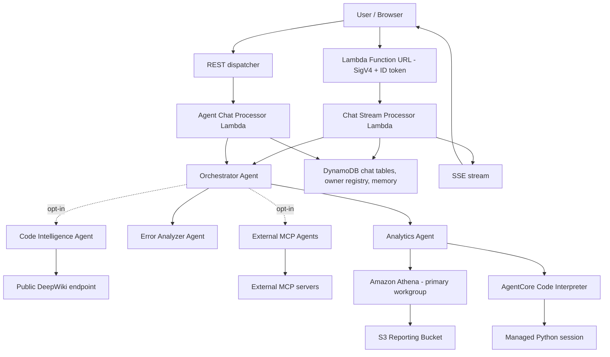

# Agent Analysis — Threat Analysis

## Document Information

| Field | Value |
|-------|-------|
| **Document Version** | 3.1 |
| **Last Updated** | 2026-11-17 |
| **Applies to release** | v0.6.16 |
| **Feature** | Agent Analysis (Multi-Agent AI System) |
| **Classification** | Internal |

## 1. Feature Overview

Agent Analysis provides a multi-agent AI system for interactive document data analysis. It includes:
- **Orchestrator Agent**: Routes user queries to specialized agents
- **Analytics Agent**: Executes SQL queries via Amazon Athena and generates Python visualizations in the AWS-managed Bedrock AgentCore Code Interpreter
- **Error Analyzer Agent**: Diagnoses processing failures from logs, execution history and tracking records
- **Code Intelligence Agent**: Answers questions about the accelerator's code by querying a public DeepWiki endpoint
- **External MCP Agents**: Tool integrations registered from the `ExternalMCPAgentsSecret` Secrets Manager secret, which send their query to a server outside the deployment

The Analytics and Error Analyzer agents are **data agents**: they read this deployment's own data. Code Intelligence and every External MCP agent are **opt-in agents**: each kind is off in a conversation until the request opts in (`enableCodeIntelligence`, `enableExternalMcpAgents`, both default `false`), and once a data agent has returned a result in a conversation neither opt-in kind is used in it again (`idp_common.chat_session_agents`; see AGT.T06).

Users interact via Companion Chat, over the REST dispatcher or as Server-Sent Events from a Lambda Function URL (`AuthType=AWS_IAM`) that also verifies the caller's Cognito ID token. See [companion-chat.md](companion-chat.md) for the transport, the session-ownership controls and the Quick Start agent.

## 2. Architecture

## 3. Threat Analysis

### AGT.T01: SQL Injection via Natural Language

| Attribute | Value |
|-----------|-------|
| **Threat ID** | AGT.T01 |
| **Category** | STRIDE: Tampering, Information Disclosure |
| **Description** | The Analytics Agent writes its own SQL from the user's natural-language question, so the statement Athena receives is model output. A crafted question, or injected text in data the agent has already read, could steer it toward a statement that writes, changes the catalog, runs a function or reads outside the reporting database |
| **Attack Vector** | User submits a question designed to make the agent generate a write or code-running statement (e.g. "show me all data; DROP TABLE documents--", an `UNLOAD`, a `USING EXTERNAL FUNCTION` clause or a `"lambda:<function>"` catalog) |
| **Impact** | Unauthorized data access, data deletion, exposure of all processed document data |
| **Likelihood** | Medium |
| **Severity** | High |
| **Affected Components** | Analytics Agent (`run_athena_query` in `idp_common/agents/analytics/tools/athena_tool.py`), Amazon Athena, S3 Reporting Bucket, `AgentChatProcessorFunction`, `ChatStreamProcessorFunction`, `AgentProcessorFunction` |
| **Mitigations** | `run_athena_query` passes every statement through `validate_read_only_query` (`idp_common/agents/analytics/query_validation.py`) before calling Athena, and a refused statement returns `state: NOT_RUN` without a `StartQueryExecution` call. The check accepts exactly one `SELECT` (optionally opening with `WITH` or a parenthesis), `SHOW` or `DESCRIBE` statement and refuses: more than one statement; any `REFUSED_KEYWORDS` entry outside literals, quoted identifiers and comments (DDL, DML, `UNLOAD`, `INTO`, `PREPARE`/`EXECUTE`, `CALL`, `EXTERNAL`, `FUNCTION`, table functions); a quoted `lambda:` catalog; a backslash in `SHOW`/`DESCRIBE`; and anything it cannot tokenize. The roles that run the agent hold `athena:StartQueryExecution`/`GetQueryExecution`/`GetQueryResults` on the `primary` workgroup and the data catalog only, read-only Glue actions on the reporting database and its tables, `S3ReadPolicy` on the reporting bucket, and `s3:PutObject` on its `athena-results/` prefix alone. `return_full_query_results` inlines at most `MAX_ROWS_TO_RETURN_DIRECTLY` rows; larger results stay in S3. Each query is logged by `analytics_logger.log_query` to the function's log group |
| **Residual risk / recommendation** | The statement check is lexical, not a full SQL parse, and refuses what it recognises rather than proving a statement harmless. The stack does not configure the `primary` workgroup, so no per-query data-scanned limit or enforced result location is set by this solution. |
| **Evidence** | `lib/idp_common_pkg/tests/unit/agents/analytics/test_query_validation.py::test_refused`; `lib/idp_common_pkg/tests/unit/agents/analytics/test_query_validation.py::TestRunAthenaQueryRefusesBeforeCallingAthena::test_refused_query_makes_no_athena_call`; `scripts/tests/test_analytics_role_grants.py::test_s3_object_access_is_declared`; UNVERIFIED: the citations cover the statement check and the declared S3 object access; the Athena and Glue action scope, the inline row limit and query logging are not covered |

### AGT.T02: Arbitrary Code Execution via AgentCore

| Attribute | Value |
|-----------|-------|
| **Threat ID** | AGT.T02 |
| **Category** | STRIDE: Tampering, Elevation of Privilege |
| **Description** | The Analytics Agent generates Python and runs it in an AWS-managed AgentCore Code Interpreter session to chart or summarise query results. AI-generated code could contain unintended operations if a question or the data it reads carries a prompt injection |
| **Attack Vector** | Prompt injection via user query or data content that manipulates the AI into generating Python that imports networking or process modules, reads other files, or sends query data elsewhere |
| **Impact** | Code execution within the managed session, which holds no AWS credentials and has no public internet access but can reach Amazon S3 in its Region; query results could be processed or written somewhere unintended |
| **Likelihood** | Medium |
| **Severity** | Medium |
| **Affected Components** | Analytics Agent (`CodeInterpreterTools` in `idp_common/agents/analytics/tools/code_interpreter_tools.py`), Bedrock AgentCore Code Interpreter |
| **Mitigations** | `execute_python` runs `check_sandbox_code` (`idp_common/agents/analytics/sandbox_code_checks.py`) on the exact text it will send and returns an error instead of running code that does not parse, imports a module outside `IMPORTABLE_MODULES` (a data, charting and computation set with no networking, HTTP, AWS SDK, `os` or process modules), uses a dynamic-lookup built-in or an attribute starting with `_`, names a refused module or file-helper submodule as an attribute, holds a `://` literal, or opens or writes a file other than by a direct call on a bare literal file name. `write_query_results_to_code_sandbox` takes no arguments: it copies only the result of the agent's last successful `run_athena_query`, at the location Athena reported, as `query_results.csv`. The session runs in the AWS-managed interpreter (no AWS credentials; no public internet access; reaches Amazon S3 in its Region and an instance metadata service that lists no role), and the roles hold the Code Interpreter actions on the managed `code-interpreter/*` ARN pattern only |
| **Residual risk / recommendation** | `check_sandbox_code` reads the code's text and syntax tree and is not a boundary: a construction it does not recognise still runs. Code running in a session can write data, including the result of the query the agent ran, to Amazon S3 in the session's Region. No execution-time or output-size limit is set by this solution beyond what the managed interpreter applies. `make stacktest-sandbox-network` measures the session's network reach. |
| **Evidence** | `make stacktest-sandbox-network`; `lib/idp_common_pkg/tests/unit/agents/analytics/test_sandbox_code_checks.py::test_refused`; `lib/idp_common_pkg/tests/unit/agents/analytics/test_code_interpreter_tools.py::TestWriteQueryResultsToCodeSandbox::test_the_tool_takes_no_arguments`; `scripts/tests/test_analytics_role_grants.py::test_code_interpreter_is_granted_on_the_managed_interpreter_only`; UNVERIFIED: the citations cover the session's network reach and credentials, the checks on code before it is sent, and what data the sandbox tool reads; execution-time and output-size limits of the managed interpreter are not covered |

### AGT.T03: Agent Routing Manipulation

| Attribute | Value |
|-----------|-------|
| **Threat ID** | AGT.T03 |
| **Category** | STRIDE: Elevation of Privilege |
| **Description** | The orchestrator agent decides which sub-agent answers a turn. Prompt injection in the question, in conversation memory or in a sub-agent's result could steer it to an agent or tool the user did not intend, including one that sends the query outside the deployment |
| **Attack Vector** | Crafted user queries, or injected content returned by a data agent, that trick the orchestrator into invoking a more powerful agent or a sensitive tool |
| **Impact** | Unauthorized access to analytics data, code execution, or data sent to external systems |
| **Likelihood** | Medium |
| **Severity** | Medium |
| **Affected Components** | Orchestrator Agent (`idp_common/agents/orchestrator/agent.py`), agent registry (`idp_common/agents/factory/registry.py`), all sub-agents, both agent chat processors |
| **Mitigations** | The orchestrator is built per turn only with the agents the caller may use: `select_orchestrator_agent_ids` (`idp_common/chat_session_agents.py`) leaves out each opt-in kind the request did not opt in to and every opt-in agent once the session holds data-agent results, and `SessionAgentGate` makes an opt-in agent already built into the turn answer `UNAVAILABLE_MESSAGE` instead of running after a data agent returns. The Quick Start agent is never in the orchestrator. Agent Chat itself requires Admin, Author or Viewer (`_enforce_agent_chat_groups` in the processor, the same check in `agent_chat_resolver`, and `_enforce_groups_or_403` on the streaming route), and is Admin-only when `unscoped_is_denied()` holds (`TenantIsolationMode=Strict` or an external `TenantGrantSource`). Each sub-agent holds only its own tools, and the analytics tools check what they run (AGT.T01, AGT.T02). Agent invocations are logged to CloudWatch |
| **Residual risk / recommendation** | Routing among the agents the turn was built with remains a model decision; the controls bound which agents exist in the turn, not which one the model picks. |
| **Evidence** | `lib/idp_common_pkg/tests/unit/test_chat_session_agents.py`; `lib/idp_common_pkg/tests/unit/agents/orchestrator/test_orchestrator_session_gate.py::test_code_intelligence_is_refused_after_analytics_in_the_same_turn`; `lib/idp_common_pkg/tests/unit/test_agent_chat_rbac.py::test_processor_denies_caller_without_an_authorized_group`; `lib/idp_common_pkg/tests/unit/test_strict_isolation_surfaces.py::test_agent_chat_is_admin_only_in_strict`; UNVERIFIED: the citations cover agent selection, the in-turn gate and the group and tenant checks; per-tool access within an agent and audit logging are not covered |

### AGT.T04: Conversation History Poisoning

| Attribute | Value |
|-----------|-------|
| **Threat ID** | AGT.T04 |
| **Category** | STRIDE: Tampering |
| **Description** | Conversation memory (up to `MAX_CONVERSATION_TURNS` turns, default 20) is loaded into the agent's context on each turn. If an earlier turn contains injected content, it could influence subsequent agent responses and tool calls |
| **Attack Vector** | Multi-turn attack where early messages, or a data agent's result quoting document-derived text, inject context that activates in later turns when combined with agent tool calls |
| **Impact** | Persistent prompt injection across conversation, manipulated agent behavior |
| **Likelihood** | Low |
| **Severity** | Medium |
| **Affected Components** | `IdHelperChatMemoryTable`, `DynamoDBMemoryHookProvider` (`idp_common/agents/utils/memory_provider.py`), both agent chat processors |
| **Mitigations** | Memory is keyed `conversation##<sessionId>` on the caller's verified Cognito `sub`, so a conversation can only be poisoned by its own owner's turns and the results those turns produced; a provider with no user, or a user id containing the key separator, is refused. The session id is registered to its owner in `ChatSessionOwnersTable` before memory is built, and another user's session is refused (CHAT.T02, CHAT.T03). Memory items carry `ExpiresAfter` at `DataRetentionInDays` after their last write, and an item past it is neither loaded nor appended to. History is bounded by `MAX_CONVERSATION_TURNS` and the per-turn context by `DropAndSlideConversationManager`. A new conversation starts from empty memory |
| **Residual risk / recommendation** | Content in memory is not sanitized or tagged as untrusted before it re-enters the prompt, so a user's own earlier turns and the results they produced still shape later turns of that conversation. |
| **Evidence** | `lib/idp_common_pkg/tests/unit/agents/utils/test_memory_provider.py::TestConstructionAndKeys::test_another_users_history_is_not_loaded`; `lib/idp_common_pkg/tests/unit/agents/utils/test_memory_provider.py::TestExpiredMemoryIsNotRead::test_history_skips_an_expired_item`; `src/lambda/chat_stream_processor/tests/test_processor_session_owner.py::test_another_users_session_is_refused_before_memory_is_built`; UNVERIFIED: the citations cover per-user keying, expiry and the owner check; history sanitization and the turn bound are not covered |

### AGT.T05: Cross-User Data Leakage via Athena

| Attribute | Value |
|-----------|-------|
| **Threat ID** | AGT.T05 |
| **Category** | STRIDE: Information Disclosure |
| **Description** | Every user with agent access queries the same reporting database. The Analytics Agent's queries are not filtered by the caller's configuration-profile scope (`allowedConfigVersions`), so a scoped user can retrieve results from documents processed under profiles outside their scope, or uploaded by other users |
| **Attack Vector** | User asks the agent for processing results of documents they did not upload, or of profiles outside their scope |
| **Impact** | Cross-user and cross-profile information disclosure of processed document data |
| **Likelihood** | Medium |
| **Severity** | High |
| **Affected Components** | Amazon Athena, S3 Reporting Bucket, Analytics Agent, both agent chat processors |
| **Mitigations** | Agent Chat requires Admin, Author or Viewer (Reviewer and Annotator are refused) on both chat paths (`_enforce_agent_chat_groups`, `_enforce_groups_or_403`). Under `TenantIsolationMode=Strict` or an external `TenantGrantSource`, Agent Chat and agent queries are Admin-only, and the web UI is given no streaming URL (`VITE_STREAM_URL` is empty under `DeniesUnscopedCaller`). Deploying one stack per environment or data owner keeps the reporting database single-tenant |
| **Residual risk / recommendation** | Outside tenant isolation, profile scope does not bound what the Analytics Agent returns (stated in the RBAC page's Known Limitations). A deployment that relies on `allowedConfigVersions` to separate users should not grant those users Agent Chat. |
| **Evidence** | `lib/idp_common_pkg/tests/unit/test_agent_chat_rbac.py::test_agent_chat_rejects_reviewer`; `lib/idp_common_pkg/tests/unit/test_strict_isolation_surfaces.py::test_agent_chat_is_admin_only_in_strict`; `lib/idp_common_pkg/tests/unit/test_strict_isolation_surfaces.py::test_agent_queries_are_admin_only_in_strict`; UNVERIFIED: the citations cover the group and tenant-isolation checks; profile-scoped filtering of agent queries does not exist and is not covered |

### AGT.T06: Deployment Data Sent Outside the Deployment by an Opt-in Agent

| Attribute | Value |
|-----------|-------|
| **Threat ID** | AGT.T06 |
| **Category** | STRIDE: Information Disclosure |
| **Description** | The Code Intelligence Agent sends its query to a public DeepWiki endpoint (`DEEPWIKI_MCP_URL`), and each External MCP agent sends its query to a server named in `ExternalMCPAgentsSecret`. The orchestrator composes that query from the conversation, so results from the data agents (Analytics, Error Analyzer), which hold document-derived data, logs and execution records, could be forwarded to a third party if both kinds of agent served one conversation |
| **Attack Vector** | A user, or injected text in a data agent's result, leads the orchestrator to pass reporting data or error details to an opt-in agent in the same conversation |
| **Impact** | Disclosure of processed document data or operational detail to a service outside the deployment |
| **Likelihood** | Low |
| **Severity** | High |
| **Affected Components** | Code Intelligence Agent (`idp_common/agents/code_intelligence/agent.py`), External MCP agents (`idp_common/agents/external_mcp/`), `idp_common/chat_session_agents.py`, `idp_common/chat_session_owner.py`, both agent chat processors, `ChatSessionOwnersTable` |
| **Mitigations** | Both opt-in kinds are off unless the request opts in for that conversation (`enableCodeIntelligence`, `enableExternalMcpAgents`, `StrictBool`, default `false`, on the REST resolver, the streaming route and the API schema); a non-boolean does not opt in. The first data-agent result in a session is recorded on its `ChatSessionOwnersTable` row (`record_data_results`, attribute `dataResultsAt`), and from then on no opt-in agent is built into that session's orchestrator. Within the turn that produced the result, `SessionAgentGate` makes an already-built opt-in agent answer `UNAVAILABLE_MESSAGE`, and it re-reads the flag before an opt-in agent runs so a concurrent turn's result also closes it. A failed read or write of the flag leaves the opt-in agents out. A request that opts in on a flagged session is moved to a new session with empty memory (`needs_new_session`). The flag lives as long as the owner row, which outlives the session's memory |
| **Residual risk / recommendation** | Before any data-agent result exists in a conversation, an opt-in agent receives whatever the orchestrator puts in its query, including text the user typed or pasted. The External MCP servers are chosen by whoever writes the secret, and what they do with a query is outside this solution. |
| **Evidence** | `lib/idp_common_pkg/tests/unit/test_chat_session_agents.py`; `lib/idp_common_pkg/tests/unit/agents/orchestrator/test_orchestrator_session_gate.py`; `src/lambda/chat_stream_processor/tests/test_processor_session_agents.py::test_opt_in_agents_are_off_by_default`; `src/lambda/chat_stream_processor/tests/test_processor_session_agents.py::test_a_flag_set_by_a_concurrent_turn_closes_opt_in_agents`; `src/lambda/chat_stream_processor/tests/test_processor_session_agents.py::test_a_failed_read_of_the_flag_leaves_opt_in_agents_out`; UNVERIFIED: the citations cover opt-in defaults, the session flag and the in-turn gate; nothing measures what reaches an external server, and no live run is cited |

## 4. Security Controls Summary

| Control | Implementation | Threats Mitigated |
|---------|---------------|-------------------|
| **Read-only statements** | The Athena tool runs exactly one `SELECT`, `WITH … SELECT`, `SHOW` or `DESCRIBE` statement and refuses any other before calling Athena (`idp_common/agents/analytics/query_validation.py`) | AGT.T01 |
| **Narrow analytics grants** | Athena on the `primary` workgroup, read-only Glue on the reporting database, reporting-bucket read and `athena-results/` write only, Code Interpreter on the managed interpreter ARN only | AGT.T01, AGT.T02 |
| **Python checks** | `check_sandbox_code` refuses imports outside a data and charting set, dynamic lookups, URL literals and file access other than by literal name (`idp_common/agents/analytics/sandbox_code_checks.py`) | AGT.T02 |
| **AgentCore sandbox** | AWS-managed isolation (no credentials; no public internet access; reaches Amazon S3 in the session's region and the instance metadata service, which lists no role) | AGT.T02 |
| **Query result handoff** | The sandbox tool takes no S3 location and copies only the result of the agent's last successful query (`write_query_results_to_code_sandbox`) | AGT.T01, AGT.T02 |
| **RBAC** | Agent Chat requires Admin, Author or Viewer on both chat paths; Admin-only under tenant isolation | AGT.T03, AGT.T05 |
| **Opt-in agents per conversation** | Code Intelligence and External MCP agents off by default and left out of any session holding data-agent results (`idp_common/chat_session_agents.py`, `dataResultsAt` on `ChatSessionOwnersTable`) | AGT.T03, AGT.T06 |
| **Audit logging** | Agent invocations and Athena queries logged to CloudWatch | AGT.T01, AGT.T03 |
| **Per-user memory** | Memory keyed on the verified Cognito `sub` and session id, expired after `DataRetentionInDays`, bounded by `MAX_CONVERSATION_TURNS` | AGT.T04 |
| **Single-tenant, or Admin-only when shared** | One deployment per environment; in a stack shared by tenants, `TenantIsolationMode: Strict` or an external `TenantGrantSource` makes Agent Chat Admin-only | AGT.T05 |
