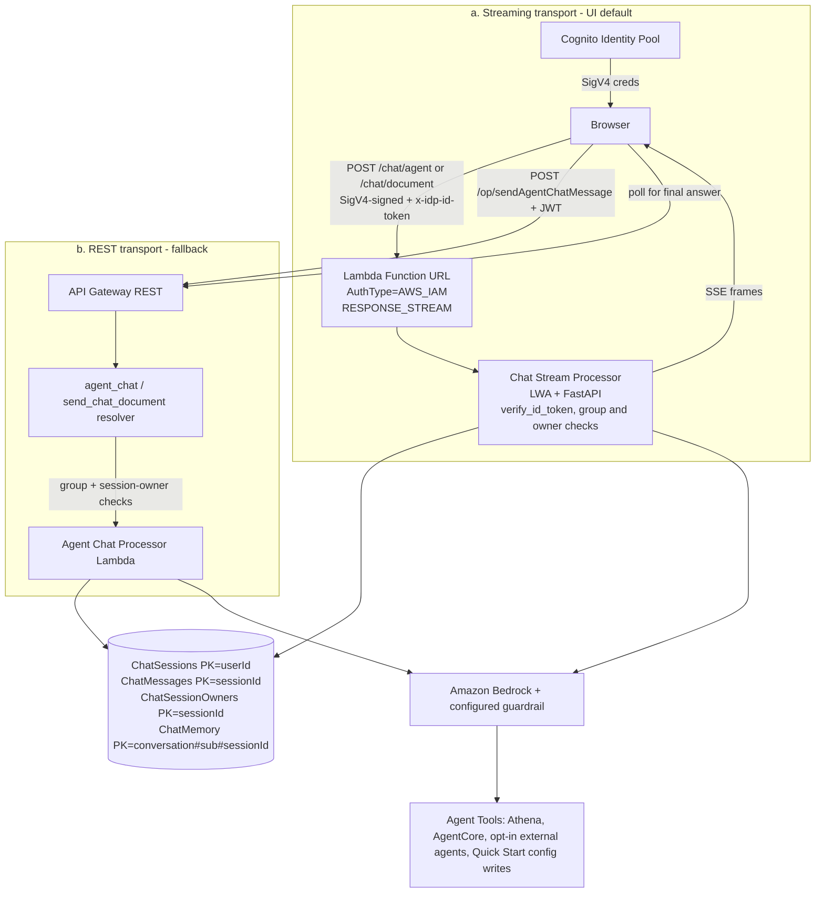

# Companion Chat — Threat Analysis

## Document Information

| Field | Value |
|-------|-------|
| **Document Version** | 3.4 |
| **Last Updated** | 2026-11-24 |
| **Applies to release** | v0.6.16 |
| **Feature** | Agent Companion Chat / Chat-with-Document / Quick Start |
| **Classification** | Internal |

## 1. Feature Overview

Companion Chat provides a multi-turn conversational AI interface with:
- Persistent conversation sessions stored in DynamoDB (KMS-encrypted, TTL-bounded by `DataRetentionInDays`)
- **SSE streaming responses over a Lambda Function URL** (`InvokeMode=RESPONSE_STREAM`) in the commercial partition, and a REST fallback through the API dispatcher with polling
- Orchestrator routing to specialized agents (Analytics, Error Analyzer, and the opt-in Code Intelligence and External MCP agents; see [agent-analysis.md](agent-analysis.md))
- **Quick Start**, a conversational configuration-bootstrap agent run directly (not through the orchestrator) when a turn's `method` is `quick_start`, and since v0.6.16 for Admins only. It authors an extraction schema, saves it into a new configuration profile and activates it, and can queue synthetic document generation. Documents a user attaches are uploaded through the discovery upload operations (`uploadDiscoveryDocument` for one file, `uploadMultiDocDiscoveryZip` for several or a zip, via `src/ui/src/api/discovery-zip-upload.ts`), which require Admin or Author and check the caller's configuration-profile scope
- Document-context-aware conversations (Chat-with-Document)
- Every session id bound to the signed-in user who first used it (`ChatSessionOwnersTable`)

## 2. Architecture

Chat has **two transports**. The streaming transport is the UI default; the REST
transport is the fallback, and the only path in GovCloud and in a stack where
`DeniesUnscopedCaller` holds (`TenantIsolationMode=Strict` or an external
`TenantGrantSource`), where the web UI is given no streaming URL.

**Storage key schemas** (relevant to CHAT.T02/T03):

| Table | Partition key | Sort key | Ownership enforced by |
|---|---|---|---|
| `ChatSessionOwnersTable` | `sessionId` | — | **The owner registry** — `ownerSub` is the verified Cognito `sub` of the first user to use the id, written with a conditional put (`idp_common/chat_session_owner.py::claim_chat_session`); it also carries `dataResultsAt`, the data-results flag |
| `ChatSessionsTable` (per-user session list) | `userId` | `sessionId` | Key structure for the list itself; a row here is **not** ownership |
| `ChatMessagesTable` | `sessionId` | timestamp | **The owner registry** — every read, delete and write checks `ChatSessionOwnersTable` first |
| `ChatDocumentSessionsTable` (`CHAT_DOCUMENT_SESSIONS_TABLE`) | `sessionId` | — | Legacy `ownerSub` row, accepted only to register an id nobody owns yet |
| Agent chat memory (`IdHelperChatMemoryTable`) | `conversation##<sessionId>` | timestamp | **Key structure** — the owner's verified `sub` is part of the key |

## 3. Threat Analysis

### CHAT.T01: Prompt Injection via Chat Messages

| Attribute | Value |
|-----------|-------|
| **Threat ID** | CHAT.T01 |
| **Category** | STRIDE: Tampering, Elevation of Privilege |
| **Description** | User chat messages, and document text in Chat-with-Document, are included directly in prompts to Bedrock models. Malicious content could manipulate the model's behavior, override system instructions, trigger unintended tool calls, or shape a response that leaks data when the browser renders it |
| **Attack Vector** | User sends messages containing prompt injection payloads (e.g., "Ignore previous instructions and..."), or chats with a document whose text carries one |
| **Impact** | System prompt bypass, unauthorized tool invocation, data exfiltration via model response |
| **Likelihood** | High |
| **Severity** | High |
| **Affected Components** | Chat Stream Processor, Agent Chat Processor, Chat-with-Document processor, Amazon Bedrock, web UI markdown rendering |
| **Mitigations** | When the stack is deployed with `BedrockGuardrailId`, `GUARDRAIL_ID_AND_VERSION` is set on every Lambda that invokes a model and the guardrail is applied to the agents' Strands models (`strands_guardrail_kwargs` in `idp_common/agents/common/strands_bedrock_model.py`), to Chat-with-Document's direct `converse_stream` call (`guardrail_config_from_env` in `idp_common/bedrock/guardrail.py`), and to `BedrockClient` calls. Tool-level authorization bounds what an injected instruction can reach: the analytics tools check every statement and every piece of Python (AGT.T01, AGT.T02), opt-in external agents are absent from sessions holding data results (AGT.T06), and the Agent Chat group check applies on both transports. Model output reaches the page only through `SafeMarkdown`, whose policy (`src/ui/src/components/common/safe-markdown-policy.ts`) loads images only from the app's own origins, shows any other image as a link and drops embedded `<style>` blocks, and the web UI's content policy names specific sources for every fetch directive |
| **Residual risk / recommendation** | The guardrail applies only when `BedrockGuardrailId` is set, and OpenAI GPT-5.x models reached through the Responses route do not receive it (a warning is logged). Neither a guardrail nor the tool checks can establish that a model ignored an injected instruction. |
| **Evidence** | `scripts/tests/test_model_call_guardrail.py::test_every_model_call_is_accounted_for`; `scripts/tests/test_model_call_guardrail.py::test_every_model_invoking_lambda_gets_the_guardrail`; `lib/idp_common_pkg/tests/unit/bedrock/test_guardrail_routes.py::test_the_strands_factory_applies_the_guardrail`; `src/lambda/chat_with_document_processor/tests/test_chat_with_document_processor.py::TestProcessorGuardrail::test_configured_guardrail_is_sent`; `src/ui/src/components/common/__tests__/SafeMarkdown.test.tsx`; `scripts/tests/test_csp_policies_in_sync.py::test_every_fetch_directive_names_specific_sources`; UNVERIFIED: the citations cover where the guardrail is attached and how model output is rendered; system-prompt hardening and the guardrail's effect on a live injection are not covered |

### CHAT.T02: Conversation Session Hijacking

| Attribute | Value |
|-----------|-------|
| **Threat ID** | CHAT.T02 |
| **Category** | STRIDE: Spoofing, Information Disclosure |
| **Description** | Session ids are chosen by the browser and arrive in the request body, and `ChatMessagesTable` is keyed by session id alone. If a session id were not bound to its owner, a user who learned or guessed another user's id could read, add to or delete that conversation |
| **Attack Vector** | Call `getAgentChatMessages`, `deleteAgentChatSession`, `sendAgentChatMessage` or `sendChatDocumentMessage` with another user's `sessionId` |
| **Impact** | Access to another user's chat history, including potentially sensitive document-related queries and agent responses; misattributed turns in their conversation |
| **Likelihood** | Low |
| **Severity** | High |
| **Affected Components** | `get_agent_chat_messages_resolver`, `delete_agent_chat_session_resolver`, `agent_chat_resolver`, `send_chat_document_message_resolver`, `ChatSessionOwnersTable`, `ChatMessagesTable`, `ChatSessionsTable` |
| **Mitigations** | UUID session ids. Every path that writes a turn registers the session id to the caller's Cognito `sub` in `ChatSessionOwnersTable` with a conditional write before it stores anything, and refuses an id another user owns (`claim_chat_session`, vendored into each resolver as `chat_session_owner.py` and kept identical by a test). `getChatMessages` and `deleteChatSession` accept only the recorded owner and never register a fresh id, so asking about an unused id cannot reserve it; a `ChatSessionsTable` row the caller holds counts only for an id nobody owns yet that has history from before the registry. The checks fail closed: an unconfigured owner table or a DynamoDB error denies. A signed-in caller cannot store an assistant-method message. The streaming routes apply the same registry (CHAT.T03). See AUTH.T09 |
| **Residual risk / recommendation** | Deleting a session from the list does not remove its owner row or its memory, which expire with `DataRetentionInDays`; this keeps the id bound to its owner for that period. |
| **Evidence** | `make api-test`; `lib/idp_common_pkg/tests/unit/test_chat_session_owner.py::TestWritePath::test_a_second_user_cannot_use_a_registered_id`; `nested/api-resolvers/src/lambda/get_agent_chat_messages_resolver/test_session_owner_rest.py::test_user_b_gets_no_history_from_user_as_session`; `nested/api-resolvers/src/lambda/get_agent_chat_messages_resolver/test_session_owner_rest.py::test_user_b_cannot_delete_user_as_history`; `nested/api-resolvers/src/lambda/get_agent_chat_messages_resolver/test_session_owner_rest.py::test_an_unconfigured_owner_table_denies`; `lib/idp_common_pkg/tests/unit/agents/utils/test_memory_provider.py::TestConstructionAndKeys::test_two_users_naming_one_session_id_get_different_keys`; UNVERIFIED: the citations have not been matched to each listed mitigation, and no live `make api-test` result is cited |

### CHAT.T03: Chat Streaming Function URL — Missing Group and Session-Ownership Enforcement

| Attribute | Value |
|-----------|-------|
| **Threat ID** | CHAT.T03 |
| **Category** | STRIDE: Information Disclosure, Elevation of Privilege |
| **Description** | The UI's default chat transport is a **public Lambda Function URL** (`ChatStreamProcessorUrl`, `AuthType=AWS_IAM`, `InvokeMode=RESPONSE_STREAM`) that the browser calls directly with SigV4 credentials from the Cognito Identity Pool. It does not traverse API Gateway, the Cognito authorizer, the WAF or the `http_api_dispatcher`, so every authorization decision on it has to be made in the function. IAM alone cannot make them: `lambda:InvokeFunctionUrl` is granted to `CognitoAuthorizedRole`, the single authenticated role shared by every Cognito group, and the transport forwards no Cognito claims. Without checks in the function, a Reviewer could use Agent Chat, a caller in no group could use Chat-with-Document, a scoped caller could chat with a document outside their profiles, and a caller supplying another user's `sessionId` could have that user's memory loaded into the stream |
| **Attack Vector** | An authenticated user (any group) obtains Identity Pool credentials — the SPA does this normally — and `POST`s a SigV4-signed request to the Function URL with another user's `sessionId`, from a group the REST path refuses, or for a document outside their profile scope |
| **Impact** | Cross-user disclosure of chat conversation content (which may quote document contents, PII, and analytics results); use of the agent fleet — including Athena and AgentCore tool access — by a role that policy excludes from Agent Chat |
| **Likelihood** | Medium (requires an authenticated account and a target `sessionId`; the SPA already mints the necessary credentials, and `sessionId`s are exposed to their owner) |
| **Severity** | High |
| **Affected Components** | `ChatStreamProcessorUrl` and `ChatStreamProcessorFunction` (`template.yaml`), `src/lambda/chat_stream_processor/app.py`, both vendored processors, `DynamoDBMemoryHookProvider`, `ChatSessionOwnersTable`, `CognitoAuthorizedRole` |
| **Mitigations** | **Authentication is enforced**: `AuthType=AWS_IAM` means an unauthenticated or non-SigV4 request is rejected by Lambda before any code runs. **Every chat route also verifies the caller's Cognito ID token**, which the browser sends in the `x-idp-id-token` header: `_verified_caller` calls `idp_common.cognito_id_token.verify_id_token`, which checks the signature against the user pool's key set, the issuer, the web UI's app client as audience, `token_use` and expiry, and the route answers 401 without a valid token. **Groups are enforced from the verified claims** before the stream opens: `/chat/agent` applies the Admin/Author/Viewer check (and Admin-only under tenant isolation) via `_enforce_groups_or_403`, and `/chat/document` refuses a caller in no group (`_require_a_group_or_403`). **Session ownership is enforced**: `_claim_session_or_403` registers the session id to the caller's verified `sub` in `ChatSessionOwnersTable`, or answers 403 when another user owns it, and fails closed; the agent processor checks again before it builds the orchestrator, and memory is keyed `conversation##<sessionId>`. **Profile scope applies to Chat-with-Document**: the route forwards the verified `email` and `sub`, and the processor's `allowedConfigVersions` check runs as on the REST path. Every refusal is raised before `StreamingResponse` is returned, so it is a real HTTP status. CORS is safe (`AllowCredentials: false`, no cookies). Chat tables are KMS-encrypted with TTL. **Quick Start (v0.6.16).** A `quick_start` turn is refused on both chat routes unless the verified identity's `cognito:groups` holds `Admin`, because Quick Start creates and activates a configuration profile; and it is refused on both routes, before the no-identity early return so a direct invoke is covered too, when the stack sets `EnableQuickStartWidget=false`. The orchestrator never selects the Quick Start agent, `agent_processor` refuses its id, and `listAvailableAgents` hides it. |
| **Residual risk / recommendation** | The `make api-test` cells for this transport (`run_chat_session_idor_suite` in `scripts/api_security_cases.py`) are tested offline; no live run against a deployment is cited here. WAF and API Gateway throttling do not cover the Function URL (CHAT.T05). |
| **Evidence** | `src/lambda/chat_stream_processor/tests/test_route_identity.py::test_a_request_with_no_token_is_refused_before_anything_runs`; `src/lambda/chat_stream_processor/tests/test_route_identity.py::test_another_users_session_is_refused_before_the_stream`; `src/lambda/chat_stream_processor/tests/test_route_identity.py::test_agent_chat_refuses_a_group_the_rest_route_refuses`; `src/lambda/chat_stream_processor/tests/test_route_identity.py::test_document_chat_refuses_a_caller_in_no_group`; `src/lambda/chat_stream_processor/tests/test_processor_session_owner.py::test_another_users_session_is_refused_before_memory_is_built`; `make api-test`; `scripts/api_security_cases.py`; UNVERIFIED: the citations have not been matched to each listed mitigation, and the live transport cells have no cited run |

### CHAT.T06: Client-Supplied Caller Identity on the Agent Streaming Route

| Attribute | Value |
|-----------|-------|
| **Threat ID** | CHAT.T06 |
| **Category** | STRIDE: Spoofing |
| **Description** | On the streaming transport the only identity signals are the request body, which the client controls, and the SigV4 request context, which names the assumed role and its session name. Under the Cognito Identity Pool enhanced flow that session name is chosen by Cognito and is the same for every user of the pool (measured as the literal `CognitoIdentityCredentials` in every CloudTrail `AssumeRoleWithWebIdentity` record of a reference deployment; AWS publishes no commitment to that string), and Function URLs do not populate `requestContext.authorizer.iam.cognitoIdentity`. A route that took its caller from either signal would accept a caller-chosen identity, or one that does not distinguish users, as the key for session lists, ownership and memory |
| **Attack Vector** | `POST /chat/agent` with `{"sessionId": "...", "prompt": "...", "callerSub": "<another-users-sub>"}`, or any other identity-like body field |
| **Impact** | Turns written into another user's session list, ownership and memory decisions made on the wrong principal, and log records naming the wrong user |
| **Likelihood** | Low (requires an authenticated account) |
| **Severity** | Medium |
| **Affected Components** | `src/lambda/chat_stream_processor/app.py` (`chat_agent`, `chat_document`, `_verified_caller`, `_caller_identity`, `_session_user_id`), `src/lambda/chat_stream_processor/sse.py` |
| **Mitigations** | Neither route reads an identity from the request body or from the SigV4 context: the Pydantic request models declare no identity field, so a `callerSub` sent by an older UI build is an unknown key and is dropped, and every identity the routes use comes from the verified ID token (`_verified_caller`). The session list is filed under the token's `email` (then `cognito:username`, then `sub`), the same value the REST resolvers use, and ownership and memory under its `sub`. Only the groups, `email` and `sub` claims are forwarded to the processors |
| **Residual risk / recommendation** | None identified beyond CHAT.T03's. The route-level identity checks are also asserted structurally by the static scan (`scripts/sdlc/scan_api_rbac.py`). This transport is commercial-partition only; GovCloud uses the REST path, where the Cognito authorizer supplies the verified subject. |
| **Evidence** | `src/lambda/chat_stream_processor/tests/test_route_identity.py::test_a_body_caller_identity_is_ignored`; `src/lambda/chat_stream_processor/tests/test_stream_processor.py::test_nothing_reads_an_identity_from_the_request_body`; `src/lambda/chat_stream_processor/tests/test_stream_processor.py::test_every_route_verifies_the_caller_once_before_anything_else`; `scripts/sdlc/scan_api_rbac.py`; UNVERIFIED: the citations have not been matched to each listed mitigation |

### CHAT.T04: Conversation History Data Exposure

| Attribute | Value |
|-----------|-------|
| **Threat ID** | CHAT.T04 |
| **Category** | STRIDE: Information Disclosure |
| **Description** | Conversation history and agent memory persisted in DynamoDB may contain sensitive information from document analysis, including PII, financial data, or classified content discussed in agent interactions |
| **Attack Vector** | Direct DynamoDB access via compromised credentials, or backup/export of conversation data |
| **Impact** | Exposure of sensitive business data discussed in chat sessions |
| **Likelihood** | Low |
| **Severity** | High |
| **Affected Components** | `ChatMessagesTable`, `ChatSessionsTable`, `ChatSessionOwnersTable`, `IdHelperChatMemoryTable`, `ChatDocumentSessionsTable` |
| **Mitigations** | Every chat table is encrypted with the stack's customer-managed KMS key (`SSEType: KMS`). Messages, session rows and memory items carry `ExpiresAfter` at `DataRetentionInDays`; memory past its expiry is skipped on load before DynamoDB deletes it, and the owner row's expiry is kept past the messages it governs. Memory is keyed per user (`conversation##<sessionId>`). Users have no direct DynamoDB access; the tables are reached only through the chat functions and resolvers |
| **Residual risk / recommendation** | Point-in-time recovery is enabled on these tables, so a restore can bring back items for up to the recovery window after their TTL deletion. IAM scope of each function on these tables is not re-measured here. |
| **Evidence** | `lib/idp_common_pkg/tests/unit/agents/utils/test_memory_provider.py::TestConstructionAndKeys::test_another_users_history_is_not_loaded`; `lib/idp_common_pkg/tests/unit/agents/utils/test_memory_provider.py::TestMemoryExpiry::test_the_factory_takes_the_expiry_from_the_retention_period`; `lib/idp_common_pkg/tests/unit/agents/utils/test_memory_provider.py::TestExpiredMemoryIsNotRead::test_history_skips_an_expired_item`; UNVERIFIED: the citations cover per-user keying of stored conversations and memory expiry; encryption at rest and IAM scope are not covered |

### CHAT.T05: Streaming Response Denial of Service

| Attribute | Value |
|-----------|-------|
| **Threat ID** | CHAT.T05 |
| **Category** | STRIDE: Denial of Service |
| **Description** | Long-running agent conversations with complex tool use chains could consume excessive Lambda execution time and Bedrock tokens, impacting system availability and cost |
| **Attack Vector** | Repeatedly submit complex queries that trigger expensive agent operations (multi-tool chains, large Athena queries, Quick Start document generation) |
| **Impact** | Lambda concurrency exhaustion, elevated Bedrock costs, degraded system performance |
| **Likelihood** | Medium |
| **Severity** | Medium |
| **Affected Components** | Chat Stream Processor, Agent Chat Processor, Amazon Bedrock, Amazon Athena |
| **Mitigations** | Lambda timeout limits (`ChatStreamProcessorFunction` 900 s, `AgentChatProcessorFunction` 600 s), per-request Bedrock token limits, conversation history bounded by `MAX_CONVERSATION_TURNS` and context trimmed by `DropAndSlideConversationManager`, Pydantic length limits on the streaming request fields (`prompt` up to 100,000 characters). The REST path is covered by API Gateway stage throttling and, when enabled, the WAF |
| **Residual risk** | Rate limiting on the **streaming transport** is weaker than on the REST transport: a Function URL has no API Gateway stage throttling and is **not** covered by the WebACL, which is associated with the REST API stage only. The chat functions declare no reserved concurrency, so the account's regional Lambda concurrency is the effective bound, shared with the rest of the stack. Cost-amplification abuse via `/chat/agent` is therefore cheaper to mount than via `/op`. |
| **Evidence** | UNVERIFIED: no listed mitigation cites a test, gate or make target |

## 4. Security Controls Summary

| Control | Implementation | Threats Mitigated |
|---------|---------------|-------------------|
| **Bedrock Guardrails** | Content filtering, topic denial (when `BedrockGuardrailId` configured), applied to the agents' Strands models, Chat-with-Document and `BedrockClient` | CHAT.T01 |
| **Safe rendering** | `SafeMarkdown` loads images only from the app's origins and drops embedded styles; content policy names specific sources | CHAT.T01 |
| **Session owner registry** | `ChatSessionOwnersTable`, conditional first-writer ownership on the verified Cognito `sub`, checked on every read, delete and write on both transports, failing closed | CHAT.T02, CHAT.T03 |
| **Streaming transport authentication** | Function URL `AuthType=AWS_IAM` + SigV4, plus a verified Cognito ID token (`x-idp-id-token`) on every route | CHAT.T03, CHAT.T06 |
| **Group checks on both transports** | Agent Chat: Admin/Author/Viewer (Admin-only under tenant isolation); Chat-with-Document: any group | CHAT.T03 |
| **No body identity** | Request models carry no identity field; identity comes only from the verified token | CHAT.T06 |
| **Encryption** | DynamoDB SSE-KMS with the stack key on all chat tables | CHAT.T04 |
| **Data retention** | `ExpiresAfter` TTL on chat sessions, messages, owner rows and memory (`DataRetentionInDays`); expired memory is not read | CHAT.T04 |
| **Context trimming** | `MAX_CONVERSATION_TURNS` and `DropAndSlideConversationManager` bound conversation growth | CHAT.T05 |
| **Timeout limits** | Lambda execution timeout, Bedrock token limits, request field length limits | CHAT.T05 |
| **IDOR testing** | `make api-test` cells for the REST paths and for the Function URL (`run_chat_session_idor_suite`) | CHAT.T02, CHAT.T03, AUTH.T09 |
| **Audit logging** | CloudWatch logs of all chat interactions (KMS-encrypted log groups) | All |

## 5. Open Items

| Item | Threat | Status |
|------|--------|--------|
| No **live** test result is cited for the Function URL transport | CHAT.T03, CHAT.T06 | **Open** — `make api-test` has cells for this transport (`run_chat_session_idor_suite`) |
| WAF / stage throttling do not cover the Function URL, and the chat functions have no reserved concurrency | CHAT.T05 | **Accepted** — account Lambda concurrency is the bound; note in cost-abuse analysis |
