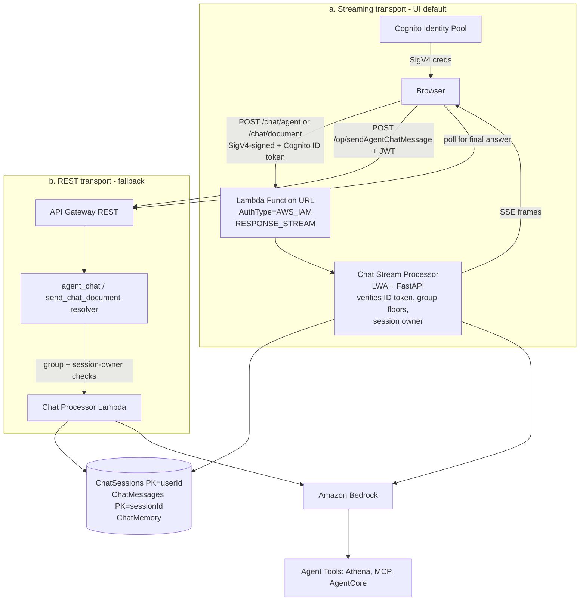

# Companion Chat — Threat Analysis

## Document Information

| Field | Value |
|-------|-------|
| **Document Version** | 3.3 |
| **Last Updated** | 2026-09-19 |
| **Applies to release** | v0.6.9 |
| **Feature** | Agent Companion Chat / Chat-with-Document |
| **Classification** | Internal |

> **v3.0 update.** AppSync subscriptions are gone. CHAT.T03 ("Real-Time
> Subscription Eavesdropping") described a mechanism that no longer exists and
> credited AppSync subscription filters as its mitigation; it is **replaced** by
> a threat covering the actual streaming transport — a public Lambda Function
> URL. **CHAT.T06** is new (caller-identity trust inconsistency). CHAT.T02's
> mitigation is corrected: the two chat tables have *different* key schemas and
> ownership is enforced by explicit resolver checks, not by partition key alone.

> **The streaming transport verifies the caller.** The chat streaming Function URL
> verifies the caller's Cognito ID token on both routes before it opens a stream, so
> the Agent Chat group restriction, Chat-with-Document's group floor and
> configuration-profile scope, and the identity a turn is attributed to follow the
> signed-in user there as they do on the REST path. That mitigates CHAT.T06 and
> closes CHAT.T03's group half. Every agent chat send path — the REST resolver, the
> processor and the streaming route — also refuses a turn for a session another
> user owns, which closes CHAT.T03's session-ownership half. The Identity Pool
> authenticated role is shared by all **five** Cognito groups, so IAM alone
> distinguishes none of them.

## 1. Feature Overview

Companion Chat provides a multi-turn conversational AI interface with:
- Persistent conversation sessions stored in DynamoDB (KMS-encrypted, TTL-bounded)
- **SSE streaming responses over a Lambda Function URL** (`InvokeMode=RESPONSE_STREAM`)
- Orchestrator routing to specialized agents (Analytics, Error Analyzer, Code Intelligence, Quick Start, MCP)
- Document-context-aware conversations (Chat-with-Document)
- User-scoped conversation isolation

## 2. Architecture

Chat has **two transports**, with materially different authorization properties.
The streaming transport is the UI default; the REST transport is the fallback
(and the only path in GovCloud without live streaming).

**Storage key schemas** (relevant to CHAT.T02/T03):

| Table | Partition key | Sort key | Ownership enforced by |
|---|---|---|---|
| `ChatSessionsTable` (agent chat) | `userId` | `sessionId` | Key structure — a foreign `sessionId` resolves under the caller's own partition |
| `ChatMessagesTable` | `sessionId` | timestamp | **Explicit checks** — `_verify_session_ownership` on read and delete; on send, the agent chat session check (CHAT.T03) |
| Document-chat sessions | `sessionId` | — | **Explicit `ownerSub` check** |
| Agent chat memory (`ID_HELPER_CHAT_MEMORY_TABLE`) | `conversation#<sessionId>` | timestamp | **Not by the key** — the agent chat session check on send (CHAT.T03) counts a session id with messages or memory as in use, and refuses it to a caller with no `ChatSessionsTable` record for it |

## 3. Threat Analysis

### CHAT.T01: Prompt Injection via Chat Messages

| Attribute | Value |
|-----------|-------|
| **Threat ID** | CHAT.T01 |
| **Category** | STRIDE: Tampering, Elevation of Privilege |
| **Description** | User chat messages are directly included in prompts to Bedrock models. Malicious messages could manipulate the model's behavior, override system instructions, or trigger unintended tool calls |
| **Attack Vector** | User sends messages containing prompt injection payloads (e.g., "Ignore previous instructions and...") |
| **Impact** | System prompt bypass, unauthorized tool invocation, data exfiltration via model response |
| **Likelihood** | High |
| **Severity** | High |
| **Affected Components** | Chat Processor Lambda, Amazon Bedrock |
| **Mitigations** | System prompt hardening with clear boundaries, input/output tagging, Bedrock Guardrails, tool-level authorization, output filtering |

### CHAT.T02: Conversation Session Hijacking

| Attribute | Value |
|-----------|-------|
| **Threat ID** | CHAT.T02 |
| **Category** | STRIDE: Spoofing, Information Disclosure |
| **Description** | If conversation session IDs are predictable or insufficiently scoped, an attacker could access another user's conversation history. Note the two chat tables are keyed differently, so a single mechanism does not cover both (see the key-schema table in §2). |
| **Attack Vector** | Enumerate or guess `sessionId` values and call `getAgentChatMessages` / `deleteAgentChatSession` with another user's id |
| **Impact** | Access to another user's chat history, including potentially sensitive document-related queries and agent responses |
| **Likelihood** | Low |
| **Severity** | High |
| **Affected Components** | `get_agent_chat_messages_resolver`, `delete_agent_chat_session_resolver`, `agent_chat_resolver`, ChatSessions / ChatMessages / document-chat-sessions tables |
| **Mitigations** | UUID-based session IDs. For the **read/delete resolvers**, ownership is verified explicitly: `_verify_session_ownership` checks the agent `ChatSessionsTable` by `(userId, sessionId)` and falls back to `_owns_document_session`, which compares the stored `ownerSub` to the caller's Cognito `sub`; a session owned by neither raises `Unauthorized`. The agent `ChatSessionsTable` is additionally protected by construction (`PK=userId`). The **send** resolver cannot be used to manufacture that record: `sendAgentChatMessage` refuses a session that already holds messages or agent memory the caller has no `(userId, sessionId)` record for, before it stores anything, so the record the read resolvers accept is only ever created by a conversation's first sender (CHAT.T03). The **live IDOR suite in `make api-test`** asserts User B is denied User A's session while the owner retains access. See AUTH.T09. |
| **Residual risk** | The read and delete checks are on the **REST resolvers**, which is where history is read on either transport. A send on either transport is checked by the agent chat session check (CHAT.T03). |

### CHAT.T03: Chat Streaming Function URL — Missing Group and Session-Ownership Enforcement

| Attribute | Value |
|-----------|-------|
| **Threat ID** | CHAT.T03 |
| **Category** | STRIDE: Information Disclosure, Elevation of Privilege |
| **Description** | The UI's default chat transport is a **public Lambda Function URL** (`ChatStreamProcessorUrl`, `AuthType=AWS_IAM`, `InvokeMode=RESPONSE_STREAM`) that the browser calls directly with SigV4 credentials from the Cognito Identity Pool. It does **not** traverse API Gateway, the Cognito authorizer, the WAF, or the `http_api_dispatcher`, and therefore inherits **none** of the authorization machinery those layers provide: every check on this transport has to be made by its own handler. Two checks are at stake. **(a) RBAC group.** The IAM gate is `lambda:InvokeFunctionUrl` and `lambda:InvokeFunction` granted to `CognitoAuthorizedRole` — the *single* authenticated role shared by **all five Cognito groups** (`Admin`, `Author`, `Reviewer`, `Annotator`, `Viewer`) — so IAM cannot distinguish a Reviewer from an Admin, and a route without a group check of its own lets a Reviewer holding valid Identity Pool credentials use `POST /chat/agent`, which `sendAgentChatMessage` refuses. **(b) Session ownership.** An agent chat conversation's messages (`ChatMessagesTable`, `PK=sessionId`) and the agent's memory (`IdHelperChatMemoryTable`, `PK=conversation#<sessionId>`) are keyed by the session id **alone**; only `ChatSessionsTable` (`userId`, `sessionId`) records which user a session belongs to. The agent memory provider (`DynamoDBMemoryHookProvider`) loads prior conversation turns by that key, so a route that does not compare a session's owner with the caller lets a caller who supplies another user's `sessionId` have that user's conversation history loaded into the model context and echoed back in the streamed response. |
| **Attack Vector** | An authenticated user obtains Identity Pool credentials and their own Cognito ID token — the SPA does both normally — and `POST`s a signed request to the Function URL with (i) a `sessionId` belonging to another user, reading their chat history back through the SSE stream; and/or (ii) `/chat/agent` from a Reviewer account, which the REST path refuses. |
| **Impact** | Cross-user disclosure of chat conversation content (which may quote document contents, PII, and analytics results); use of the agent fleet — including Athena and AgentCore tool access — by a role that policy excludes from Agent Chat. |
| **Likelihood** | Medium (requires an authenticated account and a target `sessionId`; the SPA already mints the necessary credentials, and `sessionId`s are exposed to their owner) |
| **Severity** | High |
| **Affected Components** | `ChatStreamProcessorUrl` (`template.yaml`), `src/lambda/chat_stream_processor/app.py`, `src/lambda/chat_stream_processor/id_token.py`, both vendored processors, `src/lambda/agent_chat_processor/index.py`, `nested/api-resolvers/src/lambda/agent_chat_resolver/index.py`, `DynamoDBMemoryHookProvider`, `ChatSessionsTable`, `ChatMessagesTable`, `IdHelperChatMemoryTable`, `CognitoAuthorizedRole` |
| **Mitigations** | **Authentication is enforced twice.** `AuthType=AWS_IAM` means an unauthenticated or non-SigV4 request is rejected by Lambda before any code runs, and the resource permission is scoped to this account with the actual gate being the caller's identity policy. The handler then verifies the caller's Cognito User Pool **ID token**, which the web UI sends in the `x-idp-id-token` header inside the SigV4-signed headers (`src/ui/src/api/stream-client.ts`): an RS256 signature against the pool's published JWKS, the deployment's pool as `iss`, the web UI's app client as `aud` (a token from another app client of the pool is refused), `token_use` of `id`, and an unexpired `exp` (`src/lambda/chat_stream_processor/id_token.py`). `_caller_identity` in `app.py` runs at the top of both routes, before the stream opens, and refuses a missing, invalid, expired or wrong-client token with HTTP 403. **Gap (a) is closed by that.** `/chat/agent` applies the processor's own Admin/Author/Viewer predicate to the verified groups (`_enforce_groups_or_403`), so a Reviewer, an Annotator or a caller in no group is refused with a 403, and `/chat/document` applies the `ANY_GROUP` floor its REST operation carries (`_enforce_any_group_or_403`). The verified identity is also what a turn is attributed to (CHAT.T06), and it is the subject the session check below compares against. **Gap (b) is closed by one session check on every agent chat send path.** The predicate is the same on each: a session id is in use when it holds messages in `ChatMessagesTable` or agent memory under `conversation#<sessionId>`, and an id in use is refused unless the caller holds a `(userId, sessionId)` record in `ChatSessionsTable`. Memory is checked as well as messages because it outlives them — memory items carry no `ExpiresAfter`, and deleting a session leaves them — so an id whose messages were deleted or aged out is still refused to anyone without a record for it. An id with neither is a new conversation, allowed, which the first sender's record then makes theirs. A failed lookup refuses the turn, and so does a verified caller with no user key; the check stands down only when the chat tables are not configured, and a deployed stack always configures them. On `/chat/agent` the route applies it before the stream opens, as an HTTP 403 (`_refuse_foreign_session_or_403` in `app.py`), to the verified identity's history key — the `email`, else `cognito:username`, else `sub` a turn is filed under. The processor applies it again before any agent work (`_session_belongs_to_another_user` and `_refuse_foreign_session` in `src/lambda/agent_chat_processor/index.py`, vendored identically into the streaming function), from the `callerSub` and `identity` it is given. The REST resolver behind `sendAgentChatMessage` applies it before it stores anything, keyed on `identity.username`, else `sub`, and its refusal is a 403 through the dispatcher; refusing there is what keeps a send from creating the session record the read resolvers' ownership check accepts (CHAT.T02). The resolver holds a read-only grant on the memory table for this check. It applies to every caller with an identity, whatever the message `method`. A direct `lambda:InvokeFunction` of the processor carries no identity and is gated by IAM, which the browser's Identity Pool role does not grant on that function. The document route keeps no server-side history on this transport and loads none, so a `sessionId` there addresses no stored conversation; Chat-with-Document's REST path has its own owner-keyed session table and `ownerSub` checks. CORS is safe (`AllowCredentials: false`, credentials in headers, no cookies). Session ids are UUIDs. Chat tables are KMS-encrypted, and messages and session records carry a TTL. |
| **Residual risk / recommendation** | **Mitigated.** Gaps (a) and (b) are both closed on this transport, and the session check also runs on the REST send path. A session record is written once, with the `DataRetentionInDays` TTL, and is not refreshed on later turns, so once it expires its owner is refused for that id too and starts a new chat; that is the check failing closed, and the read resolvers deny the owner that session's history at the same point. Agent memory carries no expiry and outlives a deleted session, which is a retention property rather than an access path, since the session check counts memory as in use. What remains is coverage: extend the live harness to this transport. `make api-test-static` checks the Function-URL routes statically (S6–S9), and the endpoint's unit suites cover token verification, both routes' group floors, the attribution refusal and the session check, but `make api-test` still drives `POST /op/{field}` only, so **no live test would catch a regression here**. Note also that `Cors.AllowOrigins` on the Function URL is `["*"]` despite a template comment describing it as the SPA origin; with `AllowCredentials: false` and credentials in headers this is not itself a gap, but it means any origin can drive the endpoint with credentials it can obtain. |

### CHAT.T06: Client-Supplied Caller Identity on the Agent Streaming Route

| Attribute | Value |
|-----------|-------|
| **Threat ID** | CHAT.T06 |
| **Category** | STRIDE: Spoofing |
| **Description** | Both streaming routes accept a `callerSub` field in the request body, and a turn's chat history is filed under the caller identity the route resolves: on `/chat/agent` it becomes `user_id`, the partition key of the chat sessions table. If that identity can be taken from the body, a caller can set an arbitrary `callerSub` and have it accepted as their identity. The transport offers no per-user identity of its own to prefer instead: the SigV4 principal is the assumed-role ARN of the Identity Pool's single `authenticated` role, and its session name is the same for every user of the deployment (see the note below), so it says *a* signed-in user of this deployment is calling, not *which* one. |
| **Attack Vector** | `POST /chat/agent` with `{"sessionId": "...", "prompt": "...", "callerSub": "<another-users-identifier>"}`. |
| **Impact** | **Write misattribution** — a chat turn written into another user's session/history view, and log/audit records naming the wrong principal. The agent chat session check (CHAT.T03) is keyed to that value, so it would inherit a spoofed identity and pass for it. |
| **Likelihood** | Low (requires an authenticated account) |
| **Severity** | Medium (High if an ownership check were keyed to a value the client chooses) |
| **Affected Components** | `src/lambda/chat_stream_processor/app.py` (`_caller_identity`, `_resolve_caller_sub`), `src/lambda/chat_stream_processor/sse.py` (`history_key`, `resolve_caller_sub`), `src/lambda/chat_stream_processor/id_token.py` |
| **Mitigations** | **The identity comes from a verified token, never from the body.** Both routes verify the caller's Cognito ID token before the stream opens (`_caller_identity`, see CHAT.T03) and resolve the caller through one helper, `_resolve_caller_sub`, whose verified input is the token's `history_key`: `email`, else `cognito:username`, else `sub` — the value the REST path puts in `identity.username` and its chat read resolvers key on, so a turn streamed here and one sent over REST belong to the same history. A body `callerSub` that differs from it is refused with HTTP 403 before the stream opens, and a request with no verified identity has already been refused by the token check. The web UI derives its body value from the same claims in the same order (`src/ui/src/hooks/use-agent-chat.ts`), and a unit test holds the two equal, so an honest client never trips the refusal. Nothing on this transport reads the SigV4 principal for identity. `_persist_chat_turn` refuses to write when no caller identity is present at all. |
| **Residual risk** | The attribution key is the one the REST path uses, so it has that key's properties and no stronger ones: it is the `email` claim wherever one is present. The refusal is covered by unit suites and by the static Function-URL checks (S7, S8); no live test exercises it (see CHAT.T03). |

> **Why the SigV4 principal is not the identity.** The Function URL authenticates a
> request by SigV4 with the Identity Pool's single `authenticated` role, which every
> user and every Cognito group shares. The pool does not set `AllowClassicFlow`, so
> only the **enhanced (simplified) flow** is available, in which Cognito — not the
> client — calls `AssumeRoleWithWebIdentity` and chooses the role session name. On a
> reference deployment that name was the literal `CognitoIdentityCredentials` in all
> 499 CloudTrail `AssumeRoleWithWebIdentity` records across three identity pools and
> three roles. That is a measurement rather than a documented guarantee, since AWS
> publishes no `RoleSessionName` for the enhanced flow, but nothing here depends on
> the literal: the client cannot influence a value Cognito picks, and one shared role
> cannot distinguish its assumers. Lambda Function URLs do not forward the Cognito
> identity separately either —
> [`requestContext.authorizer.iam.cognitoIdentity` is documented as not populated
> for Function URLs](https://docs.aws.amazon.com/lambda/latest/dg/urls-invocation.html).
> Preferring the SigV4 value would attribute every turn in the deployment to one
> shared identifier and collapse the chat sessions table to a single partition. The
> per-user identity therefore comes from a second signal, the User Pool ID token sent
> alongside the signed request, and the handler reads nothing from the SigV4
> principal.
>
> Scope note: this transport is commercial-partition only — GovCloud has no Lambda
> Function URLs and the UI falls back to the REST API with polling, where the Cognito
> authorizer supplies a verified subject. The UI also uses that REST path under
> `TenantIsolationMode=Strict` or an external `TenantGrantSource`, where it is given
> no stream URL.

### CHAT.T04: Conversation History Data Exposure

| Attribute | Value |
|-----------|-------|
| **Threat ID** | CHAT.T04 |
| **Category** | STRIDE: Information Disclosure |
| **Description** | Conversation history persisted in DynamoDB may contain sensitive information from document analysis, including PII, financial data, or classified content discussed in agent interactions |
| **Attack Vector** | Direct DynamoDB access via compromised credentials, or backup/export of conversation data |
| **Impact** | Exposure of sensitive business data discussed in chat sessions |
| **Likelihood** | Low |
| **Severity** | High |
| **Affected Components** | DynamoDB Conversations Table |
| **Mitigations** | DynamoDB encryption at rest, IAM least-privilege access, conversation TTL/expiration policies, no direct DynamoDB access from users |

### CHAT.T05: Streaming Response Denial of Service

| Attribute | Value |
|-----------|-------|
| **Threat ID** | CHAT.T05 |
| **Category** | STRIDE: Denial of Service |
| **Description** | Long-running agent conversations with complex tool use chains could consume excessive Lambda execution time and Bedrock tokens, impacting system availability |
| **Attack Vector** | Repeatedly submit complex queries that trigger expensive agent operations (multi-tool chains, large Athena queries) |
| **Impact** | Lambda concurrency exhaustion, elevated Bedrock costs, degraded system performance |
| **Likelihood** | Medium |
| **Severity** | Medium |
| **Affected Components** | Chat Stream Processor, Chat Processor Lambda, Amazon Bedrock, Amazon Athena |
| **Mitigations** | Lambda timeout limits, Bedrock token limits per request, Lambda reserved concurrency, CloudWatch alarms on Lambda duration/errors, conversation-manager context trimming (`DropAndSlideConversationManager`) bounding per-turn token growth. |
| **Residual risk** | Rate limiting on the **streaming transport** is weaker than on the REST transport: a Function URL has no API Gateway stage throttling and (when the WAF is enabled) is **not** covered by the WebACL, which is associated with the REST API stage only. Lambda concurrency is the effective bound. Cost-amplification abuse via `/chat/agent` is therefore cheaper to mount than via `/op`. |

## 4. Security Controls Summary

| Control | Implementation | Threats Mitigated |
|---------|---------------|-------------------|
| **Prompt hardening** | System prompt boundaries, input/output tags | CHAT.T01 |
| **Bedrock Guardrails** | Content filtering, topic denial (when `BedrockGuardrailId` configured) | CHAT.T01 |
| **Session ownership (REST read and delete)** | `_verify_session_ownership` / `_owns_document_session` — `ownerSub` vs caller `sub`; agent sessions keyed `PK=userId` | CHAT.T02 |
| **Streaming transport authentication** | Function URL `AuthType=AWS_IAM` + SigV4; `lambda:InvokeFunctionUrl` on the authenticated Identity Pool role | CHAT.T03 (authn only) |
| **Streaming transport caller identity** | Cognito ID token verified on every request (`id_token.py`); each route's group floor applied before the stream opens; a turn attributed to the verified identity, a differing body value refused | CHAT.T03 (group half), CHAT.T06 |
| **Session ownership (agent chat send paths)** | `sendAgentChatMessage`, the agent processor and `/chat/agent` refuse a session that holds messages or agent memory the caller has no `ChatSessionsTable` record for, the streaming route as a 403 before the stream opens; a failed lookup refuses | CHAT.T02, CHAT.T03 (session half) |
| **Encryption** | DynamoDB SSE-KMS at rest on all chat tables | CHAT.T04 |
| **Data retention** | `ExpiresAfter` TTL on chat sessions and messages (`DataRetentionInDays`); agent memory items carry none | CHAT.T04 |
| **Context trimming** | `DropAndSlideConversationManager` bounds conversation growth | CHAT.T05 |
| **Timeout / concurrency limits** | Lambda execution timeout, reserved concurrency, Bedrock token limits | CHAT.T05 |
| **IDOR testing** | Live IDOR suite in `make api-test` (**REST paths only**) | CHAT.T02, AUTH.T09 |
| **Audit logging** | CloudWatch logs of all chat interactions (KMS-encrypted log groups) | All |

## 5. Open Items

| Item | Threat | Status |
|------|--------|--------|
| No **live** test coverage of the Function URL transport | CHAT.T03, CHAT.T06 | **Open** — `make api-test-static` checks the routes statically (S6–S9) and the endpoint's unit suites cover the token, group, attribution and session checks; `make api-test` still covers `POST /op/{field}` only, so a runtime regression on this transport is not detected by a live test |
| WAF / stage throttling do not cover the Function URL | CHAT.T05 | **Accepted** — Lambda concurrency is the bound; note in cost-abuse analysis |
