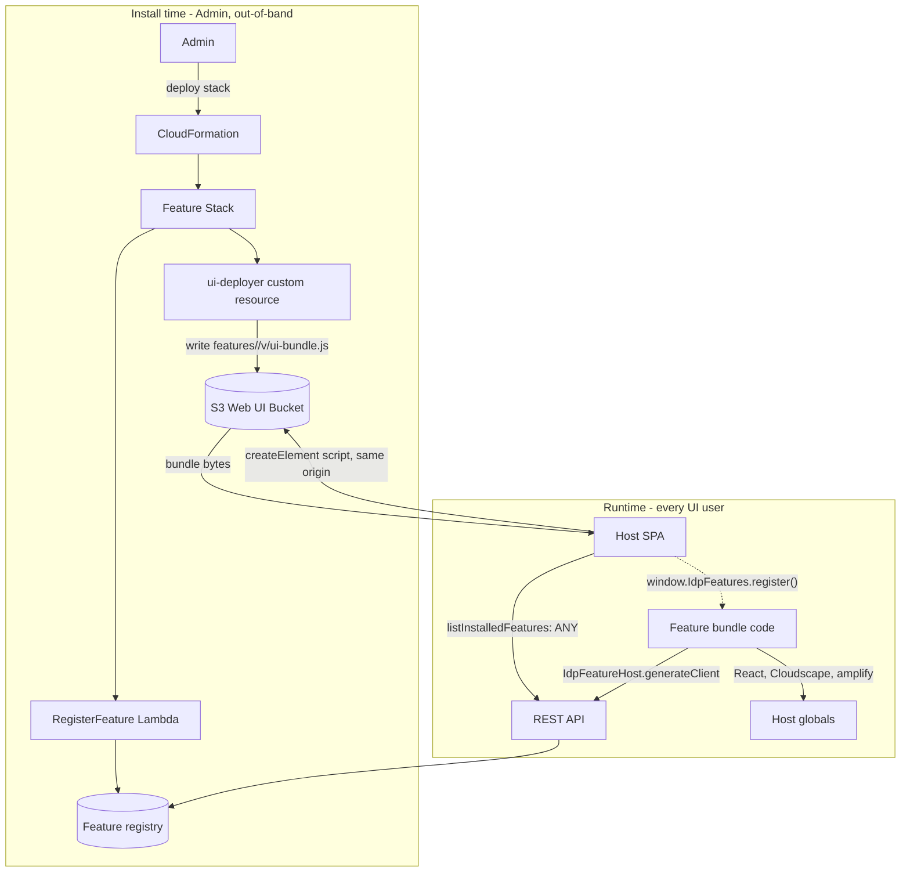

# Feature Platform / Extensions — Threat Analysis

## Document Information

| Field | Value |
|-------|-------|
| **Document Version** | 1.2 |
| **Last Updated** | 2026-11-24 |
| **Applies to release** | v0.6.16 |
| **Feature** | Feature Platform (installable Extension Features) |
| **Classification** | Internal |

> The Feature Platform carries the sharpest trust-boundary crossing in the v0.6
> architecture: third-party JavaScript executing in the host SPA's own origin,
> inside the authenticated user's session.

## 1. Feature Overview

The Feature Platform lets an operator install **Extension Features** into a
running IDP deployment. A feature is an independently-deployed CloudFormation
stack that may contribute any of:

- **A UI bundle** (`ui-bundle.js`) rendered as a page inside the host Web UI
- **A feature API** (its own API Gateway routes / Lambdas)
- **Pipeline hooks** (`preprocessing`, `postExtraction`, `postRuleValidation`, …)
- **A config preset** applied to the host's configuration
- **AgentCore Runtime agents**

Bundled examples: PII Anonymization, Test Set Generator (`idp-data-generator`),
Test Set - ConfBench (`confbench-testset`), Sample: Health Insurance Review,
Sample: Document Status. Third-party and
customer-authored features use the same mechanism (`lib/idp_feature_sdk`).

## 2. Architecture

**Key mechanics** (`src/ui/src/components/feature-page/FeatureLoader.tsx`,
`feature-host-globals.ts`):

- The bundle URL is normalized to a **same-origin absolute path**
  (`/<uiBundlePath>/ui-bundle.js`) and injected as a `<script>` tag.
- The host pre-exposes `React`, `ReactDOM`, Cloudscape, `aws-amplify`, and
  `react-router-dom` on `window` so the UMD bundle can resolve them.
- The host exposes `window.IdpFeatureHost.generateClient` — a REST-backed,
  GraphQL-shaped client that calls `POST /op/{field}` **with the current user's
  credentials**.
- The bundle self-registers via `window.IdpFeatures.register(featureId, …)`;
  the host renders its `Component` with a `FeatureContext`.

## 3. Threat Analysis

### FEAT.T01: Feature UI Bundle Executes Unsandboxed in the Host Origin

| Attribute | Value |
|-----------|-------|
| **Threat ID** | FEAT.T01 |
| **Category** | STRIDE: Tampering, Information Disclosure, Elevation of Privilege |
| **Description** | An installed feature's `ui-bundle.js` is loaded via `document.createElement('script')` from the **host's own origin** and executes with the full privileges of the host SPA in the visiting user's browser. It is not isolated by an iframe, a worker, a separate origin, or CSP: both hosting modes send a policy with `default-src 'self'` and `script-src 'self' 'unsafe-inline' 'unsafe-eval' https://cdn.jsdelivr.net/npm/` (UI.T07), and the bundle is same-origin, so `'self'` admits it regardless of how narrow the other directives are. The bundle can read the DOM and any in-memory/session-storage tokens, call `POST /op/{field}` as the user via the host-provided `IdpFeatureHost.generateClient`, and reach any origin the CSP `connect-src` allows. Installing a feature therefore grants that feature's code the **effective privilege of every user who loads the UI**, including Admins. |
| **Attack Vector** | (a) A malicious or backdoored third-party feature is installed by an Admin who evaluated its *documented* behavior, not its bundle contents. (b) A legitimate feature's build/supply chain is compromised upstream, and the published bundle differs from what was reviewed. (c) An attacker who obtains write access to the feature's prefix in the Web UI bucket (or to the ui-deployer's role) replaces the bundle. |
| **Impact** | Full compromise of the Web UI session for every user: exfiltration of document content and extracted PII via authorized API calls, silent configuration tampering (which redirects all subsequent document processing — PM.T06), privilege abuse as an Admin visitor, credential/token theft. |
| **Likelihood** | Low (requires an Admin install decision or a supply-chain compromise) |
| **Severity** | **Critical** |
| **Affected Components** | `FeatureLoader.tsx`, `feature-host-globals.ts`, S3 Web UI Bucket, feature ui-deployer roles, `listInstalledFeatures` |
| **Mitigations** | **Install is a privileged, deliberate, out-of-band act**: a feature is a CloudFormation stack an Admin deploys with their own credentials — it cannot be installed through the UI by a lower-privileged user, and `subscribeFeature`/`unsubscribeFeature`/`getFeatureLaunchUrl` are **Admin-only** (server-side enforced; `scripts/api_rbac_expectations.yaml`). Each shipped feature template scopes its ui-deployer's S3 write to `features/${FeatureId}/*` in the Web UI bucket, so one feature cannot overwrite another's bundle or the host SPA's own assets; a feature can overwrite any of its own versions. Bundles are served same-origin (no third-party CDN in the trust path) with `Cache-Control: max-age=300`, so a malicious version can be replaced and propagate within minutes rather than being pinned for a year. The pipeline-hooks dispatcher role may invoke only same-account, same-Region functions tagged `idp:feature-id` or named `GENAIIDP-*` (HOOK.T06). Features are distributed with source in-repo for the bundled ones. |
| **Residual risk / recommendation** | **No integrity verification occurs at load time** — there is no Subresource Integrity (SRI) hash, no signature, and no version pinning check against a manifest digest (`expectedVersion` only produces a warning; loading proceeds regardless). Recommended, in order: (1) record a SHA-384 digest of the bundle in the feature registry at install time and set `script.integrity` from it in `FeatureLoader` — this is a small change that converts (b) and (c) from silent to blocked; (2) document the trust decision explicitly in the install flow ("installing a feature grants it your users' UI privileges"); (3) longer term, consider rendering third-party feature UIs in a sandboxed iframe on a distinct origin with a narrow `postMessage` API instead of `window` globals. Treat FEAT.T01 as **accepted-with-compensating-controls for first-party/bundled features and open for third-party features**. |
| **Evidence** | UNVERIFIED: no listed mitigation cites a test, gate or make target |

### FEAT.T02: Feature Registry Enumeration by Any Authenticated User

| Attribute | Value |
|-----------|-------|
| **Threat ID** | FEAT.T02 |
| **Category** | STRIDE: Information Disclosure |
| **Description** | `listInstalledFeatures`, `listCatalogFeatures`, and `checkFeatureEntitlement` are readable by **any authenticated user** (`groups: ANY`). They disclose which extensions are installed, their versions, and their `uiBundlePath`s. |
| **Attack Vector** | A low-privileged authenticated user calls `listInstalledFeatures` to inventory the deployment's extensions and versions. |
| **Impact** | Reconnaissance: an attacker learns which features (and versions) are present, enabling targeting of a known-vulnerable feature version. Low direct impact — no document data is exposed. |
| **Likelihood** | Medium (trivially callable) |
| **Severity** | Low |
| **Affected Components** | `list_installed_features`, `list_catalog_features`, `check_feature_entitlement` |
| **Mitigations** | Necessarily readable by all roles — the host SPA must render the Extensions nav for every user, so this is a **design requirement**, not an oversight. No secrets, credentials, or document data are returned. Version information is also inferable from the loaded bundle paths. Install/modify operations are Admin-only. |
| **Status** | **Accepted risk** — inherent to rendering a per-user nav; disclosure is limited to non-sensitive inventory metadata. |
| **Evidence** | UNVERIFIED: no listed mitigation cites a test, gate or make target |

### FEAT.T03: Feature Stack IAM Privilege and Host Resource Access

| Attribute | Value |
|-----------|-------|
| **Threat ID** | FEAT.T03 |
| **Category** | STRIDE: Elevation of Privilege, Tampering |
| **Description** | A feature stack creates its own IAM roles and is granted access to host resources it imports (e.g. `${MainStackName}-InputBucketName`, `-WebUIBucketName`, `-UsersTableName`). A feature can therefore read/write host data directly from its own Lambdas, independent of the host's API authorization. A hook feature additionally receives full document content in-band. |
| **Attack Vector** | A malicious or over-permissioned feature template grants its own role broader host access than its function requires, then reads document content or writes configuration outside the host's RBAC controls. |
| **Impact** | Data exfiltration or tampering that bypasses the host's resolver-side authorization entirely, because it operates at the AWS API layer rather than through `POST /op/{field}`. |
| **Likelihood** | Low (requires installing a hostile/over-broad feature) |
| **Severity** | High |
| **Affected Components** | Feature templates, feature Lambda execution roles, host `Fn::ImportValue` exports |
| **Mitigations** | Features declare their host imports explicitly in their template, so the grant surface is **reviewable in the IaC before install**. `PermissionsBoundaryArn` is forwarded to the feature-platform nested stack and attached to the roles it creates, and a static test asserts that every deployed-stack template attaches the boundary to every role it creates and that every nested stack forwards the parameter — so an SCP-enforced account can bound a feature's maximum privilege centrally. Feature-owned data (e.g. the PII mapping table) lives in the feature's own stack, encrypted, rather than in host tables. Install requires CloudFormation privileges. |
| **Residual risk** | The permissions boundary is the real control here and is only as tight as the account's boundary policy. In accounts with no boundary, a feature stack's roles are bounded only by the installing principal's own privileges. Recommend requiring `PermissionsBoundaryArn` for deployments that install third-party features. |
| **Evidence** | `lib/idp_sdk/tests/unit/test_permissions_boundary_coverage.py::test_every_iam_role_sets_permissions_boundary`; `lib/idp_sdk/tests/unit/test_permissions_boundary_coverage.py::test_nested_stacks_forward_permissions_boundary`; UNVERIFIED: the reviewability of a feature's host imports and the scope of its grants are not tested |

### FEAT.T04: Stale or Downgraded Feature Bundle Served to Users

| Attribute | Value |
|-----------|-------|
| **Threat ID** | FEAT.T04 |
| **Category** | STRIDE: Tampering, Denial of Service |
| **Description** | The host loads whatever bundle exists at the registry's `uiBundlePath`. If a security fix is published under the **same** feature version, browsers and CDN edges may continue serving the old bytes; conversely, a rollback to a known-vulnerable version is not detected. |
| **Attack Vector** | A feature hotfix is republished at the same version; users continue running the vulnerable bundle from cache. Or an attacker with the feature's S3 prefix write access reverts the bundle to an older vulnerable build. |
| **Impact** | A patched client-side vulnerability remains exploitable for the cache lifetime; version-based assurance is unreliable. |
| **Likelihood** | Low |
| **Severity** | Medium |
| **Affected Components** | Feature ui-deployers, S3 Web UI Bucket, CloudFront TTL, `FeatureLoader` version check |
| **Mitigations** | Feature ui-deployers set `Cache-Control: public,max-age=300`, matching the CloudFront TTL — so an update propagates within minutes. The module-level registry loads a given feature's script once per page load, so a mid-session swap does not take effect until reload. `expectedVersion` mismatches are logged. |
| **Residual risk** | The `expectedVersion` check **warns but still loads**, and there is no digest pinning (see FEAT.T01 recommendation 1, which also closes this). Prefer publishing security fixes under a **new version** so the registry path itself changes. |
| **Evidence** | UNVERIFIED: no listed mitigation cites a test, gate or make target |

### FEAT.T05: Test Set Generator's Model-Written HTML Reaches the Network While Rendering

| Attribute | Value |
|-----------|-------|
| **Threat ID** | FEAT.T05 |
| **Category** | STRIDE: Information Disclosure, Tampering |
| **Description** | The Test Set Generator extension (`feature-platform/idp-data-generator`) runs SEED (`seed-data`) in an AgentCore runtime created in `PUBLIC` network mode. Its document-generator model writes HTML that is rendered to a PDF. A renderer that fetches the `http(s)` images, stylesheets, `@import`s and fonts the HTML references would let the model's output cause outbound requests from the runtime, and the model's context holds the document class schema, the scenario text, the data it generates, and any file it reads with `editor`. |
| **Attack Vector** | Instructions in a class description, scenario or file the model reads lead it to write HTML whose resource URLs carry context data to an external host, or pull external content into a generated test document. A change in SEED's tools or default PDF backend between releases adds a tool that takes a URL or runs a command. |
| **Impact** | Disclosure of schema and generated data to an external host; test documents carrying externally supplied content. |
| **Likelihood** | Low |
| **Severity** | Medium |
| **Affected Components** | `lib/idp_common_pkg/idp_common/synthesis/engine.py` (`_render_without_remote_fetches`, `SEED_RENDERER`), `feature-platform/idp-data-generator/Dockerfile`, `feature-platform/idp-data-generator/agentcore_runtime_lambda/index.py` |
| **Mitigations** | The image pins `seed-data[augment]==0.0.7` and `xhtml2pdf==0.2.28`, so the tool set the models hold changes only with a pin change. The adapter names the `xhtml2pdf` backend explicitly, which keeps SEED's `shell` tool (given only with its `reportlab` backend) out of the set, and replaces that backend with one that renders under `ResourceAccessPolicy(allow_remote=False)`: a remote reference is logged and left out of the PDF. With that policy no tool the models hold takes a URL or makes a network request, and no tool calls an AWS API; the runtime role's S3 and DynamoDB permissions are used only by the runtime handler and the adapter. The extension's README records the per-agent tool inventory for the pinned release. |
| **Residual risk** | If the installed `xhtml2pdf` lacks `xhtml2pdf.config.resources`, or SEED stops keeping its backends in `seed_data.tools._HTML_RENDERERS`, the adapter logs `Render fetch policy not applied` and SEED's own renderer runs, which fetches remote references; the pin is what keeps that from happening. Inline `data:` resources and files in the runtime user's home directory still load. `file_write` and `editor` read and write any path the image's `appuser` can, so anything that user can read can enter the model's context. The runtime keeps outbound internet access, and VPC network mode is not offered; an account that requires no internet route should not install the extension. |
| **Evidence** | `lib/idp_common_pkg/tests/unit/synthesis/test_engine.py::TestRenderFetchPolicy::test_xhtml2pdf_backend_renders_with_remote_resources_refused`; `lib/idp_common_pkg/tests/unit/synthesis/test_engine.py::TestRenderFetchPolicy::test_seed_renderer_is_left_alone_without_the_policy_module`; `lib/idp_common_pkg/tests/unit/synthesis/test_engine.py::TestSynthesizeShaping::test_generator_is_given_an_html_renderer`; UNVERIFIED: the tool inventory was taken by reading the pinned wheel, not by running it, and no test asserts the `Dockerfile` pins |

### FEAT.T06: An Extension Builds Third-Party Code and Model Weights into an In-Account Image

| Attribute | Value |
|-----------|-------|
| **Threat ID** | FEAT.T06 |
| **Category** | STRIDE: Tampering, Information Disclosure |
| **Description** | The *Decision Model: Strands Decider* extension (v0.6.16) builds a Lambda container image in the customer's account with CodeBuild, from the upstream `strands-labs/strands-decider` repository and model weights downloaded from a model hub, and installs it as the decision model that section classification and extraction confidence call. The function then receives section text or page images, field names and extracted values (HOOK.T09). Whatever the upstream source, its Dockerfile's dependencies or the model repository contain at build time runs inside the account with document content as input. |
| **Attack Vector** | A compromised upstream commit, a dependency the upstream Dockerfile installs from PyPI, the PyTorch index or a public container registry, or a model repository that changes what a revision name resolves to. An installer pins a revision from a fork. |
| **Impact** | Code chosen by a third party processing document content inside the account, with the ability to send it out over the function's internet egress; decisions skewed by tampered weights. |
| **Likelihood** | Low |
| **Severity** | High |
| **Affected Components** | `feature-platform/decision-model-decider/` (`template.yaml`, `image-build/`), its CodeBuild project and ECR repository, the `GENAIIDP-decider` function |
| **Mitigations** | **Pins.** The upstream source revision and the model revision are stack parameters that must each be a 40-character commit SHA, and the source repository is a constant in code. The build confirms through the hub API that the model revision resolves to itself (refusing a branch name), refuses a source commit that is on no branch or tag of the upstream repository (refusing a fork commit), and checks `HEAD` after checkout. **Image.** The ECR repository scans on push and is encrypted with the host stack's key; tags are derived from the build inputs and the build never re-pushes an existing tag. **Roles.** The CodeBuild role holds logs, push and pull on the extension's own repository, and use of the host key; the decider function's role holds logs and X-Ray only, so it reaches no bucket, table or other function. Installing the extension is an Admin action through the extension catalog (FEAT.T03). |
| **Residual risk / recommendation** | Integrity rests on git and hub content addressing; the transitive dependencies the upstream Dockerfile installs are pinned only as upstream wrote them and are not verified here. CodeBuild runs privileged, outside a VPC, with internet egress, and the decider function has no VPC configuration, so code in the image can reach the internet with the content it is sent. ECR tag mutability is left on. Review the pinned commit before installing or changing it, and treat a pin change as a code change. |
| **Evidence** | `feature-platform/decision-model-decider/image-build/tests/test_image_build.py`; UNVERIFIED: the citation covers the image-build function; the buildspec's revision and fork checks and the IAM grants are not matched to a test, and the build has not been exercised against a hostile upstream |

## 4. Security Controls Summary

| Control | Implementation | Threats Mitigated |
|---------|---------------|-------------------|
| **Admin-gated install/subscribe** | `subscribeFeature` / `unsubscribeFeature` / `getFeatureLaunchUrl` Admin-only, server-side enforced | FEAT.T01, FEAT.T03 |
| **Out-of-band deployment** | Feature install is a CloudFormation stack deploy, not a UI action | FEAT.T01, FEAT.T03 |
| **Prefix-scoped bundle writes** | ui-deployer IAM policy limited to `features/${FeatureId}/*` | FEAT.T01, FEAT.T04 |
| **Same-origin bundle delivery** | Bundles served from the host Web UI bucket; no third-party CDN in the trust path | FEAT.T01 |
| **Permissions boundary** | `PermissionsBoundaryArn` forwarded + attached to feature roles; static regression test | FEAT.T03 |
| **Hook invoke scope** | Pipeline-hooks dispatcher may invoke only functions tagged `idp:feature-id` or named `GENAIIDP-*` | FEAT.T03 |
| **Short bundle cache TTL** | `Cache-Control: max-age=300` matching CloudFront TTL | FEAT.T04 |
| **Feature-owned sensitive storage** | Feature data (e.g. PII mappings) in the feature's own encrypted tables | FEAT.T03 |
| **Commit-pinned image builds** | Strands Decider source and model revisions must be 40-character SHAs; fork and branch revisions refused at build; scan on push; logs-only function role | FEAT.T06 |
| **Pinned generator and local-only rendering** | Test Set Generator pins `seed-data` and `xhtml2pdf`, names the `xhtml2pdf` backend, and renders with `ResourceAccessPolicy(allow_remote=False)` | FEAT.T05 |

## 5. Open Items

| Item | Threat | Status |
|------|--------|--------|
| No SRI/digest/signature verification on `ui-bundle.js` at load | FEAT.T01, FEAT.T04 | **Open** — recommended primary fix |
| Feature UI runs unsandboxed in host origin with host API client | FEAT.T01 | **Accepted** for bundled/first-party; **open** for third-party |
| `expectedVersion` mismatch warns but loads anyway | FEAT.T04 | **Open** |
| No permissions boundary required for third-party feature installs | FEAT.T03 | **Open** — recommend documenting as a prerequisite |
| Feature registry readable by all roles | FEAT.T02 | **Accepted** — design requirement |
| Decider image's transitive dependencies are not verified; CodeBuild and the function have open egress | FEAT.T06 | **Open** — recommendation |
| Test Set Generator runtime has outbound internet access; render policy falls back to SEED's renderer if the pinned packages change shape | FEAT.T05 | **Accepted** — the pins hold it; no VPC mode is offered |
