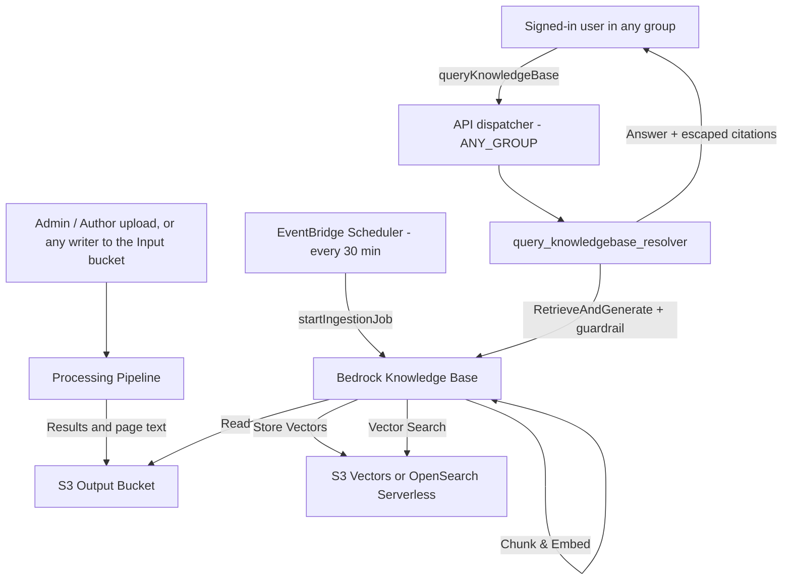

# Knowledge Base — Threat Analysis

## Document Information

| Field | Value |
|-------|-------|
| **Document Version** | 3.2 |
| **Last Updated** | 2026-11-17 |
| **Applies to release** | v0.6.16 |
| **Feature** | Document Knowledge Base Query (Bedrock Knowledge Base, RAG) |
| **Classification** | Internal |

## 1. Feature Overview

The Document Knowledge Base Query feature lets signed-in users ask natural-language questions about the deployment's **processed documents**. When `DocumentKnowledgeBase` is `BEDROCK_KNOWLEDGE_BASE (Create)` (the default), the `DOCUMENTKB` nested stack (`nested/bedrockkb/template.yaml`) creates an Amazon Bedrock Knowledge Base whose S3 data source is the stack's **Output bucket**, with no inclusion prefix. An EventBridge Scheduler schedule starts an ingestion job every 30 minutes, which chunks (fixed size, up to 8,192 tokens), embeds (`KnowledgeBaseEmbeddingModel`) and indexes the bucket's content in the vector store chosen by `KnowledgeBaseVectorStore`: S3 Vectors (the default) or an OpenSearch Serverless collection.

Queries arrive through the `queryKnowledgeBase` operation. Its resolver (`nested/api-resolvers/src/lambda/query_knowledgebase_resolver/index.py`) calls Bedrock `RetrieveAndGenerate` with the model in `KnowledgeBaseModelId`, applies the configured Bedrock guardrail, and returns the answer with HTML-escaped citation snippets that the web UI renders through `SafeMarkdown`. The processing pipeline and the chat agents do not query the knowledge base.

Key components:
- **S3 data source**: the Output bucket, so every processed document's results and page text
- **Bedrock Knowledge Base**: manages chunking, embedding, retrieval and answer generation
- **Vector store**: S3 Vectors bucket and index (`S3VectorBucketAndIndex`, customer-managed key) or an OpenSearch Serverless `VECTORSEARCH` collection
- **Query resolver**: `query_knowledgebase_resolver`, reached through the API dispatcher

## 2. Architecture

## 3. Threat Analysis

### KB.T01: Knowledge Base Poisoning

| Attribute | Value |
|-----------|-------|
| **Threat ID** | KB.T01 |
| **Category** | STRIDE: Tampering |
| **Description** | The knowledge base indexes everything in the Output bucket. Any document that gets processed contributes its extracted content to the index at the next ingestion, so a misleading document, or one carrying prompt-injection text, contaminates the answers every user receives |
| **Attack Vector** | Upload a document containing misleading information or injection payloads (as an Admin or Author, or as any principal with `s3:PutObject` on the Input bucket), let it be processed, and wait for the next scheduled ingestion |
| **Impact** | Incorrect or manipulated knowledge-base answers and citations for every user who queries it; document processing itself is not affected, because the pipeline does not query the knowledge base |
| **Likelihood** | Medium |
| **Severity** | High |
| **Affected Components** | S3 Output Bucket, `S3DataSource` and `S3DataSourceScheduler` (`nested/bedrockkb/template.yaml`), Bedrock Knowledge Base, vector store |
| **Mitigations** | Only Admin and Author can upload documents through the API, which checks the caller's profile scope. The configured Bedrock guardrail is applied to the answer (`guardrailConfiguration` in `get_kb_response`). Every answer carries citations naming the source documents, so a poisoned answer is attributable. Deleting or reprocessing a document changes the bucket, and the next ingestion reflects it |
| **Residual risk / recommendation** | There is no review step between processing and ingestion and no version history of the index; a direct writer to the Input bucket is bounded only by the IAM policy on that writer. The knowledge base can be turned off with `DocumentKnowledgeBase=DISABLED`. |
| **Evidence** | UNVERIFIED: no listed mitigation cites a test, gate or make target |

### KB.T02: RAG Context Injection

| Attribute | Value |
|-----------|-------|
| **Threat ID** | KB.T02 |
| **Category** | STRIDE: Tampering, Elevation of Privilege |
| **Description** | Retrieved chunks are inserted into the answer model's prompt by `RetrieveAndGenerate`. If indexed content carries prompt-injection text, it can steer the answer, and the answer and snippets are rendered in the user's browser |
| **Attack Vector** | Get a document holding injection instructions or markup processed, so that it is retrieved for other users' questions |
| **Impact** | Manipulated answers for questions where the poisoned chunk is retrieved; markup in a snippet or answer reaching the page |
| **Likelihood** | Medium |
| **Severity** | High |
| **Affected Components** | Bedrock Knowledge Base, `query_knowledgebase_resolver`, `DocumentsQueryLayout.tsx` |
| **Mitigations** | The configured Bedrock guardrail (`BedrockGuardrailId`) is applied through `generationConfiguration.guardrailConfiguration` on `RetrieveAndGenerate`. `markdown_response` HTML-escapes each snippet and document title and URL-encodes each document id before building the citation markup. The web UI renders the result through `SafeMarkdown`, which loads images only from the app's own origins and drops embedded styles. The answer model has no tools, so an injected instruction cannot call anything |
| **Residual risk / recommendation** | The prompt that frames retrieved content is Bedrock's default `RetrieveAndGenerate` template; this solution adds no instruction isolating retrieved text, and the guardrail applies only when `BedrockGuardrailId` is set. |
| **Evidence** | `src/ui/src/components/common/__tests__/SafeMarkdown.test.tsx`; UNVERIFIED: the citation covers how the answer is rendered; the guardrail on `RetrieveAndGenerate` and the resolver's snippet escaping are not covered |

### KB.T03: Vector Store Data Exposure

| Attribute | Value |
|-----------|-------|
| **Threat ID** | KB.T03 |
| **Category** | STRIDE: Information Disclosure |
| **Description** | The vector store holds embeddings and the text chunks of every processed document. Misconfigured access policies, or credentials with access to the store, could expose that content outside the query resolver |
| **Attack Vector** | Overly permissive vector-store access policies, or compromised credentials with S3 Vectors or OpenSearch Serverless data access |
| **Impact** | Exposure of processed document content stored as embeddings and chunks |
| **Likelihood** | Low |
| **Severity** | Medium |
| **Affected Components** | `S3VectorBucketAndIndex` and the S3 vector manager role, or `OSSCollection` with `OSSEncryptionPolicy`, `OSSNetworkPolicy` and `OSSDataAccessPolicy`; `KnowledgeBaseServiceRole` |
| **Mitigations** | With S3 Vectors (the default), the vector bucket and the knowledge base use the stack's customer-managed key, the vector manager's grants name exactly the bucket and index it creates in this account and Region, and it can pass only the knowledge base's own service role, only to Bedrock (`S3VectorManagerPassRolePolicy`). With OpenSearch Serverless, the data access policy grants collection and index permissions to `KnowledgeBaseServiceRole` alone, so every data-plane request needs that role's IAM-signed credentials. Under `TenantIsolationMode=Strict` or an external `TenantGrantSource`, knowledge-base queries are Admin-only (`_refuse_non_admin_when_unscoped_is_denied`), because retrieval cannot be confined to one tenant (TEN.T01) |
| **Residual risk / recommendation** | The OpenSearch Serverless collection's network policy sets `AllowFromPublic: true` for the collection and its dashboard, and its encryption policy uses an AWS-owned key rather than the stack key, so the data access policy and IAM are the only boundary. The service role's own S3 read reaches the whole Output bucket. |
| **Evidence** | `nested/bedrockkb/src/s3_vectors_manager/tests/test_iam_scope.py::test_grants_stay_inside_this_account_and_region`; `scripts/tests/test_iam_privilege_escalation.py::test_pass_role_is_scoped`; `lib/idp_common_pkg/tests/unit/test_strict_isolation_surfaces.py::test_the_knowledge_base_is_admin_only_in_strict`; UNVERIFIED: the citations cover the S3 Vectors grants, the PassRole scope and the tenant-isolation check; the OpenSearch Serverless policies and key choice are not covered |

### KB.T04: Excessive RAG Retrieval

| Attribute | Value |
|-----------|-------|
| **Threat ID** | KB.T04 |
| **Category** | STRIDE: Information Disclosure, Denial of Service |
| **Description** | A query retrieves from every processed document in the deployment. The resolver applies no configuration-profile scope (`allowedConfigVersions`) and no group check of its own, so outside tenant isolation a user can retrieve content from documents in profiles outside their scope; repeated queries also bill Bedrock inference |
| **Attack Vector** | A signed-in user in any group, including a profile-scoped user, asks questions designed to retrieve content from documents they cannot otherwise see, or submits many queries |
| **Impact** | Exposure of processed document content across profile scopes, in synthesised and cited form; increased Bedrock and vector-store costs |
| **Likelihood** | Medium |
| **Severity** | Medium |
| **Affected Components** | `query_knowledgebase_resolver`, Bedrock Knowledge Base, vector store |
| **Mitigations** | The API dispatcher admits `queryKnowledgeBase` only for a caller in some group (`ANY_GROUP` in `scripts/api_rbac_expectations.yaml`). Under `TenantIsolationMode=Strict` or an external `TenantGrantSource` the resolver refuses every non-Admin caller. `RetrieveAndGenerate` returns the service's default number of retrieved results per query. The resolver truncates the query and response in its logs (`sanitize_event_for_logging`). The REST API is covered by API Gateway stage throttling and, when enabled, the WAF |
| **Residual risk / recommendation** | Profile scope does not bound knowledge-base results (stated in the RBAC page's Known Limitations), and the resolver has no group check of its own (`GAP-02`); a deployment that relies on `allowedConfigVersions` to separate users should disable the knowledge base or use tenant isolation. The resolver sets no relevance threshold or result count of its own, and passes the caller-supplied `sessionId` to `RetrieveAndGenerate` without binding it to the caller. |
| **Evidence** | `lib/idp_common_pkg/tests/unit/test_strict_isolation_surfaces.py::test_the_knowledge_base_is_admin_only_in_strict`; `make api-test-static`; UNVERIFIED: the citations cover the tenant-isolation refusal and the declared group floor; profile-scoped retrieval does not exist and is not covered, and result limits and throttling are not covered |

## 4. Security Controls Summary

| Control | Implementation | Threats Mitigated |
|---------|---------------|-------------------|
| **Upload RBAC** | Only Admin and Author upload documents through the API, within their profile scope | KB.T01 |
| **Bedrock Guardrails** | `guardrailConfiguration` on `RetrieveAndGenerate` when `BedrockGuardrailId` is set | KB.T01, KB.T02 |
| **Output escaping** | Snippets and titles HTML-escaped in `markdown_response`; rendered through `SafeMarkdown` | KB.T02 |
| **Citations** | Every answer names its source documents | KB.T01 |
| **Encryption** | Customer-managed key on S3 Vectors and the knowledge base; AWS-owned key on OpenSearch Serverless | KB.T03 |
| **Access policies** | Exact-resource S3 Vectors grants; OpenSearch data access limited to the knowledge base service role; PassRole limited to that role | KB.T03 |
| **Query gating** | `ANY_GROUP` at the dispatcher; Admin-only under tenant isolation | KB.T03, KB.T04 |
