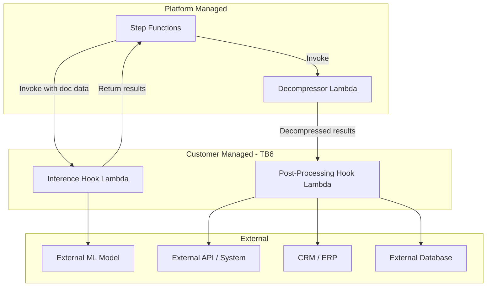

# Lambda Hooks — Threat Analysis

## Document Information

| Field | Value |
|-------|-------|
| **Document Version** | 3.3 |
| **Last Updated** | 2026-11-17 |
| **Applies to release** | v0.6.9 |
| **Feature** | Lambda Hooks (Inference, Decision Models & Post-Processing) |
| **Classification** | Internal |

## 1. Feature Overview

Lambda Hooks provide extensibility points for customer-managed code execution within the processing pipeline:

### 1.1 Inference Hook
- Invoked in place of a Bedrock model by a processing step configured with a model Lambda hook (OCR, extraction, assessment, summarization, and each classification call — the combined call and, under `split_then_classify`, the splitting and section-classification calls, each with its own setting)
- Receives the request and a `context` naming the calling step (for classification: `Classification`, `Splitting` or `SectionClassification`), returns the model response
- The step roles may invoke only functions whose name matches `GENAIIDP-*`, enforced by both the resource ARN and a `lambda:FunctionName` condition
- Enables integration with custom models, external ML services, or specialized processing logic

### 1.2 Decision Models
- A **decision model** is a customer-deployed Lambda function that answers closed questions over the System One request contract (`lib/idp_common_pkg/idp_common/decision_model/wire.py`) and returns a probability per option instead of generated text. The [Strands Decider](https://github.com/strands-labs/strands-decider) Lambda deployment is the reference implementation
- Two call sites use one in place of an LLM call: section classification under `split_then_classify` (`section_classification.method: decision_model`, one `choice` question per section over the configured classes, `idp_common/classification/decision_model_labeler.py`) and extraction confidence (`extraction.confidence.method: decision_model`, one `noul` question per extracted value per page, `idp_common/assessment/decision_model_confidence.py`)
- The client (`idp_common/decision_model/invoker.py`, `DecisionModelClient`) invokes the configured `endpoint` synchronously; the function name must start with `GENAIIDP-` (`FUNCTION_NAME_PREFIX`), and the grant it relies on is the same `GENAIIDP-*` grant the inference hook uses, carried by the Classification, Extraction, Assessment and Advanced-extraction `ShardRuntimeFunction` roles in `patterns/unified/template.yaml`
- The request carries the section's OCR text or page images (scaled to at most 448 px on the longer side; at most `max_pages` pages per section) and, for confidence, each field's path, schema description and extracted value

### 1.3 Post-Processing Hook
- Invoked after document processing completes
- Receives full processing results (decompressed) including all extracted data
- Enables integration with downstream systems (databases, CRMs, ERPs, notifications)
- Results are decompressed by a platform-managed Decompressor Lambda before hook invocation

## 2. Architecture

## 3. Threat Analysis

### HOOK.T01: Malicious Customer Code Execution

| Attribute | Value |
|-----------|-------|
| **Threat ID** | HOOK.T01 |
| **Category** | STRIDE: Tampering, Elevation of Privilege |
| **Description** | Customer-managed Lambda hooks execute arbitrary code within the customer's AWS account. Malicious or compromised hook code could abuse its position in the processing pipeline |
| **Attack Vector** | Deploy malicious Lambda function as inference or post-processing hook that exploits its access to document data and AWS resources |
| **Impact** | Data exfiltration, modification of processing results, abuse of IAM permissions, lateral movement within AWS account |
| **Likelihood** | Low |
| **Severity** | Critical |
| **Affected Components** | Customer Lambda hooks, IAM roles |
| **Mitigations** | Customer responsibility for hook security, documentation of security best practices, hook Lambda runs with customer-managed IAM role (separate from platform roles), platform only has invoke permission on hook |
| **Evidence** | UNVERIFIED: no listed mitigation cites a test, gate or make target |

### HOOK.T02: Data Exfiltration via Post-Processing Hook

| Attribute | Value |
|-----------|-------|
| **Threat ID** | HOOK.T02 |
| **Category** | STRIDE: Information Disclosure |
| **Description** | Post-processing hooks receive complete decompressed processing results including all extracted data, PII, and document content. This data could be sent to unauthorized external destinations |
| **Attack Vector** | Post-processing hook sends full document results to unauthorized endpoint |
| **Impact** | Complete exfiltration of all processed document data |
| **Likelihood** | Medium |
| **Severity** | Critical |
| **Affected Components** | Post-Processing Hook Lambda, Decompressor Lambda |
| **Mitigations** | Customer-managed VPC with egress controls on hook Lambda, security review of hook code, network-level monitoring, data loss prevention policies |
| **Evidence** | UNVERIFIED: no listed mitigation cites a test, gate or make target |

### HOOK.T03: Inference Hook Result Tampering

| Attribute | Value |
|-----------|-------|
| **Threat ID** | HOOK.T03 |
| **Category** | STRIDE: Tampering |
| **Description** | Inference hooks return results that feed into the downstream pipeline. A compromised hook could return manipulated extraction results |
| **Attack Vector** | Inference hook returns carefully crafted false extraction data that passes validation but contains incorrect or malicious content |
| **Impact** | Corrupted processing results, incorrect business decisions based on tampered data |
| **Likelihood** | Low |
| **Severity** | High |
| **Affected Components** | Inference Hook Lambda, downstream pipeline steps |
| **Mitigations** | Output schema validation in platform code, assessment step as verification layer, evaluation framework to detect accuracy degradation, human review for critical documents |
| **Evidence** | UNVERIFIED: no listed mitigation cites a test, gate or make target |

### HOOK.T04: Hook Lambda Timeout/Failure Cascade

| Attribute | Value |
|-----------|-------|
| **Threat ID** | HOOK.T04 |
| **Category** | STRIDE: Denial of Service |
| **Description** | Customer hook Lambdas that timeout, fail, or hang can block the processing pipeline, especially if retry policies are aggressive |
| **Attack Vector** | Hook Lambda with infinite loop, external dependency timeout, or resource exhaustion |
| **Impact** | Pipeline processing blocked for affected documents, Step Functions execution stuck |
| **Likelihood** | Medium |
| **Severity** | Medium |
| **Affected Components** | Step Functions, Hook Lambdas |
| **Mitigations** | Step Functions timeout configuration on hook invocation states, error handling with fallback states, CloudWatch alarms on hook failures, DLQ for failed processing |
| **Evidence** | UNVERIFIED: no listed mitigation cites a test, gate or make target |

### HOOK.T05: Privilege Escalation via Hook IAM Role

| Attribute | Value |
|-----------|-------|
| **Threat ID** | HOOK.T05 |
| **Category** | STRIDE: Elevation of Privilege |
| **Description** | If the hook Lambda's IAM role has excessive permissions, compromised hook code could access platform resources beyond its intended scope |
| **Attack Vector** | Hook Lambda with over-permissioned IAM role accesses platform S3 buckets, DynamoDB tables, or other resources |
| **Impact** | Unauthorized access to platform data and resources |
| **Likelihood** | Low |
| **Severity** | High |
| **Affected Components** | Hook Lambda IAM role, platform resources |
| **Mitigations** | Documentation emphasizing least-privilege IAM for hooks, platform resources use resource-based policies that don't grant hook roles access, clear boundary between platform and customer IAM roles |
| **Evidence** | UNVERIFIED: no listed mitigation cites a test, gate or make target |

### HOOK.T06: Preprocessing Hook Operates on the Raw Source Document and Can Halt or Replace It

| Attribute | Value |
|-----------|-------|
| **Threat ID** | HOOK.T06 |
| **Category** | STRIDE: Tampering, Information Disclosure, Denial of Service |
| **Description** | The `preprocessing` hook point (v0.6.2) is materially more powerful than the post-step `postHook` lists this document originally covered. It runs **first** — before BDA/pipeline routing — so it fires in **both** processing modes and even when OCR is disabled, and it operates on the **source document itself** rather than on derived results. It may return `halt: true` to end the execution outright, and it can write replacement documents back to the Input bucket. A preprocessing hook therefore sees every document in its most sensitive, un-redacted form and can suppress, substitute, or mutate any document before any processing occurs. |
| **Attack Vector** | A malicious or compromised preprocessing hook (a) exfiltrates raw source documents including all PII, (b) silently substitutes a benign document for a sensitive one, or (c) returns `halt: true` for targeted documents so they are never processed — a **silent, targeted denial of processing** that is harder to notice than an outright failure. |
| **Impact** | Complete pre-pipeline compromise: exfiltration of raw documents, undetected substitution of content that all downstream results are then derived from, or selective suppression of documents. |
| **Likelihood** | Low (requires registering a hostile hook, which is an Admin/config action) |
| **Severity** | **High** |
| **Affected Components** | Pipeline hooks dispatcher, `preprocessing` config section, S3 Input Bucket, workflow state machine |
| **Mitigations** | Registration is a **configuration action** requiring the Admin/Author group and is config-versioned, attributable, and reversible (PM.T06 controls). The hook is a **separate customer/feature-managed Lambda** with its own IAM role — the platform holds only `lambda:InvokeFunction` on it (HOOK.T01/T05 controls apply unchanged). The dispatcher role (`PipelineHooksDispatcherFunctionRole` in `patterns/unified/template.yaml`) may invoke only a same-account, same-Region function that carries an `idp:feature-id` tag (`aws:ResourceTag/idp:feature-id` condition) **or** whose name starts with `GENAIIDP-`; an ARN outside both is refused by IAM with `AccessDenied`. The hook config is a deliberately **generic** `arn` + key/value `args` shape with no feature-specific fields, limiting the platform's own attack surface. `onError: fail` is **terminal** (fail-closed — no fall-through to processing the un-preprocessed original). The distinct, visible **`PREPROCESSING`** document status (abortable like other in-flight statuses) makes a hook that hangs or halts observable in the UI rather than silent, and it is a no-op when no hook is registered (backward-compatible default). |
| **Residual risk** | A `halt: true` return is a legitimate, expected outcome (the PII feature uses it after spawning a replacement document), so a *malicious* halt is not distinguishable from a *correct* one by the platform alone — detection depends on operators noticing documents that never produce results. Recommend monitoring the rate of halted executions and alerting on anomalies. See [PII Anonymization](pii-anonymization.md) for the reference consumer's own threats (PII.T01–T05). |
| **Evidence** | UNVERIFIED: no listed mitigation cites a test, gate or make target |

### HOOK.T07: `onError: fail` Does Not Halt the Workflow at Six of Seven Hook Points

| Attribute | Value |
|-----------|-------|
| **Threat ID** | HOOK.T07 |
| **Category** | STRIDE: Tampering, Repudiation |
| **Description** | A hook declares `onError: fail` to mean "if I cannot run, do not continue processing this document". The dispatcher (`patterns/unified/src/pipeline_hooks_function/index.py`) raises `HookFatalError` when such a hook returns not-ok, and whether the document then stops depends entirely on how the hook state's `Catch` blocks in the Step Functions definition route that error. A catcher that matched `States.ALL` before `HookFatalError` and routed to the next processing step would turn a gate into advice: the document would complete normally and be indistinguishable, in its results, from one whose hook succeeded. This matters most where a hook exists for a compliance purpose — a redaction step, a classification-based routing restriction, a data-residency check. |
| **Attack Vector** | Not primarily an attacker action: it is a control that does not hold. An attacker who can cause a gating hook to fail — resource exhaustion, a malformed document that trips the hook's own error path, revoking the hook's permissions — converts "processing stops" into "processing continues without the gate", with no failed execution to investigate. |
| **Impact** | A gating extension can be bypassed by making it fail. Compliance-motivated hooks (PII redaction being the reference consumer) may be skipped while the document still produces normal results. Weak repudiation: the error is written into execution state, not surfaced as a failure. |
| **Likelihood** | Medium |
| **Severity** | High |
| **Affected Components** | `patterns/unified/statemachine/workflow.asl.json` (the `Catch` blocks on `PostOcrHook`, `PostClassificationHook`, `PostExtractionHook`, `PostRuleValidationHook`, `PostSummarizationHook`, `PostprocessingHook`), `patterns/unified/src/pipeline_hooks_function/index.py` |
| **Mitigations** | `onError: fail` is terminal at every hook point a document reaches. In `patterns/unified/statemachine/workflow.asl.json` each post-step hook state (`PostOcrHook`, `PostClassificationHook`, `PostExtractionHook`, `PostRuleValidationHook`, `PostSummarizationHook`, `PostprocessingHook`) catches `HookFatalError` first and routes it to a terminal failure state (`PostExtractionHookFailed`, or the shared `PostStepHookFailed`); its later `States.ALL` catcher routes forward, so a transient dispatcher fault (timeout, throttle) does not discard an already-processed document. `PreprocessingHook` routes any error to `PreprocessingHookFailed`. The catcher order is asserted by enumerating every hook state from the definition rather than from a list, so a hook point added later is covered. `postOcr`, `postClassification` and `postExtraction` exist only on the Pipeline branch, so a gate placed there does not apply to a BDA-mode document. Hook failures remain visible in CloudWatch and in the execution history. `onError: continue` routes forward by design. |
| **Residual risk / recommendation** | A hook is customer code and a *gate implemented as a hook* is only as reliable as the hook's own availability. Where a control must hold, prefer `preprocessing` (terminal today) and alert on the rate of failed and halted executions rather than inferring success from the absence of errors. |
| **Evidence** | `patterns/unified/tests/test_workflow_hook_fatal_catch.py::test_hook_state_fails_closed_on_the_fail_policy`; `patterns/unified/tests/test_workflow_hook_fatal_catch.py::test_post_step_hook_state_stays_open_on_a_transient_fault`; `lib/idp_common_pkg/tests/unit/lambdas/test_pipeline_hooks_dispatcher.py::test_onerror_fail_raises_hook_fatal_error`; `patterns/unified/tests/test_hook_point_reachability.py`; UNVERIFIED: the hook-availability residual and the alerting recommendation have no test |

### HOOK.T08: Decision Model Answers Set Classification and Confidence Without an Independent Check

| Attribute | Value |
|-----------|-------|
| **Threat ID** | HOOK.T08 |
| **Category** | STRIDE: Tampering |
| **Description** | A configuration that selects a decision model for section classification or extraction confidence takes that function's answer as the result. Under section classification the chosen class becomes the section's class and `probabilities[choice]` its confidence; under extraction confidence a value's confidence is its highest `noul` probability across the pages read, and that number is what thresholds, alerts and human review are decided on. A function that returns a wrong or manipulated answer therefore changes which class schema a section is extracted with and which values reach a reviewer, and does so without any LLM call that could disagree. |
| **Attack Vector** | (a) The decision model function is replaced or redeployed with different code or weights under the same `GENAIIDP-` name, or its model revision is left unpinned and changes on redeploy. (b) A compromised function returns a high probability for every value, so no value falls below its threshold and nothing goes to review. (c) Document content steers the model's answer, as PM.T01 describes for an LLM. |
| **Impact** | Misclassified sections extracted against the wrong schema; extracted values that should have been reviewed pass as confident; human review suppressed for chosen documents. |
| **Likelihood** | Low (requires control of a function in the stack's own account and Region, or a hostile configuration) |
| **Severity** | High |
| **Affected Components** | `idp_common/decision_model/invoker.py` (`DecisionModelClient`), `idp_common/decision_model/wire.py` (`SystemOneResponse`), `idp_common/classification/decision_model_labeler.py`, `idp_common/assessment/decision_model_confidence.py`, the customer's decision model function |
| **Mitigations** | Selecting a decision model and its `endpoint` is a configuration change, which needs the Admin or Author group and is versioned (PM.T06). Every response is parsed into `SystemOneResponse`, and one that does not match the contract raises `DecisionModelUnavailable` rather than being used. A `choice` answer naming no configured class (after `label_map`) is assigned the fallback class instead of being accepted. A field with no answer fails the confidence pass rather than keeping a default. Each value's explainability entry records `confidence_source: decision_model` and a reason naming the model and the page, and each section's classification reason names the model and the probability, so the source of a confidence is visible in the document's details. `low_confidence` can send section answers below `min_confidence` to the fallback class or to the LLM. The function runs under the customer's own role and is a separate trust zone (TB6), as for HOOK.T01 and HOOK.T03. |
| **Residual risk** | Probabilities are not range-checked: `NoulAnswer.noul` and `ChoiceAnswer.probabilities` are unconstrained floats, so a function returning a value above 1 clears every confidence threshold (measured: a `noul` of 7.5 parses). The platform cannot tell a correct answer from a manipulated one; evaluation against ground truth (RPT.T04) is the check on accuracy. Recommend pinning the decision model's revision, as `docs/decision-models.md` advises, and restricting who can update a `GENAIIDP-` function in the account. |
| **Evidence** | `lib/idp_common_pkg/tests/unit/decision_model/test_client.py::test_a_response_that_is_not_system_one_is_unavailable`; `lib/idp_common_pkg/tests/unit/classification/test_decision_model_section_classification.py::test_confidence_is_the_chosen_class_probability`; `lib/idp_common_pkg/tests/unit/classification/test_decision_model_section_classification.py::test_low_confidence_fallback_class_assigns_the_fallback`; `lib/idp_common_pkg/tests/unit/assessment/test_decision_model_confidence.py::test_one_request_per_page_and_the_best_page_wins`; UNVERIFIED: the fallback-class path for an answer naming no configured class, and the unchecked probability range, have no dedicated test |

### HOOK.T09: `GENAIIDP-*` Grant Lets Configuration Send Document Content to Any Function So Named

| Attribute | Value |
|-----------|-------|
| **Threat ID** | HOOK.T09 |
| **Category** | STRIDE: Information Disclosure, Elevation of Privilege |
| **Description** | The pipeline functions that run the classification, extraction and assessment services — `ClassificationFunction`, `ExtractionFunction`, `ShardRuntimeFunction`, `AssessmentFunction`, and also `OCRFunction` and `SummarizationFunction` for `LambdaHook` inference — may invoke any function in the stack's account and Region whose name starts with `GENAIIDP-`. The grant is a name prefix, not a list of functions this stack owns, so the function a decision model or `LambdaHook` call reaches is whatever the configuration names. Each decision model request carries the section's OCR text or page images and, for confidence, the field names, descriptions and extracted values. |
| **Attack Vector** | An Author points `decision_model.endpoint` (or a `LambdaHook` ARN) at a `GENAIIDP-` function they or someone else deployed — another stack's function, a function that forwards its input elsewhere — and every document processed under that configuration version sends its content there. Alternatively, any principal able to create or update a `GENAIIDP-` function in the account makes it reachable from every stack's pipeline roles. |
| **Impact** | Document text, page images and extracted values delivered to a function outside this stack's review; that function can then send them anywhere its own role and network allow (HOOK.T02). |
| **Likelihood** | Low (requires an Admin or Author configuration change, or account-level Lambda write access) |
| **Severity** | High |
| **Affected Components** | `ClassificationFunction`, `ExtractionFunction`, `ShardRuntimeFunction`, `AssessmentFunction`, `OCRFunction`, `SummarizationFunction` policies in `patterns/unified/template.yaml`; `idp_common/decision_model/invoker.py`; the configuration's `decision_model.endpoint` and `LambdaHook` fields |
| **Mitigations** | Each grant is bounded to `arn:${AWS::Partition}:lambda:${AWS::Region}:${AWS::AccountId}:function:GENAIIDP-*` and carries a `lambda:FunctionName` condition on the same prefix, so a function in another account or Region, or one named otherwise, is refused by IAM. The client refuses an endpoint whose function name lacks the prefix (`FUNCTION_NAME_PREFIX`) before calling it, refuses an unimplemented backend, and a configuration that selects a decision model without an endpoint is refused when it is loaded. Changing the endpoint needs the Admin or Author group and is versioned and scope-checked (`updateConfiguration`; PM.T06). The set of functions that must carry the grant is derived from source rather than listed, so the grant follows the services rather than a hand-kept inventory. Images are scaled down before they are sent, which bounds the payload but not what it reveals. |
| **Residual risk** | The prefix is shared across every stack and every customer function in the account, so the effective boundary is who may create or update a `GENAIIDP-` function there, which this stack does not control. Recommend restricting `lambda:CreateFunction` and `lambda:UpdateFunctionCode` on `GENAIIDP-*` to the principals that deploy decision models and hooks, and reviewing the `endpoint` field in configuration change review. |
| **Evidence** | `scripts/tests/test_decision_model_invoke_grants.py::test_a_function_that_runs_the_services_may_invoke_genaiidp_functions`; `scripts/tests/test_decision_model_invoke_grants.py::test_the_derived_set_is_not_empty_and_includes_the_shard_runtime`; `lib/idp_common_pkg/tests/unit/decision_model/test_client.py::test_endpoint_must_carry_the_prefix`; `lib/idp_common_pkg/tests/unit/decision_model/test_client.py::test_unimplemented_backend_is_refused`; `lib/idp_common_pkg/tests/unit/assessment/test_decision_model_confidence.py::test_the_method_needs_an_endpoint_and_ocr_geometry`; UNVERIFIED: the account and Region bound and the `lambda:FunctionName` condition are read from the template, not asserted by a test, and nothing limits which `GENAIIDP-` function a configuration names |

### HOOK.T10: Decision Model Failure or Cost Amplification Stops or Inflates Processing

| Attribute | Value |
|-----------|-------|
| **Threat ID** | HOOK.T10 |
| **Category** | STRIDE: Denial of Service |
| **Description** | A configuration that selects a decision model uses only that model: a failed call is never converted into an LLM call. Section classification makes one call per section; extraction confidence makes, per section, one call per page read for every batch of up to `max_questions_per_request` values, each a large-memory Lambda execution. A function that is throttled, timing out, crashing or refusing therefore fails the sections or confidence passes that depend on it, and a configuration with high `max_pages` multiplies the calls. |
| **Attack Vector** | The decision model function is deleted, throttled by its reserved concurrency, or returns errors; or an Author raises `max_pages` and `max_concurrency` so that every long section makes many concurrent large-memory invocations. |
| **Impact** | Sections labelled `unclassified`, failed confidence passes, and Lambda cost that scales with pages × value batches per section. |
| **Likelihood** | Medium |
| **Severity** | Medium |
| **Affected Components** | `idp_common/decision_model/invoker.py` (`DecisionModelClient.decide`, `decide_many`), `decision_model_labeler.py`, `decision_model_confidence.py`, the customer's decision model function |
| **Mitigations** | Failures are typed: `DecisionModelRefused` (over the model's window or request limit, too many images, malformed) is never retried, and `DecisionModelUnavailable` covers a call that did not complete. Only throttling, a crashed execution environment and a connection that never opened are retried, with bounded exponential backoff clamped to the calling Lambda's remaining time; a read timeout and a closed connection are not retried because the invocation may still be running and billing. Every terminal failure records `DecisionModelRequestsFailed` once, and an abandoned retry records `DecisionModelRetryAbandonedOutOfTime`. A refused or failed section keeps its boundaries and is labelled `unclassified`, as when an LLM section call fails. `max_concurrency` bounds calls in flight per client across threads, `max_pages` bounds the pages read per section (validated at load), and `timeout_ms` bounds each call. Each request is metered under `{context}/decision_model/{function}`, so the cost appears in the document's cost table. |
| **Residual risk** | Cost per document is bounded per section, not per document, so a packet with many long sections still makes many calls. A decision model's own availability is outside the stack; there is no fallback by design. |
| **Evidence** | `lib/idp_common_pkg/tests/unit/decision_model/test_client.py::test_over_window_is_refused_and_not_retried`; `lib/idp_common_pkg/tests/unit/decision_model/test_client.py::test_throttle_retries_are_bounded`; `lib/idp_common_pkg/tests/unit/decision_model/test_client.py::test_read_timeout_is_not_retried`; `lib/idp_common_pkg/tests/unit/decision_model/test_client.py::test_every_failure_records_the_failure_metric_once`; `lib/idp_common_pkg/tests/unit/classification/test_decision_model_section_classification.py::test_a_refusal_fails_the_section_and_calls_no_llm`; `lib/idp_common_pkg/tests/unit/assessment/test_decision_model_confidence.py::test_max_pages_and_chunking_bound_the_requests`; UNVERIFIED: no test bounds the total calls or cost per document |

## 4. Security Controls Summary

| Control | Implementation | Threats Mitigated |
|---------|---------------|-------------------|
| **Invocation-only access** | Platform only has lambda:InvokeFunction on hooks | HOOK.T01, HOOK.T06 |
| **Separate IAM roles** | Hook Lambdas use customer-managed IAM roles | HOOK.T01, HOOK.T05, HOOK.T06 |
| **Hook invoke scope** | Dispatcher role may invoke only same-account, same-Region functions tagged `idp:feature-id` or named `GENAIIDP-*` | HOOK.T06 |
| **Admin-gated registration** | Hook ARNs are set in config (Admin/Author), versioned and auditable | HOOK.T06 |
| **Fail-closed error handling** | `onError: fail` is terminal at every hook point: each hook state catches `HookFatalError` first and routes it to a terminal failure state | HOOK.T06, HOOK.T07 |
| **Visible in-flight status** | `PREPROCESSING` status is distinct and abortable | HOOK.T06 |
| **Generic hook contract** | `arn` + opaque key/value `args`; no feature-specific fields | HOOK.T06 |
| **Output validation** | Schema validation of hook return values | HOOK.T03 |
| **Timeout handling** | Step Functions timeout on hook states | HOOK.T04 |
| **Error handling** | Fallback states and DLQ | HOOK.T04 |
| **Security documentation** | Best practices guide for hook development | HOOK.T01, HOOK.T02, HOOK.T05 |
| **Network controls** | Customer-managed VPC for hook Lambdas | HOOK.T02 |
| **`GENAIIDP-*` invoke grant** | Pipeline roles may invoke only same-account, same-Region functions named `GENAIIDP-*` (resource ARN plus `lambda:FunctionName` condition); the decision model client refuses an endpoint without the prefix | HOOK.T09 |
| **Decision model response contract** | Responses parsed into `SystemOneResponse`; an off-contract response is `DecisionModelUnavailable`; a class outside the configured set gets the fallback class | HOOK.T08 |
| **Decision model failure contract** | Typed refusals and unavailability, bounded retries inside the Lambda deadline, no fallback to an LLM on error, failure metrics, per-request metering | HOOK.T10 |
| **Attributable confidence source** | `confidence_source: decision_model` and a reason naming the model on every value and section | HOOK.T08 |

## 5. Hook Points (v0.6)

| Hook point | Runs | Sees | Can halt? | `onError: fail` terminal? | Under queue review (v0.6.13) |
|---|---|---|---|---|---|
| `preprocessing` | First, before mode routing; both modes; even with OCR disabled | **Raw source document** | **Yes** (`halt: true`) | **Yes** — any error is caught to `PreprocessingHookFailed` | Runs in **both** executions |
| `postOcr`, `postClassification`, `postExtraction` | After the named step | Derived results for that step | No | **Yes** — `HookFatalError`, which `onError: fail` raises, is caught first and routed to `PostStepHookFailed` / `PostExtractionHookFailed`; any other error routes forward | Run in **both** executions |
| `postRuleValidation`, `postSummarization` | After the named step — `postRuleValidation` **including the skip paths** (no-policy-match, rule-validation-disabled) | Results for that step | No | **Yes** — as above | Finalize execution only; never for a rejected document |
| `postprocessing` (pipeline hook) | Last state of the shared tail, both modes | Full document results | No | **Yes** — as above | Finalize execution only; never for a rejected document |
| `PostProcessingLambdaHookFunctionArn` | Invoked by an EventBridge rule through the Decompressor Lambda **after** the execution has succeeded | Full document results | No | **Not applicable** — it runs outside the state machine, after the document is complete, so it can neither halt nor fail it | Skipped for `HITL_IN_PROGRESS` and `REJECTED` (and for `REDACTED_SUPERSEDED`); fires after the finalize execution |

A document held by a review queue is processed by **two** executions: the first
ends `HITL_IN_PROGRESS` once the review hold is recorded, and a second (finalize)
execution, started from `DocumentQueue` when a reviewer completes or rejects the
item and named from a single-use finalize token, re-enters the state machine at
`preprocessing`. The four hook points before the review point therefore run twice
for such a document, and a hook with side effects outside the stack — a delivery
to a downstream system, a write keyed on the document — must be idempotent. That
is a property each customer hook has to provide; nothing in the dispatcher
de-duplicates it (HOOK.T04).
