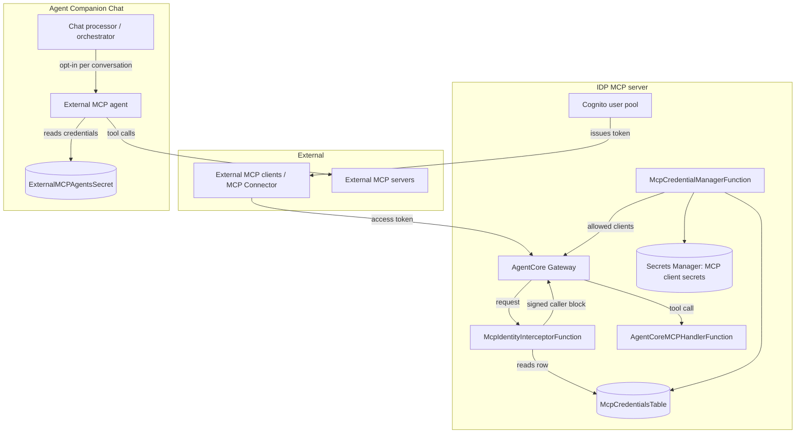

# MCP Integration — Threat Analysis

## Document Information

| Field | Value |
|-------|-------|
| **Document Version** | 4.0 |
| **Last Updated** | 2026-11-17 |
| **Applies to release** | v0.6.16 |
| **Feature** | Model Context Protocol (MCP) Integration |
| **Classification** | Internal |

## 1. Feature Overview

MCP reaches the IDP Accelerator in two directions, and the two have different trust boundaries:

- **The IDP MCP server (inbound).** An Amazon Bedrock AgentCore Gateway (`AgentCoreGateway`, managed by `AgentCoreGatewayManagerFunction`) with one Lambda target, `AgentCoreMCPHandlerFunction`, serving the tools `search`, `process`, `reprocess`, `status` and `get_results` (`IDP_TOOLS_SCHEMA` in `src/lambda/agentcore_gateway_manager/index.py`). It exists only when the `EnableMCP` stack parameter is `true`; the parameter defaults to `false`, and the console and `idp-cli deploy` keep an existing stack's value. The gateway validates a Cognito access token, and a request interceptor (`McpIdentityInterceptorFunction`, decisions in `idp_common.mcp_access`) resolves the caller to a role and configuration scope, refuses tools the caller may not use, filters tool listings, and passes the handler a signed caller block.
- **MCP service credentials.** Non-human callers (Amazon Quick workflows, the MCP Connector in `lib/idp_mcp_connector_pkg`, integrations) use client-credentials app clients that an Admin creates on the MCP Configuration page (`McpCredentialManagerFunction`) or with `idp-cli mcp credentials` / `IDPClient.mcp`. Each credential is a row in `McpCredentialsTable` with its own role, configuration profiles, write-tools setting and expiry, and its secret is stored in Secrets Manager (`idp_common.mcp_credentials`). The stack-created clients' secrets are in `McpConnectorClientSecret` and `McpUserClientSecret`, whose ARNs are the stack outputs `MCPConnectorClientSecretArn` and `MCPClientSecretArn`; no stack output carries a secret value.
- **External MCP agents (outbound).** Agent Companion Chat can register agents that connect to external MCP servers listed in the `ExternalMCPAgentsSecret` secret (`idp_common.agents.external_mcp`). They are off unless a conversation opts in ("Enable External MCP agents", `enableExternalMcpAgents: true`), and are never used in a conversation that holds Analytics or Error Analyzer results (`idp_common.chat_session_agents`).

## 2. Architecture

## 3. Threat Analysis

### MCP.T01: Data Exfiltration via MCP Tools

| Attribute | Value |
|-----------|-------|
| **Threat ID** | MCP.T01 |
| **Category** | STRIDE: Information Disclosure |
| **Description** | MCP moves document data across the deployment boundary in both directions. The IDP MCP server returns extracted values, classifications and analytics answers to MCP clients, and an External MCP agent sends a chat query, and whatever the orchestrator puts in it, to an external MCP server |
| **Attack Vector** | An MCP caller reads documents outside its configuration scope or tenant; or prompt injection in a chat conversation causes an External MCP agent to pass document data to an external server as tool parameters |
| **Impact** | Disclosure of customer confidential data, PII, or processing results to an unauthorized caller or external service |
| **Likelihood** | Medium |
| **Severity** | Critical |
| **Affected Components** | `McpIdentityInterceptorFunction`, `AgentCoreMCPHandlerFunction` and its tools (`src/lambda/agentcore_mcp_handler/tools/`), `idp_common.mcp_access`, `idp_common.mcp_credentials`, External MCP agents (`idp_common.agents.external_mcp`), the chat processors |
| **Mitigations** | **Inbound:** each caller is resolved by the interceptor (`resolve_caller` in `idp_common.mcp_access`): a signed-in user's token groups and `allowedConfigVersions` (read with `AdminGetUser`, which also refuses a disabled user or a token whose `sub` does not match), or a service credential's role and profiles from its registry row. The handler refuses a call whose signed caller block it cannot verify (`verify_caller`, keyed by `McpCallerSigningSecret` and bound to the gateway request id). `status` and `get_results` return only documents inside the caller's scope (`document_keys_in_scope`), `process` and `reprocess` refuse a document or destination profile outside it, and `search`, which reads reporting tables spanning every profile, is refused to any scoped caller, so under `TenantIsolationMode=Strict` or an external `TenantGrantSource` it is Admin-only (TEN.T01). **Outbound:** External MCP agents are off unless the conversation opts in, and once a data agent (Analytics, Error Analyzer) has returned a result in a session no opt-in agent is built into, or answers in, that session (`select_orchestrator_agent_ids`, `SessionAgentGate`); an opt-in request on such a session moves to a new session with no memory. The handler logs each call's sanitized event to its own log group. **Residual:** an External MCP server is whatever URL the secret names, and there is no egress control on what an opted-in agent sends to it |
| **Evidence** | `lib/idp_common_pkg/tests/unit/test_mcp_access.py::test_search_is_refused_to_any_scoped_caller`; `lib/idp_common_pkg/tests/unit/lambdas/test_agentcore_mcp_handler_scope.py::test_get_results_refuses_a_document_outside_scope`; `lib/idp_common_pkg/tests/unit/lambdas/test_agentcore_mcp_handler_scope.py::test_status_counts_only_documents_in_scope`; `lib/idp_common_pkg/tests/unit/test_mcp_credentials.py::test_strict_switched_on_later_narrows_an_unscoped_credential`; `lib/idp_common_pkg/tests/unit/test_chat_session_agents.py::TestSelection::test_no_opt_in_means_no_opt_in_agent`; `lib/idp_common_pkg/tests/unit/test_chat_session_agents.py::TestSelection::test_a_flagged_session_gets_no_opt_in_agent_whatever_was_asked`; UNVERIFIED: the citations have not been matched to each listed mitigation, and nothing measures what an opted-in External MCP agent sends |

### MCP.T02: Malicious Tool Injection

| Attribute | Value |
|-----------|-------|
| **Threat ID** | MCP.T02 |
| **Category** | STRIDE: Tampering, Elevation of Privilege |
| **Description** | Tool definitions an agent or MCP client treats as legitimate capabilities could be added or altered. The IDP MCP server's tool set is fixed in code; an External MCP agent's tool set and descriptions come from the external server at run time |
| **Attack Vector** | A caller invokes a tool name the server does not define, or forwards a tool argument the schema does not declare; or an external MCP server (or whoever controls it) publishes tools or descriptions that steer the agent |
| **Impact** | Agent executes unintended operations; unauthorized system access |
| **Likelihood** | Low |
| **Severity** | High |
| **Affected Components** | `AgentCoreGatewayManagerFunction` (`IDP_TOOLS_SCHEMA`), `McpIdentityInterceptorFunction`, `idp_common.mcp_access`, External MCP agents, `ExternalMCPAgentsSecret` |
| **Mitigations** | The IDP MCP server's tool schema is `IDP_TOOLS_SCHEMA` in the gateway manager's source, applied to the gateway target by the `AgentCoreGateway` custom resource on each deploy, and is not configurable at run time. `MCP_TOOL_POLICY` in `idp_common.mcp_access` lists exactly the tools `IDP_TOOLS_SCHEMA` defines; any other tool name is refused for every caller, including Admin, by the interceptor and again by the handler, and `tools/list` and the gateway search tool's results are filtered to what the caller may call. A client-supplied `_caller` argument is replaced by the interceptor and unsigned blocks are refused. External MCP agents are registered only from entries in `ExternalMCPAgentsSecret`, which an AWS principal with write access to that secret edits (no application role can), and each is marked opt-in when registered. **Residual:** the external server's tool list and tool names are taken as returned (`list_tools_sync`) and the names are placed in the agent's system prompt; nothing allowlists or validates them |
| **Evidence** | `lib/idp_common_pkg/tests/unit/test_mcp_access.py::test_an_unknown_tool_is_refused_even_for_admin`; `lib/idp_common_pkg/tests/unit/test_mcp_access.py::test_the_policy_covers_exactly_the_five_tools`; `src/lambda/mcp_identity_interceptor/test_index.py::test_tools_list_is_filtered_to_the_callers_tools`; `src/lambda/mcp_identity_interceptor/test_index.py::test_a_client_supplied_caller_is_replaced`; `lib/idp_common_pkg/tests/unit/agents/orchestrator/test_orchestrator_session_gate.py::test_the_registry_marks_every_external_mcp_agent_as_opt_in`; UNVERIFIED: external tool definitions are not validated, and no test covers the External MCP agent's tool discovery |

### MCP.T03: MCP Response Injection

| Attribute | Value |
|-----------|-------|
| **Threat ID** | MCP.T03 |
| **Category** | STRIDE: Tampering |
| **Description** | Text in a tool result reaches a model as context, enabling indirect prompt injection. IDP MCP server results carry document-derived text to the MCP client's model, and External MCP agent results carry external-server text into the chat orchestrator |
| **Attack Vector** | A processed document contains instructions that an MCP client's model reads in a `get_results`, `status` or `search` result; or an external MCP server returns a prompt injection payload as tool output |
| **Impact** | Model behavior manipulation via tool result content, cascading to further tool calls or data disclosure |
| **Likelihood** | Medium |
| **Severity** | High |
| **Affected Components** | `AgentCoreMCPHandlerFunction`, `idp_common.mcp_access` (`with_provenance`), the MCP Connector (`idp_mcp_connector.connector`), External MCP agents, the chat orchestrator |
| **Mitigations** | `get_results`, `status` and `search` results carry a `provenance` field naming the fields that hold document-derived text (`DOCUMENT_DERIVED_FIELDS`) with a notice to treat that text as data, not instructions; the MCP Connector passes that notice to its client's model (`provenance_of`, `notice_text`). For External MCP agents, the opt-in per conversation and the rule that no opt-in agent runs in a conversation holding Analytics or Error Analyzer results bound what an injected result can steer the orchestrator towards. **Residual:** the provenance notice is advisory to the client's model; External MCP tool output is not sanitized or size-limited, and the External MCP agent's system prompt does not mark it untrusted |
| **Evidence** | `lib/idp_common_pkg/tests/unit/test_mcp_provenance.py::test_document_derived_results_carry_the_envelope`; `lib/idp_common_pkg/tests/unit/lambdas/test_agentcore_mcp_handler_scope.py::test_a_document_derived_result_leaves_the_handler_with_its_envelope`; `lib/idp_common_pkg/tests/unit/test_chat_session_agents.py::TestGate::test_first_data_result_records_once_and_closes_opt_in_agents`; UNVERIFIED: the MCP Connector's handling of the notice has no test, and External MCP tool output is not covered |

### MCP.T04: Unauthorized External Service Access

| Attribute | Value |
|-----------|-------|
| **Threat ID** | MCP.T04 |
| **Category** | STRIDE: Spoofing, Elevation of Privilege |
| **Description** | An External MCP agent connects to its server with the credentials stored for it in `ExternalMCPAgentsSecret` (a Cognito user pool, client, username and password per server), not with the chat user's own identity. Any chat user whose conversation opts in reaches that external system with the stored identity and whatever tools it exposes |
| **Attack Vector** | A chat user, or prompt injection in their conversation, has the agent call external tools with model-chosen parameters that act beyond what that user should be able to do on the external system |
| **Impact** | Unauthorized operations on external systems, unintended data modifications |
| **Likelihood** | Medium |
| **Severity** | High |
| **Affected Components** | External MCP agents (`idp_common.agents.external_mcp`), `ExternalMCPAgentsSecret`, the chat processors |
| **Mitigations** | The secret is encrypted with the stack's customer-managed key and read only by the chat functions granted it; its entries are edited through AWS, not through any application role. External MCP agents are off unless a conversation opts in, and the configuration is validated for its required fields and transport (`_validate_mcp_config`). Least privilege for the stored identity on the external system is the operator's responsibility. **Residual:** every opted-in user shares the stored identity; there is no per-user mapping and no per-tool allowlist on the IDP side |
| **Evidence** | `lib/idp_common_pkg/tests/unit/test_chat_session_agents.py::TestSelection::test_each_opt_in_admits_only_its_kind`; UNVERIFIED: no test covers the stored-credential flow or what tools an External MCP agent may call |

### MCP.T05: External MCP Client Abuse

| Attribute | Value |
|-----------|-------|
| **Threat ID** | MCP.T05 |
| **Category** | STRIDE: Spoofing, Denial of Service |
| **Description** | MCP clients connecting to the IDP MCP server could submit excessive requests or attempt operations their role does not allow |
| **Attack Vector** | A client sends high-volume requests or crafted tool calls, or keeps using a credential after it should have stopped working |
| **Impact** | Resource exhaustion, cost escalation, unauthorized data access |
| **Likelihood** | Medium |
| **Severity** | Medium |
| **Affected Components** | AgentCore Gateway, `McpIdentityInterceptorFunction`, `AgentCoreMCPHandlerFunction`, `McpCredentialsTable` |
| **Mitigations** | No MCP server exists unless `EnableMCP=true`. Cognito authentication is required; the gateway admits only the user-authentication client and registered client-credentials apps (`update_allowed_clients` in `idp_common.mcp_gateway`), and a client with no rule in `resolve_caller` is refused. Per-tool role checks in the interceptor and the handler match each tool's REST equivalent (`mcp_tools:` in `scripts/api_rbac_expectations.yaml`, checked by `make api-test-static` and driven live by `make api-test`): `process`/`reprocess` need Admin or Author, `status`/`get_results` any document role, `search` Admin, Author or Viewer with no scope; a user in no stack group is refused. Write tools also need the credential's write-tools setting, which only Admin and Author credentials can hold. Service credentials carry a role, profiles and an expiry (90 days by default), issue one-hour access tokens, and are read on every call, so a disabled, revoked or expired credential is refused on its next request; a daily sweep (`McpCredentialSweepSchedule`) revokes expired ones. **Residual:** there is no per-caller rate limit, no reserved concurrency on the handler, and no MCP-specific usage alarm; volume is bounded only by service quotas and the workflow concurrency controls downstream of `process` |
| **Evidence** | `lib/idp_common_pkg/tests/unit/test_mcp_access.py::test_each_role_may_call_exactly_its_tools`; `lib/idp_common_pkg/tests/unit/test_mcp_access.py::test_write_tools_need_write_enabled`; `lib/idp_common_pkg/tests/unit/lambdas/test_agentcore_mcp_handler_scope.py::test_no_verified_caller_is_refused_before_the_tool`; `src/lambda/mcp_identity_interceptor/test_index.py::test_a_registry_credential_is_refused_on_the_next_request_after_revocation`; `lib/idp_common_pkg/tests/unit/test_mcp_credentials.py::test_an_expired_credential_is_refused`; `make api-test-static`; UNVERIFIED: the citations cover per-role tool restrictions, caller verification and credential lifecycle; rate and volume limits do not exist and are not covered |

### MCP.T06: AgentCore Gateway Lifecycle Attacks

| Attribute | Value |
|-----------|-------|
| **Threat ID** | MCP.T06 |
| **Category** | STRIDE: Denial of Service, Tampering |
| **Description** | The gateway's configuration (target, tool schema, JWT authorizer, interceptor) is written by several functions. If it is corrupted or the interceptor is removed, MCP availability or the caller checks could be affected, and a function that manages it could be used to escalate privileges |
| **Attack Vector** | An `UpdateGateway` call that omits the interceptor or rewrites the allowed clients; repeated or conflicting gateway updates; IAM permission escalation via a gateway-managing role |
| **Impact** | MCP tool unavailability, degraded agent functionality, or tool calls reaching the handler without a resolved caller |
| **Likelihood** | Low |
| **Severity** | Medium |
| **Affected Components** | `AgentCoreGatewayManagerFunction`, `McpInterceptorAttachFunction`, `McpCredentialManagerFunction`, `AgentCoreGatewayExecutionRole`, Bedrock AgentCore |
| **Mitigations** | The manager's role holds `bedrock-agentcore:*` for the gateway and target lifecycle, the two delivery deletes, `logs:DeleteLogGroup` on the gateway's vended log-group path only, and `iam:GetRole`/`iam:PassRole` on the single `AgentCoreGatewayExecutionRole`, with no IAM write (`template.yaml`). `McpInterceptorAttachFunction` and `McpCredentialManagerFunction` hold only `GetGateway`/`UpdateGateway` on this account and region's gateways and `PassRole` on the same role. Every gateway update sends the full current configuration (`full_update_request` in `idp_common.mcp_gateway`), the allowed-client update retries on a concurrent change and never leaves the list empty, and the interceptor attachment re-runs on every release, restoring an interceptor removed out of band. Because the handler refuses any call without a verifiable signed caller block, a missing interceptor refuses every tool call rather than admitting an unresolved caller. **Residual:** `AgentCoreGatewayExecutionRole` carries the AWS-managed `CloudWatchLogsFullAccess` policy; there is no alarm on gateway status changes |
| **Evidence** | `scripts/tests/test_iam_privilege_escalation.py::test_the_agentcore_gateway_manager_policy_stays_scoped`; `scripts/tests/test_iam_privilege_escalation.py::test_the_agentcore_gateway_manager_grants_only_what_it_calls`; `lib/idp_common_pkg/tests/unit/test_mcp_credentials.py::test_updating_the_gateway_keeps_its_other_configuration`; `lib/idp_common_pkg/tests/unit/test_mcp_credentials.py::test_the_gateway_is_never_left_with_no_clients`; `lib/idp_common_pkg/tests/unit/lambdas/test_agentcore_mcp_handler_scope.py::test_no_verified_caller_is_refused_before_the_tool`; UNVERIFIED: the citations have not been matched to each listed mitigation, and gateway health is not monitored |

### MCP.T07: MCP Client Secret Exposure and Credential Mismanagement

| Attribute | Value |
|-----------|-------|
| **Threat ID** | MCP.T07 |
| **Category** | STRIDE: Information Disclosure, Elevation of Privilege |
| **Description** | MCP client secrets grant a role and scope on the MCP server to whoever holds them. A secret that is readable more widely than intended, a credential granted more than its creator holds, or credentials left behind when MCP is switched off would let a holder act through MCP beyond what was meant |
| **Attack Vector** | Reading a client secret from a stack output, log or console; a scoped Admin creating a credential wider than their own scope or an Admin credential; a credential surviving `EnableMCP=false`, a downgrade or a stack delete |
| **Impact** | Unauthorized MCP access with the credential's role and scope, including cross-tenant access for an unscoped credential |
| **Likelihood** | Low |
| **Severity** | High |
| **Affected Components** | `McpCredentialManagerFunction`, `idp_common.mcp_credentials`, `McpCredentialsTable`, `McpConnectorClientSecret`, `McpUserClientSecret`, `McpDefaultCredential`, `McpCredentialsCleanup`, `idp-cli mcp credentials` / `IDPClient.mcp` |
| **Mitigations** | Each credential's secret is written to Secrets Manager (`<stack>/mcp/credentials/<clientId>`, encrypted with the stack's customer-managed key), returned once on creation or rotation, and never stored on the registry row or listed; the credential manager's role can create, describe and delete those secrets but not read them. The stack-created clients' secrets are in `McpConnectorClientSecret` and `McpUserClientSecret`, and the stack outputs `MCPConnectorClientSecretArn` and `MCPClientSecretArn` carry only the ARNs. Every credential operation is Admin-only; a scoped Admin can grant only inside their own scope and cannot create an Admin credential (`require_within` in `src/lambda/mcp_credential_manager/index.py`), and `validate_access` refuses a scope spanning more than one tenant, and, wherever tenant isolation or an external grant source applies, an Admin credential or an unscoped one. The stack-created client is registered as "Default (stack-created)" and starts disabled under Strict isolation or `IdpClaim`/`Api` grants. Rotation overlap is at most seven days, and `McpCredentialsCleanup` revokes every credential when the registry is removed (stack delete, `EnableMCP=false`, or a downgrade). **Residual:** any AWS principal with `secretsmanager:GetSecretValue` on those secrets and `kms:Decrypt` on the stack key reads them; `idp-cli mcp credentials` acts with the caller's AWS credentials and is not subject to the scoped-Admin narrowing (SDK.T09) |
| **Evidence** | `lib/idp_common_pkg/tests/unit/test_mcp_credentials.py::test_the_secret_is_returned_once_and_never_listed_or_stored_on_the_row`; `lib/idp_common_pkg/tests/unit/test_mcp_credentials.py::test_tenant_isolation_requires_a_scope_and_refuses_admin`; `lib/idp_common_pkg/tests/unit/test_mcp_credentials.py::test_the_stack_client_is_registered_disabled_under_tenant_isolation`; `lib/idp_common_pkg/tests/unit/test_mcp_credentials.py::test_removing_the_registry_revokes_every_credential`; `lib/idp_common_pkg/tests/unit/test_mcp_credentials.py::test_rotate_overlap_is_bounded`; `src/lambda/mcp_credential_manager/test_index.py::test_every_operation_is_admin_only`; `src/lambda/mcp_credential_manager/test_index.py::test_a_scoped_admin_cannot_create_an_admin_credential`; UNVERIFIED: the absence of secret values from stack outputs and the credential manager's lack of secret read access are not asserted by a test |

## 4. Security Controls Summary

| Control | Implementation | Threats Mitigated |
|---------|---------------|-------------------|
| **Off by default** | `EnableMCP` defaults to `false`; no gateway, clients or credential registry exist without it | MCP.T05, MCP.T07 |
| **Caller identity at the gateway** | `McpIdentityInterceptorFunction` resolves every token to a role and configuration scope and signs a caller block the handler verifies | MCP.T01, MCP.T05, MCP.T06 |
| **Per-tool authorization** | `MCP_TOOL_POLICY` applied by the interceptor and the handler, mirrored in `scripts/api_rbac_expectations.yaml` | MCP.T01, MCP.T02, MCP.T05 |
| **Scope filtering** | `status`, `get_results`, `process` and `reprocess` apply the caller's scope; `search` is unscoped-only | MCP.T01 |
| **Fixed tool schema** | `IDP_TOOLS_SCHEMA` in the gateway manager; unknown tools refused | MCP.T02 |
| **Provenance labels** | `provenance` field on results carrying document text; passed on by the MCP Connector | MCP.T03 |
| **Credential registry** | Per-credential role, profiles, write tools and expiry, read on every call; daily expiry sweep; revoke-all on removal | MCP.T05, MCP.T07 |
| **Secrets in Secrets Manager** | Client secrets under the stack key; outputs carry ARNs only | MCP.T07 |
| **Opt-in External MCP agents** | Off per conversation unless enabled; never in a conversation holding data-agent results | MCP.T01, MCP.T03, MCP.T04 |
| **Scoped gateway IAM** | Gateway-managing roles hold no IAM write and pass only `AgentCoreGatewayExecutionRole` | MCP.T06 |
