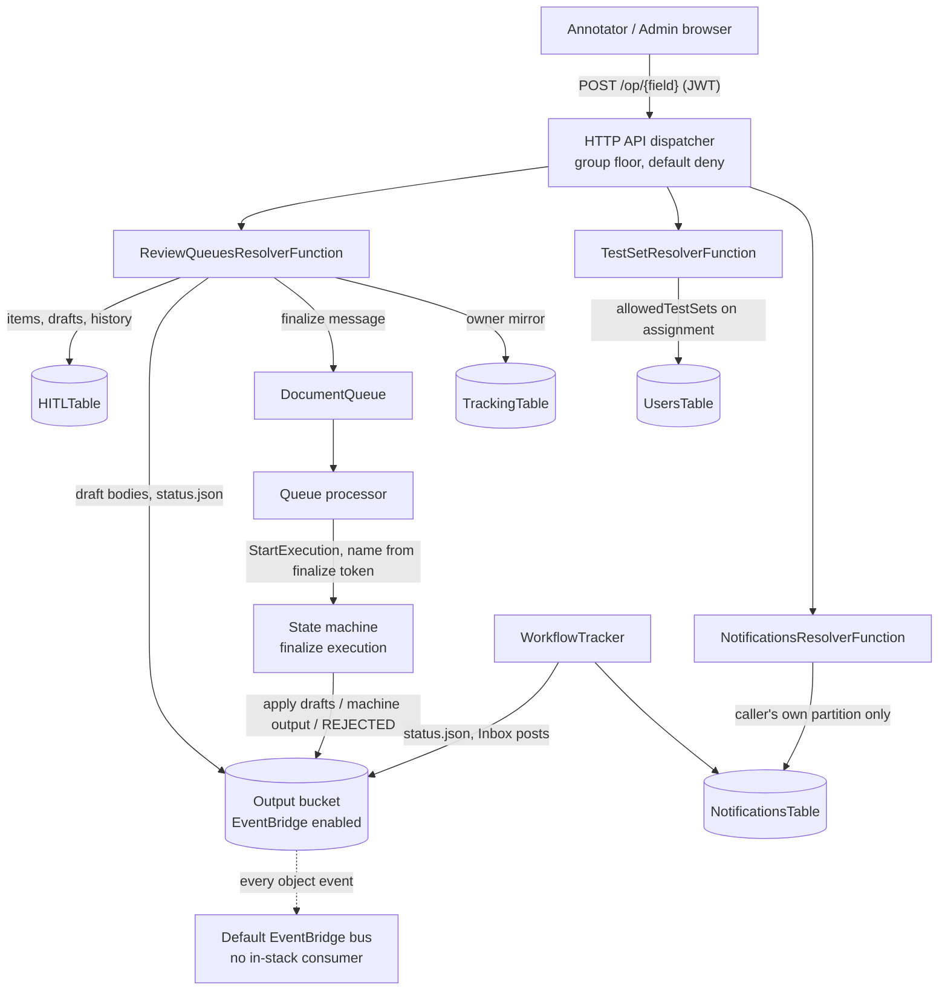

# HITL Review Queues and Inbox — Threat Analysis

## Document Information

| Field | Value |
|-------|-------|
| **Document Version** | 1.1 |
| **Last Updated** | 2026-10-30 |
| **Applies to release** | v0.6.13 |
| **Feature** | HITL review queues (Production and Test Studio), the per-user Inbox, the review finalize execution |
| **Classification** | Internal |

> **New document.** Review queues add 40 operations to the UI API, a new table
> (`HITLTable`), a per-user Inbox (`NotificationsTable`), a second Step Functions
> execution per reviewed document, and an outbound interface (`review/status.json`
> plus Output-bucket EventBridge notifications). They also change what the
> `Annotator` group can reach: before this release it was confined by design to
> the test sets named in `allowedTestSets`; it now works **production** documents
> in the queues it is eligible for. Each of those is an entry point or a principal
> capability the rest of the corpus does not describe, which is why this surface
> has its own prefix rather than further `AUTH.*` entries.

## 1. Feature Overview

When HITL is enabled in a document's configuration and the **Default** review
queue is enabled, a production document that raised confidence alerts is held for
review instead of completing. Each test set is also a Test Studio queue.

- **Queues** are system-wide definitions in `HITLTable` with an **Eligible
  Annotators** list (an empty list means no Annotator; Admins work every queue).
  Queue administration — create, update, delete, list, overview, list Annotators —
  is `Admin` only.
- **Items** are claimed by an eligible Annotator (or assigned to one by an Admin),
  edited as per-section drafts, and completed, rejected, released or skipped with a
  reason. An Admin can also take over, assign, unassign, move, or remove an item
  from review, which completes the document with its machine output.
- **Finalize.** Completing, rejecting or removing an item moves it to
  `FINALIZING` with a single-use finalize token, and the review-queues resolver
  sends the document to `DocumentQueue` itself. The queue processor validates the
  token's shape, names the execution from it, and the second (finalize) execution
  re-runs the state machine; `ProcessResults` matches the execution name to the
  item and applies the reviewer's drafts (complete), the machine output (removed),
  or ends the document `REJECTED`. The first execution ended `HITL_IN_PROGRESS`.
- **Status object.** `<document>/review/status.json` in the Output bucket records
  `in_review`, then `complete` or `rejected`, written last. The Output bucket now
  sends every object event to the account's default EventBridge bus so external
  consumers can trigger on it; no rule in the stack consumes them.
- **Inbox.** `idp_common.notifications` posts messages — assignments, released
  claims, take-overs, time-limit reminders, items waiting — addressed to users or
  to Cognito groups, expanded to per-recipient rows at post time with
  `ListUsersInGroup`. No API operation posts a message; the eight Inbox
  operations read, mark, delete and set preferences, each keyed on the caller's
  verified identity.
- **Sweepers.** `ReviewQueueSweeperFunction` (schedule) resends stalled finalize
  runs and sends reminders; `TestRunSweeperFunction` (schedule) reconciles Test
  Studio run status.

The legacy HITL operations (`claimReview`, `releaseReview`,
`completeSectionReview`, `skipAllSectionsReview`, `saveSectionReviewEdits`) remain
for documents that are not queue-managed, and refuse a document a queue manages
(`QUEUE_MANAGED`). `uploadDocument` and `processChanges` refuse to overwrite a
document's section results while it is in review.

## 2. Architecture

## 3. Threat Analysis

### HITL.T01: Queue Listings Show Items Outside the Caller's Profile Scope

| Attribute | Value |
|-----------|-------|
| **Threat ID** | HITL.T01 |
| **Category** | STRIDE: Information Disclosure |
| **Description** | Queues are system-wide, so one queue holds items of several configuration profiles, and an Annotator's access to an item is bounded by two things: queue eligibility and profile scope (`allowedConfigVersions`). A queue reference carries no profile, so a check made at the queue level cannot apply profile scope; it has to be made against each item's own profile. A listing that applies only eligibility shows a scoped Annotator the items of every profile in the queues they work. A listed item carries the document's object key, its profile, the fields that raised confidence alerts with their scores, and the holder's email. |
| **Attack Vector** | An Annotator with `allowedConfigVersions` set, eligible for a queue that also holds other profiles' items, calls `listReviewQueueItems`, `getMyReviewQueues`, `listMyReviewWork` or `claimNextReviewItem`. |
| **Impact** | Disclosure of review-item metadata — document names, profile names, alert fields and scores, holder identity — across the profile boundary. Not document content, drafts or the work itself, which the per-item operations refuse. |
| **Likelihood** | Low |
| **Severity** | Medium |
| **Affected Components** | `review_queues_resolver`, `idp_common/review_queues/` (`service.py`, `directory.py`) |
| **Mitigations** | Every per-item operation and every listing decides profile scope by the **item's own profile**: `ReviewQueueService._sees`, which uses `idp_common.config_scope.scope_allows` — the same comparison the rest of the API uses (AUTH.T07) — and so admits an item with no profile to no scoped caller. It applies to `listReviewQueueItems` (one queue or all of the caller's), `getMyReviewQueues`, `listMyReviewWork` and `claimNextReviewItem`; a listing that leaves items out still pages forward, and Claim next reads past them up to `CLAIM_NEXT_MAX_PAGES` pages of a queue. `QueueDirectory.in_scope`, which admits an empty profile, is used only for a queue reference, never for an item. `lib/idp_common_pkg/tests/unit/review_queues/test_listing_profile_scope.py` covers each listing for a scoped caller, an unscoped caller and an Admin. Admins and unscoped Annotators see every profile by design. |
| **Residual risk / recommendation** | A queue's counts (depth, unclaimed) are the queue's and are not filtered by scope, so a scoped Annotator can see how many items a queue holds beyond the ones they are shown, though not what they are. The static RBAC rule (`make api-test-static`) checks that a scope lookup is reachable from a `scope_filtered` operation, not that its result is applied to each returned item, so a regression of this class is caught by the unit tests above rather than by that gate. The behaviour has not been exercised against a live deployment. |

### HITL.T02: Reviewer-Controlled Drafts Become the Document's Final Output

| Attribute | Value |
|-----------|-------|
| **Threat ID** | HITL.T02 |
| **Category** | STRIDE: Tampering, Repudiation |
| **Description** | Review exists to let a person change what the pipeline produced, so the threat is a holder who changes it wrongly — deliberately, or because their account is compromised. A draft is any JSON object up to 2,000,000 bytes and nesting depth 64; it is not validated against the class schema or restricted to the extracted values, and on completion the finalize execution copies each section's latest draft verbatim over that section's extraction result. The holder can also regroup pages, and the finalize run reprocesses with the new grouping. An Admin can complete or reject an item someone else holds, take one over, or **remove** a document from review, which completes it with its unreviewed machine output. Downstream consumers — the post-processing hooks, reporting, evaluation against a baseline, and any external reader of `status.json` — receive the result as reviewed. |
| **Attack Vector** | An eligible Annotator claims an item and saves a draft that alters values or the section structure, then completes it; or an Admin removes a document from review to release machine output that should have been checked. |
| **Impact** | Falsified final extraction results presented as human-reviewed, reaching every downstream consumer of the document. |
| **Likelihood** | Low |
| **Severity** | High |
| **Affected Components** | `review_queues_resolver`, `idp_common/review_queues/` (`service.py`, `finalize.py`, `routing.py`, `regrouping.py`), `process_changes_resolver`, the state machine's `ProcessResults` steps |
| **Mitigations** | Only the holder can save, complete or reject: each write is a transactional `Put` conditioned on the item's version **and** on `Status = CLAIMED AND OwnerKey = <caller>` (with the lease unexpired), so a stale or concurrent writer is refused by DynamoDB rather than by a read-then-check. Supervisor operations (take over, assign, unassign, move, remove, force release) are `Admin` only at the dispatcher and again in the service, and a take-over tells the former holder in their Inbox. The finalize message body is built server-side from the tracking row, so no request argument reaches the workflow input; the finalize token is validated by shape and becomes the execution name, so a resent finalize does not start a second run. The item records its review activity, field edits and disposition; `status.json` and the `document_reviews` reporting table record the reviewer and disposition. Legacy review operations and `uploadDocument` refuse a document a queue manages, so there is one write path while it is in review. `processChanges` requires a caller who is not an Admin to hold the document's open review and to have the document's profile in scope, and refuses section and page changes to a document whose pinned revision routes it to BDA. |
| **Residual risk / recommendation** | The review history lives in `HITLTable`, which several Lambda roles in the stack hold write grants on, so it is an operational record rather than a tamper-evident one. A draft is not checked against the section's schema; validating it there would bound a draft to the fields the class declares and keep a malformed body out of the consumers that render it (UI.T01). Remove-from-review is a supervisor decision with no second approver, recorded only as a disposition. |

### HITL.T03: Review Metadata Reaches Readers Beyond the Queue's Audience

| Attribute | Value |
|-----------|-------|
| **Threat ID** | HITL.T03 |
| **Category** | STRIDE: Information Disclosure |
| **Description** | Three channels carry review metadata further than a queue's eligible Annotators. **(1) Inbox announcements.** The "items waiting" message for a queue is addressed to the queue's member groups, which every queue definition returns as `Annotator` and `Admin`, so it reaches every Annotator in the pool whether or not they are eligible for that queue; messages carry the queue and test-set ids, the profile name, the assigning user's email and the document's file name. **(2) `review/status.json`.** It records the reviewer's email and, for a rejection, the free-text reject note, and it sits under the document's prefix in the Output bucket, where the generic object reads serve it to any caller whose scope covers the document. **(3) Output-bucket EventBridge.** Every object event in the Output bucket — not only `status.json` — now goes to the account's default event bus, carrying object keys (document names) to any rule another workload in the account defines. The `document_reviews` reporting table also records reviewer identity, so it is queryable wherever Athena reporting is (AGT.T05). |
| **Attack Vector** | An Annotator reads announcements for queues they cannot work; a caller with document read scope fetches a document's `status.json`; a principal in the same account subscribes a rule to the default bus. |
| **Impact** | Disclosure of queue activity, profile names, document names and reviewer identities beyond the queue's audience; no document content. |
| **Likelihood** | Medium |
| **Severity** | Low |
| **Affected Components** | `idp_common/notifications/`, `idp_common/review_queues/` (`queue_defs.py`, `notify.py`, `status_object.py`), `NotificationsTable`, Output bucket notification configuration |
| **Mitigations** | No API operation posts a message, so Inbox content comes only from platform code. Reading, marking and deleting are keyed on the caller's verified identity and take no user argument, and the Inbox operations require an assigned group. A message's link must be an in-app route: the server refuses a scheme, a host or a protocol-relative form, and the UI repeats the check before rendering it as a hash route. Message bodies are rendered through `SafeMarkdown` (`rehype-sanitize`), not raw HTML, and skip notes are never put into a message. `NotificationsTable` is encrypted with the stack CMK, expires rows by TTL and has point-in-time recovery. EventBridge delivery from S3 carries object metadata, not object content. |
| **Residual risk / recommendation** | Address the waiting-work announcement to the queue's eligible Annotators rather than to the whole `Annotator` group. Message bodies interpolate the uploader's file name and are rendered as sanitized markdown; the sanitizer removes script and event handlers but admits external `http(s)` links and inline style, so a file name is rendered as markup in another user's Inbox rather than as text — rendering the interpolated name as plain text would remove that class. Whether every Output-bucket event needs to reach the default bus, rather than only the `status.json` key, is a deployment decision; a rule filtering on the key suffix bounds what a consumer receives but not what the bus carries. |

### HITL.T04: Resolvers Serving Annotator Operations Hold Write Grants on Authorization and Workflow State

| Attribute | Value |
|-----------|-------|
| **Threat ID** | HITL.T04 |
| **Category** | STRIDE: Elevation of Privilege |
| **Description** | The new resolvers are reachable by the `Annotator` group and carry grants wider than any one Annotator operation needs. `TestSetResolverFunction`, which serves `claimTestSetDocument` and the test-set draft and save operations to Annotators, can now `PutItem` and `UpdateItem` on the **UsersTable** — the table `allowedTestSets` and `allowedConfigVersions` live in — because the Admin-only `assignTestSetDocuments` writes the assignee's `allowedTestSets`. `ReviewQueuesResolverFunction` can `UpdateItem` anywhere in the TrackingTable, read every object in the Output bucket, write the Working bucket, and send to `DocumentQueue`, which starts a workflow execution. `ReviewQueueSweeperFunction` and `TestRunSweeperFunction` can update any tracking row. |
| **Attack Vector** | A defect in one of those resolvers' Annotator-callable paths — an argument used as a key without the per-object check, a missing branch guard — is steered by an Annotator into a write the operation was not meant to make, such as widening a user's scope or re-queueing a document. |
| **Impact** | A scope change on any user row, or a document re-run or status change, made with the resolver's role rather than the caller's authority. |
| **Likelihood** | Low |
| **Severity** | High |
| **Affected Components** | `TestSetResolverFunction`, `ReviewQueuesResolverFunction`, `ReviewQueueSweeperFunction`, `TestRunSweeperFunction` (IAM policies in `template.yaml` and `nested/api-resolvers/template.yaml`) |
| **Mitigations** | The dispatcher's group floor admits `assignTestSetDocuments` to `Admin` only, and the resolver checks again. Every grant is scoped to a named table, bucket, prefix or queue of this stack; the only `*` resources are `cloudwatch:PutMetricData` statements conditioned on the namespace. `states:StopExecution` on the queue processor and `states:DescribeExecution` on the sweeper are scoped to this stack's processing state machine. The finalize message is built server-side from the tracking row (HITL.T02). |
| **Residual risk / recommendation** | IAM cannot express "this item" or "this user's own row", so a resolver's per-object correctness is the only bound on these writes (AUTH.T16). Moving the `allowedTestSets` write behind the user-management function, which already owns UsersTable writes, would take UsersTable write off a role Annotators reach. |

## 4. Security Controls Summary

| Control | Implementation | Threats Mitigated |
|---------|---------------|-------------------|
| **Group floor and default deny** | Dispatcher `authz.py`; queue administration and supervisor operations `Admin` only; item operations `Admin` + `Annotator` | HITL.T02, HITL.T04 |
| **Per-item profile scope** | `ReviewQueueService._sees` (`scope_allows` on the item's own profile) in every per-item operation and every listing | HITL.T01 |
| **Conditional writes** | Version plus `Status`/`OwnerKey`/lease conditions on every item write | HITL.T02 |
| **Server-built finalize** | Message body from the tracking row; token validated by shape and used as the execution name | HITL.T02, HITL.T04 |
| **Single write path in review** | Legacy review operations, `uploadDocument` and `processChanges` refuse a document a queue manages | HITL.T02 |
| **Self-scoped Inbox** | Partition key from verified claims; no posting operation; in-app links only, checked server- and client-side; sanitized rendering | HITL.T03 |
| **Encryption and retention** | `HITLTable` and `NotificationsTable` on the stack CMK; Inbox TTL and per-user cap | HITL.T03 |
| **Stack-scoped grants** | Named resources only; state-machine actions scoped to this stack's processing state machine | HITL.T04 |

## 5. Open Items

| Item | Threat | Status |
|------|--------|--------|
| Queue counts (depth, unclaimed) are not filtered by profile scope | HITL.T01 | **Open** — residual, counts only |
| Waiting-work announcements reach every Annotator, not the queue's eligible ones | HITL.T03 | **Open** |
| Drafts are not validated against the section schema | HITL.T02 | **Open** — recommendation |
| UsersTable write on a role Annotators reach | HITL.T04 | **Open** — recommendation |
