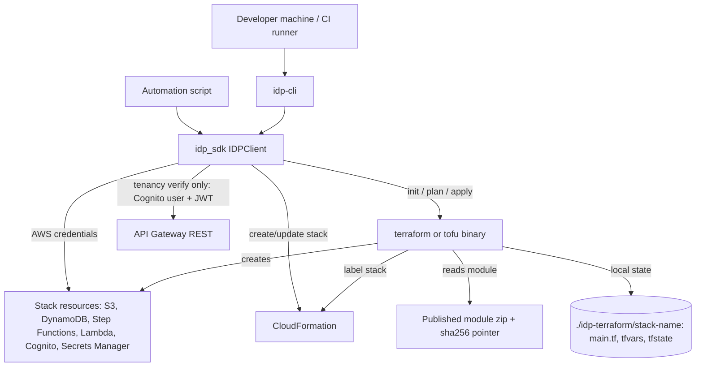

# SDK/CLI — Threat Analysis

## Document Information

| Field | Value |
|-------|-------|
| **Document Version** | 4.0 |
| **Last Updated** | 2026-11-17 |
| **Applies to release** | v0.6.16 |
| **Feature** | IDP SDK & CLI (Programmatic Access) |
| **Classification** | Internal |

## 1. Feature Overview

The IDP SDK and CLI provide programmatic access to the IDP Accelerator for automation, integration, and development workflows:

- **IDP SDK** (`lib/idp_sdk`, package `idp_sdk`): Python library with the `IDPClient` entry point and operation namespaces for stacks, batches, documents, configuration, discovery, evaluation, search, tenancy, MCP credentials (`client.mcp`) and Terraform (`client.terraform`). It builds on `idp_common`.
- **IDP CLI** (`lib/idp_cli_pkg`, command `idp-cli`): command-line interface over the SDK.
- **Authentication**: the SDK and CLI act with the caller's **AWS credentials** (the boto3 default chain) and call the stack's resources directly — CloudFormation, S3, DynamoDB, Step Functions, Lambda, Cognito, Secrets Manager. Application roles (Cognito groups, `allowedConfigVersions`) do not apply to these calls; IAM is the boundary. The one path that signs in as a Cognito user and calls the web UI's REST API (`POST /op/{field}`) is `idp-cli tenancy verify` (`idp_sdk._core.ui_api`), which needs to observe what a scoped user is refused.
- **Deployment**: `idp-cli deploy` deploys the CloudFormation templates, optionally building from a local checkout (`--from-code`), and may be given the optional CloudFormation service role in `iam-roles/cloudformation-management/`. `idp-cli deploy --terraform` deploys the same release as a Terraform or OpenTofu module (`idp_sdk._core.terraform_deploy`), with state and configuration in a local working directory (default `./idp-terraform/<stack-name>`) and a read-only CloudFormation label stack so the SDK and CLI can address the deployment by `--stack-name`. `idp-cli terraform migrate-from-genai-idp-terraform` moves a `genai-idp-terraform` deployment onto that module in place (`idp_sdk._core.terraform_migrate`).
- **Configuration**: `idp-cli config-validate` and `config-upload` validate a configuration before it is stored, including every model ID against `pricing.yaml` and the confidence prompt's placeholders.
- **Monitoring**: `run-inference --monitor` and `status` poll document status, and report a document awaiting human review as such and a document refused at ingest with its refusal reason.

## 2. Architecture

## 3. Threat Analysis

### SDK.T01: Credential Exposure on Developer Machines

| Attribute | Value |
|-----------|-------|
| **Threat ID** | SDK.T01 |
| **Category** | STRIDE: Information Disclosure |
| **Description** | The SDK and CLI run with the caller's AWS credentials, which reach the stack's resources directly with no application-role check. Those credentials, and secrets the CLI prints (an MCP client secret on creation or rotation), could be exposed through credential files, environment variables, shell history, terminal scrollback or process memory |
| **Attack Vector** | Long-lived access keys in `~/.aws/credentials`, environment variable leakage, a printed client secret captured in a terminal log, or a memory dump of a running SDK process |
| **Impact** | Unauthorized access to the deployment with the victim's IAM permissions, which for a deploying principal can be broad |
| **Likelihood** | Medium |
| **Severity** | High |
| **Affected Components** | Developer machines, IDP SDK/CLI |
| **Mitigations** | The SDK takes credentials from the standard boto3 chain, so short-lived credentials (IAM Identity Center, assumed roles) work unchanged and nothing is stored by the SDK itself. `idp-cli mcp credentials create` and `rotate` print the client secret once, as JSON on stdout, say on stderr that it will not be shown again, and never list it afterwards; the secret is also in Secrets Manager. `tenancy verify` logs and returns no token. **Residual:** the protection of the credentials themselves is the operator's machine and practice |
| **Evidence** | `lib/idp_cli_pkg/tests/test_mcp_commands.py::test_create_prints_the_secret_once_as_json_on_stdout`; `lib/idp_cli_pkg/tests/test_mcp_commands.py::test_list_json_carries_no_secret`; UNVERIFIED: credential handling on the operator's machine is outside the code and not covered |

### SDK.T02: Insecure Automation Pipelines

| Attribute | Value |
|-----------|-------|
| **Threat ID** | SDK.T02 |
| **Category** | STRIDE: Spoofing, Information Disclosure |
| **Description** | SDK used in CI/CD pipelines or automation scripts may have credentials hardcoded or stored insecurely in pipeline configurations, or write secrets into pipeline logs |
| **Attack Vector** | AWS keys in CI/CD configuration files, pipeline logs capturing a printed MCP client secret, shared pipeline roles with excessive permissions |
| **Impact** | Pipeline compromise leads to access to the deployment with the pipeline role's IAM permissions, potentially administrative |
| **Likelihood** | Medium |
| **Severity** | High |
| **Affected Components** | CI/CD pipelines, IDP SDK/CLI |
| **Mitigations** | Use the CI platform's OIDC federation or secret store rather than stored keys; give read-only pipelines an IAM role limited to the read actions they use; send `idp-cli mcp credentials` output to a secret store rather than the log, or read the secret from Secrets Manager later. For a non-human MCP caller, an MCP service credential carries its own role, profiles and expiry rather than a shared user (MCP.T07). **Residual:** these are operator practices; nothing in the SDK enforces them |
| **Evidence** | UNVERIFIED: no listed mitigation cites a test, gate or make target |

### SDK.T03: SDK Supply Chain Attack

| Attribute | Value |
|-----------|-------|
| **Threat ID** | SDK.T03 |
| **Category** | STRIDE: Tampering |
| **Description** | The SDK and CLI are installed as Python packages. If a package or a dependency is compromised, or a same-named package is fetched from a public index, malicious code runs with the operator's credentials |
| **Attack Vector** | Compromised dependency in the dependency chain, or a bare `pip install` of a first-party package name, which on public PyPI belongs to an unrelated party |
| **Impact** | Arbitrary code execution on developer machines with access to AWS credentials |
| **Likelihood** | Low |
| **Severity** | High |
| **Affected Components** | `idp_sdk`, `idp_cli`, `idp_common` packages, Python package ecosystem |
| **Mitigations** | First-party packages are installed from the local checkout (`make setup`), never by bare name (`docs/dependency-confusion.md`); `scripts/check_first_party_deps.py` confirms each first-party package resolves from source in this tree; pinned dependencies are audited against OSV by `make dep-audit` in both CI systems |
| **Evidence** | `make dep-audit`; `scripts/check_first_party_deps.py`; UNVERIFIED: the citations have not been matched to each listed mitigation |

### SDK.T04: Batch Processing Abuse

| Attribute | Value |
|-----------|-------|
| **Threat ID** | SDK.T04 |
| **Category** | STRIDE: Denial of Service |
| **Description** | SDK enables batch document upload and processing. Malicious or misconfigured batch operations could flood the processing pipeline, exhausting Lambda concurrency, SQS capacity, or Bedrock quotas |
| **Attack Vector** | Script using SDK uploads a massive number of documents at once, overwhelming processing capacity |
| **Impact** | Processing pipeline saturation, legitimate document processing delayed or blocked, cost escalation |
| **Likelihood** | Medium |
| **Severity** | Medium |
| **Affected Components** | Document queue, Queue Processor Lambda, Step Functions, Lambda concurrency, Bedrock quotas |
| **Mitigations** | Uploads enter the same queue as every other ingest path; the Queue Processor starts workflows only within `MaxConcurrentWorkflows`, tracked in `ConcurrencyTable`, so a burst waits in the queue rather than running at once. CloudWatch alarms cover workflow errors, timeouts, a stalled document queue, dead-letter queues and concurrency-counter drift (`template.yaml`). Uploading at all requires IAM write access to the input bucket. **Residual:** there is no per-caller rate limit; a caller with that access is bounded only by the global concurrency limit and cost |
| **Evidence** | UNVERIFIED: no listed mitigation cites a test, gate or make target |

### SDK.T05: Deployment Service Role Is Broad by Design

| Attribute | Value |
|-----------|-------|
| **Threat ID** | SDK.T05 |
| **Category** | STRIDE: Elevation of Privilege |
| **Description** | The accelerator ships an optional CloudFormation **service role** (`iam-roles/cloudformation-management/IDP-Cloudformation-Service-Role.yaml`) so that operators can deploy the stack without holding administrator rights themselves. It is a deployment role, not a least-privilege role: it holds `cloudformation:*` and wildcards on the services the stack uses, with `Resource: "*"`, so whoever can pass it to CloudFormation can change any resource of those services in the account. It appears here with the SDK/CLI because `idp-cli deploy` is its most common consumer |
| **Attack Vector** | A principal permitted to pass this role to a stack operation uses a template to change resources the role can reach, or to try to grant itself IAM privileges through roles the role creates |
| **Impact** | Changes to any resource of the services the role covers; IAM escalation is contained by the controls below |
| **Likelihood** | Low (requires an existing principal able to pass the role) |
| **Severity** | High |
| **Affected Components** | `iam-roles/cloudformation-management/IDP-Cloudformation-Service-Role.yaml`, `scripts/sdlc/validate_service_role_permissions.py` |
| **Mitigations** | The role is optional: a deployment may use any role or an administrator directly. Every IAM role it creates or re-permissions must carry the boundary named by `CreatedRolePermissionsBoundaryArn` (`CreateOrChangeRolesOnlyWithBoundary`); stripping any permissions boundary, editing the boundary policy, modifying the service role or its PassRole policy, and creating IAM users, access keys or identity providers are explicitly denied; IAM writes and `iam:PassRole` are confined to names starting with `ManagedStackNamePrefix`. The trust policy admits only the CloudFormation service principal for stacks in this account (`StringEqualsIfExists`/`ArnLikeIfExists` on `aws:SourceAccount`/`aws:SourceArn`), and the role may carry its own boundary (`ServiceRolePermissionsBoundaryArn`). `scripts/sdlc/validate_service_role_permissions.py` runs in both CI systems and checks the shipped role covers what the stack needs and has no hardening findings; every use is a CloudTrail event attributable to the passing principal. **Residual:** the service wildcards remain broad; treat `iam:PassRole` on this role as authority over every resource of those services in the account, and set the IDP stack's `PermissionsBoundaryArn` to the same value as `CreatedRolePermissionsBoundaryArn` |
| **Residual risk / recommendation** | A CloudFormation service role for a stack this broad will always be substantial — it creates IAM roles, KMS keys, buckets and Lambda functions. The goal it meets is that it cannot escalate IAM beyond the created-role boundary, not that it be small; `iam-roles/cloudformation-management/README.md` explains per service why each wildcard stays broad |
| **Evidence** | `scripts/sdlc/tests/test_validate_service_role_permissions.py::test_shipped_service_role_has_no_hardening_findings`; `scripts/sdlc/tests/test_validate_service_role_permissions.py::test_shipped_service_role_satisfies_the_main_stack`; `scripts/sdlc/tests/test_validate_service_role_permissions.py::test_boundary_removal_is_never_granted`; UNVERIFIED: the citations have not been matched to each listed mitigation |

### SDK.T06: Terraform Working Directory and State Disclosure

| Attribute | Value |
|-----------|-------|
| **Threat ID** | SDK.T06 |
| **Category** | STRIDE: Information Disclosure, Tampering |
| **Description** | `idp-cli deploy --terraform` keeps the deployment's Terraform state and configuration in a working directory (default `./idp-terraform/<stack-name>`) with no backend configured. The state records account IDs, ARNs and sensitive values — every parameter passed, and secrets the module creates, such as the MCP client secrets — and the directory is the only record Terraform has of the deployment. The migration command reads an old deployment's state and writes state backups |
| **Attack Vector** | Another local user, a backup, a shared volume or an accidental commit exposes `terraform.tfstate`, `terraform.tfvars` or a migration backup; or the directory is altered or lost, so a later `apply` or `destroy` acts on the wrong resources or cannot run |
| **Impact** | Disclosure of deployment secrets and parameters; loss of the ability to update or delete the deployment |
| **Likelihood** | Medium |
| **Severity** | High |
| **Affected Components** | `idp_sdk._core.terraform_deploy` (`write_private`, `write_root_config`), `idp_sdk.operations.terraform`, the working directory |
| **Mitigations** | `terraform.tfvars` and the remembered-parameters file are created owner-only (`0600`) from the start, and an existing wider file is narrowed before it is written (`write_private`); the migration's plan, configuration backup and state backups are written the same way. The saved plan file is deleted after apply. `idp-terraform/` is in the repository's `.gitignore`. `write_root_config` refuses a `main.tf` or `terraform.tfvars` idp-cli did not write, and a directory that holds another deployment's stack name. `docs/terraform.md` directs operators to plan the state's location before the first apply and recommends an encrypted, locked remote backend. **Residual:** `terraform.tfstate` itself is written by Terraform with Terraform's own file mode and, without a backend, is unencrypted on local disk |
| **Evidence** | `lib/idp_sdk/tests/unit/test_terraform_deploy.py::TestPrivateFiles::test_values_files_are_created_owner_only`; `lib/idp_sdk/tests/unit/test_terraform_deploy.py::TestPrivateFiles::test_an_existing_wider_file_is_narrowed`; `lib/idp_sdk/tests/unit/test_terraform_deploy.py::TestRootConfig::test_refuses_to_overwrite_a_foreign_main_tf`; `lib/idp_sdk/tests/unit/test_terraform_deploy.py::TestRootConfig::test_another_deployments_directory_is_refused`; UNVERIFIED: the state file's mode and storage are Terraform's and are not covered |

### SDK.T07: Terraform Module Integrity

| Attribute | Value |
|-----------|-------|
| **Threat ID** | SDK.T07 |
| **Category** | STRIDE: Tampering, Elevation of Privilege |
| **Description** | `idp-cli deploy --terraform` applies a module fetched from a URL with the deploying principal's credentials (or an assumed role). A substituted or altered module would create whatever resources and IAM it declares with those privileges |
| **Attack Vector** | Write access to the artifact bucket or pointer, a module URL pointing at an attacker-controlled location, or a module changed between the SDK's check and Terraform's download |
| **Impact** | Arbitrary resource and IAM changes in the deploying account |
| **Likelihood** | Low |
| **Severity** | Critical |
| **Affected Components** | `idp_sdk._core.terraform_deploy` (`fetch_url`, `load_module_manifest`, `terraform_module_source`, `check_assume_role_arn`), `idp-cli deploy --terraform`, the published module zip and pointer |
| **Mitigations** | Each published module has a SHA-256 checksum beside it and in the `idp-terraform-latest.json` pointer, and the SDK refuses a module whose digest differs from the pointer's. S3 module URLs are read through the S3 API and written for Terraform's signed `s3::` getter, so a private bucket works and no public object is needed; any other URL must be HTTPS. `--terraform-assume-role-arn` must be an IAM role ARN and is written into both providers. A name already used by a CloudFormation stack is refused. **Residual:** the checksum is checked on the SDK's own fetch, which supplies the module manifest; Terraform downloads the module again with no checksum pinned in `source`, and a module URL given directly (`--terraform-module-url`) carries no checksum at all. The pointer travels the same channel as the module, so it detects corruption, not substitution by someone who can write both |
| **Evidence** | `lib/idp_sdk/tests/unit/test_terraform_deploy.py::TestDeployOperation::test_a_pointer_checksum_mismatch_is_refused`; `lib/idp_sdk/tests/unit/test_terraform_deploy.py::TestDeployOperation::test_a_cloudformation_stack_of_that_name_is_refused`; `lib/idp_sdk/tests/unit/test_terraform_deploy.py::TestRootConfig::test_a_malformed_role_is_refused_and_writes_nothing`; UNVERIFIED: Terraform's own module download is not checked against the checksum |

### SDK.T08: Destructive Terraform Plan or Migration

| Attribute | Value |
|-----------|-------|
| **Threat ID** | SDK.T08 |
| **Category** | STRIDE: Denial of Service, Tampering |
| **Description** | A Terraform apply, a module upgrade or the `genai-idp-terraform` migration could delete or replace a resource that holds documents, configuration or users — buckets, tables, the KMS key, the Cognito user pool — losing its data |
| **Attack Vector** | A plan that replaces a stateful resource after a module or parameter change, an adoption that imports the wrong resource, or an old deployment's destroy that still manages an adopted resource |
| **Impact** | Loss of documents, configuration, users or the key that decrypts them |
| **Likelihood** | Low |
| **Severity** | Critical |
| **Affected Components** | `idp_sdk._core.terraform_deploy` (`protected_addresses`, `protected_deletions`, `refuse_protected_deletions`), `idp_sdk._core.terraform_migrate`, `idp_sdk.operations.terraform` |
| **Mitigations** | `deploy --terraform` saves a plan, refuses it when it would delete or replace any address the installed or new module lists as retained or stateful, and applies exactly that saved plan; only `--terraform-allow-replace-stateful` overrides the refusal. Every migration phase that changes something is a dry run unless given `--apply`; the plan refuses an old-state resource of a stateful type it has no verdict for, `check_apply_plan` requires every adopted resource to be imported with none replaced or destroyed, `check_destroy` requires that the old deployment's destroy plan deletes nothing adopted, and state and configuration are backed up before they are changed. **Residual:** `--terraform-allow-replace-stateful` applies such a plan, by design |
| **Evidence** | `lib/idp_sdk/tests/unit/test_terraform_deploy.py::TestRetainedResourceGuard::test_a_plan_replacing_a_retained_bucket_is_refused_and_not_applied`; `lib/idp_sdk/tests/unit/test_terraform_deploy.py::TestStatefulResourceGuard::test_replacing_a_stateful_resource_that_is_not_retained_is_refused`; `lib/idp_sdk/tests/unit/test_terraform_migrate.py::TestFreeze::test_a_dry_run_lists_the_rule_and_leaves_it_enabled`; `lib/idp_sdk/tests/unit/test_terraform_migrate.py::TestFixConfig::test_apply_backs_up_then_removes_the_counters`; UNVERIFIED: the citations have not been matched to each listed mitigation |

### SDK.T09: MCP Credentials Managed with AWS Credentials

| Attribute | Value |
|-----------|-------|
| **Threat ID** | SDK.T09 |
| **Category** | STRIDE: Elevation of Privilege, Repudiation |
| **Description** | `idp-cli mcp credentials` and `IDPClient.mcp` create, change, rotate and revoke MCP service credentials by calling `idp_common.mcp_credentials` directly with the caller's AWS credentials, not through the Admin-only REST operations behind the MCP Configuration page. The page's narrowing of a scoped Admin to their own scope is in the credential manager Lambda and does not apply on this path |
| **Attack Vector** | An AWS principal with access to the stack's user pool, credential table, secrets and gateway creates an unscoped or Admin MCP credential without holding any application role |
| **Impact** | An MCP credential with any role and scope the deployment's tenancy settings allow |
| **Likelihood** | Low |
| **Severity** | High |
| **Affected Components** | `idp_sdk.operations.mcp`, `idp_cli.mcp`, `idp_common.mcp_credentials` |
| **Mitigations** | The SDK reads the deployment's tenancy mode from the credential manager function's own environment, not the local machine's, and calls the same `validate_access` the page does, so an Admin or unscoped credential is still refused under tenant isolation or an external grant source and a scope spanning tenants is always refused. The actor recorded on the credential is the caller's STS ARN. Reaching this path requires IAM permissions on Cognito, DynamoDB, Secrets Manager and Bedrock AgentCore that already confer comparable control over the deployment. **Residual:** application roles do not gate this path; IAM does |
| **Evidence** | `lib/idp_sdk/tests/unit/test_mcp_operation.py::test_settings_come_from_the_manager_functions_environment`; `lib/idp_sdk/tests/unit/test_mcp_operation.py::test_create_passes_the_caller_identity_as_actor`; `lib/idp_sdk/tests/unit/test_mcp_operation.py::test_refusals_become_sdk_exceptions`; UNVERIFIED: the citations have not been matched to each listed mitigation |

## 4. Security Controls Summary

| Control | Implementation | Threats Mitigated |
|---------|---------------|-------------------|
| **IAM as the boundary** | SDK/CLI calls use the caller's AWS credentials from the boto3 chain; short-lived credentials work unchanged | SDK.T01, SDK.T02, SDK.T09 |
| **Secrets shown once** | MCP client secrets printed once on creation or rotation, never listed, stored in Secrets Manager | SDK.T01, SDK.T02 |
| **Dependency management** | Local-checkout install of first-party packages, `scripts/check_first_party_deps.py`, `make dep-audit` | SDK.T03 |
| **Workflow concurrency** | `MaxConcurrentWorkflows` via `ConcurrencyTable`; queue and workflow alarms | SDK.T04 |
| **Deployment role containment** | Created-role boundary, denied boundary removal and self-modification, name-prefix confinement; `scripts/sdlc/validate_service_role_permissions.py` in both CI systems | SDK.T05 |
| **Private working files** | `write_private` (`0600`) for tfvars, parameters, migration plans and backups; `idp-terraform/` gitignored | SDK.T06 |
| **Module checksum** | SHA-256 beside each module and in its pointer, checked on the SDK's fetch | SDK.T07 |
| **Plan guard** | Saved plan refused when it deletes or replaces a retained or stateful address; migration dry-run per phase | SDK.T08 |
| **Shared credential rules** | SDK and page both call `idp_common.mcp_credentials.validate_access` with the stack's tenancy settings | SDK.T09 |
