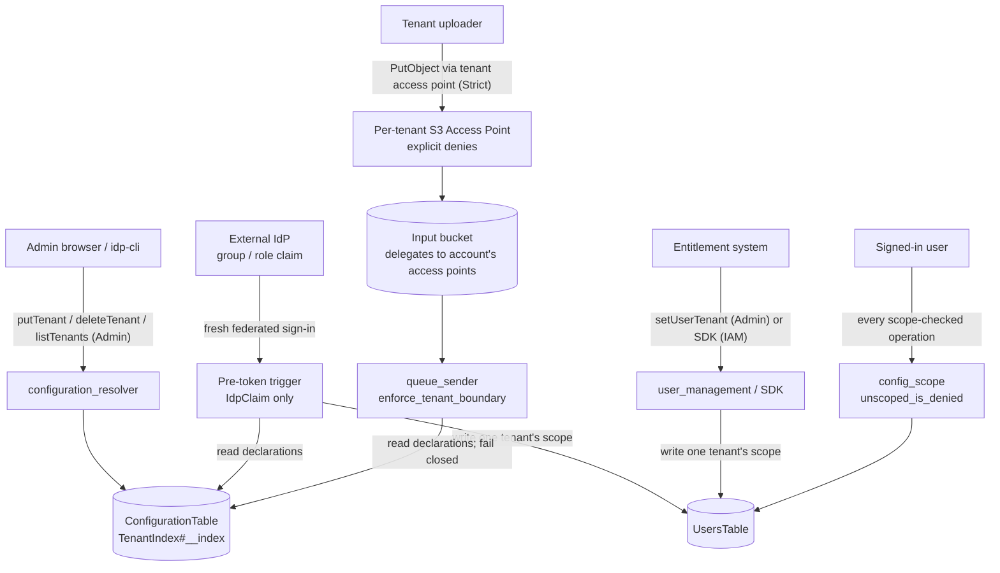

# Tenant Isolation in a Shared Stack — Threat Analysis

## Document Information

| Field | Value |
|-------|-------|
| **Document Version** | 1.0 |
| **Last Updated** | 2026-11-10 |
| **Applies to release** | v0.6.14 |
| **Feature** | Tenant declarations, `TenantIsolationMode`, `TenantGrantSource`, per-tenant S3 Access Points |
| **Classification** | Internal |

> **New document.** Several tenants can share one deployment. That makes the
> tenant a trust boundary inside the stack, where before every principal of a
> deployment was on the same side of it. It also brings in three principals the
> rest of the corpus does not describe. The first is whoever deploys the
> per-tenant access points. The second is the identity provider's role
> administration, when the claim grants tenants. The third is an entitlement
> system, when an API push grants them. It adds four API operations as well. The
> configuration-profile scope that this feature builds on is modelled under
> AUTH.T07. What is new here is the boundary between tenants and the controls
> that hold it, which is why this surface has its own prefix.

## 1. Feature Overview

Everything below was read from the v0.6.14 source.

- **Tenant declarations.** A tenant is an id, up to `MAX_PREFIXES_PER_TENANT`
  Input-bucket prefixes, one configuration-profile name pattern and up to
  `MAX_GRANTS_PER_TENANT` **Granted by** values. All of them are stored in one
  ConfigurationTable item, `TenantIndex#__index`
  (`idp_common/config/tenants.py`, `TenantStore`), and a stack holds up to
  `MAX_TENANTS`. Only an Admin can call `listTenants`, `putTenant` or
  `deleteTenant` (`scripts/api_rbac_expectations.yaml`). `listTenants` is not
  scope-filtered, because the tenant set reveals where every tenant's documents
  land.
- **Write-time refusals, in both modes.** Once tenants are declared, a prefix
  mapping, a tenant, or a user scope that would cross a tenant is refused when it
  is written. That covers the prefix-mapping writer in `configuration_resolver`,
  the scope writer in `user_management` (`_refuse_scope_crossing_tenants`, which
  refuses the write when the declarations cannot be read), and the SDK's tenancy
  operations. All three call `mapping_rejection_reason`,
  `scope_rejection_reason` and `stored_scopes_rejection_reason` in
  `idp_common/config/tenants.py`.
- **`TenantIsolationMode`** (`template.yaml`, default `Off`). `Strict` changes
  four things:
  - A non-Admin caller with no scope resolves to nothing rather than everything
    (`config_scope.unscoped_is_denied`).
  - `queue_sender.enforce_tenant_boundary` refuses at ingest a document whose key
    and resolved profile belong to different tenants. It checks again after a
    malware-scan hold, because the configuration is re-resolved there.
  - Agent Chat, agent queries and Knowledge Base queries become Admin-only, and
    MCP tools are refused (`agent_chat_resolver`, `agent_request_handler`,
    `query_knowledgebase_resolver`, `agentcore_mcp_handler`).
  - The Input and Output bucket policies gain a `DelegateToTenantAccessPoints`
    statement conditioned on `s3:DataAccessPointAccount`. On the Input bucket it
    allows `s3:PutObject` only.
- **`TenantGrantSource`** (`template.yaml`, default `Manual`). This parameter
  decides who writes a non-Admin's scope:
  - `Manual`: an Admin, in User Management.
  - `IdpClaim`: the pre-token-generation trigger
    (`src/lambda/external_idp_group_mapping/index.py`), at a fresh sign-in by a
    user linked to the configured provider.
  - `Api`: the Admin-only `setUserTenant` operation, or the SDK and
    `idp-cli tenancy set-user-tenant` writing the UsersTable with the caller's IAM
    credentials.

  Under the last two, every grant is written through
  `idp_common/user_scope.py:apply_tenant_grant`, which writes exactly one
  tenant's pattern or the deny marker `NO_TENANT_GRANTED`. Claim values that
  grant two or more tenants grant none (`resolve_grants`). Admin edits of a scope
  are refused (`_refuse_manual_scope_edit`). An unscoped non-Admin is denied in
  every consumer, whatever `TenantIsolationMode` says, and the `DeniesUnscopedCaller`
  condition moves the web UI's chat off the Function URL.
- **`RefreshTokenValidityHours`** (default 720) bounds how long a web session can
  renew itself without a fresh sign-in. A grant removed at the identity provider
  takes effect at the next fresh sign-in.
- **Tooling.** `idp-cli tenancy generate-policies --deploy` creates one access
  point per tenant and direction. The policies are generated in
  `idp_sdk/_core/tenancy_policies.py` and confine with explicit denies:
  principals of other tenants are denied, and so are objects and listings
  outside the tenant's prefixes. An account-root principal is refused. `tenancy
  audit` and `tenancy verify` check a deployed stack.

## 2. Architecture

## 3. Threat Analysis

### TEN.T01: Cross-Tenant Access in a Shared Stack

| Attribute | Value |
|-----------|-------|
| **Threat ID** | TEN.T01 |
| **Category** | STRIDE: Information Disclosure, Elevation of Privilege |
| **Description** | Isolation between tenants is enforced by the application. Every processing Lambda, table and bucket is shared, and IAM does not separate one tenant's documents from another's inside the stack. A non-Admin user therefore sees another tenant's documents, profiles or results in any of four cases: when their scope admits that tenant, when they have no scope in a mode that reads that as unrestricted, when an operation reads documents without applying scope, or when the surface they use cannot be scoped at all. |
| **Attack Vector** | (1) With `TenantIsolationMode=Off` and `TenantGrantSource=Manual`, the defaults, a non-Admin user row with no `allowedConfigVersions` is unrestricted. (2) A new or changed operation reads documents without a scope check. (3) Agent Chat, agent queries, Knowledge Base queries, MCP tools and the chat Function URL cannot be confined to one tenant. (4) An Annotator's `allowedTestSets` names a test set built from another tenant's documents. |
| **Impact** | Disclosure of another tenant's documents, extraction results and configuration, and operations on them (review, reprocess, delete). |
| **Likelihood** | Medium |
| **Severity** | High |
| **Affected Components** | `idp_common/config_scope.py`, `idp_common/config/tenants.py`, every scope-checked resolver, `queue_sender`, the chat, agent, Knowledge Base and MCP handlers |
| **Mitigations** | **Declarations are enforced when written, in both modes.** Once tenants are declared, a scope, mapping or tenant that would cross a tenant is refused, so a scoped user cannot be given two tenants' profiles. **Fail closed when configured to.** `Strict`, or either external grant source, makes an unscoped non-Admin resolve to nothing (`unscoped_is_denied`), refuses a cross-tenant document at ingest, makes the four unscopable surfaces Admin-only or refused, and moves the web UI's chat onto the REST path. **Scope on every single-document operation.** In 0.6.14, fetch, versions, review, delete, abort, copy-to-baseline and the test-run operations apply profile scope in both modes. `scripts/api_rbac_expectations.yaml` declares where each operation applies it, and `make api-test-static` fails when the code does not match the declaration. `idp-cli tenancy audit` reports unscoped users and boundary-crossing mappings, and `tenancy verify` and `make stacktest-tenancy` test the boundary on a live stack. |
| **Residual risk / recommendation** | `Off` with `Manual` is the default. Under it, an unscoped non-Admin is unrestricted by design, so a shared stack depends on every non-Admin being scoped; run `tenancy audit` and use `Strict` for a shared stack. Admins are cross-tenant in every mode. The static gate proves that a declared check exists, not that every operation that should declare one does, so a new document-reading operation with no declaration is a cross-tenant read until one is added. Test sets record no tenant, so `allowedTestSets` is not confined to one. The reader binds the record to the account's Cognito `sub` and denies a record naming another `sub` wherever an unscoped caller is denied, and the grant writer gives each account sharing an address a record of its own; the remaining residuals of the join are those AUTH.T07 records. |
| **Evidence** | `make api-test-static`; `make stacktest-tenancy`; UNVERIFIED: the citations have not been matched to each listed mitigation |

### TEN.T02: Access-Point Delegation Trusts Every Access Point in the Account

| Attribute | Value |
|-----------|-------|
| **Threat ID** | TEN.T02 |
| **Category** | STRIDE: Elevation of Privilege, Information Disclosure |
| **Description** | Under `Strict`, the Input and Output bucket policies delegate to access points through `DelegateToTenantAccessPoints`, conditioned on `s3:DataAccessPointAccount` equalling the stack's account. The condition admits **any** access point the account owns, not only the generated per-tenant ones. A principal that can create an access point on these buckets, or change an access point's policy, can therefore grant itself bucket access that no tenant boundary confines. |
| **Attack Vector** | A principal in the account holding `s3:CreateAccessPoint` or `s3:PutAccessPointPolicy` creates an access point on the Output bucket, or rewrites a tenant's access point policy, naming itself. |
| **Impact** | Reads of every tenant's output, or writes into any tenant's Input prefixes, outside the application's scope checks. |
| **Likelihood** | Low |
| **Severity** | High |
| **Affected Components** | `InputBucketPolicy` and `OutputBucketPolicy` in `template.yaml`, `idp_sdk/_core/tenancy_policies.py`, `idp-cli tenancy generate-policies` |
| **Mitigations** | The statement exists only under `Strict`. On the Input bucket it grants `s3:PutObject` on objects only, so delegation widens nothing for a principal that does not go through an access point. The generated access point policies allow one tenant's principals and add explicit denies for other tenants' principals and for objects and listings outside the tenant's prefixes. An account-root principal is refused, because the deny compares `aws:PrincipalArn` and a root entry would otherwise escape it. `docs/multi-tenancy.md` makes restricting `s3:CreateAccessPoint` and `s3:PutAccessPointPolicy` to the access point deployer a prerequisite of `Strict`, gives an SCP for it, and recommends alarming on the CloudTrail events. `tenancy audit --principals` compares the deployed access points with the declarations. |
| **Residual risk / recommendation** | The template cannot enforce that prerequisite. Whoever can create access points in the account is inside the delegation boundary, and nothing in the stack detects one created outside the tooling until `tenancy audit` is run. Apply the SCP before switching to `Strict`. |
| **Evidence** | UNVERIFIED: no listed mitigation cites a test, gate or make target |

### TEN.T03: An External Grant Source Decides Tenancy

| Attribute | Value |
|-----------|-------|
| **Threat ID** | TEN.T03 |
| **Category** | STRIDE: Spoofing, Elevation of Privilege |
| **Description** | Under `TenantGrantSource=IdpClaim` the identity provider's group or role claim decides which tenant a user belongs to. Under `Api` an entitlement system decides it, through the Admin-only `setUserTenant` or through the SDK with IAM credentials that can write the UsersTable. Either way, the authority over the tenant boundary moves out of the stack to whoever administers that source. |
| **Attack Vector** | An identity-provider administrator, or a principal able to change a user's group or role assignments there, adds a tenant's **Granted by** value to a user. A principal holding the entitlement system's credentials, or UsersTable write in the account, pushes a tenant. A grant removed at the source is not applied to a live session until its next fresh sign-in. |
| **Impact** | A user is placed in a tenant they should not belong to, or keeps one they should have lost. |
| **Likelihood** | Low |
| **Severity** | High |
| **Affected Components** | `src/lambda/external_idp_group_mapping/index.py`, `src/lambda/user_management/index.py` (`set_user_tenant`), `idp_sdk/operations/tenancy.py`, `idp_common/user_scope.py` |
| **Mitigations** | The claim is honoured only under the same two checks as the group mapping. The user must be linked to the configured provider, which is read from the Cognito-managed `identities` attribute. The sign-in must be fresh, never a token refresh, since a refresh re-reads a stored attribute the user can write. A grant is exactly one tenant's pattern or the deny marker: values granting several tenants grant none, and so does an unknown value. A grant that cannot be written fails the sign-in or the API call, rather than leaving the previous tenant in place. Admin edits of a scope are refused under both sources, so the stack has one writer per mode. Admins are never granted a tenant, and a claim that promotes a user to Admin removes the tenant it granted. `RefreshTokenValidityHours` bounds how long a removed grant can outlive its removal. |
| **Residual risk / recommendation** | Whoever administers the identity provider's roles, or the entitlement system, decides tenancy. Treat those as administrative to the stack. A removal applies at the next fresh sign-in, so a session can keep a revoked tenant for up to `RefreshTokenValidityHours`; shorten that value where revocation latency matters. The reader binds the record to the account's Cognito `sub` and denies a record naming another `sub` wherever an unscoped caller is denied, and the grant writer gives each account sharing an address a record of its own; the remaining residuals of the join are those AUTH.T07 records. |
| **Evidence** | UNVERIFIED: no listed mitigation cites a test, gate or make target |

### TEN.T04: The Sign-In Trigger Holds UsersTable Write Under `IdpClaim`

| Attribute | Value |
|-----------|-------|
| **Threat ID** | TEN.T04 |
| **Category** | STRIDE: Elevation of Privilege, Tampering |
| **Description** | Under `IdpClaim` the pre-token-generation trigger writes users' scopes, so its role holds `dynamodb:GetItem`, `PutItem`, `UpdateItem` and `DeleteItem` on the whole UsersTable with no key condition, `Query` on its email index, `GetItem` on the ConfigurationTable restricted by `dynamodb:LeadingKeys` to `TenantIndex#__index`, and encrypt and decrypt on the stack key. The UsersTable row holds a user's `persona` as well as their scope, and the UsersTable stream syncs a `persona` change into Cognito groups (`UserSyncFunction`). Which rows and attributes the trigger writes is therefore decided by its code, not by IAM. |
| **Attack Vector** | A defect in the trigger, in the `idp_common` layer it imports under `IdpClaim`, or in a dependency of either, writes another user's row or a `persona` attribute. |
| **Impact** | Changes to any user's scope, or to their role through the stream sync. |
| **Likelihood** | Low |
| **Severity** | High |
| **Affected Components** | `ExternalIdPGroupMappingFunction` in `template.yaml`, `src/lambda/external_idp_group_mapping/index.py`, `idp_common/user_scope.py`, `UserSyncFunction` |
| **Mitigations** | The grants exist only when `IsTenantGrantFromIdpClaim` holds, and so does the layer. In every other mode the function runs layer-free with no data-plane grant, as it did before tenant grants existed. On an existing row the writer sets only the scope attributes and the row's link to the signing-in account, in one write conditioned on the row recording no account or that one; it never rewrites `persona`, never changes an Admin row, and creates no row for an Admin. A row it creates records the persona the claim maps to and `source: cognito`, so the stream sync does not create a second Cognito account. The trigger runs only on Cognito's invocation, on the fresh-sign-in and linked-provider checks of TEN.T03. Unit tests are in `src/lambda/external_idp_group_mapping/test_index.py`. |
| **Residual risk / recommendation** | IAM cannot express "this user's own row" or "these attributes" for a trigger that runs for every user, so the code is the only bound. A `dynamodb:Attributes` condition limiting `UpdateItem` to the scope attributes would move part of that bound into IAM, and is recommended. |
| **Evidence** | `src/lambda/external_idp_group_mapping/test_index.py`; UNVERIFIED: the citations have not been matched to each listed mitigation |

### TEN.T05: Tenant Declarations Are an Authorization Input and a Single Point of Failure

| Attribute | Value |
|-----------|-------|
| **Threat ID** | TEN.T05 |
| **Category** | STRIDE: Tampering, Denial of Service |
| **Description** | The declarations decide where each tenant's documents land and which profiles each tenant may use, and they live in one ConfigurationTable item. Changing them redraws the boundary. Under `Strict` every ingest reads them, so a read failure stops processing for every tenant. |
| **Attack Vector** | A principal with ConfigurationTable write in the account edits the tenant index item directly. Throttling, a missing grant or a deleted item makes the ingest read fail. One tenant's bulk upload uses the workflow concurrency and Bedrock quota every tenant shares. |
| **Impact** | A boundary redrawn without the write-time checks, or every new document refused until the read recovers. |
| **Likelihood** | Low |
| **Severity** | Medium |
| **Affected Components** | `idp_common/config/tenants.py` (`TenantStore`), `configuration_resolver`, `queue_sender`, `TenantIsolationLookupFailedAlarm` |
| **Mitigations** | Only an Admin can call the API operations that write the declarations, and they apply the write-time refusals of TEN.T01. The index is size-bounded (`MAX_TENANTS`, prefix and grant caps) so it stays within one item. Under `Strict` a failed read **fails closed**: `queue_sender` emits `TenantIsolationLookupFailed` and raises, so the document is retried rather than admitted unchecked, and `TenantIsolationLookupFailedAlarm` (deployed only under `Strict`) alarms on it. `TenantBoundaryRejected` records each refusal. |
| **Residual risk / recommendation** | A direct table write bypasses the write-time checks. That is the same exposure every ConfigurationTable item carries, so keep table write to the stack's roles. Throughput is shared between tenants, and nothing in the stack meters it per tenant. |
| **Evidence** | UNVERIFIED: no listed mitigation cites a test, gate or make target |

## 4. Security Controls Summary

| Control | Implementation | Threats Mitigated |
|---------|---------------|-------------------|
| **Write-time boundary checks** | `mapping_rejection_reason`, `scope_rejection_reason`, `stored_scopes_rejection_reason`, called by the prefix-mapping and scope writers and the SDK | TEN.T01, TEN.T05 |
| **Fail-closed unscoped callers** | `config_scope.unscoped_is_denied` under `Strict` or an external grant source; `DeniesUnscopedCaller` in `template.yaml` | TEN.T01 |
| **Ingest tenant boundary** | `queue_sender.enforce_tenant_boundary`, re-checked after a malware hold | TEN.T01, TEN.T05 |
| **Unscopable surfaces closed** | Agent Chat, agent and Knowledge Base queries Admin-only; MCP tools refused; chat moved off the Function URL | TEN.T01 |
| **Confining access point policies** | Explicit denies by principal and prefix; account-root principals refused; `tenancy audit --principals` | TEN.T02 |
| **One writer per grant source** | Admin scope edits refused under `IdpClaim` and `Api`; exactly one tenant or the deny marker | TEN.T03 |
| **Trusted-claim checks** | Linked provider, fresh sign-in only, grant failure fails the sign-in | TEN.T03, TEN.T04 |
| **Conditional trigger grants** | UsersTable and layer only under `IsTenantGrantFromIdpClaim`; tenant index read restricted by `dynamodb:LeadingKeys` | TEN.T04 |
| **Lookup alarm** | `TenantIsolationLookupFailedAlarm` (`Strict` only) | TEN.T05 |

## 5. Open Items

| Item | Threat | Status |
|------|--------|--------|
| `Off` with `Manual` is the default, under which an unscoped non-Admin is unrestricted | TEN.T01 | **Accepted** — by design; `Strict` for shared stacks |
| Access point creation in the account is not restricted by the template | TEN.T02 | **Open** — prerequisite, SCP documented |
| Revocation at the identity provider applies at the next fresh sign-in | TEN.T03 | **Open** — bounded by `RefreshTokenValidityHours` |
| Trigger's UsersTable write is not restricted to the scope attributes | TEN.T04 | **Open** — recommendation |
| Throughput is not metered per tenant | TEN.T05 | **Open** — recommendation |
